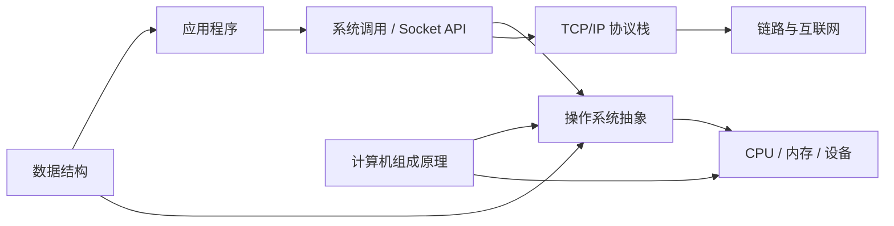
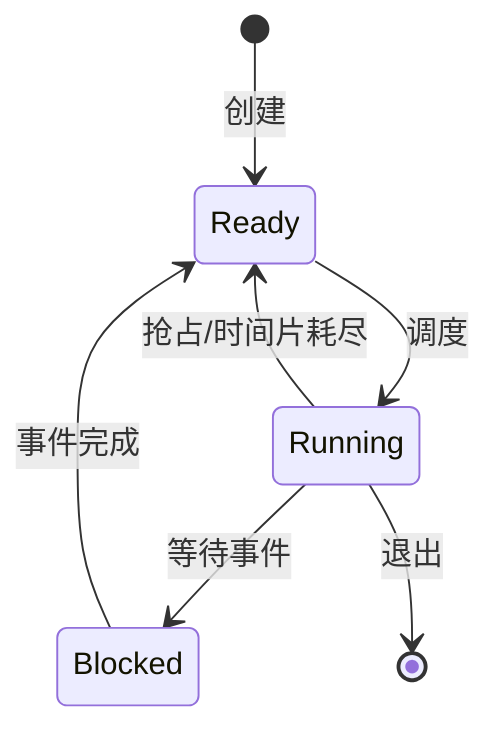
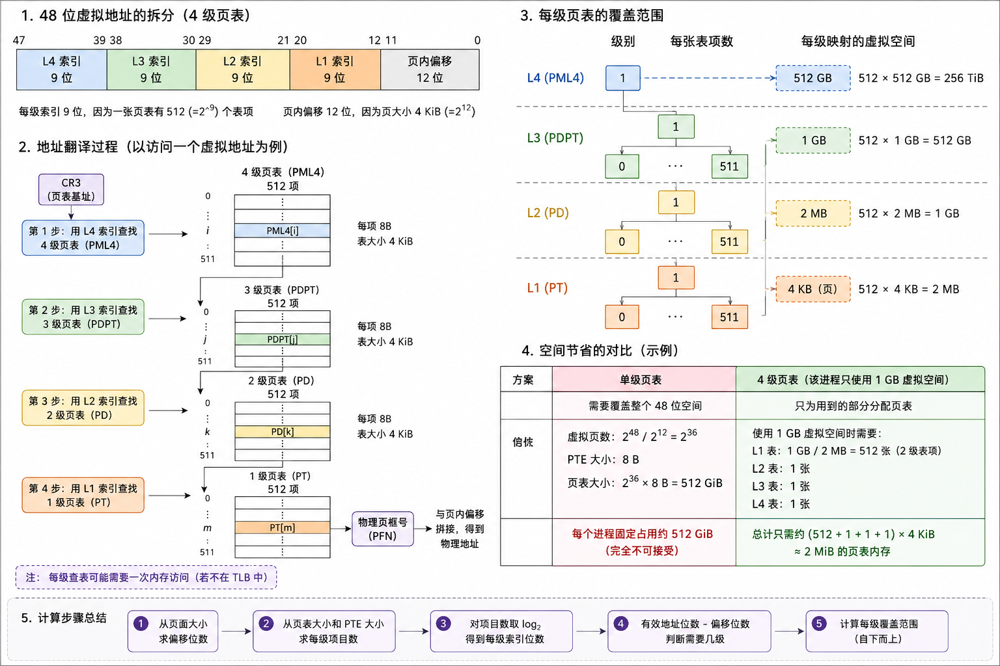
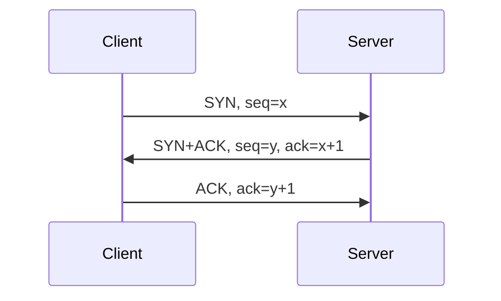
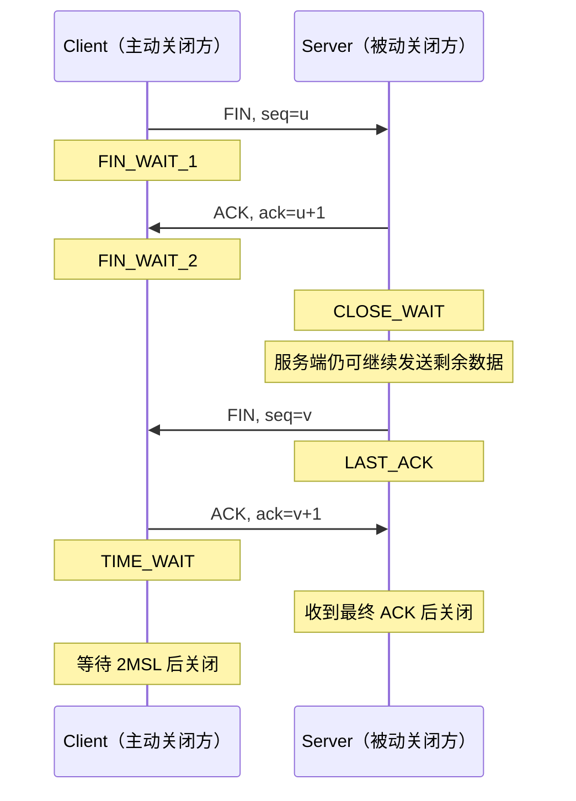

# 408 计算机基础学习笔记：从抽象到 Linux 内核

> 408 的四门课并不是四座孤岛。数据结构研究“怎样组织信息”，计算机组成原理解释“机器怎样执行指令”，操作系统负责“怎样安全、高效地共享机器”，计算机网络解决“不同机器上的进程怎样通信”。本文暂为数据结构和计算机组成原理建立知识入口，重点完整讲解操作系统、计算机网络，以及它们在 Linux、Socket 和 HTTP 中的落地。

## 参考资料

- [CyC2018 CS-Notes：计算机网络](https://github.com/CyC2018/CS-Notes/blob/master/notes/计算机网络.md)
- [CyC2018 CS-Notes：HTTP](https://github.com/CyC2018/CS-Notes/blob/master/notes/HTTP.md)
- [CyC2018 CS-Notes：Socket](https://github.com/CyC2018/CS-Notes/blob/master/notes/Socket.md)
- [CyC2018 CS-Notes：计算机操作系统](https://github.com/CyC2018/CS-Notes/blob/master/notes/计算机操作系统%20-%20目录.md)
- [CyC2018 CS-Notes：Linux](https://github.com/CyC2018/CS-Notes/blob/master/notes/Linux.md)
- Abraham Silberschatz 等：《操作系统概念》
- Andrew S. Tanenbaum：《现代操作系统》《计算机网络》
- James F. Kurose、Keith W. Ross：《计算机网络：自顶向下方法》
- W. Richard Stevens：《UNIX 网络编程》
- RFC 8200（IPv6）、RFC 9293（TCP）、RFC 9110（HTTP Semantics）

本文是重新组织后的原创学习讲义。教材用于建立模型，RFC 用于确认协议语义，Linux 用于观察模型怎样落地。教材中的简化模型与某个 Linux 版本的具体实现不应混为一谈。

## 0. 知识地图

| 领域       | 核心对象                   | 核心问题                   | Linux 中的落点                   |
| ---------- | -------------------------- | -------------------------- | -------------------------------- |
| 数据结构   | 表、树、图、索引           | 数据怎样组织，操作成本多大 | 链表、红黑树、XArray、哈希表     |
| 计算机组成 | 指令、CPU、缓存、总线      | 程序怎样变成机器动作       | 上下文、原子指令、内存屏障、页表 |
| 操作系统   | 进程、地址空间、文件、设备 | 多个程序怎样共享硬件       | 调度器、虚拟内存、VFS、驱动      |
| 计算机网络 | 帧、分组、报文段、消息     | 跨机器进程怎样通信         | 网络协议栈、Socket、epoll        |



贯穿全文的主线只有三个问题：

1. **抽象是什么？** 进程不是 CPU，文件不是磁盘块，Socket 也不是协议；它们都是系统提供的接口和状态。
2. **状态如何变化？** 调度、缺页、TCP 连接、epoll 就绪，本质上都要沿状态机理解。
3. **成本在哪里？** 切换、复制、排队、缓存未命中、磁盘寻道和网络往返都会花时间。

## 1. 数据结构：为后续学习建立入口

本章本轮只保留学习路线，后续再独立展开。

建议按“线性结构 → 树 → 图 → 查找 → 排序 → 算法设计”学习，始终追问：数据的逻辑关系是什么、物理布局是什么、一次操作触碰多少元素、最坏与平均复杂度分别是多少。Linux 内核学习尤其需要链表、红黑树、位图、基数树/XArray、哈希表和无锁数据结构。

## 2. 计算机组成原理：为后续学习建立入口

本章本轮只保留学习路线，后续再独立展开。

建议按“数据表示 → 指令系统 → CPU 数据通路 → 流水线 → Cache → 主存与虚拟存储 → 总线与 IO”学习。它是理解系统调用、上下文切换、原子操作、内存屏障、TLB、DMA 和中断的硬件基础。

## 3. 操作系统：在硬件之上建立可控的共享

操作系统同时扮演两个角色：向上提供稳定抽象，向下管理有限资源。应用看到进程、虚拟地址、文件和 Socket；内核在背后分配 CPU 时间、物理页、磁盘块与设备队列。

### 3.1 用户态、内核态与系统调用

CPU 至少区分低特权和高特权执行环境。普通应用不能直接修改页表、配置设备或关中断，否则一个错误程序就能破坏整个系统。需要特权操作时，应用通过系统调用进入内核。

```text
用户代码
  │ 调用 read()
  ▼
libc 包装函数：准备系统调用号和参数
  │ syscall 指令（受控特权切换）
  ▼
内核：校验参数 → VFS → 文件/设备实现
  │ 返回值或 -errno
  ▼
用户代码
```

系统调用不是普通函数调用：它跨越保护边界，需要保存现场、切换执行级别并校验用户指针。它也不等于进程切换；系统调用返回时通常仍是同一进程，只是期间可能因阻塞或抢占发生调度。

中断来自外部设备，异常由当前指令触发，系统调用则是程序主动请求。缺页异常可能是正常机制，除零异常通常是程序错误，时钟中断则为抢占式调度提供时机。

### 3.2 进程、线程与上下文

进程更像资源容器：拥有独立虚拟地址空间、文件描述符表和安全凭据。线程是调度实体：同一进程内线程共享地址空间和打开文件，但各自拥有寄存器、栈和调度状态。

| 对比       | 进程                      | 同一进程内的线程                 |
| ---------- | ------------------------- | -------------------------------- |
| 地址空间   | 通常隔离                  | 共享                             |
| 文件描述符 | 各进程拥有，fork 后可继承 | 共享进程文件表                   |
| 栈和寄存器 | 独立                      | 每线程独立                       |
| 通信       | 需要 IPC                  | 可读写共享内存，但需同步         |
| 故障隔离   | 较强                      | 一个线程破坏地址空间可拖垮全进程 |

经典三状态是就绪、运行、阻塞。就绪表示只缺 CPU，阻塞表示在等待 IO、锁或事件，即使立刻给 CPU 也无法继续。



Linux 的状态更细：`R` 包含运行和可运行，`S` 是可中断睡眠，`D` 是不可中断睡眠，`T` 是停止/跟踪，`Z` 是僵尸。`kill -9` 不能让处于 `D` 状态的任务立刻退出，因为信号要等任务回到可处理信号的路径。

### 3.3 fork、exec、wait 与进程生命周期

`fork()` 创建子进程，现代系统通过写时复制（Copy-on-Write，COW）避免立即复制全部物理页；`exec()` 用新程序替换当前进程映像；`wait()` 回收子进程退出状态。

```c
#include <sys/wait.h>
#include <unistd.h>
#include <stdio.h>

int main(void)
{
    pid_t pid = fork();
    if (pid == 0) {
        execlp("echo", "echo", "child", NULL);
        _exit(127);                 // exec 失败才会到这里
    }
    if (pid > 0) {
        int status;
        waitpid(pid, &status, 0);   // 回收退出状态
        printf("child reaped\n");
    }
    return pid < 0;
}
```

子进程已退出、父进程尚未 `wait` 时是僵尸；父进程先退出、子进程仍运行时是孤儿。僵尸不再执行，但内核必须保留少量退出信息。孤儿会被新的回收者接管。

### 3.4 CPU 调度：在响应、吞吐与公平之间取舍

常用指标：

- 周转时间 = 完成时间 − 到达时间；带权周转时间 = 周转时间 / 服务时间。
- 等待时间 = 周转时间 − 实际运行时间（忽略其他阻塞时可这样计算）。
- 响应时间 = 第一次获得 CPU 的时间 − 到达时间。
- 吞吐量表示单位时间完成多少任务，CPU 利用率表示 CPU 忙碌比例。

例：三个进程同时到达，服务时间分别为 A=6、B=2、C=4。

- FCFS 顺序 A→B→C，完成时间为 6、8、12，平均周转时间 `(6+8+12)/3=8.67`。
- 非抢占 SJF 顺序 B→C→A，完成时间为 2、6、12，平均周转时间 `(2+6+12)/3=6.67`。

SJF 能降低平均等待时间，却可能让长作业饥饿；时间片轮转改善交互响应，但时间片太小会增加切换成本；优先级调度需要老化等机制缓解饥饿。Linux 的实际调度器不是教材算法的直接照搬，它还必须处理多核、负载均衡、CPU 亲和性、实时任务和能耗。

### 3.5 并发：原子性、可见性与顺序

`counter++` 不是不可分割的动作，而是读、加、写。两个执行流交错会丢失更新，这就是竞态条件。临界区是访问共享状态且不能被任意交错的代码。

互斥锁保证同一时刻只有一个执行流进入；信号量是带计数的资源许可；条件变量让线程睡眠等待某个谓词成立；自旋锁让等待者原地循环，适合不能睡眠且临界区很短的内核场景。

```c
pthread_mutex_lock(&lock);
while (!ready)                         // 必须用 while 重查条件
    pthread_cond_wait(&cond, &lock);   // 原子地释放锁并睡眠
consume();
pthread_mutex_unlock(&lock);
```

同步强调执行顺序，互斥强调共享资源的排他访问。锁还涉及内存可见性；只用 `volatile` 不能替代锁或原子操作。

### 3.6 经典同步问题

生产者—消费者需要同时满足两个约束：缓冲区操作互斥，以及“非空/非满”的条件同步。读者—写者讨论读吞吐与写者饥饿的权衡。哲学家进餐说明即便每把锁单独正确，多个锁的获取顺序仍可能造成全局死锁。

通用分析方法是：先列共享对象，再列不变量，然后决定谁保护对象、何时睡眠、由谁唤醒。不要先背某段信号量伪代码。

### 3.7 死锁：资源等待形成闭环

死锁需要四个必要条件同时成立：互斥、占有并等待、不可抢占、循环等待。破坏任意一个条件都能预防死锁，工程上最常见的是规定全局锁顺序。

安全状态表示存在某种顺序，能让所有进程最终获得资源并完成；不安全状态不等于已经死锁，而是未来可能无解。银行家算法通过试分配后检查安全序列来避免进入不安全状态，但它要求提前知道最大需求，通用系统很少直接采用。

### 3.8 进程间通信

| IPC                | 数据路径与特点                         | 典型用途               |
| ------------------ | -------------------------------------- | ---------------------- |
| 管道/FIFO          | 字节流，内核缓冲，天然适合生产者消费者 | shell 管道、亲缘进程   |
| 消息队列           | 有消息边界，内核管理                   | 离散控制消息           |
| 共享内存           | 映射同一物理页，少复制但需自行同步     | 大数据、高吞吐         |
| 信号               | 异步通知，携带信息有限                 | 终止、重载、子进程通知 |
| Unix Domain Socket | Socket API、同机通信、可传凭据/FD      | 客户端—服务端          |

管道示例中，进程必须关闭不用的端，否则读端可能永远等不到 EOF。共享内存“快”不代表免费：缓存一致性、锁竞争和错误隔离仍是成本。

### 3.9 调度算法完整例题

现在考虑三个到达时间不同的进程。

| 进程 | 到达时间 | 服务时间 |
| ---- | -------: | -------: |
| P1   |        0 |        7 |
| P2   |        2 |        4 |
| P3   |        4 |        1 |

先使用先来先服务（FCFS）。

P1 在 0 时刻开始，运行到 7。

P2 已在 2 时刻到达，因此接着运行到 11。

P3 最后运行到 12。

P1、P2、P3 的完成时间分别为 7、11、12。

周转时间分别为：

- P1：`7-0=7`；
- P2：`11-2=9`；
- P3：`12-4=8`。

平均周转时间为 `(7+9+8)/3=8`。

等待时间分别为周转时间减服务时间：0、5、7。

平均等待时间为 4。

再使用非抢占式短作业优先（SJF）。

0 时刻只有 P1，因此仍必须先运行 P1 到 7。

7 时刻 P2 和 P3 都已到达，选择服务时间为 1 的 P3。

P3 在 8 时刻完成，P2 在 12 时刻完成。

三者周转时间为 7、10、4。

平均周转时间为 7。

这个例子说明 SJF 不能预知未来时，已经开始的长任务仍会影响短任务。

抢占式最短剩余时间优先（SRTF）则不同。

P1 从 0 运行到 2，剩余 5。

P2 到达且只需 4，于是抢占 P1。

P2 从 2 运行到 4，剩余 2。

P3 在 4 到达且只需 1，再抢占 P2。

P3 在 5 完成。

P2 从 5 继续运行到 7。

P1 最后从 7 运行到 12。

完成时间分别为 P1=12、P2=7、P3=5。

周转时间分别为 12、5、1。

平均周转时间为 6。

计算题一定要先画甘特图，再填写完成时间。

不要直接在脑中套平均值公式。

### 3.10 时间片轮转怎样选择时间片

时间片轮转（Round Robin，RR）把就绪队列看成循环队列。

任务最多运行一个时间片。

未完成就被放回队尾。

时间片过大时，RR 逐渐退化为 FCFS。

时间片过小时，交互响应看似更及时，但上下文切换比例上升。

假设上下文切换花 5 μs，时间片为 1 ms。

忽略其他因素，切换开销比例约为：

`5 / (1000+5) ≈ 0.5%`。

若时间片缩短到 50 μs，比例变为：

`5 / (50+5) ≈ 9.1%`。

这还没有计算缓存和 TLB 工作集受扰动的间接成本。

所以时间片不是越小越好。

系统要在响应时间和吞吐效率之间折中。

### 3.11 优先级反转

高优先级任务 H 等待低优先级任务 L 持有的锁。

此时中优先级任务 M 不需要这把锁，却不断抢占 L。

结果 H 间接被 M 延迟。

这叫优先级反转。

问题不在于锁本身失效，而在于调度优先级和资源依赖发生矛盾。

优先级继承让 L 在持锁期间临时继承 H 的高优先级。

这样 L 能尽快运行、释放锁，再恢复原优先级。

优先级天花板则为资源预先规定足够高的优先级规则。

实时系统必须把最坏阻塞时间纳入分析。

### 3.12 上下文切换到底保存什么

线程停止运行时，必须保存将来继续执行所需的体系结构状态。

通常包括程序计数器、栈指针和通用寄存器。

浮点和向量寄存器也可能需要保存。

内核还切换调度实体、内核栈和地址空间相关状态。

同进程线程切换通常共享页表。

跨进程切换通常需要切换地址空间标识或页表根。

直接保存寄存器只是成本的一部分。

新任务的代码和数据可能不在 CPU Cache 中。

分支预测器和 TLB 的有效内容也可能受到影响。

所以微基准得到的切换时间不能代表所有真实负载。

### 3.13 信号量经典推导

容量为 N 的有界缓冲区需要三个同步量。

`mutex=1` 保护缓冲区结构。

`empty=N` 表示空槽数量。

`full=0` 表示已有元素数量。

生产者逻辑为：

```text
P(empty)
P(mutex)
放入元素
V(mutex)
V(full)
```

消费者逻辑为：

```text
P(full)
P(mutex)
取出元素
V(mutex)
V(empty)
```

为什么先等待 empty/full，再获得 mutex？

如果生产者先拿 mutex，再等待 empty，而缓冲区已满，它会持锁睡眠。

消费者需要同一 mutex 才能取走元素。

双方就无法推进。

这说明同步原语的顺序必须从系统整体推导。

### 3.14 管程与条件变量

管程把共享状态、操作和同步规则封装在一起。

任一时刻通常只有一个线程在管程内执行受保护操作。

条件变量不是保存资源数量的计数器。

它表示线程可以等待某个条件变化。

线程被唤醒只意味着“现在值得重新检查”。

它不保证谓词此刻仍为真。

其他线程可能先取得锁并再次改变状态。

系统也可能允许虚假唤醒。

所以标准模式是：

```c
pthread_mutex_lock(&mutex);
while (!predicate())
    pthread_cond_wait(&cond, &mutex);
use_shared_state();
pthread_mutex_unlock(&mutex);
```

修改共享状态的线程应在持锁规则下更新谓词，并执行 signal 或 broadcast。

### 3.15 死锁检测示例

资源分配图中，进程指向资源表示请求。

资源指向进程表示已经分配。

每种资源只有一个实例时，图中存在环意味着死锁。

存在多个实例时，有环只是必要条件，不一定充分。

可用向量 Available 表示当前剩余资源。

请求矩阵 Request 表示各进程还在等待什么。

分配矩阵 Allocation 表示各进程已经持有什么。

检测算法反复寻找满足 `Request[i] <= Work` 的进程。

假设它能完成，就把其 Allocation 归还 Work。

最后无法标记完成的进程属于死锁集合。

检测不是免费操作。

系统还需要选择多久检测一次，以及发现后终止谁、回滚谁。

数据库比通用 OS 更常主动检测事务等待图，因为事务有清晰的回滚边界。

### 3.16 信号处理的边界

信号是异步事件。

它可能在主程序执行到几乎任意位置时打断控制流。

信号处理函数不能随意调用所有库函数。

如果主线程正在修改库内部状态，处理函数再次进入同一库，可能死锁或破坏数据。

应只调用异步信号安全函数，或只设置 `sig_atomic_t` 标志。

复杂工作回到正常控制流再完成。

多线程程序还要考虑信号屏蔽字和由哪个线程接收。

`SIGKILL` 和 `SIGSTOP` 不能被捕获、阻塞或忽略。

普通信号送达也不等于目标线程立即运行。

### 3.17 用户线程与内核线程模型

用户级线程由用户态运行时管理。

创建和切换可以很轻。

但如果多个用户线程只映射到一个内核调度实体，一个阻塞系统调用可能阻塞全部。

一对一模型让每个用户线程对应一个内核线程。

它能利用多核，也让内核独立调度和阻塞每个线程。

代价是内核对象和调度开销更高。

多对多模型试图在两者间折中，但实现更复杂。

协程通常强调用户态协作式调度。

它和抢占式内核线程在阻塞、栈、调度公平性上不同。

不能只按名字判断并发能力，必须看实际映射和 IO 运行时。

## 4. 虚拟内存：把地址空间与物理内存解耦

每个进程看到连续、私有的虚拟地址空间。CPU 的内存管理单元（Memory Management Unit，MMU）根据页表把虚拟页号翻译成物理页框号；页内偏移不变。

```text
虚拟地址 = [虚拟页号 VPN | 页内偏移]
                         │ 查页表 / TLB
物理地址 = [物理页框 PPN | 页内偏移]
```

### 4.1 地址转换完整例题

假设 32 位虚拟地址、页大小 4 KiB，虚拟地址为 `0x12345ABC`。

1. 4 KiB = `2^12`，所以低 12 位是页内偏移。
2. VPN = `0x12345ABC >> 12 = 0x12345`。
3. 页内偏移 = `0xABC`。
4. 若页表把 VPN `0x12345` 映射到页框 `0x8F012`，物理地址为 `(0x8F012 << 12) | 0xABC = 0x8F012ABC`。

转换后偏移不变，是分页题最重要的不变量。多级页表主要用于按需分配下级页表、节省稀疏地址空间的页表内存，不保证每次查询更快。TLB 缓存近期地址翻译，命中时可避免逐级访存。

### 4.2 缺页异常与按需分页

访问的虚拟页合法但当前不在物理内存，会触发缺页异常。内核确认合法性、取得空闲页框或换出牺牲页、从文件/交换区装入内容、更新页表，然后重新执行触发异常的指令。非法地址无法修复时才向进程报告段错误。

COW 也通过缺页路径实现：fork 后父子页表暂时指向同一只读物理页，任一方写入时触发保护异常，内核再复制该页并恢复可写映射。

### 4.3 页面置换例题

页框数为 3，访问序列为 `7 0 1 2 0 3 0 4`。

| 访问 | FIFO 页框（旧→新） | 是否缺页   |
| ---- | ------------------ | ---------- |
| 7    | 7                  | 是         |
| 0    | 7 0                | 是         |
| 1    | 7 0 1              | 是         |
| 2    | 0 1 2              | 是，淘汰 7 |
| 0    | 0 1 2              | 否         |
| 3    | 1 2 3              | 是，淘汰 0 |
| 0    | 2 3 0              | 是，淘汰 1 |
| 4    | 3 0 4              | 是，淘汰 2 |

共 7 次缺页。OPT 淘汰未来最晚再用的页，是理论下界；LRU 淘汰最长时间未访问的页，但精确实现成本高；Clock 用访问位近似 LRU。Linux 页面回收比这些教材模型复杂，会考虑匿名页、文件页、脏页、活跃度和内存控制组。

### 4.4 分页与分段

分页固定大小、对程序通常不可见，便于物理内存管理但产生页内碎片；分段按代码、数据、栈等逻辑单位划分，长度可变，容易产生外部碎片。现代通用系统主要依赖分页，分段更多用于历史模型或有限的体系结构用途。

### 4.5 为什么需要虚拟内存

如果程序直接使用物理地址，会立即遇到四个问题。

第一，不同程序可能写到同一地址，彼此破坏。

第二，程序必须知道自己被装入物理内存的哪个位置。

第三，物理内存很难同时容纳所有程序的全部内容。

第四，连续的大块物理内存会随着分配和释放变得难以获得。

虚拟内存在 CPU 发出的地址和内存条地址之间增加一层映射。

程序只使用自己的虚拟地址。

内核负责决定这个地址当前对应哪个物理页，或者暂时不对应任何物理页。

这层间接映射带来以下能力：

- 隔离：不同进程的相同虚拟地址可以映射到不同物理页。
- 重定位：程序无须知道自己最终位于哪个物理页框。
- 共享：不同地址空间可以把某些虚拟页映射到同一物理页。
- 按需分配：只为真正访问过的虚拟页准备物理内存。
- 文件映射：文件内容可以像普通内存一样被访问。
- 写时复制：多个映射先共享内容，发生写入后再复制。
- 换出：暂时不用的匿名页可以转移到交换空间。

因此，虚拟内存不只是“用磁盘假装更大的内存”。

地址隔离、权限控制、共享和按需分配同样重要。

### 4.6 地址空间中有什么

一个典型用户进程的虚拟地址空间可以抽象为：

```text
高地址
+---------------------------+
| 内核空间（用户态不可访问） |
+---------------------------+
| 用户栈                    | 向低地址增长
| ...                       |
| mmap 映射区               | 共享库、文件、匿名映射
| ...                       |
| 堆                        | 通常向高地址增长
| BSS                       | 未显式初始化的全局/静态变量
| Data                      | 已初始化的全局/静态变量
| Text / rodata             | 代码与只读数据
+---------------------------+
低地址
```

这只是一幅帮助理解的逻辑图。

地址随机化、链接方式、体系结构和加载器都会改变具体布局。

Text 段通常可执行且不可写。

只读数据通常不可写。

Data 和 BSS 通常可读写。

堆用于动态分配对象。

栈保存函数调用现场、局部变量和返回地址等信息。

共享库和大块动态内存经常出现在 mmap 区域。

`pmap PID` 或 `/proc/PID/maps` 可以观察实际映射。

每一行映射至少需要关注：

- 起止虚拟地址；
- 读、写、执行权限；
- 私有还是共享；
- 文件偏移；
- 对应文件或匿名区域。

虚拟地址区间已经存在，并不代表每一页已经拥有物理页。

页表项存在，也不一定代表页面当前驻留在内存。

必须区分虚拟内存区域、页表映射和物理页三个层次。

### 4.7 页、页框与页表项

- **页（Page / Virtual Page）**：虚拟地址空间按固定大小划分出的单位，例如常见的 4 KiB。程序访问的是虚拟页。
- **页框（Page Frame / Physical Page）**：物理内存按同样大小划分出的单位。真正的数据存放在物理页框中。
- **页表（Page Table）**：记录虚拟页与物理页框之间映射关系的数据结构。每个进程通常拥有自己的页表。
- **页表项（PTE，Page Table Entry）**：页表中的一条具体记录，描述某个虚拟页当前映射到哪个物理页框，同时保存 Present、读写权限、用户权限、脏位、访问位等状态。
- **TLB（Translation Lookaside Buffer）**：CPU 内部的地址翻译高速缓存，保存最近使用的“虚拟页 → 物理页框”翻译结果。CPU 访问虚拟地址时先查 TLB；TLB 命中后，可以跳过多级页表遍历，直接得到物理页框。

完整关系：

```text
虚拟地址
  ↓
拆分为：虚拟页号 + 页内偏移
  ↓
先查 TLB
  ├─ 命中：直接得到物理页框号
  └─ 未命中：遍历多级页表，找到 PTE
                    ↓
              得到物理页框号
  ↓
物理地址 = 物理页框号 + 页内偏移
```

一句话概括：

> 页是虚拟内存的基本单位，页框是物理内存的基本单位，页表和 PTE 保存二者的正式映射，TLB 缓存近期映射以加速地址翻译。

虚拟地址空间按固定大小切成页。

物理内存按相同大小切成页框。

页表项（Page Table Entry，PTE）描述虚拟页怎样映射。

一个概念化 PTE 会包含：

| 字段              | 含义                         |
| ----------------- | ---------------------------- |
| Present           | 页面是否驻留并可按该映射访问 |
| Page Frame Number | 物理页框号                   |
| Read/Write        | 是否允许写入                 |
| User/Supervisor   | 用户态是否允许访问           |
| Executable/NX     | 是否允许取指执行             |
| Accessed          | 页面近期是否被访问           |
| Dirty             | 页面是否被写脏               |

真实字段由体系结构决定。

操作系统还可能复用不在场 PTE 的位保存交换位置等软件信息。

页表同时完成地址翻译和内存保护。

如果用户态写入只读页，CPU 不应悄悄完成写入。

它会触发保护异常，让内核判断这是 COW、合法权限变更，还是非法访问。

NX（No-eXecute）位使数据页不可执行。

W^X 策略倾向于避免同一页同时可写和可执行。

这能降低把输入数据直接当作指令执行的风险。

### 4.8 多级页表为什么能够节省空间

假设 32 位虚拟地址、4 KiB 页、每个 PTE 为 4 B。

单级页表需要覆盖 `2^32 / 2^12 = 2^20` 个虚拟页。

页表大小为 `2^20 × 4 B = 4 MiB`。

每个进程都固定占 4 MiB 页表，即使只用了几个页面。

两级页表把虚拟页号继续拆分。

经典 32 位示例可写成：

```text
31              22 21              12 11               0
+-----------------+------------------+------------------+
| 页目录索引 10 bit | 页表索引 10 bit  | 页内偏移 12 bit |
+-----------------+------------------+------------------+
```

一个页目录有 1024 项。

一个二级页表也有 1024 项，占 4 KiB，正好一页。

只有用到某段虚拟地址时，才为对应目录项分配二级页表。

如果进程只使用少量地址区间，就无须创建全部 1024 张二级页表。

代价是页表遍历需要更多次内存访问。

因此多级页表用空间换取了更复杂的翻译过程。

TLB 才是降低常规翻译访存次数的关键缓存。

在 64 位系统中，虚拟地址空间更大，通常需要更多层级。

页表层数不是由“64 位”三个字直接唯一决定。

它取决于有效虚拟地址位数、页面大小和每级页表能容纳多少项。

### 4.9 多级页表完整计算

假设有效虚拟地址为 48 位。

基本页大小为 4 KiB。

每个页表项占 8 B。

每张页表恰好占一页。

一张页表可容纳：

`4096 / 8 = 512 = 2^9` 个页表项。

因此每一级索引需要 9 位。

页内偏移需要 12 位。

四级索引加偏移共：

`9 + 9 + 9 + 9 + 12 = 48` 位。

地址可拆成：

```text
[L4 9位][L3 9位][L2 9位][L1 9位][offset 12位]
```

最低级一张页表映射：

`512 × 4 KiB = 2 MiB` 虚拟空间。

再上一级一张表覆盖：

`512 × 2 MiB = 1 GiB`。

再上一级覆盖：

`512 × 1 GiB = 512 GiB`。

最上一级覆盖：

`512 × 512 GiB = 256 TiB`。

这里说的是理论覆盖范围。

体系结构还会规定地址高位的合法形式。

计算页表题时，应按以下顺序：

1. 从页面大小求偏移位数。
2. 从页表大小和 PTE 大小求每级项目数。
3. 对项目数取以 2 为底的对数，得到每级索引位数。
4. 用有效地址位数减去偏移，判断需要几级。
5. 再计算每级覆盖范围。



### 4.10 TLB：页表的地址翻译缓存

TLB（Translation Lookaside Buffer）缓存虚拟页到物理页框的近期翻译。

TLB 命中时，CPU 不必在内存中逐级读取页表。

TLB 未命中不等于缺页。

未命中只表示翻译缓存里没有结果。

硬件或软件完成页表遍历后，如果 PTE 有效，填充 TLB 即可继续。

缺页则表示页表状态无法完成当前访问，需要内核处理。

两者的代价数量级通常不同。

概念上的有效访问时间可写成：

```
EAT = h × 命中代价 + (1-h) × 未命中代价
```

其中 h 是 TLB 命中率。

例：TLB 查询 1 ns，内存访问 100 ns，命中时总计 101 ns。

假设未命中后四级遍历加最终数据访问需要 501 ns。

命中率为 99%。

则：

`EAT = 0.99×101 + 0.01×501 = 105 ns`。

即使只有 1% 未命中，也增加了约 4 ns 平均成本。

上下文切换时，如果不同地址空间使用相同虚拟页号，旧 TLB 项可能失效。

体系结构可以用地址空间标识符给 TLB 项打标签，减少全量刷新。

当内核修改已被 CPU 缓存的页表映射时，需要进行 TLB shootdown。

多核系统中，这可能要求其他 CPU 失效对应项。

频繁修改共享映射的成本因此不只是一处内存写。

### 4.11 大页为什么有用

基本页较小有利于精细分配和减少内部碎片。

但大内存工作集会需要大量 PTE，并给 TLB 带来压力。

大页用一个页表项覆盖更大范围。

优点包括：

- 减少页表项数量；
- 提高单个 TLB 项的覆盖范围；
- 降低部分页表遍历和 TLB 未命中成本。

缺点包括：

- 内部碎片可能更大；
- 分配连续物理内存更困难；
- 回收、迁移和拆分成本更高；
- 对只访问少量数据的映射可能浪费内存。

Linux 中显式 HugeTLB 与透明大页不是完全相同的机制。

透明大页试图自动使用大页，也可能在不合适的负载中带来延迟抖动。

判断是否受益应观察工作集、TLB miss、内存碎片和延迟目标。

### 4.12 缺页异常的完整处理路径

一次访问产生缺页后，可以按以下逻辑分析：

1. CPU 保存异常现场并进入内核。
2. 内核取得出错虚拟地址和访问类型。
3. 查找覆盖该地址的虚拟内存区域。
4. 如果地址不属于合法区域，通常向进程发送 `SIGSEGV`。
5. 如果区域存在但权限不允许，也通常报告访问错误。
6. 如果是合法匿名页的首次访问，分配并清零物理页。
7. 如果是文件映射，查页缓存，必要时从存储设备读入。
8. 如果是换出页，从交换空间读回。
9. 如果是 COW 写保护，分配新页并复制旧内容。
10. 更新页表和必要的 TLB 状态。
11. 返回用户态并重新执行原指令。

缺页可以分为 minor fault 和 major fault。

minor fault 不需要从慢速后备存储读取页面。

例如页已在页缓存中，或只需建立新的页表映射。

major fault 通常需要磁盘或其他存储 IO。

major fault 的延迟可能远高于普通内存访问。

`getrusage`、`time` 和 `/proc` 中的统计可帮助观察缺页数量。

缺页次数多不一定说明内存不足。

进程启动、按需加载和首次触碰匿名内存本来就会产生缺页。

真正需要结合 major fault、回收、swap 和延迟一起判断。

### 4.13 按需分配与零页

程序申请一大片虚拟内存时，内核不一定立即分配等量物理页。

申请操作可能主要建立虚拟区域。

页面在首次实际访问时才通过缺页路径分配。

这叫按需分配。

读取尚未真正分配的匿名页时，系统还可能映射共享的只读零页。

多个进程都能从它读到全零内容。

某个进程尝试写入时，再为它分配私有可写页。

这减少了从未写入或只读零内存的物理占用。

因此 `malloc` 成功不表示对应物理内存已经全部到手。

只看虚拟内存大小也无法判断真实驻留集。

### 4.14 fork 与写时复制完整过程

假设父进程有一个可写匿名页 P。

调用 `fork()` 后：

1. 内核为子进程建立地址空间和页表结构。
2. 父子页表暂时都指向物理页 P。
3. P 的引用计数增加。
4. 两边对应 PTE 被设置为只读/COW 状态。
5. 父子都只读时，无须复制页面。
6. 子进程写入时，CPU 触发写保护异常。
7. 内核确认这是合法 COW，而不是非法写只读代码。
8. 分配新物理页 Q。
9. 把 P 的内容复制到 Q。
10. 子进程 PTE 改为指向 Q，并恢复可写。
11. 父进程仍指向 P。

如果旧页已经只有当前进程引用，某些情况下可以直接恢复写权限而不用复制。

fork 后立刻 exec 的程序尤其受益（`exec()` 会把子进程从父进程继承来的用户地址空间几乎全部丢弃，换成新程序的代码、数据、堆和栈），因为大量旧地址空间从未被子进程写入。

COW 不是“fork 完全没有成本”。

页表复制、内核对象创建、引用计数和之后的写缺页仍有成本。

大进程 fork 时还可能受到页表规模和内存提交策略影响。

### 4.15 malloc、brk 与 mmap

`malloc` 是用户态分配器接口，不是系统调用。

分配器管理进程已经取得的虚拟地址区间。

小对象通常从 arena、size class 或空闲块中切分。

需要更多地址空间时，分配器才可能调用 `brk` 或 `mmap`。

`brk` 调整传统堆边界。

`mmap` 创建独立虚拟内存映射。

大块分配常使用匿名 mmap，释放时更容易把完整映射归还内核。

小块 `free` 后通常只回到分配器空闲链表，不立即让进程 RSS 下降。

这是为了复用并避免频繁系统调用。

用户态内存分配问题常见三种：

- 内部碎片：分到的块比请求略大。
- 外部碎片：空闲空间总量足够，但被切成不合适的小块。
- 元数据与并发成本：分配器需要记录块状态并协调线程。

分析“内存泄漏”时应区分：

- 对象逻辑上不再需要却仍被引用；
- 分配器保留空闲页等待复用；
- 页缓存增长；
- mmap 未解除；
- 内核对象或 slab 增长。

### 4.16 物理页分配：伙伴系统

内核经常需要按页分配连续物理内存。

伙伴系统把空闲内存按 2 的幂次组织。

order 0 表示 1 页。

order 1 表示 2 个连续页。

order 2 表示 4 个连续页。

请求较小块而只有大块可用时，大块不断二分。

释放时，如果相邻伙伴块也空闲且阶数相同，就合并为更高阶块。

假设需要 8 页，即 order 3。

如果只有一个 order 5 的 32 页块：

1. order 5 拆成两个 order 4 的 16 页块。
2. 取其中一个继续拆成两个 order 3 的 8 页块。
3. 分配其中一个 order 3 块。
4. 剩余一个 order 3 和一个 order 4 块进入对应空闲链表。

伙伴系统擅长合并 2 的幂大小块。

但请求大小向上取整会产生内部碎片。

长期运行后，即使空闲页总量不少，也可能缺少高阶连续块。

内存规整（compaction）会迁移可移动页面，尝试形成连续空闲区。

### 4.17 小对象分配：slab 思想

内核还需要频繁创建 inode、dentry、任务描述符等小对象。

若每个对象都直接按页分配，会浪费空间并重复初始化。

slab 类分配器为特定大小或类型建立缓存。

一组页被切成多个对象槽。

释放的对象回到缓存，之后可快速复用。

优点包括：

- 降低小对象内部碎片；
- 减少频繁向伙伴系统申请页面；
- 利用对象构造后的缓存热度；
- 可使用每 CPU 缓存降低锁竞争。

代价是缓存可能保留暂时不用的页面。

因此观察 Linux 内存时，不能只看用户进程 RSS。

还应关注 slab 的可回收和不可回收部分。

### 4.18 页缓存：文件 IO 与内存管理的交汇点

页缓存缓存文件内容对应的内存页。

普通 `read` 通常先在页缓存查找。

命中时可直接从内存复制给用户缓冲区。

未命中时，内核发起存储 IO，把数据读入页缓存后再完成读取。

普通 `write` 往往先修改页缓存并把页面标记为 dirty。

后台回写机制随后把脏页写到存储设备。

所以 `write` 返回通常不等于数据已经稳定落盘。

需要持久性保证时，应用要按协议使用 `fsync` 等接口，并理解存储设备缓存和文件系统语义。

页缓存的存在解释了：

- 第二次读文件经常更快；
- “空闲内存少”未必是坏事；
- 删除大文件后空间和缓存指标可能呈现不同变化；
- mmap 与 read 可能最终访问同一批缓存文件页。

可回收页缓存通常能在应用需要内存时被回收。

把所有 cache 都视为“被占死的内存”是错误的。

### 4.19 mmap 到底做了什么

`mmap` 建立虚拟地址区间与文件或匿名对象之间的映射关系。

调用成功时，文件内容不一定已经读入物理内存。

首次访问仍可能触发缺页。

文件私有映射 `MAP_PRIVATE` 的写入通常采用 COW。

修改对当前进程可见，但不作为共享写回修改原文件。

文件共享映射 `MAP_SHARED` 的修改可以反映到共享页，并按规则写回文件。

匿名映射没有文件内容作为初始后备，常用于大块内存或共享内存。

mmap 的优势不是简单的“零拷贝”。

它避免了显式 `read` 到用户缓冲区的那一步复制，但缺页、页表、缓存一致性和写回仍有成本。

随机访问大文件时，mmap 很方便。

但错误处理也不同：映射文件被截断后继续访问可能收到 `SIGBUS`。

### 4.20 匿名页、文件页与交换空间

文件页有文件作为后备存储。

干净文件页需要回收时，可以直接丢弃，之后再从文件读取。

脏文件页必须先写回文件才能安全回收。

匿名页没有普通文件作为后备。

若要释放其物理页但保留内容，需要写入 swap。

swap 可以缓解短期物理内存压力，也能把长期不用的匿名页移出内存。

但频繁换入换出会产生巨大延迟。

当工作集长期明显超过物理内存，系统可能发生 thrashing：

- 大量时间用于缺页和换页；
- 真正业务计算变少；
- 磁盘 IO 飙升；
- 响应时间急剧恶化。

因此 swap 不是物理内存的等价替代品。

### 4.21 页面回收与工作集

内核在可用内存降低到水位附近时启动回收。

回收的目标是找到近期不太可能再次访问、且处理代价合适的页面。

精确 LRU 需要在每次访问时维护全局顺序，成本过高。

实际系统采用近似算法和多类列表。

访问位、代际信息、匿名/文件类型、脏状态和 cgroup 都可能影响决策。

工作集是进程在一段时间内频繁访问的页面集合。

物理内存能容纳活跃工作集时，缺页通常可控。

容纳不下时，刚换出的页很快又被访问，形成抖动。

回收分为直接回收和后台回收。

后台线程提前回收，尽量维持可用页水位。

分配路径找不到足够页面时，任务可能进入直接回收并承担延迟。

高阶分配还可能触发内存规整。

这解释了为什么“还有一些 free 内存”时，某次分配仍可能很慢。

### 4.22 内存水位与保留空间

系统不能等物理页完全耗尽才开始行动。

网络收包、块 IO 和异常处理等内核路径也需要内存才能推进。

因此内核按内存区域维护水位和必要保留。

低于某些水位时唤醒后台回收。

更紧张时，普通分配可能直接回收或失败。

保留页面帮助关键路径在压力下继续运行。

所以 `free` 显示的数值不应被理解为所有调用者都能无条件取得的空间。

`MemAvailable` 通常比单独的 `MemFree` 更适合估计应用还能使用多少内存。

### 4.23 overcommit 与 OOM

虚拟内存申请具有承诺性质。

多个进程申请的虚拟内存总量可以超过当前物理内存和 swap。

这是 overcommit。

它之所以可行，是因为很多映射从未被全部触碰。

但如果所有承诺都同时转化为真实物理需求，系统可能无法满足。

内核已经尝试回收仍无法取得页面时，可能触发 OOM（Out Of Memory）处理。

OOM killer 会基于启发式评分选择牺牲进程，以释放内存让系统继续运行。

这不是随机挑选，也不能保证一定选择“真正有 bug”的程序。

容器或 memory cgroup 达到限制时，可能发生局部 cgroup OOM。

宿主机仍有空闲内存，也不代表受限 cgroup 能继续分配。

排查 OOM 应同时查看：

- 内核日志中的 OOM 报告；
- 被杀进程与评分；
- 匿名页、页缓存和 slab；
- swap 使用和回收活动；
- cgroup 限制；
- 进程的 RSS、PSS 与映射。

### 4.24 RSS、VSS、PSS 与共享内存

VSS/VSZ 表示进程虚拟地址空间映射总量。

它包含尚未驻留、共享库、大文件映射和保留区域。

因此 VSS 很大不一定消耗同等物理内存。

RSS 表示当前驻留在物理内存中的映射页总量。

共享页会在多个进程 RSS 中重复计数。

PSS（Proportional Set Size）把共享页按共享者数量分摊。

例如两个进程共享 100 MiB 页面。

每个进程的 RSS 都可能计入 100 MiB。

每个进程的 PSS 对这部分各计约 50 MiB。

USS 则关注进程独占的驻留页面。

评估“杀掉这个进程能释放多少”时，PSS/USS 往往比 VSS 更有意义。

### 4.25 NUMA：内存并非距离所有 CPU 一样近

非统一内存访问（Non-Uniform Memory Access，NUMA）系统把 CPU 和内存组织成节点。

CPU 访问本地节点内存通常更快。

访问远端节点需要跨互连，延迟和带宽可能更差。

首次触碰策略常让物理页分配到第一次实际写入它的 CPU 所在节点。

这意味着初始化线程的位置会影响后续内存位置。

线程迁移到另一个节点后，可能频繁远程访问原有页面。

NUMA 优化需要同时考虑 CPU 亲和性和内存放置。

只绑 CPU 不绑内存，或只迁移内存不考虑线程，都可能效果有限。

多线程共享数据还会遭遇缓存行争用。

NUMA 问题不能只用总内存使用率解释。

### 4.26 DMA 与内存

设备进行直接内存访问（Direct Memory Access，DMA）时，可以在 CPU 不逐字节搬运的情况下传输数据。

驱动建立描述符并告诉设备缓冲区位置。

设备完成后通过中断或轮询通知 CPU。

DMA 降低 CPU 搬运负担，但并非完全无成本。

还需要处理：

- 缓冲区分配与固定；
- 设备可访问地址；
- CPU 与设备缓存一致性；
- IOMMU 映射；
- 描述符和完成队列；
- 安全隔离。

IOMMU 为设备提供类似页表的地址翻译和访问控制。

它能限制设备 DMA 到任意物理地址，也支持设备地址空间重映射。

### 4.27 内存屏障与缓存一致性

多核 CPU 各自有缓存和乱序执行能力。

缓存一致性协议主要保证同一缓存行的值最终一致。

它不自动保证不同内存操作按源码顺序被其他 CPU 观察。

编译器也可能在不改变单线程语义的前提下重排指令。

锁和原子操作通常包含所需的顺序约束。

内存屏障用于限制特定重排，并建立可见性顺序。

例如发布对象时，必须先完成对象字段初始化，再让其他 CPU 看见“对象可用”标志。

如果顺序没有保证，读者可能先看见标志，再看见尚未初始化的旧字段。

这属于并发内存模型问题，不是虚拟地址翻译问题。

两者都叫“内存”，但处在不同层次。

### 4.28 常见内存故障的区别

空指针解引用通常访问未映射或受保护的低地址。

越界访问可能恰好落在已映射页中，因此不一定立即崩溃。

Use-after-free 表示对象生命周期结束后仍通过旧指针访问。

double free 会破坏分配器元数据或触发检测。

内存泄漏表示已无法合理释放仍被占用的对象。

栈溢出可能来自深递归或巨大栈上对象。

总线错误可能来自不满足对齐要求或访问被截断的文件映射。

OOM 是系统/控制组无法满足分配，不等同于某次非法地址访问。

段错误是用户态收到的信号表现，背后可能是多种地址或权限错误。

定位时要结合错误地址、访问类型、映射、调用栈和对象生命周期。

### 4.29 操作系统架构划分

```txt
整台机器 System
└── Socket / Package（一个物理 CPU 封装）
    ├── NUMA Node 0（CPU + 本地内存的距离范围）：NUMA Node：范围较大，强调 CPU 与本地内存的距离。
    │   ├── 本地内存 Memory 0
    │   │
    │   └── Die / Chiplet（封装内的一块硅片）
    │       └── Cluster / CCX（关系较近的一组核心）：Cluster：NUMA Node 内部的一组相近 Core。
    │           ├── LLC（多个 Core 共享的末级缓存）：LLC：这些 Core 共享的缓存，不是 Core 与逻辑核之间的层级。逻辑核让一个物理核心同时保留并推进多个任务的执行状态，用另一个任务填补当前任务因访存、指令依赖等造成的硬件空闲。它能提高整体吞吐量，但因为共享同一套物理执行资源，性能远不等于增加一个真正的物理核。
    │           │      ├──────────────┐
    │           │      │              │
    │           ├── Core 0         Core 1
    │           │   ├── CPU 0         ├── CPU 2
    │           │   └── CPU 1         └── CPU 3
    │           │
    │           │   Core：物理执行核心
    │           │   Logical CPU：Linux 调度任务的最小单位，Logical CPU：必须位于 Core 下面。
    │           │   LLC：共享缓存资源，不是 Core 的父节点
    │           │
    │           └── 其他 Cluster / Core ...
    │
    └── NUMA Node 1
        ├── 本地内存 Memory 1
        └── Die / Chiplet
            └── Cluster / CCX
                ├── LLC
                ├── Core
                │   ├── Logical CPU
                │   └── Logical CPU
                └── 其他 Core ...

整体大小关系（常见情况）：

System
  > Socket / Package
    > NUMA Node
      > Die / Chiplet
        > Cluster / CCX
          > Core
            > Logical CPU

LLC 不属于这条严格的上下级链：
它是挂在 Cluster 或若干 Core 旁边、供这些 Core 共享的缓存资源。
```

### 4.29 Linux 内存观测方法

`free -h` 用于观察总体内存、cache、available 和 swap。

`vmstat 1` 可观察运行队列、换页、块 IO、上下文切换和 CPU 状态的变化趋势。

`cat /proc/meminfo` 提供更细的全局分类。

`cat /proc/PID/status` 可快速查看进程 VmSize、VmRSS 和线程数等。

`cat /proc/PID/smaps` 提供逐映射的 RSS、PSS、匿名页、共享/私有脏页等信息。

`pmap -x PID` 便于汇总观察地址映射。

`slabtop` 用于观察内核 slab 缓存。

`numastat` 用于观察 NUMA 分配与远端访问线索。

`perf stat` 可观察缺页、缓存和 TLB 相关硬件事件（具体事件依平台而异）。

`dmesg` 或系统日志用于寻找 OOM、分配失败和硬件错误。

一次可靠排查应记录时间序列，而不是只截取一个瞬时数值。

先回答增长的是匿名内存、文件页、slab 还是页表。

再回答增长属于正常工作集、缓存，还是无法回落的对象。

最后结合业务请求和内核事件确定因果关系。

### 4.30 内存综合例题

某 64 位进程有以下数据：

- VSS 为 20 GiB；
- RSS 为 3 GiB；
- PSS 为 1.8 GiB；
- 匿名驻留页为 1.2 GiB；
- 文件映射驻留页为 1.5 GiB；
- 其余为共享库等；
- major fault 很少；
- 系统 MemAvailable 仍有 10 GiB。

不能仅凭 VSS=20 GiB 判断它占用了 20 GiB 物理内存。

RSS=3 GiB 包含共享页的重复计算。

PSS=1.8 GiB 更接近按比例归属给它的物理内存。

文件映射页中相当部分可能可回收或与其他进程共享。

major fault 很少说明当前没有明显的存储换入压力。

MemAvailable 仍高，说明系统整体并不紧张。

接下来应比较多个时间点的 PSS、匿名页和对象数量。

如果匿名 PSS 随业务持续上升且请求结束后不回落，再检查泄漏和分配器保留。

如果增长主要来自可回收文件页，则更可能是正常缓存行为。

这道题的核心是：任何单个“内存占用”数字都不足以描述全部事实。

## 5. 文件系统与 IO：给持久数据统一命名

文件系统把“块设备上的扇区”抽象成路径、文件和目录。Linux 虚拟文件系统（Virtual File System，VFS）再给不同文件系统提供统一的 `open/read/write` 接口。

### 5.1 inode、目录项与打开文件

inode 保存类型、权限、所有者、时间、大小和数据块位置；文件名在目录项中，目录项建立“名字 → inode”的映射。硬链接是另一个名字指向同一 inode，符号链接则是内容保存目标路径的独立文件。

```text
进程 fd ──> 打开文件描述 ──> inode ──> 数据块
                │
                └── 当前偏移、打开标志

目录项："report" ─────────> inode
```

删除文件本质上是删除目录项并减少链接计数。只有链接计数为零且不再被任何打开文件引用时，inode 和数据块才真正释放，所以进程可以继续读一个已经从目录中删除的日志文件。

### 5.2 权限为什么对目录有不同含义

对普通文件，`r/w/x` 是读内容、改内容、执行。对目录，`r` 是列出目录项，`w` 是增删/改名目录项，`x` 是穿越目录并访问其中已知名字。删除一个文件主要取决于父目录权限，而不只是文件本身权限。`drwxrwxrwx` 可以拆成：

```
d | rwx | rwx | rwx
    所有者  所属组  其他人
```

- `d`：表示这是一个目录。
- 第一组 `rwx`：目录所有者的权限。
- 第二组 `rwx`：同组用户的权限。
- 第三组 `rwx`：其他用户的权限。

### 5.3 磁盘调度例题

磁头当前在 53，等待柱面为 `98, 183, 37, 122, 14, 124, 65, 67`。

- FCFS 总移动量：`|53-98|+|98-183|+...+|65-67| = 640` 柱面。
- SSTF 每次选最近请求：53→65→67→37→14→98→122→124→183，总移动量 `236`。

SSTF 平均寻道较小，但远处请求可能饥饿；SCAN 像电梯一样沿一个方向服务再折返，等待更可预测。SSD 没有机械寻道，传统柱面算法的重要性下降，但块层仍需合并、排队和服务质量控制。

### 5.4 procfs、sysfs 与“万物皆文件”

`/proc` 和 `/sys` 不是磁盘上的普通静态文件。procfs 主要暴露进程及内核运行状态，sysfs 主要呈现设备模型和内核对象。读取 `/proc/net/tcp` 时，内核生成当前状态视图；文件接口统一了访问方式，却不意味着背后一定存在磁盘数据。

## 6. 计算机网络：分层解决跨机器通信

网络把复杂问题拆层：应用层定义消息语义，传输层在进程间传递数据，网络层跨网络选路，链路层完成一跳交付，物理层传输比特。

| 层次   | 常见协议/对象        | 主要标识            |
| ------ | -------------------- | ------------------- |
| 应用层 | HTTP、DNS、SMTP      | 域名、URL、应用消息 |
| 传输层 | TCP、UDP             | 端口                |
| 网络层 | IPv4、IPv6、ICMP     | IP 地址             |
| 链路层 | Ethernet、Wi-Fi、ARP | MAC 地址            |
| 物理层 | 电/光/无线信号       | 比特                |

发送端逐层封装，接收端逐层解封装。普通路由器主要根据网络层信息转发，但防火墙、NAT、负载均衡器和深度检测设备可能查看或修改更高层信息，因此“路由器永远只看 IP”只是教学简化。

### 6.1 时延与分组交换例题

节点时延由处理、排队、传输和传播时延组成。传输时延 `L/R` 取决于分组长度 L 和链路速率 R；传播时延 `d/s` 取决于距离 d 和介质传播速度 s。

例：1500 B 分组经过 100 Mbps 链路，距离 1000 km，传播速度 `2×10^8 m/s`，忽略处理和排队：

- 传输时延 = `1500×8 / 100×10^6 = 120 μs`。
- 传播时延 = `1000×10^3 / 2×10^8 = 5 ms`。
- 单链路总计约 `5.12 ms`。

提高带宽只能明显降低传输时延，不能消除跨洲距离带来的传播时延。

### 6.2 链路层、交换机与 ARP

交换机从收到帧的源 MAC 学习“MAC → 端口”，对已知目的 MAC 定向转发，对未知目的或广播帧泛洪。现代全双工交换式以太网每个端口是独立冲突域，传统共享介质上的 CSMA/CD 通常不再参与实际工作。

ARP 在 IPv4 局域网中把下一跳 IP 解析成 MAC。跨网段发送时，主机解析的是默认网关 MAC，不是远端主机 MAC。端到端 IP 通常保持不变，每一跳以太网帧的源/目的 MAC 都会重新封装；NAT 则可能修改 IP 和端口。

### 6.3 IP、子网与最长前缀匹配

CIDR 用前缀长度表示网络部分。`192.168.10.77/26` 中 `/26` 的掩码是 `255.255.255.192`，每个子网 64 个地址。

1. 最后一个字节的块大小是 `256-192=64`。
2. 77 落在 64～127。
3. 网络地址是 `192.168.10.64`，广播地址是 `192.168.10.127`。
4. 传统 IPv4 子网中可分配主机范围为 `.65`～`.126`，共 62 个。

路由表若同时匹配多个前缀，选择最长前缀，因为它最具体。例如 `/24` 优先于 `/16`。TTL/Hop Limit 每经一台路由器递减，归零时丢弃；Traceroute 正是利用逐步增大 TTL 和 ICMP 超时报文发现路径。

### 6.4 路由协议与 NAT

RIP 属于距离向量思路，度量简单但收敛较慢；OSPF 是链路状态协议，在自治系统内部计算最短路径；BGP 在自治系统之间传播可达性和策略，不只是求物理最短路。

NAT/PAT 让多个内网连接共享公网地址，设备维护内外地址与端口映射。它节省 IPv4 地址，却破坏端到端可达性，使外部主动连接和 P2P 更困难。VPN 是在已有网络上建立逻辑隧道，和 NAT 不是同一问题。

## 7. 传输层：把主机通信提升为进程通信

端口标识主机上的通信端点。UDP 保留数据报边界、无连接、首部小，协议本身不保证到达、有序或拥塞控制；TCP 提供面向连接的可靠有序字节流，不保留应用消息边界。

### 7.1 TCP 三次握手



握手的核心是双方同步初始序号并确认双向路径可用。第三次报文使服务端知道自己的 SYN 已被客户端确认，也避免仅凭陈旧 SYN 就建立一个服务端认为有效、客户端却不存在的连接。说“三次只是为了确认双方收发能力”不够精确。

### 7.2 TCP 的可靠传输、流量控制与拥塞控制

这三个机制解决的是不同问题：

```text
可靠传输：保证数据正确、完整、按顺序到达
流量控制：防止发送方把接收方压垮
拥塞控制：防止发送方把网络压垮
```

------

#### 7.2.1 可靠传输：保证数据不丢、不乱、不重复

TCP 主要通过以下机制实现可靠传输：

- **序号 `seq`**：标记每个字节在数据流中的位置。
- **确认号 `ack`**：告诉对方下一个期望收到的字节序号。
- **校验和**：检测报文在传输过程中是否损坏。
- **重传**：数据超时未确认，或收到多个重复 ACK 时重新发送。
- **接收端排序与去重**：乱序到达的数据会先缓存，重复数据会被丢弃。

例如发送方发送：

```text
seq=1000，长度=500 字节
```

表示这段数据占用序号：

```text
1000～1499
```

接收方正确收到后回复：

```text
ack=1500
```

意思是：

> 序号 1500 之前的数据都已收到，下一次请从 1500 开始发送。

假如中间一段数据丢失：

```text
收到：1000～1499
缺少：1500～1999
收到：2000～2499
```

接收方仍会重复回复：

```text
ack=1500
```

发送方据此判断 1500 开始的数据可能丢失，并进行重传。

------

#### 7.2.2 流量控制：保护接收方

流量控制解决的问题是：

> 接收方处理速度较慢时，如何防止发送方继续发送过多数据，撑满接收缓冲区？

接收方通过 TCP 首部中的 **接收窗口 `rwnd`** 告诉发送方：

```text
“我的接收缓冲区目前还能接收多少数据。”
```

例如：

```text
接收方缓冲区总大小：64 KiB
当前已经占用：48 KiB
剩余空间：16 KiB
```

接收方会通告：

```text
rwnd = 16 KiB
```

发送方最多只能保留约 16 KiB 尚未被确认的数据。

如果接收缓冲区已满：

```text
rwnd = 0
```

发送方会暂时停止正常发送，并周期性发送窗口探测报文，等待接收方重新通告可用空间。

因此：

```text
rwnd 保护的是接收方
```

------

#### 7.2.3 拥塞控制：保护网络

拥塞控制解决的问题是：

> 即使接收方有足够空间，如果中间路由器、链路或队列已经拥塞，发送方还应该继续高速发送吗？

发送方维护一个 **拥塞窗口 `cwnd`**，表示根据当前网络状况，允许存在多少尚未确认的数据。

```text
cwnd 较小：说明发送方认为网络承载能力有限
cwnd 较大：说明发送方认为网络还能承载更多数据
```

网络正常时，发送方逐步增大 `cwnd`；检测到丢包、超时或拥塞信号时，则减小 `cwnd`。

常见阶段包括：

- **慢启动**：开始时窗口较小，收到 ACK 后快速扩大。
- **拥塞避免**：窗口达到一定程度后，增长变得更平缓。
- **快重传**：收到多个重复 ACK 时，不等待超时就重传疑似丢失的数据。
- **快恢复**：丢包后适当降低发送速率，而不是总退回最小窗口。

不同算法的具体增长方式不同，例如 Reno、CUBIC、BBR，但目的相同：

```text
避免向网络注入超过其承载能力的数据
```

因此：

```text
cwnd 保护的是网络
```

------

#### 7.2.4 实际发送量同时受 `rwnd` 和 `cwnd` 限制

发送方真正允许保留的未确认数据量，大致受到：

```text
发送窗口 = min(rwnd, cwnd)
```

限制。

例如：

```text
rwnd = 32 KiB
cwnd = 10 MSS
MSS  = 1460 B
```

则：

```text
cwnd = 10 × 1460 = 14600 B
```

所以发送方最多保留：

```text
min(32768, 14600) = 14600 B
```

未确认的数据。

虽然接收方还能接收 32 KiB，但发送方认为当前网络只适合承载 14600 B，因此最终由 `cwnd` 限制。

反过来，如果：

```text
rwnd = 8 KiB
cwnd = 64 KiB
```

即使网络很通畅，也只能发送约 8 KiB 未确认数据，因为接收方没有更多缓冲区。

------

### 7.3 TCP 四次挥手与 TIME_WAIT

TCP 是全双工协议，两个方向的数据传输彼此独立：

```text
客户端 → 服务端
服务端 → 客户端
```

一方发送 `FIN`，只表示：

> 我已经没有数据要发送了。

但对方仍然可能继续发送剩余数据，因此两个方向通常需要分别关闭，形成四次挥手。



四个步骤分别是：

1. 客户端发送 `FIN`，表示客户端不再发送数据。
2. 服务端回复 `ACK`，确认客户端的发送方向已关闭。
3. 服务端处理完剩余数据后发送 `FIN`，表示服务端也不再发送数据。
4. 客户端回复最终 `ACK`，确认服务端的发送方向已关闭。

之所以通常是四次，而不是像握手一样合并成三次，是因为服务端收到客户端的 `FIN` 后，可能还有数据没有发送完成：

```text
收到 FIN
→ 先回复 ACK
→ 继续发送剩余数据
→ 完成后再发送 FIN
```

如果服务端正好也没有数据需要发送，第二次的 `ACK` 和第三次的 `FIN` 有时可以合并为一个 `FIN+ACK` 报文。

------

#### TIME_WAIT 为什么存在

主动关闭方发送最终 `ACK` 后，不会立刻彻底删除连接，而是进入：

```text
TIME_WAIT
```

它主要有两个作用。

**第一，保证最终 ACK 可以重传。**

如果最终 `ACK` 丢失：

```text
客户端发送最终 ACK
→ ACK 在网络中丢失
→ 服务端没有收到
→ 服务端重新发送 FIN
→ 客户端仍在 TIME_WAIT，可以再次回复 ACK
```

如果客户端已经立刻删除连接状态，就无法正确处理服务端重传的 `FIN`。

**第二，让旧连接中的报文在网络中消失。**

TCP 连接由四元组标识：

```text
源 IP、源端口、目的 IP、目的端口
```

如果旧连接关闭后立刻建立相同四元组的新连接，网络中延迟到达的旧报文可能被误认为属于新连接。

TIME_WAIT 会等待一段时间，通常按 `2MSL` 描述，让旧连接报文有足够时间从网络中消散。

------

#### TCP 粘包

TCP 提供的是连续字节流，没有应用消息边界。

发送方连续执行：

```text
send("hello")
send("world")
```

接收方可能读到：

```text
helloworld
```

也可能分成：

```text
hel
loworld
```

这不是 TCP 出错，而是 TCP 只保证字节顺序，不保证一次 `send()` 对应一次 `recv()`。

应用层需要自行定义消息边界，例如：

- 固定长度；
- 特殊分隔符；
- 消息头携带长度字段；
- JSON、HTTP 等自描述协议格式。

## 8. 应用层：DNS、HTTP 与 HTTPS

### 8.1 DNS：把名字解析为地址

浏览器/系统先查本地缓存，递归解析器再从根、顶级域和权威服务器获得答案。实际查询大量使用 UDP；响应过大、截断后重试、区域传送等场景会使用 TCP。现代 DNS 还可能运行在 TLS 或 HTTPS 之上，不能简单背成“DNS 永远用 UDP”。

输入 HTTPS URL 后的典型主线是：解析 URL → DNS → 确定下一跳并完成链路交付 → 建立 TCP（HTTP/3 则基于 QUIC/UDP）→ TLS 握手 → 发送 HTTP 请求 → 接收资源 → 浏览器解析、布局、绘制。DHCP 只在主机尚未取得网络配置等情况下参与，不是每次打开网页都执行。

### 8.2 HTTP 消息与方法语义

HTTP 请求由请求行、字段和可选内容组成，响应由状态行、字段和可选内容组成。GET 用于获取资源，POST 用于按资源定义处理内容，PUT 通常替换目标资源，PATCH 做部分修改，DELETE 请求删除。

安全方法表示语义上只读，幂等表示重复同一请求的预期效果与一次相同；它们都不等于加密。GET 参数也可能放在请求字段中，POST 内容也可能出现在日志里，机密性应由 TLS 和应用安全设计保证。

### 8.3 缓存与状态

强缓存根据 `Cache-Control` 等元数据直接复用本地响应；协商缓存发送条件请求，服务器可返回 `304 Not Modified`。ETag 是服务器选择的实体标签，通常比秒级修改时间更精确；Last-Modified 简单但可能无法区分快速修改或内容相同的重新生成。

HTTP 本身的请求彼此独立，应用可用 Cookie、Session 或 Token 叠加状态。Cookie 是客户端保存并随匹配请求发送的数据；Session 通常是服务端状态，客户端只持有标识。`HttpOnly` 限制脚本读取，`Secure` 要求安全连接，二者不能替代防跨站请求或会话固定措施。

### 8.4 TLS 与 HTTPS

HTTPS 通常指 HTTP over TLS。TLS 使用证书链认证身份，通过密钥交换建立共享密钥，再用高效的对称认证加密保护应用数据。证书不是“给数据加密的密码”，而是把公钥身份与域名等信息绑定到受信任的签名链。

HTTP/2 使用二进制分帧、流多路复用和首部压缩，消除了 HTTP/1.x 应用层流水线的队头阻塞，但多个流共享一个 TCP 连接，TCP 丢包仍可能暂时阻塞所有流。HTTP/3 基于 QUIC，把流之间的丢包恢复隔离做得更好。“HTTP/2 完全没有队头阻塞”是不准确的。

## 9. Socket 与 IO 多路复用

Socket 是通信端点及编程接口，不是传输协议。TCP 服务端典型流程是 `socket → bind → listen → accept → read/write → close`，客户端是 `socket → connect → read/write → close`。UDP 通常使用 `sendto/recvfrom`，Unix Domain Socket 可在同机使用相似 API。

```c
int fd = socket(AF_INET, SOCK_STREAM, 0);
connect(fd, (struct sockaddr *)&addr, sizeof(addr));
write(fd, request, request_len);
ssize_t n = read(fd, response, sizeof(response));
close(fd);
```

一次 `write` 不保证对应对端一次 `read`，一次 `read` 也可能只返回部分数据。健壮程序必须循环处理短读短写、`EINTR`、连接关闭和协议边界。

### 9.1 五种 IO 模型

阻塞 IO 让调用者等到操作可继续；非阻塞 IO 在暂不可用时返回 `EAGAIN`；IO 多路复用让一个线程等待多个描述符的就绪事件；信号驱动 IO 用信号通知；异步 IO 的完成语义则是内核在操作完成后通知。就绪通知和完成通知不能混为一谈。

| 接口   | 描述符集合                 | 每次等待的主要成本 | 常见特点                      |
| ------ | -------------------------- | ------------------ | ----------------------------- |
| select | 位图，有 `FD_SETSIZE` 限制 | 复制并线性扫描     | 可移植性好                    |
| poll   | `pollfd` 数组              | 复制并线性扫描     | 无固定小位图限制              |
| epoll  | 内核维护关注集与就绪队列   | 返回就绪项         | Linux，大量连接少量活跃时合适 |

### 9.2 epoll 的 LT 与 ET

水平触发（Level Triggered，LT）只要条件仍满足就会继续通知；边沿触发（Edge Triggered，ET）主要在状态从未就绪变为就绪时通知。ET 通常配合非阻塞 fd，并在一次事件中循环读到 `EAGAIN`，否则剩余数据可能没有新的边沿来提醒。

```c
for (;;) {
    ssize_t n = read(fd, buf, sizeof(buf));
    if (n > 0) {
        consume(buf, n);
    } else if (n == 0) {
        close(fd);
        break;
    } else if (errno == EAGAIN || errno == EWOULDBLOCK) {
        break;
    } else if (errno != EINTR) {
        close(fd);
        break;
    }
}
```

epoll 的优势不是任何情况下都是 O(1)，也不是“完全没有遍历”；它避免应用每轮把整个关注集合交给内核并扫描全部 fd，但注册、唤醒、就绪队列和应用处理仍有成本。

## 10. Linux 观察与诊断：让抽象变得可见

| 想回答的问题           | 常用入口                                  |
| ---------------------- | ----------------------------------------- |
| 进程为什么不运行       | `ps`, `top`, `/proc/PID/status`, 调度跟踪 |
| 谁占用文件或端口       | `lsof`, `fuser`, `ss -lntp`               |
| 路由和邻居是什么       | `ip route`, `ip neigh`                    |
| DNS/HTTP 哪一步失败    | `dig`, `curl -v`, 抓包                    |
| 文件到底指向哪个 inode | `ls -li`, `stat`, `/proc/PID/fd`          |
| 系统调用卡在哪里       | `strace`                                  |

命令输出只是某一时刻的观测，不是原理本身。排查时先定位层次：名字解析、路由、传输连接、TLS、HTTP，还是应用逻辑；再选择能验证该层假设的工具。

Bash 中也要保持边界意识：变量展开可能拆词，路径可能含空格，因此通常写 `"$var"`；管道连接的是前一进程标准输出与后一进程标准输入；重定向由 shell 在启动程序前安排文件描述符。`tar` 负责归档，gzip/xz 负责压缩，两者不是同一动作。

## 11. 高频专题：把容易混淆的概念连起来

### 11.1 就绪、阻塞与 IO 就绪

进程就绪表示可在 CPU 上执行；文件描述符就绪表示某次 IO 操作现在不会因等待该条件而阻塞。epoll 报告 fd 可读后，线程仍需被调度到 CPU，且多线程竞争可能让状态再次变化，因此非阻塞处理仍重要。

### 11.2 页缓存、mmap 与共享内存

普通文件读写常经过页缓存；`mmap` 把文件页映射进地址空间，首次访问仍可能缺页；共享内存让多个进程映射相同物理页。它们减少显式复制或统一缓存，但不会消除缺页、回写、同步和缓存一致性成本。

### 11.3 文件描述符与 Socket

fd 只是进程文件描述符表中的小整数索引。它可以引用普通文件、管道、Socket、eventfd 等内核对象。`fork` 后父子 fd 可指向同一打开文件描述，因而可能共享文件偏移；关闭一个 fd 只是释放一份引用。

### 11.4 IP、MAC、端口与进程

MAC 解决一跳帧交付，IP 解决跨网络主机/接口寻址，端口参与定位传输端点，Socket 把地址、端口、协议和内核状态交给应用使用。它们处在不同层，不能用“IP 找机器、端口找进程”这一句话覆盖所有现实情况。

## 12. 推荐复习顺序

1. 先画出系统调用边界和五层网络模型，建立全局地图。
2. 学进程状态、调度、同步和死锁，能独立分析状态变化。
3. 学页表、TLB、缺页、COW 和页面置换，能完成地址转换题。
4. 学 inode、目录项、打开文件与 IO，理解 Linux 文件接口。
5. 学 Ethernet、ARP、IP、路由和 CIDR，能手算子网。
6. 学 TCP 状态、窗口与拥塞控制，再学习 HTTP/TLS。
7. 最后用 Socket、epoll、procfs 和诊断命令把前面知识串起来。

复习定义时追问一个例子，复习流程时画状态图，复习公式时完整算一题，复习 Linux 命令时说明它观察的是哪个内核对象。

## 13. 自测题

1. 系统调用为什么不是普通函数调用？它一定触发进程切换吗？
2. 就绪态和阻塞态各缺少什么？Linux 的 `D` 状态为何难以立即杀死？
3. fork 后父子为什么能暂时共享物理页？第一次写入发生什么？
4. 条件变量为什么通常必须与 `while` 和互斥锁一起使用？
5. 不安全状态是否已经死锁？四个必要条件分别如何破坏？
6. 4 KiB 页中地址低多少位是偏移？多级页表为何省空间？
7. 缺页异常何时正常，何时演变成段错误？
8. 文件名存在哪里？删除已打开文件为何不立即释放数据？
9. 传输时延与传播时延分别由什么决定？
10. 跨网段发送时，主机 ARP 查询的是谁？路由每一跳哪些地址变化？
11. `/20` 有多少地址？给定一个地址时怎样求网络地址？
12. TCP 三次握手同步了什么？两次为什么不足？
13. `rwnd`、`cwnd` 与 BDP 分别限制什么？
14. HTTP 安全方法、幂等与 HTTPS 的“安全”是否一回事？
15. HTTP/2 是否彻底消除了队头阻塞？
16. ET 模式为什么要读到 `EAGAIN`？

## 14. 问答式复习卡片

### 为什么线程切换通常比进程切换轻？

同进程线程共享地址空间，通常不必切换完整地址空间；但实际成本还受缓存、TLB、调度器和工作集影响，不能只背一句“线程一定快”。

### 为什么 `volatile` 不能解决竞态？

它不让复合操作变成原子操作，也不提供完整的线程间同步顺序。并发共享状态应使用锁、原子操作和语言/平台规定的内存序。

### 为什么多级页表不是单纯为了加速？

它增加了最坏情况下的逐级访存，主要收益是稀疏地址空间无需分配所有末级页表；性能依赖 TLB 缓存。

### 为什么 ARP 不能替代 DNS？

DNS 把应用名字解析为 IP，ARP 在本地 IPv4 链路把下一跳 IP 解析为 MAC，作用范围和层次都不同。

### 为什么 UDP 也能做可靠传输？

UDP 本身不提供可靠性，但应用可以在其上实现序号、确认、重传和拥塞控制；QUIC 就是在 UDP 之上构建更丰富的传输语义。

### 为什么 Socket 不是协议？

Socket 是应用操作通信端点的抽象/API，它可以承载 TCP、UDP、Unix Domain Socket 等不同通信方式。

## 15. 代码阅读方法：遇到系统代码先找边界

1. 先确定代码运行在用户态还是内核态，是否跨越系统调用边界。
2. 找清对象及生命周期：进程、页、inode、Socket 由谁创建、引用和释放。
3. 画状态机：哪些事件改变状态，失败和超时走哪条路径。
4. 标出并发关系：共享字段由什么锁、原子变量或引用计数保护。
5. 追数据路径：是否复制、映射、排队、缓存或跨网络封装。
6. 区分“就绪”和“完成”，区分教材抽象与当前内核实现。
7. 最后才看性能：切换次数、缓存局部性、锁竞争、队列长度和往返次数。

## 16. 408 与 Linux 内核的连接

- 调度算法对应 Linux 调度类、运行队列、抢占和多核负载均衡。
- 同步互斥对应自旋锁、mutex、semaphore、completion、RCU 和内存屏障。
- 页表与页面置换对应缺页处理、COW、匿名页、页缓存和内存回收。
- 文件系统对应 VFS 的 inode、dentry、file 与具体文件系统实现。
- 中断和 IO 对应中断控制器、驱动、DMA、等待队列和异步通知。
- 网络分层对应 Linux 的网卡驱动、邻居子系统、路由、TCP 状态机与 Socket 层。
- 数据结构贯穿所有子系统：链表组织对象，树和哈希表完成查找，引用计数管理生命周期。

最终目标不是把 408 名词背熟，而是看到一个 Linux 现象时，能够判断它属于哪一层、涉及哪些对象、状态怎样变化、成本又发生在哪里。这样教材知识才真正成为分析系统的工具。