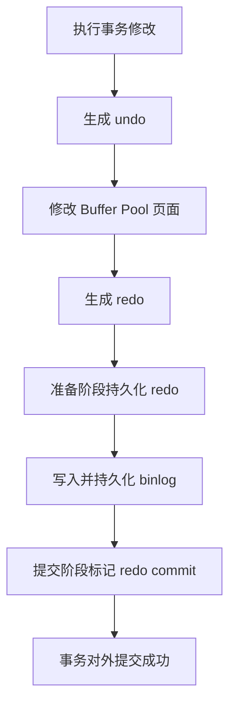

# 数据库学习笔记：关系模型、MySQL 8 与 Redis 7

> 数据库不是“会写 SQL”这么简单。关系模型决定数据怎样表达，事务与日志保证并发和故障下仍然正确，索引与缓存决定访问成本，复制和分片决定系统如何扩展。本文按“关系模型 → SQL → 事务与并发 → MySQL 8/InnoDB → Redis 7 → 缓存一致性”的顺序组织，目标是脱离参考链接也能独立学习和复习。

## 参考资料

本笔记基于 CyC2018 CS-Notes 整理，按引用编号与原文对应如下：

1. [CS-Notes SQL 语法](https://github.com/CyC2018/CS-Notes/blob/master/notes/SQL%20%E8%AF%AD%E6%B3%95.md)
2. [CS-Notes 数据库系统原理](https://github.com/CyC2018/CS-Notes/blob/master/notes/%E6%95%B0%E6%8D%AE%E5%BA%93%E7%B3%BB%E7%BB%9F%E5%8E%9F%E7%90%86.md)
3. [CS-Notes MySQL](https://github.com/CyC2018/CS-Notes/blob/master/notes/MySQL.md)
4. [CS-Notes Redis](https://github.com/CyC2018/CS-Notes/blob/master/notes/Redis.md)
5. [MySQL 8.0 Reference Manual：InnoDB](https://dev.mysql.com/doc/refman/8.0/en/innodb-storage-engine.html)
6. [MySQL 8.0 Reference Manual：Optimization](https://dev.mysql.com/doc/refman/8.0/en/optimization.html)
7. [Redis Documentation：Data Types](https://redis.io/docs/latest/develop/data-types/)
8. [Redis Documentation：Memory Optimization](https://redis.io/docs/latest/operate/oss_and_stack/management/optimization/memory-optimization/)
9. Abraham Silberschatz 等：《数据库系统概念》

---

## 0. 知识地图

这 4 篇文档其实可以归纳成一句话：

```text
SQL 语法：
    如何查询和操作数据。

数据库系统原理：
    数据库如何保证并发下的数据正确性。

MySQL：
    MySQL 如何用索引、存储引擎、复制、分库分表提高性能和可用性。

Redis：
    Redis 如何用内存 key-value 和多种数据结构解决缓存、计数、排行榜、锁、会话等高频场景。
```

也就是：

```text
会写 SQL
  ↓
理解事务、锁、MVCC
  ↓
理解 MySQL 索引和执行优化
  ↓
理解 Redis 为什么快、适合做什么
```

---

## 1. 关系数据库原理：先理解数据模型

SQL 是操作关系模型的语言。若只记 SQL 关键字，很难解释主键为什么重要、JOIN 为什么昂贵、范式为什么减少异常、索引为什么改变执行计划。

### 1.1 关系、元组与属性

关系可以直观理解为一张表，元组对应一行，属性对应一列。关系模式描述表的结构，关系实例则是某一时刻表中的具体数据。

```text
关系模式：users(id, name, email, city)
关系实例：当前 users 表里的全部行
```

关系在数学上是元组的集合，因此不天然带顺序。SQL 查询若没有 `ORDER BY`，数据库不承诺返回顺序；即使某次恰好按主键返回，也不能依赖它。

属性应有明确的域，例如 `id` 是正整数，`email` 是受长度限制的字符串。数据库类型和约束共同把不合法状态挡在系统边界。

### 1.2 键与完整性约束

超键是能够唯一标识一行的属性集合。候选键是没有多余属性的最小超键，设计者从候选键中选一个作为主键。

例如用户表中 `id` 和 `email` 都可能唯一。如果二者都满足最小唯一性，它们都是候选键；选择 `id` 为主键后，`email` 仍应通过 `UNIQUE` 保持业务唯一。

主键同时要求唯一且非 NULL。外键要求引用值存在于目标候选键中，或按定义允许为 NULL，这叫参照完整性。

约束不是“应用校验的重复劳动”。应用可能有多个入口、并发请求和运维脚本，数据库约束是最终一致的防线。

```sql
CREATE TABLE users (
    id BIGINT PRIMARY KEY,
    email VARCHAR(255) NOT NULL UNIQUE,
    name VARCHAR(100) NOT NULL,
    city VARCHAR(100),
    created_at TIMESTAMP NOT NULL DEFAULT CURRENT_TIMESTAMP
) ENGINE=InnoDB;

CREATE TABLE orders (
    id BIGINT PRIMARY KEY,
    user_id BIGINT NOT NULL,
    status VARCHAR(20) NOT NULL,
    total_amount DECIMAL(12, 2) NOT NULL,
    created_at TIMESTAMP NOT NULL DEFAULT CURRENT_TIMESTAMP,
    CONSTRAINT fk_orders_user
        FOREIGN KEY (user_id) REFERENCES users(id),
    CONSTRAINT ck_orders_amount CHECK (total_amount >= 0)
) ENGINE=InnoDB;
```

全文使用 `users`、`orders`、`order_items` 和 `products` 作为统一示例，避免每节临时发明互不兼容的表。

### 1.3 NULL 与三值逻辑

NULL 表示未知、缺失或不适用，不是零，也不是空字符串。SQL 条件除了 TRUE 和 FALSE，还有 UNKNOWN。

`NULL = NULL` 的结果不是 TRUE，而是 UNKNOWN。判断空值必须使用 `IS NULL` 或 `IS NOT NULL`。

```sql
SELECT * FROM users WHERE city IS NULL;
```

`WHERE` 只保留条件为 TRUE 的行，FALSE 和 UNKNOWN 都被过滤。`NOT IN` 子查询若产生 NULL，常导致整个条件变成 UNKNOWN；可优先考虑语义明确的 `NOT EXISTS`。

聚合函数通常忽略 NULL，但 `COUNT(*)` 统计行数，`COUNT(column)` 只统计该列非 NULL 的行。这一区别经常造成统计错误。

### 1.4 关系代数的直觉

选择是横向筛行，对应 `WHERE`；投影是纵向取列，对应 `SELECT column`；连接把满足条件的元组组合；并、交、差是集合运算；重命名解决同名关系或属性的歧义。

```text
选择 σ：哪些行？
投影 π：哪些列？
连接 ⋈：哪些关系按什么条件组合？
分组 γ：按什么键聚合？
```

优化器之所以能改写查询，是因为许多关系表达式在语义上等价。例如把只涉及单表的过滤尽早下推，通常能减少参加 JOIN 的行数。

但含 NULL、外连接、非确定函数或副作用时，改写必须更谨慎。不能凭直觉把所有谓词随意移动。

### 1.5 ER 建模：从业务对象到关系表

实体是需要独立标识的对象，例如用户和商品。属性描述实体，联系描述实体之间的关系。

一对多关系通常把“一”方主键作为“多”方外键。例如一个用户有多个订单，`orders.user_id` 引用 `users.id`。

多对多关系需要中间表。例如订单和商品之间由 `order_items` 表达：

```sql
CREATE TABLE products (
    id BIGINT PRIMARY KEY,
    name VARCHAR(200) NOT NULL,
    price DECIMAL(12, 2) NOT NULL,
    stock INT NOT NULL,
    CHECK (price >= 0),
    CHECK (stock >= 0)
) ENGINE=InnoDB;

CREATE TABLE order_items (
    order_id BIGINT NOT NULL,
    product_id BIGINT NOT NULL,
    quantity INT NOT NULL,
    unit_price DECIMAL(12, 2) NOT NULL,
    PRIMARY KEY (order_id, product_id),
    FOREIGN KEY (order_id) REFERENCES orders(id),
    FOREIGN KEY (product_id) REFERENCES products(id),
    CHECK (quantity > 0)
) ENGINE=InnoDB;
```

`unit_price` 看似可从 products.price 得到，却应保存在订单项中，因为它记录交易发生时的历史事实。商品后来改价不能改变旧订单金额。

建模时要区分当前状态、历史事件和派生数据。把三者混在一个字段里，会让更新语义变得含糊。

### 1.6 函数依赖

函数依赖 `X → Y` 表示：任意合法关系实例中，只要两行的 X 相同，它们的 Y 就必然相同。

在订单表中，若订单 ID 唯一决定用户和创建时间，可以写作：

```text
order_id → user_id, created_at, status
```

函数依赖来自业务语义，不是从当前样本数据“碰巧没有重复”推测出来的。今天两个用户名字不同，不代表 `name → user_id` 是合法依赖。

属性闭包 `X+` 是从 X 根据依赖集合能推导出的全部属性。若 `X+` 包含关系所有属性，则 X 是超键。

例：关系 `R(A,B,C,D)` 有 `A→B`、`B→C`、`AC→D`。

从 A 出发先得到 B，再由 B 得到 C；已经有 A 和 C，因此由 AC 得到 D。于是 `A+={A,B,C,D}`，A 是候选键。

### 1.7 第一范式与原子值

第一范式（First Normal Form，1NF）要求属性值在当前关系模型中不可再分成重复组或集合。

把多个电话号码塞进一个逗号字符串会带来查询、约束和更新困难。更合适的模型是单独建立 `user_phones(user_id, phone)`。

“原子”取决于业务操作。地址可以作为整体字符串，也可以拆成省、市、街道；若业务需要分别过滤或约束，就应拆分。

### 1.8 第二范式：消除对候选键的部分依赖

第二范式（2NF）建立在 1NF 之上，要求每个非主属性完全依赖整个候选键，而不是只依赖复合键的一部分。

假设表：

```text
enrollment(student_id, course_id, student_name, course_name, score)
主键：(student_id, course_id)
```

`student_name` 只依赖 `student_id`，`course_name` 只依赖 `course_id`，它们都是部分依赖。

应分解成：

```text
students(student_id, student_name)
courses(course_id, course_name)
enrollment(student_id, course_id, score)
```

分解减少学生改名时修改多行的更新异常，也避免尚未选课时无法插入课程的插入异常。

### 1.9 第三范式：消除非主属性的传递依赖

第三范式（3NF）关注非主属性通过另一个非主属性依赖候选键。

```text
employees(emp_id, dept_id, dept_name)
emp_id → dept_id
dept_id → dept_name
```

于是 `emp_id → dept_name` 是传递依赖。部门名称会在多个员工行中重复，改名容易漏更新。

分解为 `employees(emp_id, dept_id)` 和 `departments(dept_id, dept_name)` 后，每个事实只保存一次。

### 1.10 BCNF 与 3NF 的差别

Boyce-Codd Normal Form（BCNF）要求每一个非平凡函数依赖 `X→Y` 的决定因素 X 都是超键。它比 3NF 更严格。

3NF 在某些右侧为主属性的依赖上允许例外，以便同时保持依赖。BCNF 更彻底消除依赖异常，却可能无法保持所有依赖在单表内直接检查。

规范化设计要追求无损连接。分解后的表自然连接必须能恢复原关系，且不能产生原本不存在的伪元组。

### 1.11 无损连接判断直觉

把 R 分解成 R1 和 R2 时，若交集 `R1∩R2` 能函数决定 R1 或 R2 的全部属性，则二元分解通常是无损的。

例如 `employees(emp_id, dept_id, dept_name)` 分成：

```text
R1(emp_id, dept_id)
R2(dept_id, dept_name)
```

两表交集是 `dept_id`，且 `dept_id→dept_name`，因此连接不会随意组合多个部门名称。

若分解只为了“表看起来小”，却没有键和依赖保证，重新 JOIN 时可能产生错误组合。

### 1.12 反范式什么时候合理

范式减少冗余和写异常，但查询可能需要更多 JOIN。读多写少、可接受派生字段延迟更新的场景，可以有控制地反范式化。

例如在订单表保存 `item_count` 能避免每次统计订单项。但必须规定它由谁更新、失败如何修复、能否从明细重建。

反范式不是放弃一致性，而是把一致性维护从结构约束转移到事务、异步任务和校验流程。

### 1.13 数据类型设计

主键类型影响每个二级索引，因为 InnoDB 二级索引叶子保存主键值。过宽的字符串主键会放大索引和缓存压力。

金额应使用定点 `DECIMAL` 或最小货币单位整数，不应随意用二进制浮点表示精确财务值。

时间字段要明确时区和语义：记录绝对时刻、当地日期，还是持续时间。仅写一个模糊字符串会把解析问题推给所有调用者。

字符集和排序规则决定存储、比较、唯一性和排序行为。大小写是否等价不是应用层想当然的结论。

### 1.14 逻辑设计到物理设计

逻辑设计回答有哪些实体、关系和约束。物理设计回答用什么索引、分区、行格式与存储布局支持工作负载。

索引不是建模错误的补丁。先保证事实表达正确，再根据实际查询模式优化访问路径。

设计审查至少应回答：

- 每张表表示哪一种事实？
- 主键是否稳定且最小？
- 哪些唯一性由数据库保证？
- 外键删除和更新语义是什么？
- NULL 表示什么？
- 哪些字段是历史快照，哪些是当前状态？
- 高频读写路径需要哪些索引？
- 数据量和保留周期是多少？
- 是否能从源事实重建派生数据？

## 2. SQL 语法核心知识点

### 1. SQL 最核心的是增删改查

需优先掌握：

```sql
INSERT INTO table(col1, col2) VALUES(val1, val2);

UPDATE table
SET col = val
WHERE id = 1;

DELETE FROM table
WHERE id = 1;

SELECT col1, col2
FROM table
WHERE condition;
```

其中最重要的安全点是：

> `UPDATE` 和 `DELETE` 一定要带 `WHERE`，否则可能更新或删除整张表。文档也明确提醒，更新和删除前可以先用 `SELECT` 测试过滤条件。([GitHub](https://github.com/CyC2018/CS-Notes/blob/master/notes/SQL%20%E8%AF%AD%E6%B3%95.md))

---

### 2. SELECT 的基本结构

建议记成这个顺序：

```sql
SELECT 查询字段
FROM 表
WHERE 行过滤
GROUP BY 分组字段
HAVING 分组后过滤
ORDER BY 排序字段
LIMIT 返回行数;
```

容易卡的是 `WHERE`、`GROUP BY`、`HAVING`。

核心区别是：

```text
WHERE：
    分组前过滤原始行。

GROUP BY：
    把相同值的行放到一组。

HAVING：
    分组统计之后，再过滤分组结果。
```

比如：

```sql
SELECT city, COUNT(*) AS num
FROM users
WHERE age > 18
GROUP BY city
HAVING num >= 10;
```

意思是：

```text
先找 age > 18 的用户；
再按 city 分组；
再只保留人数 >= 10 的城市。
```

文档中也强调：`WHERE` 过滤行，`HAVING` 过滤分组，行过滤应该先于分组过滤。([GitHub](https://github.com/CyC2018/CS-Notes/blob/master/notes/SQL%20%E8%AF%AD%E6%B3%95.md))

---

### 3. DISTINCT 和 GROUP BY 的区别

常见疑问：

```sql
SELECT col FROM mytable GROUP BY col;
```

和：

```sql
SELECT DISTINCT col FROM mytable;
```

在只查一个字段时，结果通常都是：

```text
返回 col 的不重复值。
```

但语义不同：

```text
DISTINCT：
    目的就是去重。

GROUP BY：
    目的是分组，通常配合 COUNT / SUM / AVG / MAX / MIN。
```

比如：

```sql
SELECT col, COUNT(*) AS num
FROM mytable
GROUP BY col;
```

这就不是简单去重，而是统计每组数量。

记忆：

```text
只想去重：
    用 DISTINCT。

想分组统计：
    用 GROUP BY。
```

---

### 4. 子查询和相关子查询

这个常见 SQL：

```sql
SELECT cust_name,
       (SELECT COUNT(*)
        FROM Orders
        WHERE Orders.cust_id = Customers.cust_id) AS orders_num
FROM Customers
ORDER BY cust_name;
```

核心理解：

> 外层每拿到一个客户，内层子查询就根据这个客户的 `cust_id` 去订单表里数订单数量。

例如：

`Customers`：

| cust_id | cust_name |
| ------- | --------- |
| 1       | 张三        |
| 2       | 李四        |
| 3       | 王五        |

`Orders`：

| order_id | cust_id |
| -------- | ------- |
| 101      | 1       |
| 102      | 1       |
| 103      | 2       |

执行时相当于：

```text
处理张三时：
    SELECT COUNT(*) FROM Orders WHERE cust_id = 1;
    结果 2

处理李四时：
    SELECT COUNT(*) FROM Orders WHERE cust_id = 2;
    结果 1

处理王五时：
    SELECT COUNT(*) FROM Orders WHERE cust_id = 3;
    结果 0
```

这叫**相关子查询**，因为内层查询依赖外层当前行。文档中也说明，这类子查询会对第一个查询检索出的每个客户执行一次。([GitHub](https://github.com/CyC2018/CS-Notes/blob/master/notes/SQL%20%E8%AF%AD%E6%B3%95.md))

---

### 5. JOIN 连接

JOIN 用来把多张表按关系拼起来。文档中说，连接用于连接多个表，条件通常写在 `ON` 后面，而且连接可以替代子查询，效率一般更好。([GitHub](https://github.com/CyC2018/CS-Notes/blob/master/notes/SQL%20%E8%AF%AD%E6%B3%95.md))

常见类型：

```text
INNER JOIN：
    只保留两边都匹配的行。

LEFT JOIN：
    左表全部保留，右表没匹配则为 NULL。

RIGHT JOIN：
    右表全部保留，左表没匹配则为 NULL。
```

例如客户和订单：

```sql
SELECT c.cust_name, o.order_id
FROM Customers c
LEFT JOIN Orders o
ON c.cust_id = o.cust_id;
```

如果某个客户没有订单，`LEFT JOIN` 仍然会显示这个客户，只是订单字段为 `NULL`。

---

### 6. 函数部分重点

常见文本处理函数：`TRIM()`、`CONCAT()`、`LEFT()`、`RIGHT()`、`LOWER()`、`UPPER()`、`SOUNDEX()`。

核心记忆：

| 函数              | 作用        |
| --------------- | --------- |
| `CONCAT()`      | 拼接字符串     |
| `TRIM()`        | 去掉首尾空格    |
| `LTRIM()`       | 去掉左边空格    |
| `RTRIM()`       | 去掉右边空格    |
| `LEFT(col, n)`  | 取左边 n 个字符 |
| `RIGHT(col, n)` | 取右边 n 个字符 |
| `LOWER()`       | 转小写       |
| `UPPER()`       | 转大写       |
| `LENGTH()`      | 求长度       |
| `SOUNDEX()`     | 转换成语音相似编码 |

比如：

```sql
SELECT CONCAT(TRIM(vend_name), ' (', TRIM(vend_country), ')') AS vend_title
FROM vendors;
```

意思是：

```text
去掉供应商名称和国家两边空格；
再拼成：
ACME (USA)
```

`SOUNDEX()` 不是精确匹配，而是用于发音相近的匹配。文档中也说，它会把字符串转换为描述语音表示的字母数字模式。([GitHub](https://github.com/CyC2018/CS-Notes/blob/master/notes/SQL%20%E8%AF%AD%E6%B3%95.md))

---

## 3. 事务与并发控制

### 1. 事务 ACID

事务就是一组操作，要么全部成功，要么全部失败。文档中定义事务是满足 ACID 特性的一组操作，可以通过 `COMMIT` 提交，也可以通过 `ROLLBACK` 回滚。([GitHub](https://github.com/CyC2018/CS-Notes/blob/master/notes/%E6%95%B0%E6%8D%AE%E5%BA%93%E7%B3%BB%E7%BB%9F%E5%8E%9F%E7%90%86.md))

ACID：

| 特性              | 含义          | 例子            |
| --------------- | ----------- | ------------- |
| 原子性 Atomicity   | 要么全成功，要么全失败 | 转账不能只扣钱不加钱    |
| 一致性 Consistency | 事务前后数据合法    | 总金额不能凭空变化     |
| 隔离性 Isolation   | 并发事务互不干扰    | 别人未提交的数据我不能乱读 |
| 持久性 Durability  | 提交后数据不丢     | 宕机恢复后数据还在     |

需重点理解：

```text
原子性：
    靠 Undo Log 支持回滚。

持久性：
    靠 Redo Log 支持崩溃恢复。

隔离性：
    靠锁和 MVCC 实现。
```

---

### 2. 并发一致性问题

重点四个：

| 问题    | 通俗解释                |
| ----- | ------------------- |
| 丢失修改  | 两个事务都改同一数据，后一个覆盖前一个 |
| 脏读    | 读到了别人还没提交的数据        |
| 不可重复读 | 同一事务内，两次读同一行，值变了    |
| 幻读    | 同一事务内，两次查同一范围，行数变了  |

不可重复读和幻读最重要的一句：

```text
不可重复读：
    重点是同一行数据变了。

幻读：
    重点是同一范围内多了/少了行。
```

例子：

```text
不可重复读：
    第一次查 id=1，balance=100；
    别人把 id=1 改成 200 并提交；
    第二次查 id=1，balance=200。

幻读：
    第一次查 age > 18，有 3 行；
    别人插入一条 age=20 的记录并提交；
    第二次查 age > 18，变成 4 行。
```

---

### 3. 隔离级别

四个隔离级别：

| 隔离级别             | 能解决什么      | 可能还有什么问题    |
| ---------------- | ---------- | ----------- |
| READ UNCOMMITTED | 基本不解决      | 脏读、不可重复读、幻读 |
| READ COMMITTED   | 解决脏读       | 不可重复读、幻读    |
| REPEATABLE READ  | 解决脏读、不可重复读 | 理论上可能幻读     |
| SERIALIZABLE     | 基本都解决      | 并发性能最低      |

MySQL InnoDB 默认是 `REPEATABLE READ`。

最关键的疑问是：

> 普通 `SELECT` 不加锁，为什么还能可重复读？

答案是：

```text
InnoDB 默认 REPEATABLE READ 下，普通 SELECT 是快照读。
它不是靠读锁阻止别人修改，
而是靠 MVCC + Read View + Undo Log 读旧版本。
```

---

### 4. MVCC、快照读、当前读

文档中说，MVCC 是 InnoDB 实现提交读和可重复读的一种方式；它利用多版本思想，写操作更新最新版本，读操作读旧版本快照，从而减少读写互斥。([GitHub](https://github.com/CyC2018/CS-Notes/blob/master/notes/%E6%95%B0%E6%8D%AE%E5%BA%93%E7%B3%BB%E7%BB%9F%E5%8E%9F%E7%90%86.md))

可以这样记：

```text
MVCC = 多版本并发控制。

核心思想：
    写生成新版本；
    普通读读取符合自己 Read View 的旧版本；
    所以读不阻塞写，写不阻塞普通读。
```

### 快照读

```sql
SELECT * FROM account WHERE id = 1;
```

普通 `SELECT` 通常是快照读。

特点：

```text
不加行锁；
读的是某个时间点的一致性版本；
在 REPEATABLE READ 下，同一事务内复用第一次快照读的 Read View。
```

### 当前读

```sql
SELECT * FROM account WHERE id = 1 FOR UPDATE;

UPDATE account SET balance = 200 WHERE id = 1;

DELETE FROM account WHERE id = 1;
```

当前读特点：

```text
读最新版本；
需要加锁；
用于修改或即将修改的数据。
```

文档中也明确区分：MVCC 的普通 `SELECT` 是快照中的数据，不需要加锁；`INSERT`、`UPDATE`、`DELETE` 这类修改操作需要加锁并读取最新数据；`SELECT ... LOCK IN SHARE MODE` 和 `SELECT ... FOR UPDATE` 可以强制加锁读。([GitHub](https://github.com/CyC2018/CS-Notes/blob/master/notes/%E6%95%B0%E6%8D%AE%E5%BA%93%E7%B3%BB%E7%BB%9F%E5%8E%9F%E7%90%86.md))

---

### 5. Read View 怎么理解

可以把 Read View 理解成：

> 当前事务第一次快照读时，拍下来的“活跃事务名单”。

判断版本是否可见，大概是：

```text
如果这个版本是我自己改的：
    可见。

如果修改这个版本的事务，在我创建 Read View 前已经提交：
    可见。

如果修改这个版本的事务，在我创建 Read View 时还没提交：
    不可见，沿 undo log 找旧版本。

如果修改这个版本的事务，是我创建 Read View 后才出现的：
    不可见，沿 undo log 找旧版本。
```

所以：

```text
READ COMMITTED：
    每次 SELECT 都创建新的 Read View。
    所以可能不可重复读。

REPEATABLE READ：
    一个事务内第一次普通 SELECT 创建 Read View，后续复用。
    所以普通 SELECT 可以可重复读。
```

---

### 6. 锁：S 锁、X 锁、行锁、表锁、间隙锁

重点记这些：

```text
S 锁，共享锁：
    共享锁（读）：他人也可读，但不能改。

X 锁，排他锁：
    排他锁（写）：他人不能加锁读，也不能改。

行锁：
    锁某些行，并发高。

表锁：
    锁整张表，并发低。

意向锁：
    用来协调表锁和行锁。
```

显式锁：

```sql
SELECT * FROM account WHERE id = 1 FOR SHARE;
```

意思是加共享锁：

```text
别人可以普通读；
但不能修改这行。
```

```sql
SELECT * FROM account WHERE id = 1 FOR UPDATE;
```

意思是加排他锁：

```text
我后面要改这行；
别人不能修改，也不能拿冲突锁。
```

---

### 7. Next-Key Lock

文档中说，MVCC 不能解决幻读问题，InnoDB 在 `REPEATABLE READ` 下通过 `MVCC + Next-Key Locks` 解决幻读；Next-Key Lock 是 Record Lock 和 Gap Lock 的结合。([GitHub](https://github.com/CyC2018/CS-Notes/blob/master/notes/%E6%95%B0%E6%8D%AE%E5%BA%93%E7%B3%BB%E7%BB%9F%E5%8E%9F%E7%90%86.md))

可以这样理解：

```text
Record Lock：
    锁住已有记录。

Gap Lock：
    锁住两个索引记录之间的间隙。

Next-Key Lock：
    锁住记录 + 前面的间隙。
```

例子：

```sql
SELECT c
FROM t
WHERE c BETWEEN 10 AND 20
FOR UPDATE;
```

它不只是锁住已有的 `10`、`20`，还要锁住中间间隙，防止别人插入 `15`。

所以：

```text
普通 SELECT 防不可重复读：
    靠 MVCC 快照。

当前读 / UPDATE / DELETE 防幻读：
    靠 Next-Key Lock。
```

---

### 8. 范式和数据库设计

范式的目的不是为了背定义，而是为了减少：

```text
数据冗余；
更新异常；
删除异常；
插入异常。
```

核心记忆：

```text
1NF：
    字段不可再分。

2NF：
    非主属性必须完全依赖主键，不能只依赖联合主键的一部分。

3NF：
    非主属性不能传递依赖主键。
```

实际开发中不是范式越高越好，因为过度拆表会导致查询复杂、JOIN 增多。一般业务系统常以 3NF 为基础，再根据性能做适当反范式。

---

## 4. MySQL 8 与 InnoDB 核心知识点

### 1. MySQL 重点不是 SQL，而是 InnoDB + 索引 + 查询优化

MySQL 这篇的核心是：

```text
索引怎么组织数据；
查询怎么利用索引；
InnoDB 和 MyISAM 有什么区别；
如何通过复制、读写分离、切分扩展能力。
```

---

### 2. B+Tree 为什么适合数据库索引

文档中说，B+Tree 基于 B Tree 和叶子节点顺序访问指针实现，具有平衡性，并通过顺序访问指针提高区间查询性能；数据库和文件系统普遍使用 B+Tree，是因为它树高更低、磁盘 I/O 更友好。([GitHub](https://github.com/CyC2018/CS-Notes/blob/master/notes/MySQL.md))

可以这样理解：

```text
红黑树：
    二叉树，每个节点最多 2 个孩子。
    数据多时树高较高。

B+Tree：
    多叉树，一个节点可以有很多 key 和很多孩子。
    树更矮。
    一次磁盘 I/O 可以读一个页，一个页里放很多 key。
```

所以：

```text
B+Tree 适合磁盘：
    因为树矮，I/O 次数少。

B+Tree 适合范围查询：
    因为叶子节点有序并且通过链表相连。
```

---

### 3. InnoDB 主键索引和辅助索引

这是一个重点。

InnoDB 里：

```text
主键索引 / 聚簇索引：
    叶子节点存完整数据行。

辅助索引 / 二级索引：
    叶子节点存索引列 + 主键值。
```

文档中也说明，InnoDB 的主索引叶子节点记录完整数据记录，辅助索引叶子节点记录主键值，因此用辅助索引查找时，要先找到主键值，再到主索引中查完整行。([GitHub](https://github.com/CyC2018/CS-Notes/blob/master/notes/MySQL.md))

例子：

```sql
CREATE TABLE user (
    id INT PRIMARY KEY,
    name VARCHAR(20),
    age INT,
    INDEX idx_age(age)
);
```

数据：

| id | name | age |
| -- | ---- | --- |
| 1  | Tom  | 18  |
| 2  | Jack | 20  |
| 3  | Lily | 20  |

主键索引：

```text
id=1 -> 完整行 {1, Tom, 18}
id=2 -> 完整行 {2, Jack, 20}
id=3 -> 完整行 {3, Lily, 20}
```

辅助索引 `idx_age`：

```text
age=18 -> id=1
age=20 -> id=2
age=20 -> id=3
```

执行：

```sql
SELECT * FROM user WHERE age = 20;
```

流程：

```text
先查 idx_age：
    age=20 -> id=2, id=3

再查主键索引：
    id=2 -> 完整行
    id=3 -> 完整行
```

这叫**回表**。

---

### 4. 覆盖索引

如果查询字段已经在辅助索引里，就不需要回表。

例如：

```sql
SELECT id, age
FROM user
WHERE age = 20;
```

因为 `idx_age` 叶子节点里有：

```text
age + 主键 id
```

所以可以直接返回，不需要再查主键索引。

这叫：

```text
覆盖索引：
    查询需要的字段，索引里已经都有了。
```

---

### 5. 联合索引和最左前缀

联合索引：

```sql
INDEX idx_age_name(age, name)
```

不是两个独立索引，而是一棵按 `(age, name)` 排序的 B+Tree。

排序规则：

```text
先按 age 排；
age 相同，再按 name 排；
如果还相同，再按主键排。
```

所以可以用：

```sql
WHERE age = 20;
```

也可以用：

```sql
WHERE age = 20 AND name = 'Tom';
```

但不适合直接用：

```sql
WHERE name = 'Tom';
```

因为这棵树不是全局按 `name` 排的。

文档也说，B+Tree 索引适用于全键值、键值范围和键前缀查找，但键前缀查找只适用于最左前缀。([GitHub](https://github.com/CyC2018/CS-Notes/blob/master/notes/MySQL.md))

类比：

```text
一本通讯录按：
    省份 -> 城市 -> 姓名

查询广东省，很快；
查广东省深圳市，很快；
但直接查姓名 Tom，就不方便。
```

---

### 6. 索引失效和优化

重点记几个规则：

```text
1. 索引列不要参与表达式计算。
2. 索引列不要作为函数参数。
3. LIKE '%xxx' 前缀通配符通常无法有效用 B+Tree。
4. 联合索引要遵守最左前缀。
5. 尽量使用覆盖索引减少回表。
6. 高选择性的列适合放在联合索引前面。
```

文档中明确说，索引列不能是表达式的一部分，也不能是函数参数，否则无法使用索引；多列索引通常比多个单列索引更好；选择性越高的列区分度越高，查询效率也越高。([GitHub](https://github.com/CyC2018/CS-Notes/blob/master/notes/MySQL.md))

不好：

```sql
WHERE actor_id + 1 = 5;
```

好：

```sql
WHERE actor_id = 4;
```

---

### 7. 倒排索引和 B+Tree 的区别

倒排索引：

核心区别：

```text
B+Tree：
    字段值 -> 行
    适合等值查询、范围查询、排序。

倒排索引：
    关键词 -> 文档列表
    适合全文搜索。
```

比如文章：

```text
doc1: 我喜欢 MySQL
doc2: MySQL 索引 很重要
doc3: Linux 文件系统 索引
```

倒排索引：

```text
MySQL -> doc1, doc2
索引  -> doc2, doc3
Linux -> doc3
```

搜索：

```text
MySQL 索引
```

就是：

```text
MySQL -> doc1, doc2
索引  -> doc2, doc3

取交集：
doc2
```

文档中说，全文索引用于查找文本中的关键词，使用 `MATCH AGAINST`，底层使用倒排索引，记录关键词到所在文档的映射。([GitHub](https://github.com/CyC2018/CS-Notes/blob/master/notes/MySQL.md))

---

### 8. InnoDB 和 MyISAM

重点对比：

| 对比   | InnoDB  | MyISAM     |
| ---- | ------- | ---------- |
| 事务   | 支持      | 不支持        |
| 行级锁  | 支持      | 不支持，只支持表锁  |
| 外键   | 支持      | 不支持        |
| 崩溃恢复 | 更好      | 较弱         |
| 适合   | 绝大多数业务表 | 只读、小表、特殊场景 |

文档也明确总结：InnoDB 是事务型的，支持 `COMMIT` 和 `ROLLBACK`；MyISAM 只支持表级锁，而 InnoDB 还支持行级锁；InnoDB 支持外键和在线热备份，崩溃恢复也更好。([GitHub](https://github.com/CyC2018/CS-Notes/blob/master/notes/MySQL.md))

现代 MySQL 基本优先选 InnoDB。

---

### 9. 查询优化

核心原则：

```text
少查列：
    避免 SELECT *。

少查行：
    WHERE 条件尽量精确。

少扫描：
    建合适索引。

少回表：
    用覆盖索引。

看执行计划：
    EXPLAIN。
```

重点关注 `EXPLAIN` 里的：

```text
type：
    访问类型，越接近 const/ref/range 越好，ALL 通常表示全表扫描。

key：
    实际使用的索引。

rows：
    预计扫描行数。

Extra：
    是否 Using index、Using filesort、Using temporary。
```

---

### 10. 主从复制和读写分离

这是一个常见问题。

主从复制的本质：

```text
主库把修改写入 binlog；
从库 I/O 线程拉取 binlog；
写入 relay log；
从库 SQL 线程重放 relay log；
从库逐渐追上主库。
```

读写分离：

```text
写请求：
    走主库。

普通读请求：
    可以走从库。

强一致读 / 写后立刻读：
    走主库。
```

最大问题：

```text
主从延迟。
```

例如：

```text
刚注册用户写入主库；
马上查用户信息，如果请求被路由到从库；
从库还没同步到，就可能查不到。
```

所以需记住：

```text
读写分离提高读性能，但牺牲了一部分实时一致性。
```

---

### 11. 分库分表

重点理解：

```text
垂直切分：
    按业务或字段拆。
    例如 user 表、order 表、product 表拆到不同库。

水平切分：
    同一张表的数据按行拆。
    例如 user_0、user_1、user_2。
```

Sharding 策略：

```text
按范围：
    id 1~1000 放库 A，1001~2000 放库 B。

按 hash：
    user_id % 4 决定放哪个库。
```

问题：

```text
跨库 JOIN 困难；
分布式事务困难；
全局唯一 ID；
跨库分页排序复杂；
扩容迁移麻烦。
```

---

## 5. Redis 7 核心知识点

### 1. Redis 是什么

Redis 是速度很快的 NoSQL 内存键值数据库；key 只能是字符串，value 支持 String、List、Set、Hash、ZSet 五种常见类型；它还支持持久化、复制和分片。([GitHub](https://github.com/CyC2018/CS-Notes/blob/master/notes/Redis.md))

可以这样理解：

```text
Redis = 独立运行的内存 key-value 数据库服务。

不是 MySQL 那种表、行、列；
而是：
    key -> value
```

Redis 和 Java `HashMap` 的区别：

```text
HashMap：
    进程内数据结构；
    单机、单进程使用；
    通常比 Redis 单次访问更快；
    不能天然跨进程共享。

Redis：
    独立服务；
    多个应用服务器都能访问；
    支持过期、持久化、复制、分片、原子命令、多种数据结构。
```

一句话：

```text
HashMap 是进程内的临时内存表；
Redis 是整个系统共享的内存数据库。
```

---

### 2. Redis 五大数据类型

| 类型     | 通俗理解                   | 典型场景             |
| ------ | ---------------------- | ---------------- |
| String | 一个简单值                  | 缓存、计数器、token、验证码 |
| List   | 有序列表，可重复               | 简单队列、历史记录        |
| Set    | 无序不重复集合                | 点赞、关注、共同好友、去重    |
| Hash   | 一个 key 下多个 field-value | 用户对象、商品对象、购物车    |
| ZSet   | 带分数的有序集合               | 排行榜、热搜、延迟队列      |

文档中也列出了五种类型能存储的值和操作：String 可做字符串/数值操作，List 可两端压入弹出，Set 可做交并差，Hash 可操作键值对，ZSet 可按分值和排名获取元素。([GitHub](https://github.com/CyC2018/CS-Notes/blob/master/notes/Redis.md))

---

### 3. Set 和 Hash 的区别

这是一个常被问到的点。

### Set

```text
key -> 一堆不重复成员
```

例如文章点赞：

```redis
SADD article:100:likes user:1
SADD article:100:likes user:2
SADD article:100:likes user:1
```

结果：

```text
article:100:likes = {user:1, user:2}
```

适合：

```text
是否存在；
去重；
共同好友；
点赞用户集合。
```

### Hash

```text
key -> field -> value
```

例如用户对象：

```redis
HSET user:1 name Tom
HSET user:1 age 18
HSET user:1 city Beijing
```

结果：

```text
user:1:
    name -> Tom
    age  -> 18
    city -> Beijing
```

适合：

```text
用户信息；
商品信息；
购物车商品数量。
```

区别：

```text
Set：
    只有成员，没有 field-value。

Hash：
    一个对象，有多个字段和值。
```

---

### 4. ZSet 和跳跃表

ZSet 是：

```text
Set + score。
```

例如排行榜：

```redis
ZADD rank 100 Tom
ZADD rank 90 Jack
ZADD rank 120 Lily
```

可以理解为：

```text
Jack -> 90
Tom  -> 100
Lily -> 120
```

Redis 需要支持：

```text
查某个成员分数；
按分数排序；
查排名；
查某个分数范围。
```

所以底层常用：

```text
dict：
    member -> score，用于快速查分数。

skiplist：
    按 score 排序，用于排行榜和范围查询。
```

文档中说，跳跃表是有序集合底层实现之一，它是基于多指针有序链表实现的，可以看成多个有序链表；查找时从上层开始，找到区间后再到下一层。([GitHub](https://github.com/CyC2018/CS-Notes/blob/master/notes/Redis.md))

可以记成：

```text
跳跃表 = 带多层目录的有序链表。
```

---

### 5. Redis 字典 dict 和渐进式 rehash

Redis 内部的字典类似 HashMap。

它用于：

```text
根据 key 快速找到 value。
```

底层是散列表，文档中说 `dictht` 是散列表结构，用拉链法解决哈希冲突。([GitHub](https://github.com/CyC2018/CS-Notes/blob/master/notes/Redis.md))

重点概念：

```text
table：
    桶数组。

size：
    桶数量。

sizemask：
    用于快速计算下标。

used：
    当前已有 key-value 数量。

dictEntry：
    一个 key-value 节点。

next：
    冲突时串成链表。
```

### 拉链法

如果两个 key hash 后落到同一个桶：

```text
table[2] -> keyA -> keyB -> keyC
```

这就是拉链法。

### 为什么要 rehash

key 越来越多，桶不够用，链表越来越长，查找变慢。

所以需要扩容：

```text
4 个桶 -> 8 个桶 -> 16 个桶
```

### 为什么渐进式 rehash

不能一次性搬所有 key，否则 Redis 会卡住。

所以 Redis 用两个哈希表：

```text
ht[0]：旧表
ht[1]：新表
```

每次搬一点：

```text
这次搬 table[0]；
下次搬 table[1]；
再下次搬 table[2]；
...
```

`rehashidx` 记录搬到哪里。

核心记忆：

```text
Redis dict = HashMap + 拉链法 + 渐进式 rehash。
```

---

### 6. Redis 使用场景

文档中列出了计数器、缓存、查找表、消息队列、会话缓存、分布式锁等场景；比如 String 可做计数器，List 可用 `lpush/rpop` 做简单消息队列，Set 可做共同好友，ZSet 可做排行榜。([GitHub](https://github.com/CyC2018/CS-Notes/blob/master/notes/Redis.md))

需重点记住这些：

### 计数器

```redis
INCR article:100:views
```

用于：

```text
浏览量；
点赞数；
接口调用次数。
```

### 缓存

```redis
SET product:100 "{商品详情JSON}" EX 300
```

用于：

```text
热点商品；
用户信息；
配置；
首页数据。
```

### 消息队列

```redis
LPUSH queue:order order1001
RPOP queue:order
```

Redis List 可以做简单队列，但文档也提醒，更推荐 Kafka、RabbitMQ 等专业消息中间件。([GitHub](https://github.com/CyC2018/CS-Notes/blob/master/notes/Redis.md))

Kafka/RabbitMQ 可以这样记：

```text
Redis List：
    简单小篮子。

RabbitMQ：
    可靠任务分发中心。

Kafka：
    高吞吐、可回放事件日志。
```

### 会话缓存

```redis
SET session:abc123 "user_id=1" EX 1800
```

解决：

```text
多台应用服务器共享登录状态。
```

文档中说，Redis 可统一存储多台应用服务器的会话信息，使应用服务器不再保存状态，用户可以请求任意服务器，更容易实现高可用和可伸缩。([GitHub](https://github.com/CyC2018/CS-Notes/blob/master/notes/Redis.md))

### 分布式锁

```redis
SET lock:product:100 uuid NX EX 10
```

解决：

```text
多台机器上的多个进程，如何互斥操作同一份资源。
```

文档中也说，分布式场景下不能用单机锁同步多个节点进程，可以使用 `SETNX` 或 RedLock 实现分布式锁。([GitHub](https://github.com/CyC2018/CS-Notes/blob/master/notes/Redis.md))

注意：

```text
加锁要用 SET key value NX EX seconds；
value 要唯一；
释放锁要判断 value；
最好用 Lua 脚本保证判断和删除原子。
```

---

### 7. 过期时间和淘汰策略

Redis 可以给 key 设置过期时间，到期自动删除；但对于 Hash 这种容器，只能给整个 key 设置过期时间，不能给 Hash 里面单个 field 设置过期时间。([GitHub](https://github.com/CyC2018/CS-Notes/blob/master/notes/Redis.md))

例如：

```redis
SET code:phone:13800000000 123456 EX 300
```

表示验证码 5 分钟后过期。

内存满了怎么办？

Redis 可以设置淘汰策略，例如：

```text
allkeys-lru：
    从所有 key 中淘汰最近最少使用的。

volatile-lru：
    从设置了过期时间的 key 中淘汰最近最少使用的。

noeviction：
    不淘汰，内存满了写入报错。
```

文档中也列出多种淘汰策略，并说明 Redis 的淘汰算法实际实现不是扫描所有 key，而是抽样一部分并从中选出要淘汰的 key。([GitHub](https://github.com/CyC2018/CS-Notes/blob/master/notes/Redis.md))

---

### 8. 持久化：RDB 和 AOF

Redis 是内存数据库，但可以把数据保存到磁盘。

两种方式：

```text
RDB：
    定期生成快照。
    像拍照片。

AOF：
    记录每次写命令。
    像记流水账。
```

文档中也说，Redis 支持 RDB 快照和 AOF 日志两种持久化策略。([GitHub](https://github.com/CyC2018/CS-Notes/blob/master/notes/Redis.md))

核心对比：

| 对比   | RDB           | AOF     |
| ---- | ------------- | ------- |
| 本质   | 某个时间点的数据快照    | 写命令日志   |
| 恢复速度 | 快             | 相对慢     |
| 数据安全 | 可能丢最近一次快照后的数据 | 通常更安全   |
| 文件体积 | 较小            | 可能较大    |
| 适合   | 备份、快速恢复       | 更关注数据少丢 |

---

### 9. Redis 复制、Sentinel、Cluster

### 复制

```text
主节点负责写；
从节点复制主节点数据；
从节点可以分担读请求。
```

用途：

```text
扩展读性能；
提高可用性；
做备份。
```

### Sentinel

解决：

```text
主节点挂了，谁来自动切换？
```

Sentinel 会监控主从节点，当主节点不可用时，自动选一个从节点提升为新主节点。

### Cluster

解决：

```text
单台 Redis 内存不够；
单台 Redis 写能力不够。
```

Cluster 通过分片把不同 key 分散到不同 Redis 节点。文档中也提到 Redis Cluster 实现了分布式支持。([GitHub](https://github.com/CyC2018/CS-Notes/blob/master/notes/Redis.md))

记忆：

```text
复制：
    多份相似数据，主要扩展读能力和可用性。

分片 / Cluster：
    不同数据放不同节点，主要扩展容量和写能力。
```

---

## 6. 综合专题与重点问题

### 6.1 日志、提交与崩溃恢复统一理解

InnoDB 的 redo log 记录页面修改所需的重做信息，核心目的之一是让已提交修改在数据页尚未落盘时仍可恢复。它体现 Write-Ahead Logging（WAL）：相关脏页写回前，必要日志必须先持久化。

undo log 保存构造旧版本和事务回滚所需的信息。它既服务 MVCC，也服务逻辑撤销；不能把 undo 简化成“redo 的反操作文件”。旧版本不再被任何 Read View 需要后，purge 才能逐步清理。

binlog 位于 MySQL Server 层，记录用于复制和时间点恢复的逻辑事件。redo 属于 InnoDB，二者作用域、格式和生命周期不同。



MySQL 使用协调过程保持 redo 与 binlog 的提交结果一致。若只有 redo 提交而 binlog 缺失，主库恢复结果可能无法通过复制重放；若只有 binlog 而存储引擎修改未提交，也会产生矛盾。

崩溃恢复不能只背“redo 前滚、undo 回滚”。恢复需要根据日志和事务状态判断哪些修改已提交、哪些处于准备状态，并结合 binlog 决定最终提交或回滚。

脏页是内存内容比磁盘数据页更新的页面。事务提交通常不要求把涉及的全部数据页立即随机写盘，否则每次提交会被大量离散 IO 限制。顺序追加日志把关键持久性路径变得更可控。

doublewrite 机制解决数据页写入过程中只写了一部分的 torn page 风险。redo 假设恢复起点页面本身结构可用；若页面物理写坏，仅靠逻辑/物理重做信息未必足够。

Buffer Pool 命中率高不代表查询一定快。一次查询可能命中很多页面、扫描大量记录、持有锁或消耗 CPU。应同时观察访问行数、执行计划、锁等待和延迟分布。

假设某段时间逻辑读 990000 次、物理读 10000 次，粗略命中率为：

`990000 / (990000 + 10000) = 99%`。

但若一个请求逻辑读取十万页，即使命中率 99%，仍可能昂贵。命中率必须与每请求工作量一起解释。

### 6.2 Redis 7 的线程与持久化边界

“Redis 是单线程”只描述核心命令执行长期采用串行事件循环这一重要特征，不代表进程所有工作都只有一个线程。后台持久化、异步释放以及可配置的网络 IO 等工作可能由其他线程或子进程参与。

串行执行命令减少了共享数据结构上的锁竞争，使单条命令具有清晰的原子执行边界。但耗时命令、巨大 Key、Lua 脚本或阻塞操作仍会阻塞其他请求。

RDB 是某个时点的数据快照，适合备份和较快加载，但两次快照之间的更新在故障时可能丢失。生成快照还涉及 fork、COW 和磁盘 IO，内存写入密集时 COW 成本可能明显。

AOF 记录写命令，并按 `appendfsync` 策略决定同步频率。`everysec` 常见配置意味着通常可能丢失约一秒窗口的数据，而不是绝对零丢失；`always` 更保守但延迟和吞吐成本更高。

Redis 7 使用多部分 AOF，由清单管理基础文件和增量文件。理解原理时仍可把重写看成“根据当前数据状态生成更紧凑基线，再承接期间增量”，但不应沿用所有旧版本文件布局细节。

小型 Hash 和 Sorted Set 在 Redis 7 常使用 listpack 紧凑编码；旧资料中的 ziplist 口径已经过时。超过配置阈值后会转换为常规编码，阈值属于可配置版本细节，不应死背成数据类型定义。

复制通常是异步的。主节点确认写成功不表示所有副本已经持久化，因此故障切换仍可能丢失尚未复制的数据。`WAIT` 可以提高副本确认程度，却不把 Redis 变成严格同步共识系统。

Sentinel 负责监控、主观/客观下线判断、选主和通知客户端。它提高可用性，但数据分片不是 Sentinel 的职责。

Redis Cluster 将键空间划分为 16384 个 hash slot。节点迁移的是槽及其键，客户端需要处理重定向和拓扑变化。多键操作通常要求键落在同一槽，可用 hash tag 控制参与哈希的子串。

### 6.3 缓存一致性的可执行方案

Cache Aside 的读路径是先查缓存，未命中再查数据库并回填。写路径通常先更新数据库，再删除缓存；删除而不是直接更新缓存，可以减少并发覆盖和维护多种派生缓存的复杂度。

即便“先数据库后删缓存”，仍存在读线程在数据库提交前读到旧值、随后晚到地写回缓存的竞态。常用缓解包括短 TTL、延迟双删、按 Key 串行、版本号校验或通过 binlog 消息可靠失效。

没有一种通用方案同时免费获得强一致、极低延迟和高可用。设计必须明确允许多长时间陈旧、故障时以谁为准、消息重复或乱序如何处理。

缓存穿透是请求不存在的数据并绕过缓存直达数据库，可缓存空值、校验参数或使用 Bloom Filter 缓解。Bloom Filter 可能误判存在，但不会把实际存在的元素判断为不存在。

缓存击穿是热点 Key 失效后大量并发同时回源，可用互斥重建、逻辑过期或提前刷新。缓存雪崩是大量 Key 同时失效或整个缓存服务不可用，需要过期时间随机化、限流、降级和高可用共同处理。

分布式锁至少要保证加锁原子性、唯一持有者身份和带身份校验的释放。常见释放使用 Lua 比较 token 后删除，避免客户端 A 的锁过期后误删客户端 B 的新锁。

仅有 `SET key token NX PX ttl` 仍未解决业务执行超过租约、网络暂停、主从切换丢锁和下游资源接受旧持有者写入的问题。严格互斥场景还需要续约、fencing token 或选择具有更强一致性语义的协调系统。

### 1. 普通 SELECT 不加锁，为什么还能可重复读？

答案：

```text
因为 InnoDB 的普通 SELECT 是快照读。
它读的是 Read View 可见的版本。
他人可以修改并提交，但当前会话仍可通过 undo log 读到旧版本。
```

所以：

```text
不加锁 ≠ 不能保证可重复读。
```

---

### 2. 当前读和快照读的区别

```text
快照读：
    普通 SELECT。
    不加锁。
    读历史版本。

当前读：
    SELECT FOR UPDATE / UPDATE / DELETE / INSERT。
    加锁。
    读最新版本。
```

---

### 3. 不可重复读和幻读区别

```text
不可重复读：
    同一行变了。

幻读：
    同一范围内多了/少了行。
```

---

### 4. 主键索引、辅助索引、联合索引

```text
主键索引：
    叶子节点存完整行。

辅助索引：
    叶子节点存索引列 + 主键值。

联合索引：
    多列组成一个 key，按从左到右排序。
```

---

### 5. 回表和覆盖索引

```text
回表：
    先查辅助索引拿主键；
    再查主键索引拿完整行。

覆盖索引：
    查询字段索引里都有；
    不需要回表。
```

---

### 6. B+Tree 和倒排索引

```text
B+Tree：
    字段值 -> 行。
    适合等值、范围、排序。

倒排索引：
    关键词 -> 文档列表。
    适合全文搜索。
```

---

### 7. Redis 和 HashMap

```text
HashMap：
    本进程内用，通常更快，但不能跨进程共享。

Redis：
    独立内存数据库服务，支持共享、过期、持久化、复制、分布式能力。
```

---

### 8. Redis Set 和 Hash

```text
Set：
    一堆不重复成员。
    适合点赞、关注、共同好友。

Hash：
    一个对象的多个字段和值。
    适合用户信息、商品信息、购物车数量。
```

---

### 9. Kafka、RabbitMQ 和 Redis

```text
Redis：
    主业是缓存和内存数据结构，可以做简单队列。

RabbitMQ：
    主业是可靠业务消息投递。

Kafka：
    主业是高吞吐事件流和日志系统。
```

---

### 10. 会话缓存和分布式锁

```text
会话缓存：
    解决多台应用服务器共享用户登录状态。

分布式锁：
    解决多台服务器互斥操作同一资源。
```

---

## 7. 最终复习版口诀

4 篇文档可压缩成下面这份：

```text
SQL：
    SELECT 是核心。
    WHERE 过滤行，HAVING 过滤组。
    DISTINCT 是去重，GROUP BY 是分组。
    子查询是查询里嵌查询，相关子查询依赖外层当前行。
    JOIN 是多表关联，LEFT JOIN 能保留左表无匹配行。

数据库原理：
    事务靠 ACID 保证正确性。
    并发问题重点是脏读、不可重复读、幻读。
    普通 SELECT 是快照读，靠 MVCC。
    UPDATE / DELETE / FOR UPDATE 是当前读，靠锁。
    MVCC 解决普通读一致性，Next-Key Lock 解决当前读范围幻读。

MySQL：
    InnoDB 是主流存储引擎。
    B+Tree 适合磁盘和范围查询。
    主键索引叶子节点存整行。
    辅助索引叶子节点存主键。
    查辅助索引再查主键叫回表。
    查询字段都在索引里叫覆盖索引。
    联合索引遵守最左前缀。
    索引列不要参与函数和表达式计算。
    主从复制基于 binlog、relay log、SQL 线程重放。
    读写分离能提升读性能，但要注意主从延迟。

Redis：
    Redis 是内存 key-value 数据库。
    key 是字符串，value 有 String/List/Set/Hash/ZSet。
    String 做缓存和计数。
    List 做简单队列。
    Set 做去重和集合运算。
    Hash 做对象。
    ZSet 做排行榜。
    dict 类似 HashMap，使用拉链法和渐进式 rehash。
    skiplist 是多层有序链表，用于 ZSet 排序。
    Redis 适合缓存、计数器、会话、分布式锁、排行榜。
    RDB 是快照，AOF 是写日志。
    复制扩展读，分片扩展容量和写。
```

---

## 8. 后续复习建议

后续复习无需平均用力看 4 篇原文，建议按这个顺序反复过：

```text
第一轮：
    SQL 查询结构、GROUP BY、JOIN、子查询。

第二轮：
    事务、隔离级别、MVCC、快照读、当前读、Next-Key Lock。

第三轮：
    B+Tree、聚簇索引、辅助索引、回表、覆盖索引、最左前缀。

第四轮：
    Redis 五种类型、缓存、过期、淘汰、RDB/AOF、分布式锁、会话缓存。

第五轮：
    把 MySQL 和 Redis 放到真实业务里对比：
        哪些数据放 MySQL？
        哪些数据放 Redis？
        什么时候需要 MQ？
        什么时候需要分布式锁？
```

最关键的一句话是：

> **MySQL 负责可靠地保存结构化核心数据；Redis 负责高速访问热点数据和轻量状态；Kafka/RabbitMQ 负责系统之间可靠传递消息；数据库事务、锁、MVCC 负责并发正确性。**