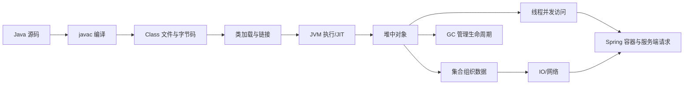
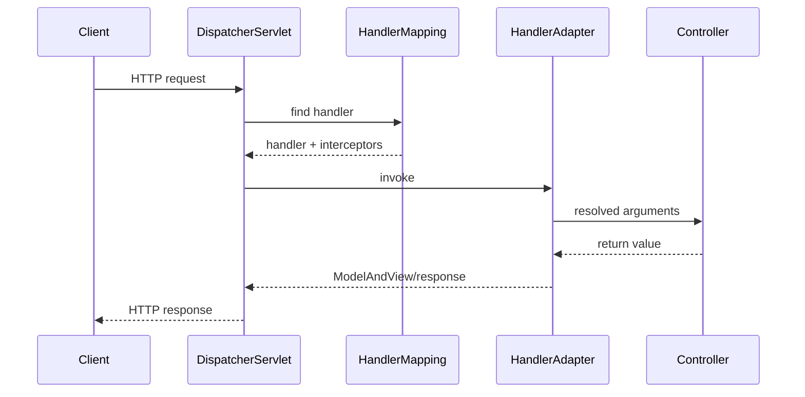

# Java 学习笔记：从语言、并发与 JVM 到 Spring 服务端

> 以 JDK 8 为讲解基线，沿“源码如何成为 JVM 中的对象与行为 → 多线程如何安全协作 → 数据如何进出进程 → Spring 如何组织服务端应用”的顺序展开。正文兼顾独立学习与面试复习，并在相关位置标注 Java 9—21 的重要变化。

## 参考资料

### Java 规范与官方资料

1. [Java Language Specification, Java SE 8](https://docs.oracle.com/javase/specs/jls/se8/html/)
2. [Java Virtual Machine Specification, Java SE 8](https://docs.oracle.com/javase/specs/jvms/se8/html/)
3. [Java SE 8 API](https://docs.oracle.com/javase/8/docs/api/)
4. [Java SE 21 文档](https://docs.oracle.com/en/java/javase/21/)
5. [JDK 21 特性清单](https://openjdk.org/projects/jdk/21/)
6. [Oracle Java 21 GC Tuning Guide](https://docs.oracle.com/en/java/javase/21/gctuning/)
7. [JEP 400：UTF-8 by Default](https://openjdk.org/jeps/400)
8. [JEP 421：Deprecate Finalization for Removal](https://openjdk.org/jeps/421)
9. [JEP 444：Virtual Threads](https://openjdk.org/jeps/444)

### 框架与补充资料

1. [Spring Framework 5.3 Reference](https://docs.spring.io/spring-framework/docs/5.3.x/reference/html/)
2. [Spring Boot 2.7 Reference](https://docs.spring.io/spring-boot/docs/2.7.x/reference/html/)
3. [Spring Framework 6 Overview](https://docs.spring.io/spring-framework/reference/overview.html)
4. [MyBatis 3 Documentation](https://mybatis.org/mybatis-3/)
5. [CS-Notes Java 系列](https://github.com/CyC2018/CS-Notes)

## 0. 知识地图：Java 程序到底怎样运行

Java 学习最容易陷入 API 清单。真正需要建立的是一条贯穿语言、运行时和框架的因果链。



全文反复回答六个问题：

1. 一个值是按值存在，还是通过引用找到对象？
2. 对象的身份、状态、类型和生命周期分别由什么决定？
3. 集合如何维持自己的结构不变量？
4. 多线程之间凭什么看到彼此的写入？
5. JVM 如何加载、执行、优化并回收代码和对象？
6. Spring 如何通过元数据、容器和代理把普通对象组织成应用？

### 0.1 JDK、JRE、JVM 和 HotSpot

JVM 是执行 Class 文件的抽象机器规范。HotSpot 是 OpenJDK/Oracle JDK 中最常见的 JVM 实现。

JRE 传统上表示运行 Java 程序所需的 JVM 和类库。JDK 在此基础上增加编译、诊断和开发工具。

JDK 8 目录中常能看到独立 JRE；JDK 9 模块化之后，发行形态发生变化，不能把旧目录结构当成永恒定义。

Java SE 定义语言、JVM 和标准库平台。Spring、MyBatis 属于建立在 Java SE 之上的第三方框架。

### 0.2 编译一次，到处运行的边界

`javac` 把源码编译为面向 JVM 指令集的 Class 文件，而不是直接生成特定 CPU 的机器码。

不同平台只要提供兼容 JVM，就能执行同一份字节码。这是可移植性的基础。

可移植不代表所有行为完全相同。文件路径、默认字符集、时区、本地库、操作系统调度和 JVM 实现都可能造成差异。

### 0.3 统一示例领域

全文的代码例子围绕 User、Order、Product、Inventory 和 OrderService。

UserId、OrderId 等值对象用于讲相等性和不可变 key；Order 用于讲状态不变量；Inventory 用于讲并发扣减。

Repository 用于讲泛型与 MyBatis，OrderService 用于讲 Spring 注入、代理和事务，Controller 用于讲 MVC 请求边界。

统一模型能让语言规则逐步进入集合、并发和框架，而不是每节重新发明无关 Cat/Dog 类。

### 0.4 编译运行全链路

```text
OrderService.java
    │ javac：词法/语法/类型检查、注解处理、生成字节码
    ▼
OrderService.class
    │ ClassLoader：加载、验证、准备、解析、初始化
    ▼
解释器执行字节码 ──热点统计──> JIT 编译机器码
    │                              │
    ├── 在堆/TLAB 分配对象         ├── 内联、逃逸分析
    ├── 在 Java 栈建立栈帧         └── 去优化与重编译
    ├── 经集合保存引用
    ├── 经锁/JMM 在线程间共享
    └── 经 IO/JDBC 跨越进程边界
```

Spring 位于源码和运行时对象之上：读取类与配置元数据，建立 BeanDefinition，再创建/代理这些普通对象。

### 0.5 编译期、加载期与运行期

泛型类型检查和重载选择主要在编译期；类验证、符号解析和初始化发生在加载/链接过程；虚方法分派、反射和代理调用发生在运行期。

很多面试混淆来自把阶段混在一起。例如“泛型被擦除”不等于编译器不检查类型，“注解存在”不等于运行时必然执行逻辑。

定位错误时先问它是编译错误、链接错误、初始化错误还是业务运行异常。

### 0.6 JDK 8 与 Java 21 版本地图

| 范围 | 本文定位 | 代表内容 |
| --- | --- | --- |
| JDK 8 | 主线基线 | Lambda、Stream、java.time、Metaspace、CHM 8、CMS/G1 |
| Java 9–11 | 迁移基础 | 模块、接口私有方法、var、HTTP Client、G1 默认 |
| Java 12–17 | 语言演进 | switch 表达式、文本块、record、sealed、模式匹配 |
| Java 18–21 | 现代差异 | UTF-8 默认、虚拟线程、record pattern、Generational ZGC |

正文示例默认能在 JDK 8 编译；出现后续语法时标题或代码前明确最低版本。

### 0.7 Spring 版本地图

Spring Framework 5.3 与 Spring Boot 2.7 是本文 JDK 8 框架基线，Servlet 等使用 `javax.*`。

Spring Framework 6 与 Boot 3 要求 Java 17+，并迁移 Jakarta EE 9+ 的 `jakarta.*`。

MyBatis 3 核心调用链相对稳定，但具体配置项、默认和 Spring 集成版本仍需按依赖组合核验。

### 0.8 学习方法

语言和集合章节要运行小代码并预测输出；并发章节要画线程时间线与 happens-before；JVM 章节要结合 javap、日志和内存图。

框架章节不要只记注解，要沿 BeanDefinition、代理、DispatcherServlet 和 MapperProxy 调用链阅读。

每轮复习先尝试不看答案画主路径，再用正文补遗漏。

### 0.9 面试与工程的关系

面试问题是知识入口，不是最终结构。`HashMap` 阈值、CMS 阶段、Bean 生命周期只有放回设计目标才容易长期记住。

工程实践又不能只讲“最佳实践”而不说明适用条件。线程数、GC、缓存、事务传播都需要负载和失败语义。

本文先解释机制，再给面试表达和工程边界。

## 1. Java 类型系统与对象模型

### 1.1 八种基本类型

Java 有 `byte`、`short`、`int`、`long`、`char`、`float`、`double`、`boolean` 八种基本类型。

| 类型 | 语义 | 位数 |
| --- | --- | ---: |
| byte | 有符号整数 | 8 |
| short | 有符号整数 | 16 |
| int | 有符号整数 | 32 |
| long | 有符号整数 | 64 |
| char | UTF-16 code unit | 16 |
| float | IEEE 754 单精度 | 32 |
| double | IEEE 754 双精度 | 64 |
| boolean | true/false | 存储大小未由 JLS 固定 |

`char` 不等于完整 Unicode 字符。辅助平面字符需要一对 surrogate，因此一个用户感知字符可能占两个 `char`。

字段有默认值，局部变量没有自动可用的默认值；编译器会执行 definite assignment 检查。

### 1.2 数值提升与溢出

`byte`、`short`、`char` 参与多数算术运算时会提升为 `int`。

```java
byte a = 100;
byte b = 20;
// byte c = a + b; // a + b 的类型是 int
int c = a + b;
```

整数溢出按固定位宽截断，不自动抛异常。

```java
int max = Integer.MAX_VALUE;
System.out.println(max + 1); // -2147483648
```

需要检测溢出时可使用 `Math.addExact` 等方法。

浮点数不能精确表示所有十进制小数。金额应优先用最小货币单位整数或 `BigDecimal`。

```java
System.out.println(0.1 + 0.2); // 通常不是精确的 0.3
```

### 1.3 包装类型与自动装箱

泛型只能使用引用类型，因此基本类型对应 `Integer`、`Long` 等包装类。

```java
Integer boxed = 42; // Integer.valueOf(42)
int raw = boxed;    // boxed.intValue()
```

拆箱 `null` 会抛出 `NullPointerException`。

```java
Integer value = null;
// int n = value;
```

JLS 要求部分小值装箱具有相同身份；HotSpot 的 `Integer` 默认缓存至少覆盖 `-128` 到 `127`。

```java
Integer x = 127;
Integer y = 127;
System.out.println(x == y);      // true（不要依赖它比较数值）
System.out.println(x.equals(y)); // true
```

业务代码比较包装值应使用 `equals` 或先安全拆箱，不应依赖缓存身份。

### 1.4 引用不是对象本身

变量 `User user` 保存的是引用值，实际对象由 JVM 管理。

两个引用可以指向同一个对象；修改对象状态会从两个引用处观察到。

```java
User a = new User("Alice");
User b = a;
b.setName("Bob");
System.out.println(a.getName()); // Bob
```

`==` 对引用比较身份，`equals` 按类定义比较逻辑相等性。

### 1.5 Java 只有值传递

调用方法时，实参值被复制给形参。对象参数复制的是引用值。

```java
static void rename(User user) {
    user.setName("Bob"); // 通过引用副本修改同一个对象
}

static void replace(User user) {
    user = new User("Carol"); // 只修改局部引用副本
}
```

这个模型同时解释“方法能改字段，却不能替换调用方变量”。

### 1.6 String 与不可变性

`String` 的公开语义不可变：构造完成后，其字符序列不会改变。

不可变性允许共享字符串常量、缓存哈希值、安全地作为 Map key，并天然避免内部状态竞态。

JDK 8 的 HotSpot `String` 主要使用 `char[]`；Java 9 的 Compact Strings 改为 `byte[]` 加编码标记。这是实现差异，不改变不可变语义。

字符串字面量进入字符串池，相同字面量通常共享对象。

```java
String a = "java";
String b = "java";
String c = new String("java");
System.out.println(a == b);      // true
System.out.println(a == c);      // false
System.out.println(a.equals(c)); // true
```

“`new String("abc")` 创建几个对象”必须带前提：字面量是否已解析、字符串池是否已有对象，以及讨论的是运行时本次表达式还是类加载全过程。

循环拼接优先用 `StringBuilder`。`StringBuffer` 的方法同步，但多个操作组合仍需调用方保证原子性。

### 1.7 equals 与 hashCode 契约

`equals` 应满足自反、对称、传递、一致，并对 null 返回 false。

只要两个对象 `equals` 相等，它们的 `hashCode` 必须相等；反向不成立。

```java
final class UserId {
    private final long value;

    UserId(long value) { this.value = value; }

    @Override
    public boolean equals(Object other) {
        if (this == other) return true;
        if (!(other instanceof UserId)) return false;
        UserId that = (UserId) other;
        return value == that.value;
    }

    @Override
    public int hashCode() {
        return Long.hashCode(value);
    }
}
```

作为 HashMap key 的字段最好不可变。插入后改变参与哈希的字段，会让对象留在旧桶中而难以查回。

### 1.8 final、不可变对象与安全发布

`final` 基本变量不能再次赋值；`final` 引用不能改指向，但被引用对象仍可能可变。

不可变类通常需要私有 final 字段、不暴露可变内部对象、构造时防御性复制，并限制可破坏不变量的继承。

JMM 对正确构造的 final 字段提供特殊可见性保证，但构造期间让 `this` 逸出会破坏安全性。

### 1.9 static 与初始化顺序

static 成员属于类，不依赖某个实例。类初始化会执行静态字段初始化器和 `static` 块。

首次主动使用一个类时，JVM 在初始化子类之前先初始化父类。

创建实例时，先完成父类实例初始化和构造，再执行子类部分。

不要在构造器中调用可被子类重写的方法；此时子类字段可能尚未初始化。

### 1.10 继承、多态与动态绑定

父类型引用可以指向子类对象。实例方法调用根据运行时对象类型动态分派。

字段、static 方法和构造器不参与同样的动态绑定规则。

重载在编译期按声明类型和参数列表选择；重写在运行期按实际对象选择实现。

优先组合而非继承，是为了减少子类对父类内部实现的脆弱依赖，而不是禁止合理的 is-a 层次。

### 1.11 抽象类与接口

抽象类可保存实例状态和部分实现，适合表达共享骨架。接口定义能力契约，类可实现多个接口。

JDK 8 接口支持 default 和 static 方法。default 方法用于接口演进，但冲突时需要遵循类优先和显式消歧规则。

函数式接口只有一个抽象方法，可作为 Lambda 的目标类型。

### 1.12 枚举

Java enum 是受限制实例集合的类，不是简单整数常量。

枚举可以拥有字段、方法、构造器并实现接口。

比较枚举可安全使用 `==`。序列化或持久化时通常保存稳定名字，但重命名仍会造成兼容问题。

### 1.13 内部类

非静态成员内部类隐式持有外部类实例引用。静态嵌套类不持有该引用。

长生命周期内部类对象可能意外延长外部对象生命周期，因此不需要外部状态时优先静态嵌套类。

匿名内部类和 Lambda 都能传递行为，但 Lambda 的 `this` 指向词法外层，匿名类的 `this` 指向匿名对象。

### 1.14 异常体系

`Throwable` 下主要有 `Error` 与 `Exception`。

受检异常必须捕获或声明；`RuntimeException` 及其子类是非受检异常。

异常用于异常控制流，不应用作正常循环条件。

捕获时从具体到宽泛，保留 cause，避免空 catch。

```java
try {
    repository.save(order);
} catch (SQLException ex) {
    throw new OrderStoreException("save order " + order.getId(), ex);
}
```

try-with-resources 按资源声明的逆序关闭资源。关闭异常会作为 suppressed exception 保留。

### 1.15 反射与注解

反射允许在运行时检查类、字段、方法和构造器，并动态调用。

框架用反射读取元数据、实例化对象和执行依赖注入，但反射会削弱编译期检查和封装，应集中在基础设施边界。

注解本身不执行逻辑。Retention 决定保留到源码、Class 文件还是运行时，Target 决定可标注位置。

Spring 读取注解后建立 BeanDefinition、切点或请求映射，真正行为来自框架处理器。

### 1.16 泛型与类型擦除

泛型在编译期提供参数化类型检查。Java 主要通过擦除实现，`List<String>` 与 `List<Integer>` 通常共享同一个运行时原始类。

擦除后编译器插入必要强制转换，并可能生成桥接方法保持多态。

不能直接 `new T()` 或 `new List<String>[10]`，因为运行时缺少所需的具体类型信息且数组具有协变运行时检查。

PECS：生产 T 的结构用 `? extends T`，消费 T 的结构用 `? super T`。

```java
static <T> void copy(List<? extends T> src, List<? super T> dst) {
    for (T value : src) dst.add(value);
}
```

### 1.17 Lambda、Stream 与 Optional

Lambda 是函数式接口实例的简洁表达，不等于把 Java 变成动态类型语言。

Stream 描述惰性的处理流水线；终止操作触发执行。流不能重复消费。

```java
List<String> names = users.stream()
        .filter(User::isActive)
        .map(User::getName)
        .sorted()
        .collect(Collectors.toList());
```

避免在并行流中修改共享可变状态。是否并行应由数据规模、拆分成本和线程池环境决定。

Optional 适合表达可能缺少的返回值，不宜无差别用作实体字段和方法参数。

### 1.18 日期时间 API

JDK 8 的 `java.time` 类型不可变且线程安全。

`Instant` 表示 UTC 时间线上的瞬间，`LocalDateTime` 不带时区，`ZonedDateTime` 带时区规则。

持久化和跨系统传输前必须明确保存的是瞬间、当地日历时间还是持续时间。

### 1.19 访问控制与封装边界

`private` 只允许当前顶级类及其嵌套关系访问，包访问允许同包访问，`protected` 同时服务同包和跨包子类，`public` 面向所有可见调用者。

跨包子类访问 `protected` 成员时还受到接收者类型限制，不能简单理解成“子类可访问任何父类对象的 protected 字段”。

封装的目标不是为每个字段机械生成 getter/setter，而是让对象自己维护不变量。

例如订单状态不应暴露任意 `setStatus`，而应提供 `pay()`、`cancel()` 等带合法迁移检查的行为。

```java
public final class Order {
    private OrderStatus status = OrderStatus.CREATED;

    public void pay() {
        if (status != OrderStatus.CREATED) {
            throw new IllegalStateException("only created order can be paid");
        }
        status = OrderStatus.PAID;
    }
}
```

### 1.20 构造器与对象不变量

构造器应在对象对外可见前建立全部必需不变量。

参数检查应尽早失败，避免创建“半合法对象”再依赖调用者补字段。

构造器不会被继承，但子类构造器第一步必须显式或隐式调用父类构造器。

父类构造期间调用可重写方法会动态分派到尚未初始化完成的子类，容易读到零值。

工厂方法可返回缓存、子类型或失败结果，并用名字表达创建意图；构造器则直接保证新实例。

### 1.21 可变对象的防御性复制

即使字段是 `final`，若它引用可变集合，调用方仍可能从外部修改对象状态。

```java
public final class OrderSnapshot {
    private final List<String> items;

    public OrderSnapshot(List<String> items) {
        this.items = new ArrayList<>(items);
    }

    public List<String> getItems() {
        return Collections.unmodifiableList(items);
    }
}
```

构造时复制阻断输入别名，返回不可修改视图阻止常规写入；若元素本身可变，还要考虑深复制或不可变元素。

### 1.22 clone 为什么难用

`Object.clone` 做字段级浅复制，数组很好用，但普通类会遇到 Cloneable 标记、受检异常、构造器绕过和深浅复制语义不清等问题。

复制构造器或静态工厂通常更显式：它们能选择字段、执行校验并决定深复制边界。

### 1.23 Comparable 与 Comparator

Comparable 把自然顺序放进类型，Comparator 把特定排序策略放在外部。

比较器不能用 `a - b` 比较大整数，因为减法可能溢出；使用 `Integer.compare(a, b)`。

```java
Comparator<Order> byAmountThenId =
        Comparator.comparing(Order::getAmount)
                  .thenComparingLong(Order::getId);
```

比较关系应稳定且传递。TreeMap/TreeSet 用 compare 为零判断排序键等价，可能与 equals 不一致。

### 1.24 异常设计

异常类型应表达调用者能否恢复，而不是按“底层来自哪一层”机械传播。

例如 Repository 可把 SQLException 转成领域持久化异常，同时保留 cause，避免上层依赖 JDBC。

异常消息应包含操作和关键标识，但不得泄漏密码、Token 或完整敏感数据。

finally 中 return 会覆盖正常返回或异常，必须避免。

### 1.25 多异常与 suppressed exception

一个 try 可捕获多个无继承关系的异常：`catch (IOException | SQLException ex)`。

try-with-resources 中主体异常是主异常，关闭失败通过 `getSuppressed()` 附加，因此诊断时不要只看 cause。

### 1.26 自定义注解处理流程

运行时注解处理通常先定义注解，再通过反射定位元素，读取注解属性并执行规则。

编译期注解处理器则在 javac 阶段生成代码或资源，不需要运行时反射。

Spring 注解多数是配置元数据；代理、后处理器或 MVC 基础设施才实现真实行为。

### 1.27 反射的类型入口

获得 Class 的常见方式有 `User.class`、`object.getClass()` 与 `Class.forName()`。

`Class.forName` 默认会触发初始化；ClassLoader.loadClass 通常只加载，不应混用它们解释初始化副作用。

反射调用会包装目标异常为 InvocationTargetException，真正原因在 `getCause()`。

### 1.28 泛型不变性

`List<Integer>` 不是 `List<Number>` 的子类型，否则向后者添加 Double 会污染前者。

通配符表达使用方视角：`List<? extends Number>` 可安全读取 Number，但不能添加具体非 null 元素；`List<? super Integer>` 可添加 Integer，读取只能当 Object。

### 1.29 泛型方法与类型推断

泛型方法在返回类型前声明类型参数：

```java
static <T> T first(List<T> values) {
    if (values.isEmpty()) throw new NoSuchElementException();
    return values.get(0);
}
```

类型推断根据实参、目标类型和边界求解；推断失败时可调整 API，而不是到处强制转换。

### 1.30 反射中的泛型

擦除不表示所有泛型信息完全消失。字段、方法签名等元数据可通过 ParameterizedType 读取声明泛型。

运行时对象通常不知道自己来自 `new ArrayList<String>()` 的 String 参数，因此框架常需要显式 TypeToken 或方法签名上下文。

### 1.31 Lambda 捕获

Lambda 可捕获 final 或 effectively final 局部变量，因为捕获的是值，不是可变局部槽位别名。

捕获对象引用不让对象不可变；仍可修改其字段，只是不能给局部引用重新赋值。

成员字段不受 effectively final 限制，因为 Lambda 可通过 this 在对象上访问它们。

### 1.32 方法引用

`Type::staticMethod`、`object::instanceMethod`、`Type::instanceMethod` 和 `Type::new` 都需要由目标函数式接口确定参数映射。

方法引用只是 Lambda 的更简洁写法，若降低可读性就保留显式 Lambda。

### 1.33 Stream 惰性

filter/map 等中间操作构建流水线，collect/reduce/forEach 等终止操作触发遍历。

短路操作如 anyMatch、findFirst、limit 可以少处理元素，但前置 sorted 可能需要看到全部输入。

流强调一次消费；需要重复处理应重新从源创建流。

### 1.34 reduce 与 collect

reduce 适合把不可变值结合成一个值；collect 适合可变结果容器。

并行归约要求结合操作满足结合律，并且 identity 真正是单位元，否则串行看似正确、并行结果错误。

### 1.35 并行流边界

parallelStream 默认使用 common ForkJoinPool，与其他公共池任务共享资源。

小集合、阻塞 IO、有顺序副作用或昂贵合并时并行流可能更慢。

性能判断应使用代表性数据和 JMH，不凭“多核一定快”。

### 1.36 Optional 的正确边界

Optional 的价值是迫使调用方显式处理缺失结果。

`orElse` 会立即计算备用值，`orElseGet` 只在缺失时调用 Supplier。

不要调用 `optional.get()` 再把它当 null 检查的替代；使用 map、flatMap、orElseThrow 等表达流程。

### 1.37 日期、时刻与时区例题

`2025-01-01 09:00` 没有时区时只是 LocalDateTime，无法唯一转换为 Instant。

附加 `Asia/Shanghai` 后才能根据该日期的区域规则得到 UTC 瞬间。

跨系统事件通常存 Instant，展示时再按用户 ZoneId 转换；生日等日历事实则可能只需要 LocalDate。

### 1.38 正则表达式与字符串边界

Java 字符串转义和正则转义是两层语法。例如匹配一个反斜杠，源码往往需要写 `"\\\\"`。

重复编译热路径正则会增加成本，可复用 Pattern；但不要把用户提供的复杂正则直接用于无界大文本，避免灾难性回溯。

### 1.39 BigDecimal

用 `new BigDecimal("0.1")` 或 `BigDecimal.valueOf(0.1)`，避免直接用二进制 double 构造带来意外小数。

`equals` 同时比较数值与 scale，`compareTo` 比较数值，因此 `1.0` 和 `1.00` compare 为零但 equals 不等。

除法无法有限表示时必须指定精度或舍入模式。

### 1.40 语言章节小结

类型系统约束哪些值能出现，对象封装约束状态怎样变化，异常与泛型约束失败和复用边界，Lambda/Stream 约束行为怎样组合。

后面的集合与并发并没有离开这些规则：集合依赖 equals、hashCode、Comparator；并发依赖对象是否可变以及怎样安全发布。

### 1.41 Object 通用方法

Object 提供 getClass、equals、hashCode、toString、clone、finalize 以及 wait/notify 等基础方法。

getClass 返回运行时类，不能被重写；`obj.getClass() == User.class` 不接受子类，而 `instanceof` 接受兼容子类型。

toString 应提供调试价值但避免输出密码、Token 和巨大对象图。

### 1.42 equals 的继承难题

可实例化父类与增加值字段的子类很难同时维持 equals 的对称性与传递性。

父类按 `instanceof` 比较可能认为父子相等，子类又需要比较新增字段，从而不对称。

值类型优先 final 或使用组合；若允许继承，应明确相等策略。

### 1.43 hashCode 分布

合法 hashCode 只要求 equals 相等时相同，但性能还依赖分布。

总返回常量在语义上可正确，却把 HashMap 退化到单桶。

组合字段可使用 31 乘法、`Objects.hash` 或类型专用实现，同时只包含 equals 使用的字段。

### 1.44 toString 与日志

字符串拼接日志参数会在日志级别关闭时仍构造字符串；参数化日志可延迟格式化。

toString 可能被调试器、异常和日志隐式调用，不应执行数据库查询或修改状态。

双向对象图自动 toString 可能无限递归。

### 1.45 浅复制与深复制

浅复制复制字段值，因此引用字段仍指向同一内部对象。

深复制要定义对象图边界、共享节点和循环引用，并非“递归 clone 所有字段”就正确。

序列化复制成本高且有安全/兼容问题，不应作为通用深复制技巧。

### 1.46 静态分派例题

重载方法 `print(Object)` 与 `print(String)`，变量声明为 Object、实际指向 String 时，编译器选择 `print(Object)`。

若两个方法是父子类重写同一签名，运行时才选择子类实现。

“重载看左边，重写看右边”只能作记忆，准确说法是编译期签名选择与运行期虚分派。

### 1.47 协变返回类型

子类重写方法可返回父方法返回类型的子类型，称协变返回。

参数列表不能随意变窄，否则是重载而非重写。

受检异常也不能比父方法声明更宽，保证父类型调用者契约成立。

### 1.48 super

`super.method()` 显式选择父类实现，常用于在重写逻辑前后复用父行为。

构造器第一条必须调用 this(...) 或 super(...)，最终链到父类构造。

super 不是可保存/传递的普通对象引用。

### 1.49 default 方法冲突

类方法优先于接口 default；更具体子接口优先于父接口。

两个无继承关系接口提供同签名 default 时，实现类必须重写并可用 `InterfaceA.super.method()` 消歧。

default 主要解决接口演进，不适合塞入大量共享可变逻辑。

### 1.50 可变参数

`void f(String... values)` 编译为数组参数，调用方可传零个、多个值或一个 String[]。

可变参数必须最后一个，且与重载、null 调用结合时可能歧义。

泛型可变参数可能产生 heap pollution，`@SafeVarargs` 只能在实现确实安全时使用。

### 1.51 注解继承

`@Inherited` 只影响类上的注解通过父类继承，不自动作用于接口、方法或字段。

框架常实现自己的合并注解查找，行为可能超出 Java 反射原生规则。

阅读 Spring 注解时需区分 JLS/反射语义与框架组合注解语义。

### 1.52 动态代理与反射

JDK Proxy 的 InvocationHandler 接收 Method，再通过反射或 MethodHandle 调目标。

代理类在运行时生成并实现指定接口，其 ClassLoader 必须能看到所有接口。

异常若未按接口 throws 契约处理，可能被包装为 UndeclaredThrowableException。

### 1.53 Class 对象与基本类型

`int.class`、`Integer.TYPE` 指向基本类型 Class；它们不同于 Integer.class。

数组类型也有 Class，例如 String[].class，其名字和组件类型可通过反射获得。

泛型参数不是普通 Class，因此框架用 Type、ParameterizedType 等表达。

### 1.54 反射访问检查

反射默认遵守语言访问检查，setAccessible 在 JDK 8 可尝试抑制检查。

模块强封装之后，跨模块深反射可能被拒绝，需要 opens 或迁移 API。

安全管理、模块与运行参数使“反射能访问任何 private”成为不准确绝对说法。

### 1.55 泛型 bridge method

父类泛型方法擦除后签名可能与子类具体方法不同，编译器生成 synthetic bridge 维持重写多态。

反射列方法时可能同时看到业务方法和 bridge method。

框架解析注解/泛型时需找到桥接方法对应的原始声明。

### 1.56 原始类型

`List` raw type 为兼容泛型前代码保留，会绕过部分类型检查并产生 unchecked warning。

值可被错误放入，直到读取处发生 ClassCastException，错误位置被推迟。

新代码不要用 raw type 消除编译错误，应修复类型模型。

### 1.57 类型令牌

只传 `Class<List<String>>` 无法表达参数化 List，因为不存在该 Class 对象。

框架可通过匿名子类捕获 `new TypeReference<List<String>>() {}` 的泛型父类签名。

类型令牌依赖声明元数据，不是恢复任意运行时对象已擦除的信息。

### 1.58 Stream 副作用

peek 主要用于调试流水线，不应承担必须执行的业务副作用，因为惰性和短路可能使元素未经过。

forEach 在并行流中不保证遇到顺序，forEachOrdered 保序但可能降低并行收益。

收集结果优先使用 Collector，而不是向外部 ArrayList add。

### 1.59 Collector

Collector 定义 supplier、accumulator、combiner、finisher 和 characteristics。

并行安全要求各分区独立容器或 CONCURRENT 语义，combiner 能正确合并。

`groupingBy`、`partitioningBy`、`mapping` 和 `collectingAndThen` 可组合统计。

### 1.60 浮点比较

浮点计算存在舍入，直接 `a == b` 只适用于确切位模式预期。

科学计算可按绝对/相对误差比较，业务金额用 BigDecimal/整数。

NaN 与任何值包括自身用 `==` 都为 false，排序应使用 Double.compare。

### 1.61 整数除法

两个 int 相除先做整数除法，再赋给 double 也已经丢失小数：`double x = 1 / 2` 得 0.0。

至少一个操作数先转 double：`1.0 / 2`。

除以零对整数抛 ArithmeticException，对浮点按 IEEE 754 得 Infinity/NaN。

### 1.62 switch 边界

JDK 8 switch 支持 byte/short/char/int、对应包装、enum 和 String，不支持 long/float/double。

传统 case 会 fall-through，除非 break/return/throw。

String switch 由编译器借 hashCode 与 equals 实现，语义仍按字符串相等。

### 1.63 序列化与单例

Serializable 对象反序列化绕过普通构造器，可能创建第二个单例实例。

readResolve 可返回规范实例，但枚举单例更自然抵抗普通序列化重复身份。

这不解决不可信反序列化安全问题。

### 1.64 语言章节复习题

1. 字段默认值与局部变量 definite assignment 有何区别？
2. char 为什么不总等于一个用户可见字符？
3. 自动拆箱在哪些场景会触发 NPE？
4. equals 继承为何容易破坏对称性？
5. `? extends T` 为什么不能安全 add？
6. parallel reduce 对结合律有什么要求？
7. Class、Type 与 ParameterizedType 各表达什么？
8. try-with-resources 如何保留关闭异常？

## 2. 集合：用不变量组织对象

### 2.1 Collection 与 Map

Collection 表示元素集合，Map 表示 key 到 value 的映射。

选择集合先回答：是否重复、是否有序、如何查找、是否需要范围查询、是否并发以及读写比例。

### 2.2 ArrayList

ArrayList 用连续对象引用数组存储元素，按下标访问是 O(1)。

容量不足时分配更大数组并复制引用。`size` 是元素数量，capacity 是底层数组容量。

在中间插入或删除需要移动后续引用，复杂度通常为 O(n)。

末尾追加的摊还复杂度是 O(1)，但某次扩容仍可能昂贵。

按预估大小初始化容量能减少扩容，但过大容量会浪费内存。

### 2.3 LinkedList 与 ArrayDeque

LinkedList 是双向链表，同时实现 List 和 Deque。已获得节点后插入删除是 O(1)，按下标寻找节点仍是 O(n)。

ArrayDeque 使用循环数组，通常比 LinkedList 更适合栈和队列，且不允许 null，能避免 null 与“队列为空”语义冲突。

遗留 Stack 继承 Vector，API 设计和同步成本不理想，新代码优先 Deque。

### 2.4 Set

HashSet 基于 HashMap 的 key，适合一般去重。

LinkedHashSet 额外维护顺序链表，保留插入顺序。

TreeSet 基于有序树，支持排序和范围操作，通常为 O(log n)。

TreeSet 的 comparator 必须与相等语义协调，否则 compare 为 0 的两个不同对象会被视为同一排序键。

### 2.5 HashMap 的核心不变量

JDK 8 HashMap 使用桶数组，桶中是链表或红黑树。

哈希值经过扰动，使高位也影响低位索引。容量为 2 的幂时，索引可用 `(n - 1) & hash` 计算。

put 路径是：计算 hash、定位桶、检查相等 key、追加节点或插入树、必要时扩容。

key 相等判断需要 hash 相同且 `equals` 相等。

默认负载因子 0.75 是空间与冲突概率的折中，不是所有业务的最优常数。

链表长度达到树化阈值时还要检查表容量；容量太小时优先扩容而非树化。

红黑树只改善严重冲突桶的最坏查找成本，不能修复低质量或恶意可变 key 设计。

### 2.6 HashMap 扩容与 JDK 7/8 差异

扩容把容量扩大为两倍。JDK 8 利用新增的一个掩码位，把旧桶节点分为原索引组和 `oldIndex + oldCapacity` 组。

JDK 7 多线程并发 resize 曾可能破坏链表结构；JDK 8 改变迁移方式也不代表 HashMap 变得线程安全。

并发写使用 ConcurrentHashMap 或外部同步。

### 2.7 LinkedHashMap 与 LRU

LinkedHashMap 在哈希结构之外维护双向链表，可按插入顺序或访问顺序排列。

访问顺序配合 `removeEldestEntry` 能实现简单的进程内 LRU 缓存。

它仍非线程安全，也没有自动处理缓存击穿、过期和分布式一致性。

### 2.8 TreeMap 与比较器

TreeMap 使用红黑树，按自然顺序或 Comparator 排列 key。

比较器必须满足稳定、反对称和传递等要求。比较结果在 key 存活期间变化会破坏树结构语义。

### 2.9 PriorityQueue

PriorityQueue 通常用二叉堆维护队头最小或最大元素。

查看队头 O(1)，插入和删除队头 O(log n)，遍历顺序不是全局排序顺序。

需要得到完整有序结果时应反复 poll 或另行排序。

### 2.10 Iterator 与 fail-fast

许多非并发集合用 `modCount` 检测遍历期间的结构修改，并尽力抛出 ConcurrentModificationException。

fail-fast 是错误检测机制，不是并发安全保证，也不承诺在所有竞态下必然抛异常。

遍历中删除当前元素应使用 Iterator.remove，或使用集合提供的批量方法。

### 2.11 CopyOnWriteArrayList

写操作复制整个底层数组，再发布新快照。读操作无需对数组内容加锁，迭代器看到稳定快照。

它适合元素不多、读远多于写且允许读取旧快照的场景。

大数组或频繁写入会产生复制、分配和 GC 压力。

### 2.12 ConcurrentHashMap

JDK 7 使用 Segment 分段结构；JDK 8 改为桶数组、CAS、synchronized 桶头以及协作扩容。

读通常不锁整个 Map，写竞争集中在相关桶或初始化/扩容状态。

复合逻辑不要写成“先 containsKey 再 put”；使用 `putIfAbsent`、`compute` 或 `merge` 表达原子意图。

ConcurrentHashMap 不允许 null key/value，因为并发读取 null 无法区分“不存在”与“映射到 null”。

### 2.13 BlockingQueue

BlockingQueue 把“队列为空/已满时等待”封装进 API，是生产者消费者和线程池的重要基础。

`put/take` 阻塞，`offer/poll` 可立即返回或带超时。应根据背压语义选择，而不是吞掉失败。

无界队列只是没有较小的业务上限，仍受内存限制；生产速度持续高于消费速度最终会造成 OOM。

### 2.14 集合复杂度不能只背 Big-O

ArrayList 下标访问 O(1) 仍会受缓存未命中影响，LinkedList 插入 O(1) 前提是已经持有节点位置。

HashMap 平均 O(1) 依赖合理哈希分布，TreeMap O(log n) 则提供稳定排序和范围能力。

Big-O 忽略常数、内存布局、对象分配和并发同步，选型要结合真实工作负载。

### 2.15 ArrayList 扩容推导

JDK 8 ArrayList 初次实际添加时才按需要建立数组，后续通常按约 1.5 倍增长。

增长不是语言契约，业务代码只应依赖 List 语义；源码学习用于理解复制成本和预估容量价值。

若已知将加入一百万个元素，提前指定容量可避免多次复制，但也要避免因过高估计长期占用巨大空数组。

### 2.16 remove 的重载陷阱

`List<Integer>.remove(1)` 调用 `remove(int index)`，不是删除值 1。

删除值应写 `remove(Integer.valueOf(1))`。

这是编译期重载选择与自动装箱交互的典型面试题。

### 2.17 subList 是视图

ArrayList.subList 通常返回原列表区间视图，不是独立复制。

对子列表的结构修改会影响原列表；原列表在视图外结构修改后再操作视图可能触发 ConcurrentModificationException。

需要独立列表时显式 `new ArrayList<>(list.subList(...))`。

### 2.18 HashMap hash 扰动

JDK 8 将原 hashCode 的高 16 位异或到低位，使容量较小时高位差异也参与桶索引。

```java
static final int hash(Object key) {
    int h;
    return key == null ? 0 : (h = key.hashCode()) ^ (h >>> 16);
}
```

这不是密码哈希，也不能抵抗所有恶意碰撞；它只改善常见 hashCode 分布到 2 的幂桶数组的效果。

### 2.19 HashMap put 路径

表未初始化时先 resize 建表；桶为空直接放节点；桶非空则依次判断首节点、树节点或链表。

找到相等 key 时替换 value，不增加 size；新增结构节点后才检查树化和总阈值。

modCount 记录结构变化，为 fail-fast 迭代器提供尽力检测。

### 2.20 树化条件

JDK 8 常见阈值是链表节点达到 8 时考虑树化，但 table 容量小于 64 时优先扩容。

原因是小表冲突常可通过增加桶数缓解，红黑树节点本身有更大空间与维护成本。

阈值属于 JDK 8 实现细节，不能写进依赖 HashMap 的业务契约。

### 2.21 扩容拆分例题

旧容量 16 时，key 的索引由低 4 位决定；扩到 32 后新增第 5 位。

若 `(hash & 16) == 0`，节点留在原索引；否则移动到 `原索引 + 16`。

因此 JDK 8 无需重新计算完整取模，也能保持每组链表的相对顺序。

### 2.22 红黑树桶

树节点还要维持桶链关系，便于遍历和 resize，不是把桶完全替换成独立 TreeMap。

当节点数量降低到阈值附近时可能退化回链表，避免小集合继续承担树结构成本。

### 2.23 null key

HashMap 允许一个 null key，并把其 hash 当 0；Hashtable 和 ConcurrentHashMap 不允许 null。

允许 null 是具体 Map 实现语义，不是 Map 接口统一保证。

API 设计中若 null 同时表示“缺少映射”和“映射值为空”，会增加歧义。

### 2.24 compute 系列

`computeIfAbsent` 可原子地按 key 建立值，适合并发 Map 中初始化计数器或集合。

映射函数不应递归修改同一 Map 的相关 key，也不应执行不可控长时间阻塞。

对 HashMap 使用 compute 仍不获得线程安全，原子性取决于具体实现。

### 2.25 WeakHashMap

WeakHashMap 用弱引用保存 key，当 key 没有其他强引用时条目可被清理。

value 若反向强引用 key，仍可能阻止预期回收。

GC 时机不确定，因此它不适合作为需要精确容量和过期时间的通用缓存。

### 2.26 EnumSet 与 EnumMap

EnumSet 可用位向量高效表示枚举集合，EnumMap 用枚举序号组织 value。

它们比通用 HashMap/HashSet 更紧凑且语义清晰，但 key 类型必须是单一 enum。

### 2.27 Collections 工具与不可修改视图

`Collections.unmodifiableList` 返回拒绝修改操作的视图，不复制底层数据。

若原列表仍被其他引用修改，视图会看到变化；需要快照应先复制再包装。

`synchronizedList` 让单个方法同步，迭代时仍需在返回的列表对象上手工同步。

### 2.28 并发集合的弱一致迭代

ConcurrentHashMap 迭代器不会像普通集合那样 fail-fast，可在并发修改时继续遍历。

结果反映遍历期间某种弱一致状态，可能看到部分更新，但不会构造损坏结构。

需要严格快照时必须建立额外同步或复制边界。

### 2.29 BlockingQueue 选型

ArrayBlockingQueue 有固定容量、数组布局和可选公平锁；LinkedBlockingQueue 可指定容量，默认上限非常大；SynchronousQueue 不存元素，生产者直接与消费者交接。

线程池选择队列会改变建线程、排队、内存和拒绝行为，不能孤立调一个 maximumPoolSize。

### 2.30 DelayQueue

DelayQueue 中元素实现 Delayed，只有延迟到期才能从队头取得。

它适合进程内延时调度，但不提供持久化、分布式容错或严格实时保证。

### 2.31 集合选型案例

订单按 ID 查找用 HashMap；按金额范围查找用 TreeMap 或数据库索引；按到达顺序消费用 Queue；按优先级消费用 PriorityQueue。

需要线程安全时还要问操作是否是单步、复合，是否允许快照旧数据，以及过载时如何背压。

### 2.32 集合章节小结

集合的关键不是类名，而是不变量：数组保持连续索引，哈希表保持 key 到桶的稳定映射，树保持排序与平衡，队列保持消费顺序与容量协议。

并发访问集合时，不变量必须在所有线程观察下仍成立，这正是下一章的主题。

### 2.33 Deque API

队头/队尾操作各有抛异常和返回特殊值两组：add/remove/get 与 offer/poll/peek。

有界队列满或空是正常控制流时，offer/poll 更适合；非法状态才用抛异常版本。

ArrayDeque 作为栈使用 push/pop/peek，避免 Stack 遗留设计。

### 2.34 PriorityQueue 比较边界

元素必须有自然顺序或提供 Comparator，且不允许 null。

修改已在堆中元素的排序字段不会自动重新堆化，可能让 poll 顺序错误。

应 remove 后修改再 add，或存不可变优先级节点。

### 2.35 TreeMap 范围视图

subMap、headMap、tailMap 返回与原树共享的范围视图。

通过视图修改会影响原 Map，超出范围的 put 会抛 IllegalArgumentException。

并发修改仍不安全，视图不是快照。

### 2.36 IdentityHashMap

IdentityHashMap 用 `==` 比 key，而不是 equals，适合对象图遍历、拓扑等身份语义。

它违反普通 Map 调用者对逻辑相等 key 的常见预期，不应用于一般业务映射。

名称中的 HashMap 不表示与 HashMap 有相同桶实现。

### 2.37 BitSet

BitSet 用位压缩非负整数集合，支持 and/or/xor、nextSetBit 等操作。

大量布尔标志比 `Set<Integer>` 更节省内存，但最大索引会决定内部 long[] 长度。

它非线程安全，也不保存元素对象。

### 2.38 Arrays.asList

它返回固定大小的数组视图，set 可修改底层数组，add/remove 抛 UnsupportedOperationException。

基本类型数组如 int[] 会被当成一个元素，因为泛型元素不能是 int。

需要独立可变列表时用 `new ArrayList<>(Arrays.asList(...))`。

### 2.39 List.sort 稳定性

对象列表排序要求稳定：比较相等元素保持原相对顺序，具体实现可用 TimSort 等。

稳定排序允许先按次要键排序再按主要键排序，但直接组合 Comparator 更清晰高效。

比较器违反契约可能抛异常或产生不可预测顺序。

### 2.40 HashSet 可变元素

HashSet 把元素作为 HashMap key，因此元素参与 equals/hashCode 的字段在集合期间应稳定。

修改后 remove 可能找不到它，集合内部却仍占一个节点。

这与 HashMap 可变 key 是同一不变量问题。

### 2.41 CopyOnWrite 迭代

迭代器保存创建时数组引用，不反映后续写入，也不支持 iterator.remove。

这种 snapshot iterator 避免 ConcurrentModificationException，但可能长时间保留旧大数组。

长迭代与频繁写结合会增加内存峰值。

### 2.42 ConcurrentSkipListMap

它提供并发有序 Map 和范围视图，操作期望 O(log n)。

相比锁住 TreeMap，它允许更高并发并提供弱一致迭代。

不需要顺序/范围时 ConcurrentHashMap 通常常数更小。

### 2.43 LinkedBlockingQueue 双锁

LinkedBlockingQueue 经典实现用 takeLock 与 putLock 分离队头消费和队尾生产，并用 AtomicInteger count 协调。

队列从空变非空需通知消费者，从满变非满需通知生产者。

像 size/clear 等全局操作可能同时取得两把锁。

### 2.44 ArrayBlockingQueue 单锁

ArrayBlockingQueue 用固定数组和一个 ReentrantLock，配 notEmpty/notFull 条件。

内存可预测、无节点分配，但生产消费竞争同一锁。

公平选项可降低插队但减少吞吐。

### 2.45 SynchronousQueue

它没有数据容量，每次 put 必须与 take 配对完成直接交接。

CachedThreadPool 使用它时，任务无法排队就倾向创建新线程，因此必须警惕无界线程增长。

公平/非公平模式可采用队列或栈式传递算法。

### 2.46 集合内存成本

LinkedList 每元素有节点对象和前后引用；HashMap 每条目有节点、key/value/hash/next；树节点字段更多。

百万级小元素时对象头和指针可能超过业务数据本身。

容量估算应使用目标 JVM 下测量，而不只乘字段大小。

### 2.47 集合复习题

1. 为什么 ArrayDeque 通常比 LinkedList 更适合队列？
2. HashMap 树化为什么还要求最小表容量？
3. subList 和 unmodifiableList 为什么都不是独立快照？
4. ConcurrentHashMap 为什么禁止 null？
5. SynchronousQueue 如何影响线程池扩容？
6. fail-fast 与弱一致迭代分别保证什么？

## 3. Java 并发：从线程到 happens-before

### 3.1 并发问题的本质

线程共享堆对象，却各自在 CPU、缓存、寄存器和编译器优化产生的执行环境中运行。

正确并发程序必须同时处理原子性、可见性、有序性和生命周期。

线程安全不是“用了一个并发类”就自动成立，而是所有共享不变量在允许的交错下仍成立。

### 3.2 线程状态

Java Thread.State 包括 NEW、RUNNABLE、BLOCKED、WAITING、TIMED_WAITING、TERMINATED。

Java 的 RUNNABLE 同时覆盖操作系统层面正在运行和可运行，不应与 OS 教材状态逐字对应。

BLOCKED 专指等待进入 synchronized monitor；等待 Lock、Condition 或 IO 可能呈现不同状态。

### 3.3 启动线程与提交任务

调用 `run()` 只是普通方法调用，调用 `start()` 才请求 JVM 创建新的执行路径。

业务代码优先把“任务”与“线程”分离，通过 Executor 提交 Runnable 或 Callable。

Callable 可返回结果并抛受检异常，Future 表示待完成结果。

### 3.4 中断

中断是协作式取消信号，不是强制杀死线程。

`interrupt()` 设置中断状态；某些阻塞方法响应中断时抛 InterruptedException 并清除状态。

不能处理 InterruptedException 时，通常恢复中断：`Thread.currentThread().interrupt()`，再退出或向上传播。

吞掉中断会让线程池关闭和任务取消失效。

### 3.5 线程池参数

ThreadPoolExecutor 的核心决策顺序是：未达 corePoolSize 时建核心线程；否则先入队；队列拒绝后尝试扩到 maximumPoolSize；仍失败则执行拒绝策略。

因此 maximumPoolSize 在无界队列下通常不会生效。

CPU 密集任务关注核心数和切换成本；IO 密集任务可有更多并发，但必须结合下游容量、内存和延迟测量。

拒绝策略是过载协议的一部分。静默丢弃任务通常不可接受，应明确失败、降级、回压或调用方执行。

### 3.6 关闭线程池

`shutdown()` 不再接收新任务，但让已提交任务完成。

`shutdownNow()` 尝试中断正在执行的任务，并返回尚未开始的任务；它仍不能保证任务立刻停止。

任务必须正确响应中断，资源必须在 finally 中释放。

### 3.7 synchronized 与 monitor

synchronized 实例方法锁当前实例，static synchronized 方法锁 Class 对象，代码块锁括号中的对象。

进入 monitor 建立加锁语义，退出建立解锁语义；它既提供互斥，也提供可见性与顺序保证。

锁对象必须稳定且只在预期范围共享。不要锁可被替换的字段、字符串池对象或外部可获得对象。

synchronized 可重入：同一线程再次进入同一 monitor 不会与自己死锁。

### 3.8 wait、notify 与条件谓词

调用 wait 前必须持有对应对象 monitor。wait 原子地释放 monitor 并进入等待集。

notify 选择一个等待者，notifyAll 唤醒全部等待者；它们不会立即释放当前线程持有的锁。

等待必须放在 while 中重查谓词，以处理虚假唤醒和条件被其他线程抢先改变。

```java
synchronized (queue) {
    while (queue.isEmpty()) {
        queue.wait();
    }
    Task task = queue.remove();
}
```

### 3.9 ReentrantLock 与 Condition

ReentrantLock 支持可中断获取、超时尝试、公平选项和多个 Condition。

lock 后必须在 finally 解锁。

Condition 将不同谓词分到不同等待队列，例如 `notEmpty` 和 `notFull`，减少无关唤醒。

公平锁减少插队但通常降低吞吐，也不保证操作系统调度层面的绝对公平。

### 3.10 Java 内存模型

JMM 定义线程间动作在什么条件下可见，并约束编译器、JIT 和 CPU 允许的重排序。

它不是 JVM 内存区域图，也不是“主内存一定等于物理 RAM”。

数据竞争发生在多个线程访问同一变量、至少一个写，且访问之间没有 happens-before 顺序时。

### 3.11 happens-before

happens-before 是可见性与顺序保证，不表示动作必须在墙上时钟中紧邻执行。

关键规则包括程序次序、monitor 解锁到后续加锁、volatile 写到后续读、线程 start、线程终止到 join，以及传递性。

如果 A happens-before B，则 B 必须看见 A 的效果，并且实现不能重排到破坏该关系。

### 3.12 volatile

volatile 写 happens-before 后续对同一变量的 volatile 读。

它适合发布状态和独立变量，不让 `count++` 变成原子操作。

```java
private volatile boolean stopped;

void runLoop() {
    while (!stopped) doOneUnit();
}
```

双重检查单例中的实例引用需要 volatile，防止其他线程观察到尚未正确构造完成的对象。

### 3.13 安全发布

对象发布后，其他线程必须同时看到引用和正确初始化状态。

安全方式包括 static 初始化、volatile 引用、正确加锁、线程安全容器或在启动线程前完成构造。

把 this 从构造器注册到监听器或启动线程属于 this 逸出风险。

### 3.14 CAS 与 ABA

CAS 比较内存值是否仍等于期望值，相等才写入新值。

它避免阻塞不等于没有竞争；高冲突下会不断重试并消耗 CPU。

ABA 表示值从 A 变 B 又回 A，单纯值比较无法发现中间变化。版本戳或业务不变量可解决需要识别历史的场景。

### 3.15 Atomic 与 LongAdder

AtomicInteger 用 CAS 实现单变量原子更新。

LongAdder 在竞争时把计数分散到多个 cell，读取时求和，提高高并发统计吞吐。

sum 不是与所有并发更新形成单一线性化快照，因此不适合需要严格即时值的控制逻辑。

### 3.16 AQS 模型

AbstractQueuedSynchronizer 用一个 volatile state、等待队列和 acquire/release 模板支撑多种同步器。

子类定义 `tryAcquire`、`tryRelease` 等资源语义，AQS 负责失败排队、阻塞、唤醒和取消。

独占模式一次允许一个拥有者，共享模式可传播给多个等待节点。

AQS 队列受 CLH 思想启发，但实现包含前后指针、等待状态和 park/unpark，不应简单等同教科书 CLH 自旋锁。

### 3.17 CountDownLatch、Semaphore 与 CyclicBarrier

CountDownLatch 的 state 是剩余计数，减到零后等待者通过，不能重置。

Semaphore 的 state 表示许可证，可限制同时访问下游的任务数；释放应与成功获取配对。

CyclicBarrier 让一组参与者在栅栏点互相等待，可进入下一代；某线程超时或中断可能破坏本代栅栏。

### 3.18 ThreadLocal

ThreadLocal 值存在线程自己的 ThreadLocalMap 中，ThreadLocal 对象像访问键。

键是弱引用，但 value 并不会因此立即释放。线程池线程长期存活时必须 remove。

```java
try {
    requestId.set(id);
    handle();
} finally {
    requestId.remove();
}
```

ThreadLocal 解决线程隔离，不自动传播到新线程，也不能替代方法参数表达明确依赖。

### 3.19 CompletableFuture

CompletableFuture 同时表达结果和依赖图，支持变换、组合、竞争和异常恢复。

`thenApply` 转换值，`thenCompose` 扁平化另一个异步阶段，类似 map 与 flatMap 的区别。

未指定 Executor 的异步方法常使用 common ForkJoinPool；服务端应评估阻塞任务污染公共池的风险。

异常链必须显式处理，否则失败可能直到 join/get 才暴露。

### 3.20 ForkJoin 与工作窃取

ForkJoinPool 适合可递归拆分、子任务相对独立的 CPU 计算。

worker 优先从自己双端队列一端取任务，空闲 worker 从其他队列另一端窃取，减少竞争。

阻塞 IO 会浪费工作线程；不要因为任务能拆分就默认 ForkJoin 更快。

### 3.21 死锁与活锁

死锁需要互斥、占有并等待、不可抢占和循环等待。统一锁顺序是最实用的预防手段之一。

活锁中线程不断响应对方却没有进展；饥饿则是某线程长期得不到资源。

生产诊断可用线程转储观察 BLOCKED、锁拥有者和等待环。

### 3.22 锁优化的版本边界

JDK 8 HotSpot 可能使用偏向锁、轻量级锁和重量级 monitor 等优化路径。

偏向锁在后续 JDK 被禁用并移除，不能当作 Java 21 的现行通用机制。

锁消除和锁粗化属于 JIT 优化，应从逃逸和执行形态理解，而不是当成程序员直接控制的锁类型。

### 3.23 线程池执行路径

execute 收到任务后先读取当前 ctl，它把运行状态和 worker 数量编码在一个原子整数中。

worker 少于 corePoolSize 时尝试 addWorker(command, true)；失败后重新读取状态，避免与关闭并发产生错误接收。

核心数已满时调用 workQueue.offer。入队成功后仍要复查线程池是否已停止，必要时移除任务并拒绝。

队列无法接收时，尝试按 maximumPoolSize 建非核心 worker；再次失败才执行 RejectedExecutionHandler。

这套复查逻辑说明线程池状态不是一次 if 判断，而是与关闭、建线程并发协调的状态机。

### 3.24 Worker

Worker 同时实现 Runnable 并继承 AQS，内部保存 Thread 和 firstTask。

它用 AQS 状态帮助控制任务执行期间的中断，而不是把 ReentrantLock 塞进每个 worker。

runWorker 循环取得任务，在执行前后调用钩子，并处理异常和 worker 退出。

Worker 退出后 processWorkerExit 更新计数，必要时补充工作线程。

### 3.25 核心数估算

CPU 密集任务的起点常接近可用核心数，但超线程、容器 CPU quota 和其他进程会改变有效并行度。

等待型任务可用近似公式：线程数约为核心数乘以 `(1 + 等待时间/计算时间)`。

公式只提供初值。数据库连接数、下游限流、内存和尾延迟常比 CPU 更早成为约束。

### 3.26 拒绝策略

AbortPolicy 抛异常，让过载显式传回调用者；CallerRunsPolicy 让提交线程执行，形成一定回压。

DiscardPolicy 静默丢弃，DiscardOldestPolicy 丢队头再重试，都可能破坏业务语义。

选择策略前必须回答任务是否允许丢、是否可重试、调用者能否阻塞以及如何监控拒绝数量。

### 3.27 定时任务

ScheduledThreadPoolExecutor 用延迟队列管理任务，优于遗留 Timer 的单线程和异常脆弱性。

fixed-rate 尝试按计划起点保持频率，fixed-delay 从上次完成后等待固定延迟。

任务执行时间超过周期时不会凭空获得无限并行；行为还取决于线程数和同一周期任务的调度规则。

### 3.28 monitorenter 与 monitorexit

synchronized 代码块通常编译成 monitorenter 和正常/异常路径上的 monitorexit。

同步方法通过方法访问标志表达，虚拟机进入方法时取得 monitor。

字节码中的异常路径释放锁解释了 synchronized 为什么能自动解锁，而 Lock 必须 finally。

### 3.29 Mark Word 与锁状态

JDK 8 HotSpot 会在对象头中复用位保存偏向线程、锁记录指针或 monitor 指针。

轻量级获取尝试把对象头替换为指向线程栈 Lock Record 的指针；竞争升级后使用 ObjectMonitor。

这些是 HotSpot 版本实现，不是 JLS 对 synchronized 的语义定义。

### 3.30 锁粗化与消除

JIT 若发现一串操作反复锁同一对象，可能把临近锁区合并，减少进入退出开销。

若对象不逃逸且锁不会被其他线程观察，可能消除锁。

源码层仍应先保证正确性，不应通过人为扩大临界区“帮助锁粗化”。

### 3.31 ReentrantReadWriteLock

读锁允许多个读者，写锁排斥所有读写者，适合读多且读操作足够长的共享结构。

从写锁降级到读锁可以先在持写锁时取得读锁，再释放写锁。

读锁直接升级到写锁容易死锁或不被支持，应释放读锁后重新竞争并重验条件。

### 3.32 StampedLock

StampedLock 提供写锁、悲观读和乐观读 stamp。乐观读必须在读取后 validate，失败则退回悲观读。

它不可重入，API 更易误用，也不直接实现 Lock；只在测量证明读竞争收益明显时使用。

### 3.33 可见性例题

线程 A 先写 `data=42` 再写 volatile `ready=true`；线程 B 读到 ready 为 true 后读取 data。

volatile 写与读建立 happens-before，加上传递性，B 必须看到 data=42。

若只把 data 声明 volatile 而 ready 普通，B 的循环可能看不到 ready 更新，发布协议仍不成立。

### 3.34 final 字段语义

对象在构造器中正确设置 final 字段，且构造期间 this 未逸出时，其他线程取得引用后能看到 final 初始化值。

final 引用指向对象内部的非 final 字段仍可能随后竞态修改。

安全发布不是“所有字段加 final”的机械做法，而是构造完整对象并通过受保证边界发布。

### 3.35 单例实现比较

饿汉式依赖类初始化的线程安全保证，简单可靠但可能提前创建。

静态内部类 holder 在首次访问 holder 时初始化，兼顾延迟和安全。

双重检查必须使用 volatile 实例引用；枚举单例还自然处理序列化身份。

### 3.36 原子性边界

单次引用读写和大多数基本类型读写不等于业务事务。

“检查库存大于零，然后减一”跨越读取、判断和写入，需要锁、CAS 循环或数据库原子条件更新。

即便每个字段都是 AtomicInteger，多字段不变量仍需更高层协调。

### 3.37 CAS 循环

原子更新通常读取旧值、计算新值、compareAndSet，失败后重试。

更新函数可能被执行多次，因此不能在计算函数中发送消息或产生不可重复副作用。

高竞争计数用 LongAdder 分散热点，但余额扣减等严格线性化操作仍需 AtomicLong 或锁。

### 3.38 park 与 unpark

LockSupport.park 阻塞当前线程，unpark 给指定线程一个许可证。

许可证最多一个，先 unpark 后 park 也能立即消费，不像 notify 强制要求先进入等待集。

park 可能无理由返回，AQS 醒来后仍会循环检查前驱和资源状态。

### 3.39 AQS 独占获取

acquire 先调用 tryAcquire；失败后把节点加入队尾，并在前驱合适时重试或 park。

只有前驱是 head 的节点才有资格积极争取资源，减少惊群和无序竞争。

释放成功后唤醒 head 后继，后继重新竞争而不是被直接“转交锁所有权”。

### 3.40 AQS 取消

等待线程超时或中断后节点进入取消状态，并需要从有效等待链路中跳过。

取消与入队、唤醒并发，使 AQS 源码包含大量前驱/后继修正逻辑。

理解主不变量比死背每个 if 分支更重要：有效节点最终能找到可唤醒前驱与后继。

### 3.41 公平与非公平锁

公平 ReentrantLock 获取前检查队列是否有前驱，减少新线程插队。

非公平锁允许刚到线程直接 CAS，可能利用当前 CPU 和热缓存提高吞吐。

公平仍不等于严格完成顺序，操作系统调度、中断和超时都会影响结果。

### 3.42 读写锁 state

ReentrantReadWriteLock 用一个 int 的高低位分别编码共享读计数与独占写重入计数。

线程级读重入还需要额外记录，不能只用全局总数判断当前线程是否持有读锁。

这展示 AQS state 只是资源压缩表示，完整所有权信息可能存在同步器其他字段。

### 3.43 Semaphore 使用案例

假设下游最多承受 20 个并发请求，可在调用前 acquire，finally 中 release。

只有 acquire 成功后才能 release，否则中断路径会凭空增加许可证。

Semaphore 控制并发数量，不控制每秒速率；限流还需令牌桶等时间模型。

### 3.44 CountDownLatch 失败传播

工作线程必须在 finally countDown，否则异常会让等待者永久阻塞。

Latch 只表示“若干动作结束”，不自动收集异常；可结合 Future 或并发队列传递失败。

### 3.45 CyclicBarrier 破坏

一个参与线程中断、超时或 barrier action 失败时，本代 barrier 可能 broken，其他等待者收到 BrokenBarrierException。

调用 reset 可开启新一代，但业务必须确认旧参与者状态，不能只为消除异常盲目 reset。

### 3.46 Phaser

Phaser 支持动态注册参与者和多阶段同步，可表达比 CountDownLatch/CyclicBarrier 更灵活的阶段任务。

复杂度也更高，固定一次等待优先使用语义更直接的工具。

### 3.47 ConcurrentLinkedQueue

ConcurrentLinkedQueue 是基于 CAS 的无界非阻塞队列，适合多线程入队出队而不需要阻塞等待。

size 需要遍历且在并发下只是瞬时估计，不应用于频繁流量控制。

### 3.48 FutureTask

FutureTask 同时实现 Runnable 和 Future，把 Callable 执行结果、异常、取消与等待者协调在一个状态机中。

`get` 等待完成；取消是否中断取决于参数和任务响应；完成状态只能单向转换。

### 3.49 CompletableFuture 组合案例

并行查询用户和订单可用 thenCombine 合并两个独立结果；依赖前一步 ID 再异步查详情用 thenCompose。

`exceptionally` 把失败转备用值，`whenComplete` 观察结果但通常不改变它，`handle` 同时转换成功或失败。

每个阶段应明确 Executor，避免阻塞调用占满 commonPool。

### 3.50 并发测试

一次运行未出错不能证明并发安全。测试应增加线程数、重复次数、随机让步和超时，并检查不变量。

死锁测试必须有整体超时；可见性错误具有概率性，单元测试只能发现问题而难以证明不存在问题。

JCStress 用于探索 JMM 允许结果，JMH 用于性能，两者目的不同。

### 3.51 并发章节小结

线程池管理执行资源，锁和原子类维护共享不变量，JMM 定义可见顺序，AQS 复用阻塞队列机制。

所有并发工具最终都要回答同一问题：状态由谁拥有，变化是否原子，变化如何对其他线程可见，取消和失败怎样结束。

### 3.52 生产者消费者完整模型

有界缓冲区同时有三个条件：队列结构互斥、非空才能消费、非满才能生产。

用一个锁保护队列，用 notEmpty/notFull 两个 Condition 分离等待者。

```java
final class BoundedQueue<E> {
    private final Object[] items;
    private int putIndex, takeIndex, count;
    private final ReentrantLock lock = new ReentrantLock();
    private final Condition notEmpty = lock.newCondition();
    private final Condition notFull = lock.newCondition();

    BoundedQueue(int capacity) {
        if (capacity <= 0) throw new IllegalArgumentException();
        items = new Object[capacity];
    }

    void put(E value) throws InterruptedException {
        lock.lockInterruptibly();
        try {
            while (count == items.length) notFull.await();
            items[putIndex] = value;
            putIndex = (putIndex + 1) % items.length;
            count++;
            notEmpty.signal();
        } finally {
            lock.unlock();
        }
    }

    @SuppressWarnings("unchecked")
    E take() throws InterruptedException {
        lock.lockInterruptibly();
        try {
            while (count == 0) notEmpty.await();
            E value = (E) items[takeIndex];
            items[takeIndex] = null;
            takeIndex = (takeIndex + 1) % items.length;
            count--;
            notFull.signal();
            return value;
        } finally {
            lock.unlock();
        }
    }
}
```

清空槽位不仅是整洁，也避免数组继续强引用已消费对象。

### 3.53 signal 还是 signalAll

谓词和等待队列划分准确时，signal 可只唤醒一个可能推进的线程，减少惊群。

多个不同谓词共用一个 wait set，或一次状态变化允许多个线程推进时，signalAll 更安全。

选择依据是“唤醒后谁能使系统推进”，而不是简单认为 signal 性能更好。

### 3.54 中断与锁等待

synchronized 的 monitor 进入等待不能通过 InterruptedException 取消，但 ReentrantLock.lockInterruptibly 可以。

`tryLock(timeout, unit)` 同时支持超时和中断，适合需要失败上界的锁协议。

获得多把锁时可结合超时、释放已持有锁和随机退避降低死锁风险。

### 3.55 读写不变量例题

账户有 balance 与 frozen 两字段：冻结账户不允许扣款。

若 frozen 是 volatile、balance 是 AtomicLong，先检查 frozen 再扣款仍可能与冻结操作交错，破坏跨字段不变量。

应在同一锁内检查并更新，或把完整状态编码进一个不可变值后 CAS 替换。

### 3.56 不可变状态 CAS

```java
final class AccountState {
    final long balance;
    final boolean frozen;
    AccountState(long balance, boolean frozen) {
        this.balance = balance;
        this.frozen = frozen;
    }
}
```

AtomicReference<AccountState> 可在循环中基于旧快照构造新快照并 CAS，保证多字段一起变化。

对象分配和重试成本可能高于锁，方案应按竞争和可读性选择。

### 3.57 锁粒度

一把全局锁简单但限制并行；按账户、桶或分片加锁提高并行，却增加跨分片操作和死锁顺序复杂度。

锁太细还增加对象、哈希定位和维护成本。

先用清晰粗粒度保证正确，再通过测量定位真实争用。

### 3.58 锁分段

JDK 7 ConcurrentHashMap 的 Segment 是锁分段代表：不同段可并行写。

JDK 8 改为桶级协调，说明实现可继续缩小热点区域。

“分段锁”是一种设计思想，不代表所有现代 ConcurrentHashMap 仍有 Segment 字段。

### 3.59 striped counter

LongAdder 在低竞争时更新 base，竞争出现后把线程散到 Cell 数组。

Cell 常通过填充减少伪共享；数组扩容与探测哈希协作降低同一 cache line 上的 CAS 冲突。

读取需要汇总 base 与所有 cell，因此写吞吐与严格读取成本存在权衡。

### 3.60 伪共享

两个线程更新不同变量，但变量位于同一 cache line 时，一致性协议仍让缓存行在核心间来回失效。

这叫 false sharing，因为程序变量逻辑上不共享，硬件缓存粒度却共享。

填充和 `@Contended` 可缓解，但会增加内存，且注解使用有 JVM 限制。

### 3.61 内存屏障直觉

屏障限制编译器/CPU 在屏障周围重排，并促成缓存可见性，但不同体系结构指令不同。

Java 程序员应依赖 JMM 的 volatile、锁、final 和并发库语义，而不是假设某个 x86 指令序列。

Unsafe/VarHandle 层才暴露更细内存序，使用错误会产生极难复现问题。

### 3.62 volatile 写读链

生产者先写普通字段，再写 volatile 状态；消费者先读该状态，再读普通字段。

发布正确依赖同一个 volatile 变量形成写读同步边。

消费者若先读数据后读状态，程序顺序无法保证前面的数据读被更新。

### 3.63 volatile 数组引用

`volatile int[] values` 只让数组引用的读写具备 volatile 语义，不让 `values[0]` 自动成为 volatile 元素。

元素并发更新可用 AtomicIntegerArray、锁或不可变数组替换发布。

同理，volatile List 引用不让列表内部操作线程安全。

### 3.64 final 与反射

final 字段语义假设正常构造且不再修改。通过反射/Unsafe 修改会破坏优化和可见性假设。

框架对 final 字段注入应谨慎，业务不可变对象优先构造器注入。

后续模块系统还加强了对 JDK 内部和深反射的限制。

### 3.65 ThreadLocalMap 探测

ThreadLocalMap 使用开放寻址而非链表，每个线程维护自己的表。

key 弱引用清除后，访问路径会清理 stale entry 并重新整理探测簇。

若线程长期不再操作相关 ThreadLocal，清理可能迟迟不发生，因此显式 remove 仍必要。

### 3.66 InheritableThreadLocal

创建子线程时可复制父线程值，但在线程池中线程早已创建，提交任务不会重新继承。

可变对象的父子共享/复制策略也可能造成并发问题。

请求上下文跨线程应使用框架提供的显式传播和 finally 清理。

### 3.67 ForkJoin deque

worker 自己通常从一端 LIFO 取任务，有利于局部性；窃取者从另一端 FIFO 窃取较老的大任务，提高并行拆分机会。

join 时 worker 可帮助执行其他任务，而不是简单阻塞等待。

任务拆分过细会让调度成本超过计算收益。

### 3.68 ManagedBlocker

ForkJoinPool 面对不可避免阻塞时可用 ManagedBlocker 告知池补偿工作线程。

它不能让无限阻塞免费，也不适合隐藏所有同步 IO。

更好的第一选择是把阻塞任务放到合适的独立 Executor。

### 3.69 CompletionService

ExecutorCompletionService 把已完成 Future 放入完成队列，调用方按完成顺序消费，不必按提交顺序逐个 get。

适合并行请求多个独立任务并尽快处理先完成结果。

仍需取消剩余任务、处理异常和总 deadline。

### 3.70 invokeAny 与 invokeAll

invokeAll 等全部任务或超时，返回 Future 列表；单个任务失败不会自动让方法抛出其异常，需 get 检查。

invokeAny 返回一个成功结果，其他任务可被取消；若全部失败则抛 ExecutionException。

任务必须响应中断，取消才能及时释放资源。

### 3.71 CompletableFuture 线程规则

非 Async 的 continuation 可能由完成前一步的线程执行，也可能由注册线程在前一步已完成时执行。

Async 变体提交到指定 Executor 或默认公共池。

回调中不能假设固定线程、ThreadLocal 或事务上下文。

### 3.72 allOf

`allOf` 只返回 CompletableFuture<Void>，完成后仍需从各 Future 读取结果。

任一任务异常会让组合异常完成，但其他任务不自动取消。

批量调用应定义部分失败、超时和取消策略。

### 3.73 超时与取消

JDK 8 CompletableFuture 没有后续版本的 `orTimeout`，可用 ScheduledExecutor 与竞争组合实现 deadline。

cancel 对底层实际任务的中断传播取决于创建方式，不能假设业务操作一定停止。

超时返回后原任务仍运行会继续占下游资源，需要可取消协议。

### 3.74 并发缓存

`computeIfAbsent` 可避免同 key 的普通重复初始化，但映射函数失败、递归和慢加载都需处理。

高并发缓存还需要过期、容量、刷新、负缓存和加载风暴控制。

成熟缓存库通常比 ConcurrentHashMap 加定时器更可靠。

### 3.75 限流与并发限制

Semaphore 限制同时进行的操作数，令牌桶限制单位时间速率，队列限制等待量。

三者解决不同过载维度，服务端往往组合使用。

过载时无限排队只把错误变成高延迟和内存耗尽。

### 3.76 背压

生产速度持续高于消费速度时，系统必须拒绝、阻塞、降级或丢弃，不能靠无限缓冲稳定。

有界队列加显式拒绝把容量写进协议。

CallerRunsPolicy 会减慢提交方，但若提交方是关键事件循环也可能拖垮入口。

### 3.77 优先级反转

低优先级线程持锁，高优先级等待，中优先级不断抢占低优先级，会间接阻塞高优先级。

普通 Java 线程优先级只是调度提示，不适合实现严格实时协议。

缩短临界区和避免依赖优先级正确性比调数字更可靠。

### 3.78 饥饿

非公平锁、无限新任务、固定线程池中的长任务都可能让某些任务长期得不到执行。

公平锁只能改善锁队列，不解决 CPU、线程池或下游资源饥饿。

监控应包含队列等待时间和最老任务年龄，而不只看平均执行时间。

### 3.79 活锁例子

两个线程检测冲突后都立即退让，再同时重试，可能不断改变状态却没有成功。

随机退避、固定优先级或中心协调可打破同步节奏。

活锁线程通常处于 RUNNABLE，不会像死锁那样被简单检测。

### 3.80 锁顺序

转账同时锁两个账户时，可按稳定 accountId 从小到大获取。

若 ID 可能相等，还需全局 tie lock 或对象身份策略解决并列。

锁顺序必须覆盖系统所有路径，一处反向获取就可重新形成环。

### 3.81 开放调用

持锁时调用外部可重写方法、监听器或网络请求，会把未知行为带入临界区。

开放调用模式在锁内只更新内部状态，复制必要通知数据，解锁后调用外部代码。

这减少死锁和长持锁，但需定义外部失败后的补偿语义。

### 3.82 并发对象所有权

线程封闭让对象只被一个线程访问，可消除同步需求。

不可变对象可自由共享；共享可变对象才需要同步协议。

优先减少共享，再选择锁或原子结构，比为所有字段加 volatile 更简单。

### 3.83 发布集合

构造一个普通 ArrayList 后，通过 final 字段安全发布，多个线程只读是安全的，只要任何线程都不再修改。

“ArrayList 非线程安全”不表示只读共享必然错误；关键是发布和后续可变性。

若需要动态更新，可发布不可变新快照或使用并发集合。

### 3.84 线程安全文档

类应说明是否线程安全、锁由谁持有、回调是否在锁内、迭代是否快照以及方法组合是否原子。

没有文档的“看起来用了 synchronized”难以让调用方正确组合。

并发 API 的契约是设计的一部分，不只是内部实现。

### 3.85 面试回答框架

回答并发题先描述问题与不变量，再说明工具提供的 JMM 语义，最后讲实现与版本差异。

例如 volatile：先说可见性/顺序与适用条件，再说不能保证复合原子，最后可提屏障实现。

只背“volatile 防止重排序”无法判断真实代码是否正确。

### 3.86 并发故障证据

锁竞争看线程状态、阻塞时间和锁拥有者；线程池过载看 active、pool size、queue、reject 和任务延迟。

可见性竞态往往没有异常栈，需要代码不变量、JMM 关系和压力测试共同证明。

修复后应增加能稳定约束不变量的测试与监控。

### 3.87 并发日志与 MDC

MDC 常基于 ThreadLocal，在线程池任务开始时设置、finally 清理。

异步提交需要捕获调用方上下文快照，并在工作线程恢复旧上下文，不能只 set 不还原。

日志中的 requestId 只是诊断关联，不是事务或安全边界。

### 3.88 线程池指标

至少监控 poolSize、activeCount、largestPoolSize、queue size、completedTaskCount、reject、任务排队和执行时间。

completedTaskCount 近似且不适合财务计数，但足以观察吞吐趋势。

只看 active 低可能是下游阻塞或队列无任务，需要结合线程栈。

### 3.89 自定义 ThreadFactory

ThreadFactory 可统一线程名、daemon、优先级和 UncaughtExceptionHandler。

清晰线程名能直接改善 jstack 和监控定位。

线程池 worker 捕获任务异常的方式与 execute/submit 不同，不能只依赖 uncaught handler 观察 submit 失败。

### 3.90 execute 与 submit 异常

execute 的 RuntimeException 可终止 worker 并到 UncaughtExceptionHandler。

submit 把异常保存进 FutureTask，若调用方从不 get，失败可能静默。

需要统一 afterExecute 检查 Future 异常或保证结果被消费。

### 3.91 定时任务异常

ScheduledThreadPoolExecutor 的周期任务抛未处理异常后，后续周期执行会被抑制。

任务入口应记录失败，并根据语义决定是否继续；不能让一次临时异常永久停止关键刷新任务。

同时监控“最后成功时间”而不只看线程池存活。

### 3.92 并发随机数

共享 Random 在高并发下有状态竞争；ThreadLocalRandom 为线程提供独立探测/随机状态。

安全 Token 必须用 SecureRandom，不能因性能用普通伪随机替代。

随机退避要设置上下限，避免重试风暴或无限延迟。

### 3.93 并发集合复合快照

ConcurrentHashMap 的 size、isEmpty 和遍历在持续修改下是瞬时/弱一致观察。

若业务要“检查所有账户总额并同时更新”，单个并发 Map API 不提供全局事务。

需要外部锁、不可变快照、版本协议或转移到数据库事务。

### 3.94 分阶段关闭

服务关闭时先停止接收新任务，再 shutdown 线程池，等待期限，超时后 shutdownNow，并再次等待。

任务收到中断后释放资源，未执行任务按业务记录/重放。

不能只调用 shutdownNow 后立即退出而假设所有状态安全。

### 3.95 并发复习题

1. submit 的异常为什么可能看不见？
2. volatile 数组引用是否使元素 volatile？
3. LongAdder 为什么写快但不适合严格余额？
4. AQS 唤醒后为什么还要竞争？
5. REQUIRES_NEW 为什么可能耗尽连接池？
6. 如何证明一个对象被安全发布？

### 3.96 线程安全发布清单

静态初始化发布依赖类初始化锁；volatile 发布依赖写读同步；锁内发布依赖同一锁的解锁加锁；并发容器依赖其方法契约。

把引用写入普通字段后“等一会儿”不是同步，日志输出、sleep 和调试器也不建立业务可依赖的 happens-before。

审查代码时必须指出具体同步边，而不是笼统说“另一个线程应该能看到”。

### 3.97 不安全懒加载

```java
if (instance == null) {
    instance = new Service();
}
return instance;
```

多个线程可能创建多个实例，而且普通引用发布可能让其他线程观察到未正确可见的字段。

使用静态 holder、枚举、同步或正确 volatile 双重检查。

### 3.98 双重检查

```java
private static volatile Service instance;

static Service getInstance() {
    Service result = instance;
    if (result == null) {
        synchronized (Service.class) {
            result = instance;
            if (result == null) {
                result = new Service();
                instance = result;
            }
        }
    }
    return result;
}
```

局部 result 减少 volatile 读取；volatile 防止发布与构造写入被其他线程以错误顺序观察。

### 3.99 竞态检查方法

把共享读写列成事件：读旧值、计算、写新值，再枚举两个线程可能交错的位置。

若某个交错破坏余额、唯一性、容量等不变量，就需要把整个动作放进同一原子边界。

线程安全注解和并发集合不能替代这种逐不变量分析。

### 3.100 并发与数据库

进程内 synchronized 只协调当前 JVM，同一服务多实例时无法保护数据库全局库存。

数据库唯一约束、条件更新、版本号或锁承担跨实例一致性；Java 锁可用于减少本实例无效竞争。

正确设计要把两层边界组合，而不是误以为分布式部署后本地锁仍全局有效。

### 3.101 并发最终检查

确认每个线程池有名称、容量、队列、拒绝、关闭和指标。

确认每个共享可变对象有所有者和同步协议，每个等待都有谓词循环、取消与超时。

确认异步边界显式处理异常、ThreadLocal、事务、deadline 和下游限流。

## 4. JVM：Class 文件、执行、内存与 GC

### 4.1 Class 文件

Class 文件是有严格二进制结构的 JVM 输入，包含魔数、版本、常量池、访问标志、字段、方法和属性表。

常量池保存字面量与类、字段、方法的符号引用。链接阶段会把需要的符号引用解析成运行时可用的直接引用。

`javap -v` 可观察常量池、方法描述符、字节码和调试属性，是连接源码与 JVM 的首选工具。

### 4.2 字节码与操作数栈

JVM 是基于栈的抽象机器。大量指令从局部变量表或常量池取值，压入操作数栈，再消费栈顶操作数。

```java
int add(int a, int b) { return a + b; }
```

其核心字节码可抽象为加载局部变量 1、加载局部变量 2、整数相加、返回整数。

理解操作数栈能解释为什么 Class 文件包含 `max_stack` 和 `max_locals`。

### 4.3 栈帧

每次方法调用创建栈帧，主要包含局部变量表、操作数栈、动态链接和返回信息。

局部变量表槽位存放基本值或引用。long/double 在经典槽位模型中占两个 slot，但实现细节不等于对象实际内存布局。

递归过深会因线程栈耗尽抛 StackOverflowError。它与堆 OOM 是不同资源问题。

### 4.4 方法调用与分派

`invokestatic` 用于 static 方法，`invokespecial` 用于构造器、private 和特殊父类调用，`invokevirtual` 支持常见动态分派，`invokeinterface` 调接口方法。

重载在编译期解析候选签名；重写依赖运行时接收者类型。

JIT 可能通过类层次分析和内联消除虚调用成本，并在假设失效时去优化。

### 4.5 类加载阶段

类生命周期包含加载、验证、准备、解析、初始化、使用和卸载。

加载取得字节并创建 Class 对象；验证检查格式与安全；准备为 static 字段分配并设置零值；解析处理符号引用；初始化执行 `<clinit>`。

`static final` 编译期常量可能在准备阶段直接具备 ConstantValue，而普通 static 赋值在初始化阶段发生。

### 4.6 双亲委派

类加载请求通常先委托父加载器，父无法完成时子加载器再尝试。

它避免应用随意替换核心类，也促进类的稳定唯一性。

类身份由二进制名和定义它的 ClassLoader 共同决定。同名类被不同加载器定义时互不相同。

SPI、应用服务器和插件系统可能使用线程上下文类加载器或有控制的反向委托，说明双亲委派是常见模型而非不可改变的语法定律。

### 4.7 运行时数据区

程序计数器、Java 虚拟机栈和本地方法栈通常线程私有；堆和方法区逻辑上在线程间共享。

方法区是 JVM 规范概念。JDK 8 HotSpot 用本地内存中的 Metaspace 保存主要类元数据，不能把“方法区”等同“元空间”到所有 JVM。

运行时常量池是每个类或接口常量池的运行时表示。字符串池位置又是另一个具体实现问题。

直接内存不是 JVMS 运行时数据区，但 NIO、JIT、线程栈、Metaspace 等本地内存同样可能导致进程内存压力。

### 4.8 对象创建

执行 new 前先确保类已加载初始化，然后在堆中分配内存、清零实例字段、设置对象头，最后调用构造器完成 Java 层初始化。

TLAB 让线程从自己的小块分配区快速碰撞指针，降低普通小对象分配时的共享竞争。

“new 很慢”不是普遍结论；逃逸、分配速率、对象寿命和 GC 才决定总成本。

### 4.9 对象布局

HotSpot 对象通常包含对象头、实例数据和对齐填充。

对象头可能保存 Mark Word、类型指针以及数组长度。Mark Word 会复用位表示哈希、年龄和锁状态等。

压缩类指针和压缩普通对象指针会影响引用宽度与可寻址范围。具体布局应以 JVM 参数和测量工具为准。

### 4.10 逃逸分析与标量替换

若 JIT 证明对象不逃出方法或线程，可能消除锁、把对象拆成标量，甚至避免实际堆分配。

逃逸分析是优化机会，不是语言保证。不能根据源码看到 `new` 就断言运行时一定存在一个可观察堆对象。

### 4.11 解释执行与 JIT

解释器能快速启动并逐条执行字节码。热点方法达到阈值后由 JIT 编译为优化机器码。

分层编译结合快速编译和高优化编译，平衡启动与峰值性能。

内联是许多后续优化的入口；过大方法、复杂多态和不稳定类型会影响内联决策。

基准测试必须预热并避免死代码消除，通常使用 JMH，而不是简单在 `currentTimeMillis` 前后运行一次。

### 4.12 对象可达性

主流 JVM 通过从 GC Roots 出发的可达性分析判断活对象。

Roots 包括线程栈引用、活动类的静态字段、JNI 引用和 JVM 内部根等。

不可达是回收必要条件，但引用处理、finalization 和收集器阶段会影响实际回收时间。

### 4.13 四种引用

强引用存在时对象正常不被回收。SoftReference 在内存压力下可被清理，但不适合可预测缓存策略。

WeakReference 不阻止回收，常配合 ReferenceQueue 获知清理。

PhantomReference 的 get 永远返回 null，用于在对象进入特定回收阶段后获得通知并管理外部资源。

Cleaner 比 finalize 更可控，但显式 close 与 try-with-resources 仍是资源管理首选。

### 4.14 finalize 的历史位置

finalize 执行时机不确定、可能造成队列积压，还允许对象复活并引入安全问题。

它在后续 Java 已被标记为待移除。学习 JDK 8 时只需理解历史机制和为何不能依赖，不应把“自救”当成推荐技巧。

### 4.15 分代假说

大多数对象很快死亡，少数对象长期存活。分代收集据此对不同年龄对象采用不同频率和算法。

JDK 8 经典堆视图常分为 Eden、两个 Survivor 和老年代，但 G1 以 Region 实现逻辑代际，不是固定连续区域。

### 4.16 GC 算法

标记清除简单但会产生碎片；标记整理移动活对象形成连续空间；复制把活对象搬到另一空间，适合存活率低区域。

算法名称描述核心动作，具体收集器会组合并发、并行、分区、屏障和记忆集等机制。

### 4.17 跨代引用

回收新生代时不能扫描整个老年代寻找指向年轻对象的引用。

写屏障在引用写入时维护 card table/remembered set 等摘要，GC 只扫描可能含跨代引用的区域。

写屏障增加应用线程开销，换取收集时避免全堆扫描。

### 4.18 对象年龄与晋升

对象通常在 Eden 分配，Young GC 后存活对象复制到 Survivor，并增加年龄；达到阈值或 Survivor 压力较大时进入老年代。

大对象、动态年龄和分配担保规则受收集器与参数影响，不应死背为唯一固定路径。

### 4.19 Serial 与 Parallel

Serial GC 用单个 GC 线程完成主要回收，适合小堆或资源受限环境。

Parallel GC 用多个线程进行 STW 回收，目标偏向吞吐量。

吞吐量 = 应用运行时间 / 总运行时间。低平均停顿与高吞吐并非同一目标。

### 4.20 CMS

CMS 是 JDK 8 重要低停顿老年代收集器，核心包括初始标记、并发标记、重新标记和并发清除。

并发阶段与应用同时运行，会消耗 CPU 并产生浮动垃圾；标记清除还带来碎片和 concurrent mode failure 风险。

CMS 在后续 JDK 被移除，因此应作为 JDK 8 历史主线和并发收集思想学习，而非现代部署建议。

### 4.21 G1

G1 把堆划分为大小相同的 Region，年轻代与老年代是动态 Region 集合。

它通过并发标记估算 Region 回收价值，在停顿目标约束下选择 collection set。

Young GC 只回收年轻 Region；Mixed GC 在年轻 Region 外加入部分老年代候选 Region。

Remembered Set 记录外部 Region 指向本 Region 的潜在引用，避免全堆扫描。

超过 Region 一半大小的对象通常按 Humongous 对象处理，占用连续 Humongous Region，可能引发碎片和提前 GC。

### 4.22 STW 与安全点

STW 表示应用线程在某些 JVM 操作期间暂停，不等于所有 GC 全过程都停顿。

JVM 在安全点获得可枚举的执行状态。到达安全点本身也可能贡献停顿时间。

低停顿分析应拆分停顿阶段、并发阶段、到达安全点和操作系统调度，而不是只看“用了并发收集器”。

### 4.23 GC 名称边界

Young/Minor GC 一般指年轻代回收。Major GC 在不同工具和收集器中含义不统一。

Full GC 通常指完整堆的重型回收，但是否包含类卸载等仍看实现和日志。

生产分析以日志中的收集器、cause、阶段和回收前后容量为准，不依赖模糊术语。

### 4.24 常见 OOM

`Java heap space` 表示堆分配无法满足；`GC overhead limit exceeded` 表示大量 GC 但回收很少。

`Metaspace` 可能来自大量类加载或类加载器泄漏；`Direct buffer memory` 指向直接缓冲区限制；`unable to create new native thread` 可能是线程数、地址空间或 OS 限制。

不同 OOM 对应不同资源，不能统一用“加大 -Xmx”处理。

### 4.25 CPU 高与死锁诊断

CPU 高时先定位进程与高 CPU 线程，再把操作系统线程 ID 与线程转储对应，观察热点栈。

死锁可从 jstack 报告和锁拥有/等待关系确认。一次转储只是瞬时样本，持续热点应多次采样。

### 4.26 GC 日志

JDK 8 常用 `-XX:+PrintGCDetails`、时间戳等旧式选项；JDK 9+ 使用统一日志 `-Xlog:gc*`。

日志至少看 cause、停顿、各区域前后占用、总堆变化和并发周期是否按时完成。

只看 Full GC 次数不够，还要关联分配率、晋升、堆上限、业务延迟和 CPU。

### 4.27 诊断工具边界

`jps` 列 JVM 进程，`jstat` 采样统计，`jstack` 看线程，`jmap`/堆转储看对象，`javap` 看 Class 结构。

工具可能触发安全点或增加负载，生产使用前要理解影响。

堆转储包含敏感业务数据，应安全存储和清理。

### 4.28 Class 文件魔数与版本

Class 文件前四字节固定为 `0xCAFEBABE`，随后是 minor_version 和 major_version。

JVM 会拒绝高于自身支持版本的 Class 文件，并抛出 UnsupportedClassVersionError。

因此“源码语法兼容”与“生成字节码兼容”是两件事；用新 JDK 编译时需要正确配置 source/target 或 `--release`。

JDK 8 的 javac 不支持 `--release`，构建工具通常通过 source、target 和正确的 boot classpath 控制兼容性。

### 4.29 常量池项目

Class 常量池包含 UTF-8 字符串、数值常量、类、字段、方法、名称与类型等结构化条目。

方法调用字节码往往引用一个 Methodref，Methodref 再关联类和 NameAndType；它不是把完整方法地址直接写死在文件中。

这种符号结构允许类加载和链接阶段决定实际运行时目标。

### 4.30 字段描述符与方法描述符

基本类型用单字符描述符，例如 `I` 表示 int、`J` 表示 long，引用类型写成 `L包/类名;`。

数组在元素描述符前加 `[`。方法描述符把参数放在括号内，随后是返回类型。

例如 `(Ljava/lang/String;I)V` 表示参数为 String 和 int、返回 void。

阅读描述符能帮助分析重载、反射签名和 NoSuchMethodError。

### 4.31 Code 属性

非 abstract、非 native 方法通常有 Code 属性，包含最大操作数栈深度、局部变量槽数、字节码、异常表和嵌套属性。

异常表用起止字节码偏移、handler 位置和捕获类型描述 try/catch/finally 控制流。

finally 不是 JVM 的特殊运行指令，而是编译器生成确保各退出路径执行清理的字节码结构。

### 4.32 局部变量槽复用

局部变量离开作用域后，其 slot 可以被后续变量复用。

如果旧引用仍残留在未复用 slot 中，它可能暂时作为 GC Root 路径延长对象寿命；优化和后续写入会改变这种现象。

不要依赖手工赋 null 作为普遍性能技巧，只有极少数长方法、巨大对象且 slot 长期不复用的场景才可能有意义。

### 4.33 操作数栈示例

表达式 `int c = a * 2 + b` 会依次加载 a、压入常量 2、执行乘法、加载 b、执行加法，再存入 c 的局部变量槽。

每条指令只关心栈顶约定，避免为每种 CPU 寄存器组合设计指令。

JIT 最终仍会把热点字节码翻译成适合真实寄存器机器的代码。

### 4.34 异常处理开销

建立 try 块本身通常不是主要成本；真正抛出异常需要创建对象、填充栈轨迹并搜索处理器。

高频正常分支不应用异常表达。解析失败非常常见时，可以先验证或使用返回状态的 API。

异常路径还会影响 JIT 优化和日志吞吐，性能讨论应测量真实失败比例。

### 4.35 验证阶段

验证器检查 Class 文件格式、元数据、字节码类型安全和符号引用合理性。

StackMapTable 等信息帮助验证控制流到达某位置时局部变量和操作数栈的类型状态。

验证让 JVM 可以执行来自不完全可信编译器的 Class，而不只依赖 javac 正确。

### 4.36 准备与初始化例题

```java
static int a = 10;
static final int B = 20;
static final Integer C = 30;
```

准备阶段普通 `a` 先取零值；初始化阶段执行赋值 10。

带 ConstantValue 的编译期常量 B 可在准备阶段设置；包装对象 C 需要执行装箱代码，通常在初始化阶段建立。

### 4.37 类初始化触发

new、读写非编译期常量 static 字段、调用 static 方法、部分反射操作以及初始化子类会触发主动初始化。

通过子类引用父类 static 字段，只初始化真正声明字段的父类。

创建数组 `new User[10]` 创建数组类和数组对象，不等于初始化 User 类。

### 4.38 初始化锁

JVM 保证一个类的初始化方法在多线程下同步执行。

其他线程等待初始化完成；若初始化抛异常，该类可能进入错误状态，后续使用得到 NoClassDefFoundError。

静态初始化中执行阻塞 IO、获取复杂锁或启动互相依赖的初始化，会带来启动死锁风险。

### 4.39 ClassLoader 层次

JDK 8 常见层次是 Bootstrap、Extension、Application；Bootstrap 由 native 实现，Java 中可能表现为 null parent。

JDK 9 后 Extension 被 Platform ClassLoader 取代，平台模块和应用模块边界发生变化。

自定义加载器应重写 findClass，而不是轻率破坏 loadClass 的委派与并发语义。

### 4.40 线程上下文类加载器

基础设施接口可能由上层加载器定义，实现却位于应用类路径，单纯父委派无法从父看到子实现。

线程上下文类加载器让框架按当前应用上下文发现 SPI 实现。

线程池复用时错误保留上下文加载器可能造成应用重部署后的类加载器泄漏。

### 4.41 类卸载

一个类能卸载通常要求定义它的 ClassLoader 不再可达、该加载器定义的 Class 不再可达且没有相关实例存活。

应用服务器、脚本引擎和动态代理大量创建加载器时，静态缓存、ThreadLocal、线程和驱动注册都可能阻止卸载。

Metaspace 持续增长时要按 ClassLoader 统计，而不只看类数量。

### 4.42 对象分配快路径

TLAB 中碰撞指针分配只需检查剩余空间、移动指针并初始化对象头，速度可以很高。

TLAB 不够时线程申请新 TLAB 或进入共享分配慢路径；大对象可能直接走特殊路径。

高分配率仍会快速填满年轻代，因此“单次分配快”不等于无限创建临时对象没有成本。

### 4.43 零值初始化

JVM 保证新对象实例字段先有零值，使 Java 代码不会读到未初始化的随机内存。

分配器可利用预清零内存、批量清零和 JIT 消除冗余写入优化实际成本。

构造器看到的是已清零对象，再按字段初始化器和构造代码写入业务值。

### 4.44 对象头与 identity hash

默认 `Object.hashCode` 通常与对象身份有关，但规范不要求等于物理地址。

计算 identity hash 后信息需要保留，可能影响可用的对象头锁状态编码。

对象经过 GC 移动仍必须保持 identity hash 稳定，因此不能直接把最新地址当永久哈希值。

### 4.45 对齐与字段布局

HotSpot 通常按对象对齐粒度补齐大小，字段可能为减少空洞而重排，但要遵守继承与语义约束。

一个只有 boolean 字段的对象仍包含对象头和对齐，远大于一个 bit。

精确大小应用 JOL 等工具在目标 JVM 参数下测量，不从字段位数简单相加。

### 4.46 数组对象

数组对象除普通对象头外还需保存 length，元素区域按元素类型连续排列。

基本类型数组直接存值，引用数组存引用。

数组协变允许 `Object[] a = new String[1]`，但运行时写入 Integer 会触发 ArrayStoreException。

### 4.47 指针压缩

64 位 HotSpot 可用 compressed oops 把对象引用编码成较窄值，再结合堆基址和缩放还原。

它减少对象、数组和缓存占用，但受堆布局与最大可编码范围约束。

不要把“64 位 JVM 引用一定 8 字节”写成无条件结论。

### 4.48 TLAB 浪费与调整

每个线程的 TLAB 尾部可能剩少量无法容纳新对象的空间，形成可接受浪费。

JVM 根据历史分配速度调整 TLAB 大小，减少频繁申请与浪费之间的冲突。

大量短生命线程会增加 TLAB 和线程栈等资源成本，虚拟线程则采用不同实现策略。

### 4.49 标量替换例题

方法内部创建 Point，只读取 x/y 并返回和，且对象不逃逸时，JIT 可能把 Point 拆成两个局部标量。

此时分析堆分配数量不能只数源码 new。

若把 Point 放入集合、返回或传给未知调用，逃逸结论可能改变。

### 4.50 栈上分配说法

常见教材把逃逸分析结果称“栈上分配”，但 HotSpot 更典型的优化是标量替换后对象根本不物化。

在调试、去优化或某些路径上 JVM 又可能物化对象。

面试应说明概念目标与具体实现，不把营销式短语当固定内存区域机制。

### 4.51 方法内联

内联把被调方法代码复制进调用点，消除调用开销并暴露常量传播、逃逸分析等优化机会。

热点、方法大小、调用点多态程度和编译预算影响决策。

过度手工合并方法会损害可读性，且未必比 JIT 决策更好。

### 4.52 单态、双态与多态调用点

调用点长期只看到一个接收者类型时容易内联；少量类型可建立类型检查分支；类型过多时优化困难。

JIT 会基于 profiling 做推测优化，并保留假设失效时回到解释器或重编译的路径。

这解释了热代码性能可能随运行阶段变化。

### 4.53 OSR

长循环在方法尚未返回时就可能变热。On-Stack Replacement 允许从正在执行的解释器循环切换到已编译版本。

因此编译不只发生在下一次方法调用入口。

JIT 日志中的普通编译和 OSR 编译需要区分。

### 4.54 去优化

若已编译代码依赖的类层次或类型假设被新加载类打破，JVM 可使代码失效并退回安全执行状态。

动态类加载与反射让 JVM 必须支持这种恢复。

短时间性能抖动可能来自重编译、去优化或代码缓存压力。

### 4.55 Code Cache

JIT 生成机器码存入 Code Cache，它也有容量与分区管理。

Code Cache 满会限制进一步编译，导致热点继续解释执行或降低优化水平。

JVM 性能诊断不能只看堆，还要关注编译和代码缓存日志。

### 4.56 GC Roots 快照

可达性分析需要知道当前栈和寄存器中哪些位置是对象引用。

JIT 为安全点生成 OopMap 等元数据，让 GC 精确枚举引用，而不是把所有机器字猜成指针。

这也是 Java 精确 GC 与保守扫描模型的重要区别。

### 4.57 Safepoint 与 Safepoint Check

编译代码在方法返回、循环回边等位置插入安全点检查，使线程能在有限时间内响应全局 VM 操作。

一个长时间没有轮询点的线程会延迟所有线程到达安全点；现代 JVM 会优化这类情况。

安全点停顿包含“等待线程到达”和“执行 VM 操作”两部分。

### 4.58 Safe Region

处于 sleep 或阻塞 native 调用的线程可能无法主动跑到安全点。

Safe Region 表示一段执行状态中引用关系保持可枚举，线程可声明自己处于安全区域。

离开前若 GC 尚未完成，线程需要等待。

### 4.59 强、软、弱、虚引用处理顺序

引用类型由 ReferenceProcessor 等机制配合 GC 处理，ReferenceQueue 提供异步通知。

被清除与进入队列不是应用线程同步事件，处理代码必须允许延迟和重复检查。

软引用清理策略由 JVM 决定，不能用作严格容量缓存。

### 4.60 Cleaner 模式

Cleaner 注册的清理动作不能强引用被清理对象，否则对象永远不可达条件无法成立。

清理动作应只持有独立 State，且必须幂等，因为显式 close 与后台清理可能竞争。

Cleaner 是兜底，不是替代确定性关闭。

### 4.61 Young GC 根扫描

Young GC 从线程根、静态根、JNI 根以及老年代记忆集等入口寻找年轻对象。

活对象被复制到 Survivor 或晋升，引用随对象移动更新。

复制后的 Eden 和 From Survivor 可整体回收，无需逐个建立空闲链表。

### 4.62 Survivor 角色交换

经典复制年轻代中，一个 Survivor 是 From，一个是 To；回收后角色交换。

同一时刻通常只有一个保存存活对象，因此 Eden:S0:S1 为 8:1:1 时可用年轻代约九成。

比例和算法是收集器实现/参数，不是 Java 语言保证。

### 4.63 动态年龄判断

对象不一定必须达到 MaxTenuringThreshold 才晋升。

Survivor 各年龄对象累计占用达到目标容量时，JVM 可选择更低晋升年龄。

这减少 Survivor 复制压力，但会提高老年代晋升速率。

### 4.64 分配担保

Young GC 前后需要确保老年代有能力接纳最坏或估计的晋升对象。

空间不足可能触发更重的回收或分配失败。

不同 JDK/收集器对担保检查的细节不同，面试应解释目标而非死背单个参数分支。

### 4.65 大对象

连续大数组会占大量空间并增加复制成本。某些收集器允许超过阈值对象直接进入老年代。

G1 把超过 Region 一半的对象视作 Humongous，按多个连续 Region 分配。

频繁大对象应从业务分块、流式处理和对象生命周期入手，而不是只调阈值。

### 4.66 老年代晋升失败

大量对象同时存活、老年代碎片或并发周期来不及完成，都可能使晋升无法获得空间。

结果可能退化为 Full GC，严重时 OOM。

日志中要结合 promotion、evacuation failure 和回收后老年代占用判断。

### 4.67 Serial GC 过程

Serial Young 使用单 GC 线程复制年轻对象，Serial Old 通常标记整理老年代。

应用线程在回收阶段停止。小堆中单线程无协调成本，可能比复杂并发收集器更合适。

容器环境中的“可用 CPU”与宿主机核数可能不同，应以 JVM 识别资源为准。

### 4.68 Parallel GC 自适应

Parallel Scavenge/Old 以吞吐为主要目标，可根据最大停顿、吞吐目标和堆约束自适应调整代大小等参数。

目标彼此冲突时无法全部满足；更短停顿往往需要更频繁 GC，降低吞吐。

批处理任务可能优先吞吐，而交互服务更关注尾延迟。

### 4.69 CMS 初始标记

初始标记 STW，主要标记 GC Roots 直接关联的老年代对象，因此通常较短。

随后并发标记追踪对象图，应用线程继续修改引用。

并发修改要求额外机制保证重新标记时补足变化。

### 4.70 CMS 重新标记

重新标记 STW，处理并发标记期间引用变化，停顿可能显著。

相关优化会在并发预清理等阶段减少重新标记工作。

不能把 CMS 简化为“只有初始标记和重新标记停顿，因此一定很短”。

### 4.71 CMS 浮动垃圾

并发标记结束后新变成垃圾的对象可能错过本轮清理，留到下一次，这就是浮动垃圾。

CMS 需要预留足够空间让应用在并发周期继续分配。

启动太晚可能发生 concurrent mode failure，退化到长时间 STW 后备回收。

### 4.72 CMS 碎片

CMS 主要标记清除，不持续压缩老年代，会留下空洞。

总空闲足够但没有连续空间时，大对象分配仍可能失败。

某些 Full GC 或参数可整理，但会带来较长停顿。

### 4.73 G1 Region

G1 根据堆大小选择 Region 大小，使 Region 数量落在合理范围；也可通过参数影响。

Region 在不同时期可扮演 Eden、Survivor、Old、Humongous 或空闲角色。

逻辑分代仍存在，只是不要求物理连续。

### 4.74 G1 Remembered Set

每个 Region 的 remembered set 记录其他 Region 中可能指向它的 card。

应用线程写引用时经写屏障把脏 card 放入队列，后台 refinement 线程处理。

RSet 提高局部回收能力，但占内存并消耗维护 CPU。

### 4.75 SATB

G1 并发标记采用 Snapshot-At-The-Beginning 思想，近似保留标记开始时对象图快照。

覆盖旧引用前的写屏障会记录旧值，避免并发删除引用使原本快照中的对象漏标。

SATB 可能保守保留一些本轮实际已死对象，换取并发正确性。

### 4.76 G1 周期

G1 通常先处于 Young-only 阶段，达到阈值后某次 Young GC 兼作 concurrent start，启动并发标记。

标记完成、清理候选后进入包含 Mixed GC 的空间回收阶段。

Mixed GC 分多次增量回收老年代候选，避免一次整理整个堆。

### 4.77 G1 停顿预测

G1 根据历史统计预测扫描、复制和处理 Region 的成本，在 `MaxGCPauseMillis` 软目标下选择 collection set。

停顿目标不是实时保证。分配率突变、存活率、RSet、Humongous 对象和 OS 调度都可能使预测偏离。

过度压低停顿目标会减少每次回收工作，可能降低吞吐或来不及回收。

### 4.78 Evacuation Failure

G1 回收需要把活对象疏散到新 Region。没有足够 To-space 时发生 evacuation failure。

部分对象留在原处并需要复杂修复，随后可能触发 Full GC。

分析应检查堆是否过小、并发标记是否太晚、晋升/分配率和 Humongous 占用。

### 4.79 G1 Full GC

G1 并非永远没有 Full GC。并发周期失败、疏散失败、元数据压力或显式 GC 都可能触发。

JDK 版本对 G1 Full GC 并行化等能力持续改进，JDK 8 的表现不能外推到 Java 21。

### 4.80 ZGC 设计方向

ZGC 通过有色指针/元数据位、load barrier 和并发移动等机制把重型工作移出停顿。

低停顿以额外 CPU、屏障和内存余量为代价，不代表所有吞吐工作都优于 Parallel/G1。

Java 21 Generational ZGC 把对象年龄规律加入 ZGC，属于现代差异章节重点。

### 4.81 OOM 与泄漏

OOM 表示某次资源申请无法满足；泄漏表示不再需要的对象仍可达，二者相关但不等同。

合法的大工作集、堆上限过小或瞬时峰值也会 OOM。

泄漏分析要比较多个时间点存活对象和引用链，而不是只看单次堆中最大类。

### 4.82 堆转储分析

堆转储记录某时刻对象、类、字段和引用关系，可计算 shallow size、retained size 和 dominator tree。

retained size 表示对象不可达后可能一并释放的对象规模，常比 shallow size 更适合找泄漏支配者。

静态 Map、ThreadLocalMap、ClassLoader 和监听器集合是常见保留路径入口。

### 4.83 ClassLoader 泄漏案例

Web 应用重部署后旧 ClassLoader 应不可达。

若全局线程的 ThreadLocal value 是旧应用类、JDBC 驱动未注销或静态缓存由父加载器持有旧类，旧加载器和全部类元数据都无法回收。

分析时从旧 ClassLoader 到 GC Root 的路径定位跨生命周期引用。

### 4.84 ThreadLocal 泄漏案例

线程池线程长期存活，ThreadLocal key 被回收后 Entry key 变 null，但 value 仍由线程强引用。

后续 ThreadLocal 操作可能清理陈旧 Entry，但不能依赖不确定时机。

业务必须在 finally remove，框架也应在请求结束清理上下文。

### 4.85 直接内存问题

DirectByteBuffer 对象很小，背后 native 内存可能很大；堆图只看到 wrapper，容易低估占用。

清理由 Cleaner 与 GC 关联，分配速度超过回收或引用泄漏会触发 direct buffer memory OOM。

结合 Native Memory Tracking、进程 RSS 和直接缓冲池指标判断。

### 4.86 线程过多

每个平台线程需要 native 线程、栈地址空间和 JVM 结构。数千线程可能因内存或 OS 限制创建失败。

减少 `-Xss` 可增加理论线程数，却提高深调用栈溢出风险。

应从阻塞模型、线程池界限和下游并发需求解决，而非无限调系统上限。

### 4.87 StackOverflowError

无限递归是常见原因，也可能来自合理递归遇到异常深输入或过大栈帧。

线程栈调大只能推迟错误并增加每线程资源；算法可改为显式栈或迭代时更可靠。

转储中重复栈帧能快速定位递归路径。

### 4.88 CPU 100% 排查流程

先确认是进程 CPU、单核打满还是系统整体负载；再找高 CPU native 线程 ID。

把十进制线程 ID 转十六进制，与 jstack 的 nid 对应，多次采样其 Java 栈。

若栈不断变化可能是正常计算；固定在自旋、正则回溯、序列化或锁竞争路径则需结合代码分析。

### 4.89 死锁转储

线程转储列出等待的 monitor/ownable synchronizer 和持有者，HotSpot 还能检测部分 Java 级死锁。

数据库锁、文件锁和分布式锁不一定在 jstack 中形成完整环，需要结合外部系统。

修复应统一锁顺序、缩小持锁范围或消除嵌套，而不是只重启。

### 4.90 频繁 Young GC

可能原因包括分配率高、年轻代过小、大量短命对象或 Survivor/晋升配置不合适。

Young GC 很频繁但停顿极短且吞吐满足目标未必是故障。

应计算单位时间分配量、停顿占比和晋升速率。

### 4.91 频繁 Full GC

常见原因有老年代存活集逼近上限、Metaspace 压力、CMS 失败、G1 疏散失败、显式 System.gc 或分配大对象。

日志 cause 是第一证据，随后结合堆转储和对象增长确认。

盲目扩大堆会增加故障暴露时间和某些停顿，并可能掩盖泄漏。

### 4.92 GC 日志计算例题

若一分钟内 GC 停顿总计 1.2 秒，停顿时间比例约为 2%。

但平均 20ms 不能代表尾延迟；一次 500ms 停顿可能比许多 5ms 停顿更影响 SLA。

同时看次数、总时间、P95/P99 停顿和业务请求尾延迟。

### 4.93 jstat 边界

jstat 适合低成本观察代容量、使用率、GC 次数和累计时间的趋势。

列含义随版本和参数变化，它不能告诉你哪些对象占用空间或谁持有引用。

趋势异常后再用日志、堆转储或 profiler 深入。

### 4.94 jmap 与堆转储风险

导出 live 堆可能触发 Full GC 或长安全点，巨大堆写文件还会造成 IO 压力。

生产操作前确认磁盘空间、工具版本、暂停影响和敏感数据处理流程。

某些严重卡死场景 attach 机制不可用，需要其他诊断方式。

### 4.95 Java Flight Recorder

JFR 以较低开销记录分配、GC、锁、线程、IO 和方法采样等事件，适合时间相关分析。

JDK 8 不同发行版的可用性和许可历史需核验；后续 OpenJDK 已广泛提供。

JFR 与堆转储互补：一个强调事件时间线，一个强调对象图快照。

### 4.96 性能问题证据链

先定义症状和指标，再建立假设，选择能证伪假设的工具，最后用变更前后数据验证。

不要从“GC 日志有 GC”直接推出 GC 是根因，也不要从“线程很多”直接推出线程泄漏。

时间相关证据、资源使用和代码路径必须能相互对应。

### 4.97 JVM 参数原则

参数名称、默认值和可用性随 JDK 与收集器变化，复制旧博客参数可能无效甚至有害。

先使用合理堆上限和收集器默认，再依据可重复负载、日志和目标指标调整少数参数。

每次变更记录 JDK、参数、负载和结果，避免一次改十个参数后无法归因。

### 4.98 容器中的 JVM

旧 JDK 8 更新版本对 cgroup CPU/内存识别能力不同，JVM 可能按宿主机资源估算堆和线程数。

应使用带容器支持的现代更新版，并核对 JVM 实际识别的 MaxRAM、ActiveProcessorCount 等结果。

容器 OOM kill 可能没有 Java OOM 堆栈，因为是内核直接终止进程。

### 4.99 JVM 章节小结

Class 文件提供稳定执行格式，类加载建立运行时类型，解释器与 JIT 执行并优化，内存系统承载对象，GC 回收不可达对象。

性能与故障分析必须跨越 Java 堆、native 内存、线程、编译、操作系统和业务负载。

掌握各层边界，比背某个默认比例或参数更能适应不同 JDK。

### 4.100 JVMS 与 HotSpot 的边界

JVMS 定义 Class 格式、指令、运行时数据区等抽象语义，HotSpot 决定对象头、TLAB、具体 GC 和 JIT 实现。

面试回答先指出层次，再描述 JDK 8 HotSpot 常见实现，可避免把一种实现误写成所有 JVM 保证。

OpenJ9、GraalVM 等实现可能采用不同内部结构但仍执行兼容字节码。

### 4.101 方法区 OOM

JDK 7 PermGen 与 JDK 8 Metaspace 的存储位置和参数不同，但动态生成大量类都可能耗尽类元数据资源。

Metaspace 默认可按本地内存增长，未设置上限也可能先把进程或容器内存耗尽。

诊断要查看类加载总数、未卸载类、ClassLoader 数量和 native memory，而非只调 `MaxMetaspaceSize`。

### 4.102 字符串池

JDK 7 起 HotSpot 字符串池中的字符串对象位于堆，而不是旧永久代。

intern 返回池中等值字符串的规范引用；大量动态 intern 会占用池表和堆。

StringTable 大小、去重和池位置属于版本实现，业务不应依赖 intern 做无限缓存。

### 4.103 G1 String Deduplication

G1 可选字符串去重会在后台识别内容相同 String 的底层存储并共享它们。

它增加扫描和处理成本，只对大量重复、足够长寿的字符串可能有收益。

这与 String.intern 的规范池语义不同，不改变 String 对象身份。

### 4.104 类初始化死锁案例

类 A 的 static 块持 A 初始化锁并调用 B，B 的 static 块由另一线程持 B 初始化锁又调用 A，就可能循环等待。

线程转储会显示线程停在类初始化相关路径，而不是普通 synchronized 业务锁名字。

静态初始化应保持简单、无外部阻塞，并避免跨类复杂互调。

### 4.105 NoClassDefFoundError 与 ClassNotFoundException

ClassNotFoundException 是显式加载 API 可能抛出的受检异常，表示加载器找不到请求类。

NoClassDefFoundError 是链接/运行时错误，可能因为类文件缺失，也可能因先前初始化失败使类不可用。

看到后者应查看最早的 ExceptionInInitializerError，而不是只补 jar。

### 4.106 NoSuchMethodError

源码编译时看到了某方法，运行时实际加载的依赖版本没有兼容签名，会抛 NoSuchMethodError。

这通常是二进制依赖冲突，不是反射查找失败。

排查要确认类来自哪个 jar/ClassLoader，并检查依赖树与方法描述符。

### 4.107 LinkageError

LinkageError 家族表示类定义、验证、解析或初始化关系存在严重不一致。

常见原因是重复类、不同版本 jar、类加载器边界和编译/运行 classpath 不同。

重启只能清状态，不能解决依赖组合错误。

### 4.108 动态代理类

JDK Proxy 和 CGLIB 会在运行时生成新类，框架大量创建不复用的代理类可能增加 Metaspace。

正常 Spring 单例代理数量有限；异常增长往往来自不断创建 ClassLoader 或独特代理配置。

可输出生成类或按 ClassLoader 统计进行分析。

### 4.109 JNI 边界

JNI 让 Java 调 native 代码，native 可创建 local/global reference 并操作堆对象。

忘记释放 global reference 会让 Java 对象一直作为 GC Root 可达；native 内存泄漏不会完整出现在堆转储。

崩溃、越界和线程附着错误可能直接导致 JVM 进程崩溃。

### 4.110 本地方法栈

JVMS 允许 JVM 为 native 方法提供本地方法栈，其具体布局与 Java 栈不必相同。

HotSpot 线程的 native 与 Java 调用最终共享平台线程资源，诊断栈可混合 Java/native frame。

“native 方法都在本地方法栈”是抽象说明，不应推导出固定物理内存分区图。

### 4.111 ReferenceQueue 示例

缓存可把 WeakReference 与业务 key 封装，并在后台/访问时从 ReferenceQueue 取已清理引用，从 Map 移除对应条目。

只有弱引用而无 queue 会留下失效包装对象元数据。

清理线程必须可停止，并处理同一引用只入队一次的生命周期。

### 4.112 GC 与弱一致数据结构

WeakHashMap 清理依赖 GC 和访问触发，条目可能在两次操作之间消失。

它不适合“只要未过期就必须存在”的业务缓存。

GC 可达性语义与业务过期语义必须分开建模。

### 4.113 对象晋升与缓存

长时间缓存让对象及其整个引用图晋升老年代，增加并发标记和 Mixed GC 工作。

缓存命中率高不代表容量合理；低价值大对象可能挤压活跃工作集。

监控缓存权重、淘汰、存活集和 GC，而不仅是 entry 数。

### 4.114 分配率计算

若两次 Young GC 间 Eden 从空增长到 4GiB，间隔 2 秒，粗略分配率约 2GiB/s。

需要扣除 TLAB 浪费、直接老年代分配和日志采样误差，但足以比较版本或流量变化。

分配率突升可用 allocation profiler 找热点调用栈。

### 4.115 存活率

Young GC 前年轻代使用 4GiB，回收后 Survivor/晋升合计 200MiB，粗略存活率约 4.9%。

复制收集器在低存活率下高效；存活率升高会增加复制与晋升压力。

批量任务阶段变化可能让同一堆配置表现完全不同。

### 4.116 堆大小权衡

堆太小导致频繁 GC 和晋升，堆太大可能增加存活对象扫描、故障转储和某些 Full GC 时间。

并发收集器需要空闲余量在应用继续分配时完成回收。

目标不是“堆越大越好”，而是容纳稳定工作集并满足停顿/吞吐与容器内存限制。

### 4.117 `-Xms` 与 `-Xmx`

Xms 是初始堆，Xmx 是最大堆。设为相同可减少运行中扩缩容变化，使容量更可预测。

但容器中必须给 Metaspace、线程栈、direct memory、Code Cache 和 native 库留余量。

把 Xmx 设为容器 limit 会提高被 OOM killer 终止风险。

### 4.118 GC 线程

ParallelGCThreads 控制 STW 并行工作，ConcGCThreads 控制部分并发阶段，具体默认与 CPU/JDK 相关。

线程过多会在小容器中争抢应用 CPU，过少又延长回收。

优先让现代 JVM 按识别 CPU 选择，再通过日志阶段时间验证。

### 4.119 显式 GC

`System.gc()` 只是强烈建议，JVM 可按配置处理；常见实现可能触发重型回收。

直接缓冲区分配等路径历史上可能借助显式 GC 等待清理，但禁用后也有副作用。

应找到调用来源和资源问题，而不是无条件 `DisableExplicitGC`。

### 4.120 对象预分配误区

对象池可减少特定昂贵资源创建，但普通小对象池会增加同步、清理、陈旧状态和老年代存活。

现代 JVM 分配短命对象很快，先减少真正热点分配或选择更合适数据结构。

连接、线程等外部昂贵资源适合池化，普通 DTO 通常不适合。

### 4.121 GC 调优顺序

先确认问题确实与 GC 有关，再记录 JDK、堆、收集器、流量和 SLA。

分析分配率、存活集、停顿阶段和失败原因，优先优化对象生命周期和容量。

最后才调整少量参数，并用同样负载比较结果。

### 4.122 JVM 版本更新

同一大版本不同 update 也包含 GC、JIT、安全和容器识别修复。

文档说“JDK 8”时仍需记录具体发行版与 update，生产不能长期停留在早期版本。

升级应做兼容、性能和回滚验证，而不是只确认编译通过。

### 4.123 JVM 面试回答模板

先区分规范与 HotSpot，再说明 JDK 8 主线机制，最后标注现代变化与工程取舍。

例如“对象一定在堆吗”：语言语义不暴露地址，HotSpot 概念上堆分配，JIT 可标量替换使对象不物化。

这种回答比绝对化口号准确，也能连接实际诊断。

## 5. Java IO、NIO 与网络

### 5.1 IO 的三个问题

IO 学习要区分数据单位、阻塞语义和数据最终所在的位置。

Stream/Reader 是 Java API 抽象，文件描述符、页缓存、Socket 缓冲区是操作系统层对象。

### 5.2 字节流与字符流

InputStream/OutputStream 处理字节，Reader/Writer 处理字符并涉及 Charset。

图片、压缩包等任意二进制必须用字节流；文本需要明确编码。

Reader.read 返回 int 是为了同时表示所有 char 值和 -1 EOF。

### 5.3 编码与解码

编码把字符变字节，解码把字节变字符。乱码通常来自两端字符集不一致或字节序列已损坏。

JDK 8 默认字符集依赖环境，协议和文件格式应显式指定 UTF-8 等字符集。

Java 18 起标准 API 默认字符集统一为 UTF-8，但显式协议边界仍更清晰。

### 5.4 缓冲与装饰者

BufferedInputStream 减少大量小 read 直接进入底层资源的次数。

装饰者组合基础流、缓冲、解码和对象协议，但包装层的关闭通常会向内关闭底层流。

不要在不知道所有权时随意关闭调用方传入的流。

### 5.5 Files 与 Path

Path 表示路径语义，Files 提供读写、遍历、复制、移动和属性操作。

路径存在检查与后续使用之间可能发生 TOCTOU 竞态，应直接执行操作并处理异常。

大文件不要无条件用 `readAllBytes`，应流式处理。

### 5.6 try-with-resources

实现 AutoCloseable 的资源可自动关闭。多个资源按声明逆序关闭。

主体异常优先抛出，关闭异常保存在 suppressed 列表中。

### 5.7 Java 序列化风险

原生 Object Serialization 会把对象图编码为字节，serialVersionUID 参与兼容检查。

反序列化不可信数据可能触发危险对象构造链。跨服务协议优先使用明确 schema 和白名单策略，不把 Serializable 当通用网络格式。

### 5.8 Channel 与 Buffer

Channel 是读写通道，Buffer 保存待交换数据。NIO 采用“通道与缓冲区”而非只提供逐字节流接口。

Buffer 的核心不变量是 `0 <= position <= limit <= capacity`。

写入后调用 flip，把 limit 设为旧 position、position 归零，准备读取。

clear 不清零数据，只重置索引；compact 保留未读数据并把它移动到前部。

### 5.9 直接缓冲区

DirectByteBuffer 背后使用堆外内存，适合减少某些 native IO 中间复制。

分配与释放成本更高，生命周期不如普通堆对象直观。不要把每个小 Buffer 都改为 direct。

### 5.10 NIO 不等于非阻塞

FileChannel 通常仍按阻塞文件 IO 使用。SocketChannel 可配置为非阻塞并注册到 Selector。

NIO 是一组 API 与数据模型；非阻塞是部分网络通道的运行模式。

### 5.11 Selector

Selector 让一个线程等待多个 Channel 的就绪事件。

就绪表示某操作现在可能推进，不表示整个应用消息已经完整到达。

处理 selectedKeys 后必须移除已消费 key，并正确处理取消、半包、写缓冲积压和连接关闭。

### 5.12 短读短写与消息边界

一次 read 不保证填满 Buffer，一次 write 不保证写完所有剩余字节。

TCP 是字节流，不保留应用消息边界。协议必须使用长度字段、分隔符、固定大小或自描述编码 framing。

### 5.13 TCP 与 UDP

Socket/ServerSocket 提供 TCP API，DatagramSocket 提供 UDP 数据报 API。

TCP 可靠有序但仍会超时、断开和半关闭；应用必须定义重试幂等性和超时。

UDP 保留数据报边界但不保证到达、有序和不重复。

### 5.14 与 Linux 的连接

Java 文件和 Socket 最终对应内核打开文件对象和文件描述符等资源。

普通文件 IO 常经过页缓存；FileChannel.map 建立内存映射，不代表数据立即驻留。

Linux SelectorProvider 常利用 epoll，但 Java API 不保证所有平台使用同一内核机制。

### 5.15 InputStream 契约

`read()` 返回 0—255 的字节值或 -1 EOF，因此返回类型是 int。

`read(byte[])` 返回实际读取数量，可能小于数组长度；对普通阻塞流，返回 0 的具体条件需看实现，不能把“没填满”当 EOF。

调用方应循环处理，直到得到 -1、满足协议长度或主动停止。

### 5.16 OutputStream 契约

write 把字节交给当前流层，不保证已经写入稳定存储或被远端应用处理。

flush 请求把 Java 缓冲层已有数据向下推进，但磁盘持久化通常还需要 FileDescriptor.sync、FileChannel.force 或更高层协议保证。

close 通常隐含 flush，但异常处理仍要保留主异常和关闭异常。

### 5.17 Reader 的代理对处理

Reader 以 UTF-16 code unit 提供 char/int，不保证每次 read 返回完整 Unicode code point。

需要按 code point 处理时使用 `codePointAt`、`codePoints` 等 API，并理解代理对跨缓冲区边界的可能。

字符计数、字形数量和字节长度是不同概念。

### 5.18 CharsetDecoder

流式解码中一个多字节字符可能被拆在两次读之间，不能对每个 byte[] 块独立 `new String`。

CharsetDecoder 通过 ByteBuffer、CharBuffer 和 underflow/overflow 状态保存边界。

可配置 malformed input 和 unmappable character 的 REPORT、REPLACE、IGNORE 策略。

### 5.19 BufferedReader

readLine 返回不含行终止符的字符串，EOF 且无剩余字符时返回 null。

它不限制行长度；处理不可信超长单行时可能分配巨大 String，应在协议层设置上限。

`lines()` 返回惰性 Stream，底层 Reader 生命周期仍由调用方管理。

### 5.20 DataInput/DataOutput

DataInputStream 按固定二进制格式读写 Java 基本类型，使用大端序。

发送方和接收方必须约定字段顺序、版本、长度和编码；仅用 DataOutputStream 不会自动形成可演进协议。

`writeUTF` 使用 modified UTF-8 且有长度限制，不等于通用 UTF-8 文件格式。

### 5.21 RandomAccessFile

RandomAccessFile 同时支持读写和 seek，可按文件偏移随机访问。

并发线程共享同一实例会竞争文件指针；需要独立位置 IO 时可考虑 FileChannel 的带 position 方法。

随机访问磁盘文件仍受页缓存和存储设备特性影响。

### 5.22 文件复制示例

```java
static void copy(Path source, Path target) throws IOException {
    try (InputStream in = Files.newInputStream(source);
         OutputStream out = Files.newOutputStream(target)) {
        byte[] buffer = new byte[8192];
        int n;
        while ((n = in.read(buffer)) != -1) {
            out.write(buffer, 0, n);
        }
    }
}
```

必须使用实际 n 写出，不能每次写整个 buffer，否则最后一次会写入旧数据尾部。

真实复制还要决定覆盖、权限、原子替换、校验和和失败清理策略。

### 5.23 原子替换文件

安全写配置可先在同目录写临时文件、flush/force，再用原子 move 替换目标。

是否支持 `ATOMIC_MOVE` 取决于文件系统；失败时需要显式降级或报错。

跨目录/文件系统移动可能退化为复制加删除，不再原子。

### 5.24 FileChannel

FileChannel 支持显式 position、随机读写、transferTo/transferFrom、锁和内存映射。

它本身没有非阻塞模式；文件是否等待存储仍由操作系统和设备决定。

多个线程修改共享 channel position 会竞态，带 position 的绝对读写更易组合。

### 5.25 gather/scatter

Scattering read 把输入依次填入多个 Buffer，gathering write 从多个 Buffer 聚合写出。

它适合协议头和消息体分开维护，减少手工拼接。

一次调用仍可能只处理部分数据，必须根据每个 Buffer remaining 循环。

### 5.26 Buffer 状态例题

容量 8 的 ByteBuffer 初始 `position=0, limit=8`。

写入 3 字节后 position=3；flip 后 position=0、limit=3；读 2 字节后 position=2。

此时 compact 把剩余 1 字节移到索引 0，并设置 position=1、limit=8，随后可继续接收新数据。

### 5.27 mark/reset

mark 保存当前 position，reset 回到 mark。

若某操作把 position/limit 调整到 mark 之前，mark 会失效，reset 抛 InvalidMarkException。

解析器可用 mark 回退少量数据，但复杂协议通常更适合显式状态机。

### 5.28 slice 与 duplicate

slice 创建从当前 position 到 limit 的共享数据视图，拥有独立 position/limit。

duplicate 共享全部数据但复制索引状态。

修改共享数据彼此可见，索引变化互不影响；并发写仍需同步。

### 5.29 ByteOrder

网络协议常用大端序，x86 原生通常小端。ByteBuffer 默认 BIG_ENDIAN，可显式设置 order。

发送端与接收端字节序不一致会得到完全不同整数。

文本编码与整数 endian 是两种不同问题。

### 5.30 Selector 注册

SocketChannel 必须配置非阻塞后才能注册 Selector。

register 返回 SelectionKey，interestOps 表示关注事件，readyOps 表示本轮就绪事件。

attachment 可保存连接上下文，但其生命周期必须随 key 取消和 channel 关闭清理。

### 5.31 典型事件循环

```java
while (!Thread.currentThread().isInterrupted()) {
    selector.select();
    Iterator<SelectionKey> it = selector.selectedKeys().iterator();
    while (it.hasNext()) {
        SelectionKey key = it.next();
        it.remove();
        if (!key.isValid()) continue;
        if (key.isAcceptable()) accept(key);
        if (key.isReadable()) read(key);
        if (key.isWritable()) write(key);
    }
}
```

生产实现还要隔离单连接异常、控制每轮工作量、处理 wakeup 和关闭。

### 5.32 OP_WRITE 陷阱

Socket 发送缓冲区大多数时间可写，长期关注 OP_WRITE 会让 Selector 持续返回并空转。

只有应用输出缓冲区确有剩余数据时才注册 OP_WRITE，写空后移除关注。

慢客户端必须限制待发送缓冲区，否则单连接可耗尽内存。

### 5.33 半包解码器

长度字段协议先读取固定头，解析消息长度，再等待完整 body。

若 Buffer 数据不足，compact 保留半包；完整时只消费一帧所需字节，并继续解析可能粘在后面的下一帧。

消息长度必须有上限并检查负数/溢出，防止恶意长度导致大分配。

### 5.34 非阻塞 connect

SocketChannel.connect 可能立即成功，也可能返回 false；后者需关注 OP_CONNECT。

就绪后调用 finishConnect，成功才能进入读写状态。

连接超时通常需要应用自己的 deadline 管理，不能永远依赖 Selector 事件。

### 5.35 TCP 关闭

read 返回 -1 表示对端已完成发送方向的关闭，本端仍可能有数据要写。

`shutdownOutput` 可发送 FIN 而不立即关闭输入，支持半关闭协议。

close 释放本地资源，但数据是否送达仍受缓冲、异常和 TCP 状态影响。

### 5.36 超时设计

连接超时、读超时、写超时、请求总 deadline 是不同边界。

只设置 Socket read timeout 不能限制 DNS、连接、队列等待和业务处理总时长。

超时后的重试必须考虑请求是否幂等以及原请求可能已在远端成功。

### 5.37 UDP 边界

每次 UDP receive 对应一个数据报，缓冲区过小会截断；不会像 TCP 把后半部分留给下次 read。

数据报可能丢失、重复、乱序，大小还受路径 MTU 和 IP 分片影响。

需要可靠性的应用必须在更高层设计序号、确认、重传和拥塞控制。

### 5.38 Java 与零拷贝

FileChannel.transferTo 可让内核在文件和 Socket 之间优化数据路径，某些平台利用 sendfile。

“零拷贝”通常指减少用户态复制或上下文切换，不代表物理上一个字节都不复制。

TLS、内容变换和平台限制可能使路径退化。

### 5.39 mmap

MappedByteBuffer 把文件区域映射进虚拟地址空间，访问时按需缺页。

它适合随机访问大文件，但映射生命周期、文件截断、强制落盘和地址空间占用需要谨慎。

JDK 8 缺少优雅公开 unmap API，不能把映射当普通 byte[] 随意创建。

### 5.40 IO 章节小结

流定义数据单位，Channel/Buffer 定义搬运模型，Selector 定义就绪调度，协议定义消息边界和失败语义。

Java API 最终仍落到操作系统文件、页缓存、Socket 和多路复用机制，因此正确性必须跨越两层理解。

### 5.41 IO 异常与资源状态

read/write 抛 IOException 后，流可能已经处理部分数据，不能默认“异常等于零字节生效”。

文件替换和网络协议必须设计部分成功恢复、临时文件清理或连接废弃。

重试前先判断操作是否幂等以及当前位置是否可恢复。

### 5.42 IO 复习题

1. flush、force 与远端处理完成有什么区别？
2. 为什么不能按 byte[] 块独立解码多字节文本？
3. compact 后 position 和 limit 如何变化？
4. OP_WRITE 为什么会导致空转？
5. transferTo 的零拷贝到底减少什么？

## 6. Spring Core：容器如何组织对象

### 6.1 IoC 与 DI

控制反转表示对象创建和依赖装配从业务代码转移到容器。依赖注入是实现 IoC 的主要方式。

业务对象仍是普通 Java 对象；Spring 通过元数据描述哪些对象交给容器以及如何连接。

构造器注入让必需依赖显式且可测试，通常优于隐藏依赖的字段注入。

### 6.2 BeanDefinition

BeanDefinition 是 Bean 的配方，包含类型、作用域、依赖、初始化方法等元数据，不等于最终 Bean 实例。

XML、`@Bean`、组件扫描等入口最终都要形成可供 BeanFactory 使用的定义。

### 6.3 BeanFactory 与 ApplicationContext

BeanFactory 提供核心创建与依赖查找能力。ApplicationContext 在此之上整合事件、资源、国际化、后处理器等应用能力。

Spring 应用通常使用 ApplicationContext，不应把二者简化成“一个懒加载、一个立即加载”的唯一差别。

### 6.4 容器刷新主线

refresh 大致经历准备环境、取得 BeanFactory、加载 BeanDefinition、执行工厂后处理器、注册 BeanPostProcessor、初始化事件与其他基础设施、创建非懒加载单例并发布完成事件。

BeanFactoryPostProcessor 修改定义，BeanPostProcessor 处理实例；时机和对象层次不同。

### 6.5 Bean 生命周期

典型单例 Bean 经历实例化、属性注入、Aware 回调、BeanPostProcessor 前置、初始化回调、后置处理，最后供应用使用。

销毁时执行 DisposableBean、`@PreDestroy` 或配置的 destroy method。

prototype Bean 创建后容器通常不负责完整销毁，资源管理由调用方承担。

### 6.6 作用域

singleton 表示每个 ApplicationContext/BeanFactory 范围一个共享实例，不是 JVM 全局单例。

prototype 每次获取创建新对象。Web 环境还有 request、session 等作用域。

把有可变请求状态的对象声明成 singleton 会造成并发污染。

### 6.7 循环依赖边界

Spring 经典三级缓存讨论主要针对单例、setter/字段注入以及提前暴露引用。

构造器循环依赖无法先构造任一完整对象，通常直接失败。

能被容器解决不代表设计合理；循环依赖常暴露职责耦合，应优先重构。

### 6.8 BeanPostProcessor 与代理

BeanPostProcessor 能在初始化前后包装 Bean，AOP 自动代理创建器正利用这类扩展点返回代理。

因此从容器获得的对象可能不是原始实现实例，而是代理。直接 `new` 出来的对象不会自动获得容器增强。

### 6.9 配置元数据来源

XML `<bean>`、`@Bean` 方法、`@Component` 扫描和程序化注册都能产生 BeanDefinition。

不同来源可混用，但命名冲突、覆盖策略和扫描边界必须明确。

配置类本身也会作为 BeanDefinition 参与容器处理。

### 6.10 组件扫描

ClassPathScanningCandidateComponentProvider 读取 class 元数据并按 include/exclude filter 选择候选，而不需要先实例化每个类。

默认 stereotype 包括 `@Component` 及其组合注解，如 `@Service`、`@Repository`、`@Controller`。

扫描根包过宽会增加启动成本并意外注册不属于当前应用的组件。

### 6.11 `@Configuration` 与 `@Bean`

完整配置类在 Spring 5 常通过 CGLIB 增强，使一个 `@Bean` 方法调用另一个时仍从容器取得单例。

`proxyBeanMethods=false` 的 lite 模式不代理方法调用，适合方法之间没有直接调用依赖的配置，并减少增强成本。

普通组件中的 `@Bean` 也按 lite 语义处理，不能假设 Java 方法调用自动变成容器查找。

### 6.12 Bean 名称

默认组件名通常由类名派生，`@Bean` 默认使用方法名。

按名称注入和配置引用会受重命名影响；核心依赖优先按清晰类型与 qualifier 表达。

同类型多个 Bean 时需要 `@Primary`、`@Qualifier` 或集合注入消歧。

### 6.13 构造器选择

只有一个构造器时，现代 Spring 可不写 `@Autowired`；多个构造器时需明确候选和 required 规则。

构造器注入保证创建后依赖完整，也让循环依赖尽早暴露。

可选依赖可用 Optional、ObjectProvider 或合理默认实现，但不要把必需依赖伪装成可选。

### 6.14 依赖解析

DefaultListableBeanFactory 根据 ResolvableType、候选标记、qualifier、primary、优先级和名称等信息选择 Bean。

泛型可参与解析，例如注入 `Repository<Order>` 与 `Repository<User>`。

失败信息通常列出缺失或多个候选，应修正模型而不是盲目加 `@Primary`。

### 6.15 ObjectProvider

ObjectProvider 支持延迟获取、可选获取、遍历多个候选。

它可以打破非必要的立即创建依赖，但过度使用会把显式依赖变成 Service Locator 风格。

只在真正需要延迟、原型或可选插件时使用。

### 6.16 FactoryBean

FactoryBean 本身是工厂 Bean，`getObject()` 产生的对象通常是容器对外暴露产品。

按名称获取时默认得到产品，使用 `&name` 才取得 FactoryBean 本身。

代理、ORM 会话工厂等基础设施常利用该扩展点。

### 6.17 BeanFactoryPostProcessor

它在普通 Bean 实例化前修改 BeanDefinition 或注册更多定义。

ConfigurationClassPostProcessor 解析 `@Configuration`、扫描、`@Import` 和 `@Bean`，是注解配置成立的关键基础设施。

此阶段不应过早获取普通 Bean，否则会绕过部分后处理器。

### 6.18 BeanDefinitionRegistryPostProcessor

它比普通工厂后处理器更早获得 BeanDefinitionRegistry，可新增定义。

框架扫描 Mapper、Repository 或客户端接口时常生成代理 BeanDefinition，而不是直接创建对象。

注册阶段只描述对象，实例化仍由后续容器流程统一完成。

### 6.19 BeanPostProcessor 顺序

BeanPostProcessor 作用于每个 Bean 的初始化前后。

PriorityOrdered、Ordered 和普通处理器按不同优先层次注册；顺序错误会影响注解处理、代理和生命周期回调。

BeanPostProcessor 本身及其直接依赖可能提前创建，不一定能被所有后处理器处理。

### 6.20 InstantiationAwareBeanPostProcessor

该扩展点能在实例化前返回代理、参与属性注入和属性描述。

AutowiredAnnotationBeanPostProcessor 用它处理 `@Autowired` 等注入元数据。

框架能力来自扩展点组合，不能只把 Spring 描述成“反射 new 对象”。

### 6.21 Aware 回调

BeanNameAware、BeanFactoryAware、ApplicationContextAware 等让 Bean 获得容器基础设施引用。

它们增加框架耦合，业务对象通常不需要知道 ApplicationContext。

必须访问资源、事件或工厂能力的基础设施 Bean 才应使用。

### 6.22 初始化回调顺序

依赖注入完成后，常见顺序是 `@PostConstruct`、InitializingBean.afterPropertiesSet、配置的 init-method，外面包着 BeanPostProcessor 前后回调。

精确顺序还受处理器影响，文档应以目标 Spring 版本验证。

初始化失败会阻止 Bean 正常加入单例缓存，并触发已创建单例销毁。

### 6.23 销毁回调

关闭 ApplicationContext 时，单例按依赖关系和注册顺序执行销毁。

`@PreDestroy`、DisposableBean.destroy 和自定义 destroy method 可释放线程池、连接和文件。

强制终止进程不保证回调执行，关键数据持久性不能只依赖 shutdown hook。

### 6.24 单例三级缓存

经典讨论中的 `singletonObjects` 保存完整单例，`earlySingletonObjects` 保存已暴露早期引用，`singletonFactories` 保存早期引用工厂。

创建 A 依赖 B、B 又依赖 A 时，A 实例化后可注册工厂，B 注入 A 的早期引用，再完成 B 与 A。

工厂层允许 SmartInstantiationAwareBeanPostProcessor 提前产生一致代理引用。

### 6.25 为什么构造器循环不能解决

A 构造器需要完整 B，B 构造器又需要完整 A；任一方都无法先完成实例化并暴露引用。

setter 循环“能运行”也可能让对象在初始化完成前被观察，增加设计脆弱性。

拆分共同职责、引入事件或调整依赖方向通常更好。

### 6.26 代理与循环依赖

若早期注入的是原始对象，而最终容器返回代理，同一 Bean 会出现两个身份，破坏 AOP。

Spring 的早期引用处理尝试确保循环依赖方取得最终一致代理。

复杂后处理器、异步和构造代理仍可能使循环依赖失败，不能把三级缓存当万能答案。

### 6.27 prototype 依赖 singleton

singleton 创建时直接注入 prototype，只会在创建 singleton 那一刻取得一个实例，之后不会每次调用自动更新。

需要每次新实例时使用 ObjectProvider、查找方法注入或重新设计工厂边界。

反向把 singleton 注入 prototype 没问题，因为每个 prototype 都引用同一共享服务。

### 6.28 事件机制

ApplicationEventPublisher 发布事件，ApplicationListener 或 `@EventListener` 接收。

默认同步事件在发布线程执行，监听器异常可影响发布方。

异步事件需要 Executor，并失去原线程事务和 ThreadLocal 上下文的自然传播。

### 6.29 Resource 抽象

Resource 统一 classpath、文件、URL 等资源访问，但不同实现对 `getFile`、重复读取和存在性能力不同。

classpath 中位于 jar 的资源不一定能转换成普通 File，应使用 InputStream。

`classpath*:` 可匹配多个类路径位置，扫描范围和重复资源需处理。

### 6.30 Environment 与 Profile

Environment 聚合 PropertySource 并提供 profile 判断。

Profile 适合少量环境差异，不应复制出完全不同的应用拓扑而难以测试。

配置来源优先级必须可观测，避免本地、环境变量和命令行覆盖造成“配置看起来正确但未生效”。

### 6.31 类型转换

ConversionService 在字符串、数字、枚举和自定义类型间转换，MVC 参数绑定和配置绑定都会使用相关机制。

Formatter 面向带 Locale 的文本展示/解析，PropertyEditor 是较旧扩展。

转换失败应保留字段、原值类别和目标类型信息，但避免泄露敏感值。

### 6.32 SpEL

Spring Expression Language 支持属性访问、方法调用、集合选择和 Bean 引用等表达式。

它增强配置能力，也可能带来执行和注入风险；不可信用户输入不能直接当 SpEL 执行。

简单配置优先使用类型安全绑定，而非复杂表达式编程。

### 6.33 容器小结

Spring Core 的主线是：把配置解析为 BeanDefinition，经工厂后处理器完善定义，再实例化、注入、初始化并由 BeanPostProcessor 包装。

理解定义、实例和代理三个层次，才能解释循环依赖、AOP、自调用和事务问题。

### 6.34 Spring 测试层次

纯业务对象优先普通单元测试，不启动容器。

需要验证 BeanDefinition、代理和配置时使用精简 ApplicationContext；完整 `@SpringBootTest` 留给真正集成路径。

测试越接近完整应用越慢、失败原因越宽，应按要验证的边界选择。

### 6.35 Context 缓存

Spring Test 可缓存相同配置的 ApplicationContext，提高测试速度。

大量不同 profile、mock Bean 或配置类会产生不同缓存 key，导致反复启动。

测试修改全局 Bean 状态还会污染共享 context，应保持 Bean 无状态或正确清理。

### 6.36 `@DirtiesContext`

它标记测试破坏了 context，后续需要重建。

这是昂贵兜底，不应代替恢复数据库、缓存或静态状态。

频繁使用通常说明测试隔离设计有问题。

### 6.37 条件配置测试

自定义 auto-configuration 应分别验证 class 存在/缺失、property 开关、用户 Bean back off 等分支。

只跑完整应用“能启动”不能证明条件组合正确。

ApplicationContextRunner 可建立小型上下文并检查 Bean 与条件结果。

### 6.38 容器复习题

1. BeanDefinition、原始 Bean 和代理 Bean 有什么区别？
2. BeanFactoryPostProcessor 与 BeanPostProcessor 时机为何不同？
3. 构造器循环依赖为什么无法提前暴露？
4. prototype 注入 singleton 为什么只得到一次实例？
5. Spring singleton 为什么不自动线程安全？

## 7. Spring AOP 与事务

### 7.1 AOP 术语

Join Point 是可增强位置，Pointcut 选择位置，Advice 定义附加行为，Advisor 组合切点与通知，Proxy 承载运行时增强。

Spring AOP 主要基于方法执行连接点，不等同完整 AspectJ 编织能力。

### 7.2 JDK 代理与 CGLIB

JDK 动态代理基于接口生成代理；CGLIB 通过生成子类覆盖可拦截方法。

final 类或 final 方法限制子类代理。private 方法也不能通过普通覆盖式代理增强。

选择代理机制会影响类型转换、可见方法和构造行为，业务代码应面向契约。

### 7.3 代理调用链

调用先进入代理，代理根据方法匹配组装拦截器链，通知可在目标方法前后或异常时执行。

目标对象内部 `this.otherMethod()` 不经过外部代理，因此常造成事务、缓存或异步注解自调用失效。

解决方式是重新划分服务边界或显式经代理调用，而不是到处从上下文取自己。

### 7.4 声明式事务

`@Transactional` 由事务拦截器包围方法调用：取得/加入事务、执行目标、按结果提交或回滚、清理线程绑定资源。

数据库是否真正支持隔离与保存点仍由事务管理器和底层资源决定。

### 7.5 传播行为

REQUIRED 有事务就加入、没有就新建；REQUIRES_NEW 挂起外层并建立独立事务；NESTED 通常依赖保存点。

传播选择改变原子边界。内层 REQUIRES_NEW 成功后，外层回滚不会自动撤销它。

### 7.6 回滚规则

Spring 默认对 RuntimeException 和 Error 回滚，对受检异常默认不回滚，可配置 rollbackFor。

吞掉异常或在事务方法内部自行捕获不再抛出，会让拦截器看见“正常返回”并提交。

### 7.7 常见失效

非容器对象、自调用、不可代理方法、异常被吞、错误事务管理器、线程切换和传播配置错误都会导致预期事务不成立。

事务上下文通常绑定当前线程，手工新线程不会自然继承。

### 7.8 Pointcut 表达式

execution pointcut 可按修饰符、返回类型、包、类、方法和参数匹配。

`within` 按声明类型，`this` 按代理类型，`target` 按目标类型，`@annotation` 按方法注解，语义不同。

切点过宽会代理大量 Bean 并增加启动和调用成本，也容易把基础设施自己卷入增强。

### 7.9 Advice 类型

Before 在目标前执行，AfterReturning 仅正常返回，AfterThrowing 仅异常，After 类似 finally，Around 完全包围调用。

Around 必须调用 `proceed()` 才执行后续链；调用多次会多次执行目标，除非明确需要不得这样做。

通知顺序涉及 Advisor 优先级和进入/退出栈顺序，应通过测试确认，不凭注解书写顺序猜测。

### 7.10 代理选择

目标实现接口时 Spring AOP 常可用 JDK 动态代理；要求类代理或没有接口时使用 CGLIB。

JDK 代理只能按接口类型使用，强转实现类失败；CGLIB 代理是子类但受 final 限制。

Boot 配置可能改变默认代理策略，诊断应观察实际代理类和 `AopUtils` 结果。

### 7.11 InvocationHandler

JDK 代理把接口方法调用交给 InvocationHandler.invoke，参数包含 proxy、Method 和 args。

Object 的 equals/hashCode/toString 也可能经过处理器，代理身份语义需要谨慎。

Spring 在此基础上建立 MethodInterceptor 链，而不是每个 Advice 自己生成一层业务代码。

### 7.12 CGLIB MethodInterceptor

CGLIB 生成目标子类，重写可增强方法并交给 MethodInterceptor。

调用目标可使用 MethodProxy 等优化路径，避免普通反射的部分成本。

构造、private、static、final 方法不属于普通虚方法拦截范围。

### 7.13 自调用时间线

外部调用 `proxy.outer()` 先进入拦截器，再调用 target.outer。

outer 内部的 `this.inner()` 直接在 target 上虚调用，不重新回到 proxy，因此 inner 上单独的事务注解不生效。

把 inner 移到另一个 Bean 后，outer 持有的是其代理引用，调用才经过新边界。

### 7.14 TransactionInterceptor

事务拦截器读取 TransactionAttribute，确定事务管理器和名称，再调用 `getTransaction`。

目标正常返回时 commit；抛异常时按 rollback rules 决定 rollback 或 commit；finally 清理线程上下文。

commit 本身也可能失败，异常处理必须保留数据库提交失败。

### 7.15 PlatformTransactionManager

它定义 getTransaction、commit、rollback 的统一接口。

DataSourceTransactionManager 管理 JDBC Connection，JpaTransactionManager 管理 EntityManager/JPA 事务。

选错管理器会让注解存在但目标资源未加入同一事务。

### 7.16 REQUIRED

外层已有事务时，REQUIRED 加入同一物理事务；内层标记 rollback-only 后，即使外层捕获异常，最终提交也可能抛 UnexpectedRollbackException。

没有外层事务时它新建事务，是最常用传播行为。

“加入”意味着共享连接和提交命运，不是创建嵌套子事务。

### 7.17 REQUIRES_NEW

它挂起外层事务，使用新连接/资源建立独立事务。

内层提交不受外层后续回滚影响，因此适合确需独立保存的审计，但会改变原子性。

连接池容量必须容纳外层持有连接同时内层再借连接，否则并发下可能池耗尽。

### 7.18 NESTED

在 JDBC DataSourceTransactionManager 中通常用保存点实现，内层回滚到 savepoint 而外层可继续。

它仍是同一物理事务，外层最终回滚会撤销全部修改。

JPA 和不同数据库对保存点支持不同，不能把 NESTED 当通用子事务。

### 7.19 SUPPORTS 等传播

SUPPORTS 有事务就加入、没有则非事务执行；MANDATORY 要求已有事务；NEVER 要求无事务。

NOT_SUPPORTED 挂起事务后非事务执行，NEVER 遇到事务则报错。

这些选项用于表达严格边界，选择前先明确业务原子性与资源绑定。

### 7.20 隔离级别

Spring isolation 参数最终传给底层数据库连接，实际脏读、不可重复读、幻读表现由数据库实现决定。

DEFAULT 使用数据库默认级别。不要在 Java 文档中承诺所有数据库的 REPEATABLE_READ 行为完全一致。

隔离越强通常并发代价越高，仍需唯一约束、乐观锁和正确 SQL 保护业务不变量。

### 7.21 readonly 与 timeout

readOnly 是给事务管理器和数据库的提示/配置，不是 Java 层绝对禁止写入的安全边界。

timeout 通常限制事务操作等待，具体如何映射到 JDBC statement 或数据库取决于实现。

超时后事务应回滚，但外部 HTTP 调用等非事务资源不会自动撤销。

### 7.22 checked exception

默认 checked exception 不触发回滚是 Spring 约定，不是数据库限制。

业务若用 checked exception 表达必须回滚的失败，应配置 `rollbackFor` 或统一异常策略。

不要为了回滚把所有异常无脑包装成 RuntimeException 而丢失领域含义。

### 7.23 异步与事务

`@Async` 切换到线程池后不会自然继承调用线程绑定的 Connection 和事务状态。

异步方法应建立自己的事务边界，或通过消息/outbox 等方式在提交后可靠触发。

事务内直接提交异步任务存在任务先执行、主事务后回滚的竞态。

### 7.24 事务与外部系统

本地数据库事务不能自动回滚已发送的 HTTP 请求、邮件或普通消息。

把慢外部调用放在事务内还会长期占用连接和锁。

需要原子发布事件时可使用 transactional outbox，再由异步发布器重试。

### 7.25 乐观锁

更新语句可带版本条件：`UPDATE ... SET value=?, version=version+1 WHERE id=? AND version=?`。

影响行数为零表示并发冲突，业务决定重试、提示或合并。

Spring 事务提供边界，版本条件才保护“基于旧值更新”不被静默覆盖。

### 7.26 AOP 小结

AOP 的真实边界是代理方法调用，事务的真实边界是拦截器与底层资源。

看到注解时先确认对象来自容器、调用经过代理、方法可拦截、异常传播到拦截器、资源加入正确管理器。

## 8. Spring MVC 与 Spring Boot

### 8.1 MVC 请求主线

请求先到 DispatcherServlet，它通过 HandlerMapping 找处理器，再由 HandlerAdapter 以合适方式调用 Controller。

参数解析器构造方法参数，返回值处理器转换响应；视图渲染只是其中一种结果路径。



### 8.2 Filter、Interceptor 与 AOP

Filter 属于 Servlet 容器链，可处理进入 Spring MVC 前后的请求响应。

Interceptor 属于 MVC Handler 调用链，能访问 Handler 与 ModelAndView 等上下文。

AOP 面向 Spring Bean 方法，不天然等同 HTTP 请求边界。

### 8.3 参数绑定与校验

Spring 通过 Converter、Formatter、消息转换器和参数解析器把请求数据变成 Java 参数。

Bean Validation 负责声明约束，ControllerAdvice 可统一异常到响应的映射。

校验通过不表示业务不变量成立；库存、权限、状态迁移仍要在服务层和事务中检查。

### 8.4 Spring Boot 的作用

Boot 提供约定、starter、自动配置、嵌入式容器、外部化配置和生产支持，减少手工集成。

它没有替代 Spring Framework；核心容器、AOP、事务和 MVC 仍来自 Spring。

### 8.5 启动主线

`SpringApplication.run` 准备环境、创建 ApplicationContext、加载应用配置、刷新容器并运行 Runner。

`@SpringBootApplication` 组合配置、自动配置和组件扫描。

组件扫描范围通常从启动类所在包向下，因此启动类位置会影响 Bean 发现。

### 8.6 自动配置

自动配置基于 classpath、Bean 是否存在、配置属性和应用类型等条件注册候选 Bean。

它是“有条件的普通配置”，不是运行时魔法。用户自定义 Bean 常可让默认配置 back off。

排查时查看条件评估报告，比猜测 starter 做了什么更可靠。

### 8.7 外部化配置

Boot 可从配置文件、环境变量、系统属性、命令行等来源读取配置，并按既定优先级覆盖。

`@ConfigurationProperties` 适合成组、类型安全绑定；敏感信息不应硬编码进仓库。

### 8.8 版本边界

Spring Boot 2.7.18 支持 Java 8，并基于 Spring Framework 5.3，是本文 JDK 8 示例基线。

Spring Framework 6 与 Boot 3 要求 Java 17+，并迁移到 Jakarta EE 9+ 的 `jakarta.*` 命名空间。

不能把 Boot 3 的依赖和 `jakarta.servlet` 示例放进声称 JDK 8 可运行的工程。

### 8.9 Servlet 生命周期

Servlet 容器负责创建、初始化、并发调用和销毁 Servlet。

DispatcherServlet 通常是单例，多请求线程并发进入 service，因此它和 Controller 都不应把请求状态存在共享实例字段。

Servlet API 的 request/response 生命周期受单次请求约束，异步处理需要遵守容器规则。

### 8.10 DispatcherServlet 初始化

初始化时它从 WebApplicationContext 查找或建立 HandlerMapping、HandlerAdapter、HandlerExceptionResolver、ViewResolver 等策略组件。

请求阶段不需要每次扫描全部 Controller 注解；映射关系已在启动时建立。

策略列表可扩展，因此同一个 DispatcherServlet 能支持注解 Controller 和其他处理器类型。

### 8.11 HandlerMapping

RequestMappingHandlerMapping 扫描 Controller 方法，建立路径、HTTP 方法、参数、header、consumes/produces 等条件到 HandlerMethod 的映射。

两个映射同样具体时会造成启动或运行期歧义。

路径匹配策略在 Spring 版本间有变化，升级时要验证尾斜杠、通配符和编码行为。

### 8.12 HandlerAdapter

DispatcherServlet 不直接假设 Handler 类型，而是寻找 supports(handler) 的 HandlerAdapter。

RequestMappingHandlerAdapter 负责调用注解方法，并编排参数解析器、返回值处理器、数据绑定和消息转换器。

Adapter 模式把统一调度与多种处理器调用方式解耦。

### 8.13 HandlerMethodArgumentResolver

参数解析器判断是否支持某个 MethodParameter，并从 request、路径变量、header、body、session 等来源构造值。

`@RequestBody` 通常经 HttpMessageConverter 反序列化，`@ModelAttribute` 走数据绑定，二者不是同一路径。

自定义解析器适合统一用户身份等横切参数，但必须明确认证和校验边界。

### 8.14 HttpMessageConverter

Converter 根据 Java 类型与 Content-Type/Accept 在 HTTP body 和对象之间转换。

JSON converter 只是常见实现；文本、字节、表单和资源都有对应 converter。

字段可见性、日期格式、未知字段和多态反序列化策略直接影响 API 兼容与安全。

### 8.15 内容协商

请求 Content-Type 说明发送 body 的媒体类型，Accept 表示客户端希望的响应类型。

`consumes`/`produces` 可约束映射，无法找到可读/可写 converter 时返回 415 或 406 等错误。

不要把文件后缀内容协商当默认安全选择，现代配置更偏向 header。

### 8.16 数据绑定风险

把请求参数直接绑定复杂领域对象可能允许修改不应暴露的字段，形成 over-posting。

API 应使用明确 DTO，只暴露允许输入的属性，再在服务层转换为领域行为。

校验注解验证格式，不替代权限和状态迁移检查。

### 8.17 Bean Validation

`@Valid` 触发级联校验，`@Validated` 可选择 group。

约束应给用户可理解的错误码/字段信息，不能只把框架异常栈返回客户端。

跨字段不变量可定义类级约束，但依赖数据库状态的检查仍需事务业务逻辑。

### 8.18 返回值处理

`@ResponseBody` 或 `@RestController` 让返回对象经消息转换器写入 response。

普通 MVC Controller 返回 String 可能被解释为视图名，语义取决于返回值处理器。

ResponseEntity 可显式控制状态、header 和 body，但不应让所有业务层依赖 HTTP 类型。

### 8.19 异常解析

HandlerExceptionResolver 链把异常转换为 ModelAndView 或响应。

`@ExceptionHandler` 处理局部/Advice 异常，ResponseStatusException 或 `@ResponseStatus` 可映射状态。

统一错误格式应保留追踪 ID、稳定错误码和安全消息，内部栈只写服务日志。

### 8.20 Interceptor 生命周期

preHandle 可中止调用；postHandle 在目标正常完成后、视图渲染前；afterCompletion 在请求完成后用于清理。

异常或异步请求会影响回调时机，应按接口文档处理。

鉴权若需要覆盖静态资源、错误分派等更底层路径，Filter 可能更合适。

### 8.21 Filter 链

Filter 在 Servlet 容器层包围请求，可包装 request/response、处理编码、认证和日志。

必须调用 chain.doFilter 才继续；finally 中清理 MDC/ThreadLocal，防止容器线程复用污染下一请求。

Filter 顺序由注册方式和 order 决定，安全过滤器前后关系非常重要。

### 8.22 文件上传

MultipartResolver 把 multipart 请求解析为文件和字段。

必须限制请求大小、单文件大小、文件名、内容类型和存储位置，并防止路径穿越。

大文件应流式处理或直接对象存储，避免全部加载到堆。

### 8.23 异步 MVC

Callable、DeferredResult 等允许 Servlet 线程先归还容器，再由其他线程完成结果。

这提高等待型请求的容器线程利用率，不减少业务计算或下游资源需求。

ThreadLocal、事务和安全上下文跨线程传播必须显式处理。

### 8.24 Boot starter

starter 是一组经过协调的依赖描述，帮助引入某类能力，不是包含全部实现的神秘 jar。

依赖管理控制兼容版本，随意覆盖单个组件版本可能破坏经过测试的组合。

仍应理解最终 classpath，避免同时引入冲突日志、JSON 或 Web 栈。

### 8.25 `@SpringBootApplication`

它组合 `@SpringBootConfiguration`、`@EnableAutoConfiguration` 和 `@ComponentScan`。

启动类放在根包可自然扫描子包；放得过深会漏组件，放在默认包会扫描过大。

exclude 可禁用特定自动配置，但应先理解为什么条件命中。

### 8.26 自动配置导入

Boot 2.x 通过 `spring.factories` 等机制发现自动配置候选，再由条件注解过滤。

Boot 3 使用新的 imports 文件为主，升级时自定义 starter 的注册方式需要调整。

候选数量大不表示全部创建，条件评估才决定生效配置。

### 8.27 条件注解

`@ConditionalOnClass` 检查类路径，`@ConditionalOnMissingBean` 在用户未提供 Bean 时回退，`@ConditionalOnProperty` 检查配置。

条件评估顺序与 BeanDefinition 可见性会影响结果，自定义配置应避免过度依赖偶然顺序。

ConditionEvaluationReport 能显示匹配和未匹配原因。

### 8.28 配置优先级

Boot 聚合 application 配置、profile 文件、环境变量、系统属性、命令行等来源。

高优先级来源覆盖低优先级同名 key；最终值应通过 Actuator 或 Environment 在安全前提下确认。

敏感值展示必须脱敏，配置文件也不应提交真实密钥。

### 8.29 ConfigurationProperties

它把一组前缀属性绑定到结构化对象，支持类型转换和校验。

相比散落 `@Value`，它更适合层次配置、IDE 元数据和测试。

JDK 8/Boot 2 示例使用普通 JavaBean 或构造绑定支持范围内的写法，避免混入仅新版可用记录类。

### 8.30 嵌入式容器

Boot Web 应用创建 WebServerApplicationContext，并通过工厂启动 Tomcat/Jetty/Undertow 等嵌入式容器。

应用 jar 自带服务器依赖，仍遵循 Servlet 线程、连接、请求大小和优雅关闭配置。

更换容器不是只换端口，线程模型和功能兼容需要验证。

### 8.31 Actuator

Actuator 提供 health、metrics、env、beans、loggers 等运维端点。

端点暴露可能泄漏配置与内部结构，必须按网络和认证边界最小开放。

健康检查应区分存活与就绪，避免下游短暂失败导致平台无限重启。

### 8.32 优雅关闭

停止时先拒绝新流量、等待在途请求、关闭应用上下文并释放线程池/连接池。

平台终止宽限期必须大于应用所需时间，超时后仍可能被强杀。

长请求、异步任务和消息消费需要各自定义停止协议。

### 8.33 MVC/Boot 小结

MVC 把请求映射、参数构造、方法调用和响应转换拆成可扩展策略；Boot 用条件配置和依赖约定组装这些策略。

排障时沿 DispatcherServlet 调用链与自动配置条件逐层验证，不从一个注解直接猜测全部行为。

## 9. MyBatis：SQL 如何映射为对象

### 9.1 核心对象

SqlSessionFactory 创建 SqlSession；Configuration 保存全局配置和 MappedStatement；MapperProxy 把接口调用转为映射语句执行。

Executor 组织缓存和数据库操作，StatementHandler 使用 JDBC Statement，ResultSetHandler 完成结果映射。

### 9.2 Mapper 调用路径

Mapper 接口代理根据方法和参数找到 statement id，构造参数，调用 SqlSession，再经 Executor 与 StatementHandler 执行 JDBC。

最终 SQL 仍由数据库执行，MyBatis 不是数据库优化器。

### 9.3 `#{}` 与 `${}`

`#{}` 通常生成 PreparedStatement 占位符并绑定参数。

`${}` 是原样字符串替换，适合经严格白名单验证的列名等 SQL 结构，直接接收用户输入会造成注入。

### 9.4 resultMap

resultMap 显式描述列到对象属性、association 和 collection 的映射。

复杂 join 结果必须正确指定 id，帮助 MyBatis 合并重复父对象并改善性能。

嵌套 select 容易产生 N+1：先查 N 个父对象，再为每个父对象执行子查询。

### 9.5 动态 SQL

`if`、`choose`、`where`、`set`、`foreach` 等节点在执行前生成 SQL。

动态 SQL 应覆盖空集合、缺少条件和批量大小边界，不能只验证“有数据”的路径。

### 9.6 一级缓存

一级缓存属于 SqlSession/Executor 本地范围，用于同一会话重复查询及处理嵌套查询循环引用。

更新操作会按规则清理缓存。跨 SqlSession 不共享一级缓存。

### 9.7 二级缓存

二级缓存需按 mapper namespace 配置，在会话提交等边界后更新。

缓存对象序列化、共享可变对象、更新失效和多实例一致性都使其使用需谨慎。

### 9.8 Spring 与 SqlSession

MyBatis-Spring 把 SqlSession 与 Spring 事务管理的数据库连接协作起来，并为 Mapper 创建代理。

事务范围内的多个 Mapper 调用才能共享正确资源边界。手工创建不受 Spring 管理的 SqlSession 可能绕开事务。

### 9.9 SqlSessionFactory 构建

XMLConfigBuilder 解析全局配置，建立 Environment、类型别名、TypeHandler、插件和 Mapper 等 Configuration 状态。

SqlSessionFactoryBuilder 完成后即可丢弃，SqlSessionFactory 通常作为应用级单例复用。

Configuration 构建期可变，运行期再随意修改会引入线程安全和一致性问题。

### 9.10 SqlSession 生命周期

SqlSession 不是线程安全对象，应限制在一次请求/事务或明确工作单元内。

直接使用时必须 close；MyBatis-Spring 提供线程绑定代理并在事务边界管理真实会话。

把 SqlSession 存入 singleton 字段供多线程共享是错误用法。

### 9.11 MapperProxy

MapperRegistry 为接口建立 MapperProxyFactory，getMapper 创建 JDK 动态代理。

代理把 Method 缓存为 MapperMethod，解析 command name、类型、参数和返回适配，再调用 SqlSession。

default method 在不同 JDK/MyBatis 版本的调用支持有实现差异，需按目标版本验证。

### 9.12 MappedStatement

每个 select/insert/update/delete 映射最终形成 MappedStatement，包含 SQL source、statement type、参数/结果映射、缓存策略和超时等。

statement id 通常由 namespace 加方法/语句 id 组成。

重载 Mapper 方法难以仅靠方法名稳定映射，接口设计应避免含糊重载。

### 9.13 BoundSql

动态 SQL 在具体参数下生成 BoundSql，里面有最终 SQL、ParameterMapping 和附加参数。

日志看到的 SQL 常仍带 `?`，参数由 ParameterHandler 后续绑定。

排障需要同时看 SQL 模板、参数值/类型和数据库执行计划。

### 9.14 Executor 类型

SimpleExecutor 每次执行准备 Statement，ReuseExecutor 按 SQL 复用 Statement，BatchExecutor 批量累计更新。

Batch 模式的异常可能延迟到 flushStatements，生成键和部分成功处理更复杂。

选择 ExecutorType 要与事务边界和 JDBC 驱动批处理能力一起测试。

### 9.15 CachingExecutor

启用二级缓存时，CachingExecutor 包装具体 Executor，在查询前后协调 TransactionalCacheManager。

缓存更新在提交时生效，回滚丢弃暂存，避免未提交结果直接污染共享缓存。

一级缓存仍在底层 BaseExecutor，两个层次不能混为一个 Map。

### 9.16 一级缓存 key

CacheKey 通常包含 MappedStatement id、分页、最终 SQL、参数值和环境等信息。

相同方法但 SQL/参数不同不会错误命中同一结果。

`localCacheScope=SESSION` 默认在会话内复用，STATEMENT 则每条语句后清理。

### 9.17 一级缓存脏数据边界

同一 SqlSession 查询对象后，外部事务更新数据库，本会话再次相同查询可能仍返回本地缓存对象。

执行 update/commit/rollback 等会按规则清理，但不能把一级缓存当跨事务一致性保证。

长生命周期 SqlSession 会扩大旧数据和资源风险。

### 9.18 二级缓存对象

二级缓存按 namespace 共享，默认 read-write 配置可能通过序列化复制对象。

跨 namespace join、其他系统更新和多节点缓存都让失效变复杂。

很多项目宁可使用明确业务缓存，也不默认开启所有 Mapper 二级缓存。

### 9.19 StatementHandler

RoutingStatementHandler 根据 StatementType 委托 Prepared、Simple 或 Callable 实现。

prepare 创建 JDBC Statement，parameterize 绑定参数，batch/update/query 执行。

插件常拦截 StatementHandler，但修改 SQL 必须同步参数映射并保证线程安全。

### 9.20 ParameterHandler

DefaultParameterHandler 按 ParameterMapping 取得参数值，选择 TypeHandler，调用 PreparedStatement setter。

Java null 需要合适 jdbcType，否则部分驱动无法确定 SQL 类型。

枚举、JSON、加密字段等可用自定义 TypeHandler，但要保证读写对称。

### 9.21 TypeHandler

TypeHandler 连接 Java 类型与 JDBC 类型，例如 StringTypeHandler、EnumTypeHandler。

选择可能依据 javaType、jdbcType 和注册信息；模糊注册会导致使用非预期 handler。

handler 不应承载复杂业务查询，它只负责单值转换。

### 9.22 ResultSetHandler

它读取 ResultSet，创建结果对象并按 resultMap/自动映射写属性。

嵌套结果映射利用 id 列识别已创建父对象，把多行 join 合并为对象图。

缺少 id 会增加比较和对象创建成本，复杂映射应逐步构建并测试。

### 9.23 `#{}` 细节

`#{name,jdbcType=VARCHAR}` 生成一个参数占位符，并创建 ParameterMapping。

PreparedStatement 分离 SQL 结构与值，既提高复用可能，也阻止值改变 SQL 语法。

它不能参数化表名、列名或排序方向，这些结构只能由代码白名单选择。

### 9.24 `${}` 白名单

若用户传 `name desc; drop table users` 给 `${orderBy}`，内容会原样进入 SQL。

正确方式是把有限业务枚举映射到固定列片段，拒绝未知值。

转义并不适合任意 SQL 结构，白名单比尝试过滤关键字可靠。

### 9.25 `<where>` 与 `<set>`

`<where>` 只在内部有内容时加入 WHERE，并处理开头 AND/OR。

`<set>` 为动态 update 加 SET 并去掉尾逗号。

即使使用标签，所有条件为空导致全表更新的业务风险仍需显式防护。

### 9.26 `<foreach>`

foreach 可展开 IN 列表或批量 values，配置 item、index、open、separator、close。

空集合在不同写法和版本下可能生成非法 SQL，应在 Java 层或动态 SQL 中明确处理。

超长 IN 会增加 SQL 解析、网络和计划成本，需要分批或临时表等方案。

### 9.27 分页

RowBounds 可能只是客户端逻辑分页，是否转 SQL limit 取决于插件/方言。

深 offset 分页需要扫描丢弃大量行，可用基于稳定索引的 keyset pagination。

分页必须有确定 ORDER BY，否则页间结果可能重复或遗漏。

### 9.28 插件机制

Interceptor 可包装 Executor、StatementHandler、ParameterHandler、ResultSetHandler 的指定方法。

Plugin 通过 JDK 代理建立拦截，多个插件顺序影响结果。

分页、审计和 SQL 改写插件必须验证缓存 key、参数、线程安全和数据库方言。

### 9.29 Spring Mapper 扫描

MapperScannerConfigurer/相关 registrar 扫描 Mapper 接口，为每个接口注册 MapperFactoryBean 定义。

MapperFactoryBean 最终从 SqlSessionTemplate 取得代理，业务注入的是接口代理。

这与 Spring 组件扫描普通实现类的实例化路径不同。

### 9.30 SqlSessionTemplate

SqlSessionTemplate 是线程安全门面，每次调用根据 Spring 事务上下文取得合适 SqlSession。

事务存在时复用绑定会话；无事务时创建并在调用后提交/关闭相应资源。

业务不应手工 close 注入的 template。

### 9.31 事务协作

DataSourceTransactionManager 把 ConnectionHolder 绑定到当前线程。

MyBatis-Spring 创建 SqlSession 时使用同一 DataSource，才能取得事务连接并注册同步回调。

若 Mapper 使用另一个 DataSource 或手工 factory，就不会自动加入该事务。

### 9.32 MyBatis 小结

Mapper 方法只是入口，MappedStatement 描述语句，Executor 管理执行/缓存，StatementHandler 进入 JDBC，ResultSetHandler 重建对象。

理解调用链后，SQL 注入、N+1、缓存旧值、事务不生效和插件冲突都能定位到具体边界。

## 10. Java 9—21：从 JDK 8 迁移时要知道什么

### 10.1 模块系统

Java 9 引入 JPMS，用 module-info.java 声明 requires、exports、opens 等关系。

模块强化可靠配置和封装，也会限制深反射。classpath 仍存在，迁移不要求一次模块化所有应用。

### 10.2 语言演进

Java 10 引入局部变量类型推断 `var`，只改变局部声明写法，不是动态类型。

文本块改善多行字符串；switch 表达式可返回值并避免传统 fall-through；record 简洁表达数据载体；sealed class 限制直接子类型。

模式匹配减少安全类型检查后的样板转换。每项特性都要按实际最低 JDK 标注。

### 10.3 Sequenced Collections

Java 21 为具有明确遇到顺序的集合增加统一的 SequencedCollection/Set/Map 抽象和反向视图等 API。

它不改变 JDK 8 集合实现的基本数据结构，但改善不同有序集合间的一致接口。

### 10.4 虚拟线程

Java 21 虚拟线程是由 JVM 调度的大量轻量线程，适合高并发、线程等待占比高的阻塞式任务。

它不让 CPU 密集工作突破核心数，也不消除数据库连接、下游限流和内存等稀缺资源。

ThreadLocal 大量使用、固定线程池思维和 pinning 场景需要重新评估。

### 10.5 Generational ZGC

ZGC 面向低停顿，昂贵工作尽量并发执行。Java 21 提供 Generational ZGC，把年轻/老对象规律用于优化。

它与 JDK 8 的 CMS 不只是“更快版本”，在指针处理、屏障和并发移动等设计上有根本差别。

### 10.6 默认 UTF-8

JEP 400 从 Java 18 起让标准 Java API 默认字符集统一为 UTF-8，减少平台差异。

协议、持久文件和与旧系统交互时仍应显式声明字符集。

### 10.7 模块描述符

`module-info.java` 可声明 `requires` 依赖、`exports` 对外包、`opens` 反射开放、`uses/provides` 服务关系。

exports 允许编译/普通访问，opens 主要允许深反射，两者不能混为一个“公开”。

未命名模块承载传统 classpath 代码，为渐进迁移提供兼容路径。

### 10.8 强封装

JDK 内部 API 在模块化后逐步被强封装，依赖 `sun.*` 或非法反射的框架会遇到告警或失败。

短期 `--add-opens` 可作为迁移桥梁，不应成为永久设计。

优先升级库并使用标准 API。

### 10.9 接口私有方法

Java 9 允许接口 private 方法，为多个 default/static 方法抽取共享实现而不暴露公共 API。

它不改变接口没有普通实例状态的基本模型。

JDK 8 源码不能使用该语法，差异示例必须独立标注。

### 10.10 var

Java 10 `var` 只用于有初始化器的局部变量，编译器仍推断静态类型。

不能用于字段、方法参数或无初始化局部变量。

当右侧类型明显时可减少重复，类型难读时显式声明更清晰。

### 10.11 新 HTTP Client

Java 11 标准化 `java.net.http.HttpClient`，支持同步/异步请求和 HTTP/2。

JDK 8 常使用 HttpURLConnection 或第三方客户端。

无论 API 多现代，都必须设置连接/请求超时、限制 body、关闭资源并处理重试幂等性。

### 10.12 单文件源码运行

Java 11 支持 `java Hello.java` 直接编译运行单文件，适合小示例和脚本式使用。

它没有替代正常工程构建、依赖管理和测试。

文档中的 JDK 8 命令仍使用 javac 再 java 的传统流程。

### 10.13 switch 表达式

现代 switch 可用 `->` 避免 fall-through，并作为表达式产生值。

块分支用 `yield` 返回结果。它与 JDK 8 switch statement 的 break 规则不同。

迁移可减少遗漏 break，但仍要处理穷尽性和 null。

### 10.14 文本块

文本块用三引号表达多行字符串，减少 JSON/SQL/HTML 的转义噪音。

缩进处理和结尾换行有明确规则，不能把源码视觉内容直接当最终字符串猜测。

SQL 参数仍应使用 PreparedStatement，文本块不会自动防注入。

### 10.15 record

record 自动提供 final 组件字段、访问器、equals/hashCode/toString，并隐式 final。

它适合透明数据载体，但仍可在紧凑构造器验证不变量、实现接口和定义方法。

record 不等于深不可变：组件若是可变 List，仍需防御性复制。

### 10.16 sealed class

sealed 类型显式限制允许直接继承/实现的子类型，子类型必须声明 final、sealed 或 non-sealed。

它适合领域代数类型和编译器穷尽分析，而不是一般框架代理基类。

代理/ORM 需要生成子类时，sealed/final 会形成限制。

### 10.17 instanceof 模式匹配

模式匹配把类型测试和安全转换合并：`if (obj instanceof User u) { ... }`。

模式变量作用域由控制流决定，只有编译器证明匹配成功的路径可用。

它减少样板，但不改变运行时类型检查成本本质。

### 10.18 record pattern 与 switch pattern

Java 21 正式支持 record patterns 和 pattern matching for switch，可解构 record 并按类型分支。

switch 需要处理穷尽性，sealed 层次能帮助编译器证明全部情况。

这些代码不能回编译到 JDK 8，应放在明确差异代码块中。

### 10.19 虚拟线程调度

虚拟线程由 JDK 调度到较少 carrier 平台线程，阻塞支持的 JDK 操作时可卸载 carrier。

它让“一请求一线程”在等待型服务中更具扩展性，并保留直线式代码和线程转储语义。

它不是异步回调的简单别名，也不是提高单任务计算速度。

### 10.20 pinning

某些 synchronized/native/foreign 调用期间阻塞会让虚拟线程固定在 carrier 上，降低伸缩性。

Java 版本持续改善 pinning；诊断应以目标 JDK 的 JFR/日志为准。

不要因此机械把所有 synchronized 替换成 Lock，先测量真实阻塞路径。

### 10.21 虚拟线程与池

虚拟线程便宜，通常按任务创建，不需要用小固定池限制线程数量。

数据库连接等稀缺资源仍用连接池或 Semaphore 限制。

把大量虚拟线程放进固定小线程池会重新引入排队并失去主要价值。

### 10.22 Scoped Values 与结构化并发

Java 21 中 Scoped Values 和 Structured Concurrency 仍属预览，不能写成稳定 Java SE 21 正式 API。

它们探索比 ThreadLocal 更受控的上下文传递，以及子任务生命周期结构化管理。

生产采用需关注后续 JDK 状态和预览选项。

### 10.23 Generational ZGC 启用边界

Java 21 中 Generational ZGC 是新能力，具体启用选项和默认演进需看目标 update 文档。

低停顿需要足够堆余量和 CPU，若应用分配率超过回收能力仍会失败。

选择收集器要按吞吐、尾延迟、堆规模和运维经验测试。

### 10.24 JDK 8 到 21 迁移清单

检查删除/强封装 API、反射访问、字节码工具、GC 参数、默认字符集、TLS、时区数据和依赖支持。

框架方面，若升级到 Spring 6/Boot 3，还要迁移 Java 17+ 与 `javax.*` 到 `jakarta.*`。

先在兼容 JDK 运行旧构建，再逐步采用新语法和库，降低一次性变量。

### 10.25 版本章节小结

JDK 8 奠定 Lambda、Stream、java.time 和成熟并发库；后续版本持续改善语言表达、封装、HTTP、GC 和线程模型。

学习主线应保持稳定语义，版本章负责指出 API、实现和部署边界，避免新旧知识互相污染。

## 11. 高频专题与复习路线

### 11.1 `==` 与 equals

基本类型 `==` 比值，引用 `==` 比身份。equals 是否按值比较由类契约决定。

重写 equals 必须同步考虑 hashCode、继承对称性和 key 可变性。

### 11.2 ArrayList 与 LinkedList

不要只背“数组查找快、链表增删快”。真实选择还取决于定位成本、缓存局部性、对象开销和操作分布。

多数通用场景优先 ArrayList；队列优先 ArrayDeque。

### 11.3 HashMap 与 ConcurrentHashMap

ConcurrentHashMap 不只是给 HashMap 加一把全局锁，也不支持 null。

并发复合操作使用原子 API，不能先检查再更新。

### 11.4 volatile 与 synchronized

volatile 提供特定变量的可见性与顺序，不提供复合操作互斥。

synchronized 同时提供互斥和 happens-before，适合保护多字段不变量。

### 11.5 wait 与 sleep

wait 必须持有 monitor 并会释放它；sleep 不要求 monitor，也不会因为睡眠自动释放已持有的锁。

二者都可能因中断提前结束。

### 11.6 JVM 堆与进程内存

堆只是 Java 进程内存的一部分。线程栈、Metaspace、Code Cache、direct memory、native 库同样占空间。

RSS 高于 -Xmx 不一定是泄漏。

### 11.7 Spring 单例与线程安全

Spring singleton 是容器中共享一个实例，不让实例字段自动线程安全。

服务 Bean 应尽量无状态，把请求状态放在局部变量或明确作用域对象中。

### 11.8 事务与锁

Spring 事务是调用边界和资源协调抽象，数据库锁与 MVCC 才执行实际隔离。

长事务会延长连接、锁和版本生命周期，应缩小事务边界并避免事务内慢外部调用。

### 11.9 推荐复习顺序

第一遍按类型与对象、集合、并发、JVM、IO、Spring、MyBatis 顺序建立全貌。

第二遍重点画 HashMap、线程池、happens-before、AQS、类加载、G1、Spring refresh 和 MVC 请求流程。

第三遍用线程转储、GC 日志、代理失效和 SQL 映射问题练习从现象回到机制。

### 11.10 自测题

1. Java 为什么说只有值传递？
2. 可变对象作为 HashMap key 会出现什么问题？
3. JDK 8 HashMap 扩容为什么能按一个新位拆成两组？
4. ConcurrentHashMap 的原子方法解决了哪类 check-then-act 竞态？
5. 线程中断为何是协作式协议？
6. 无界线程池队列为何会让 maximumPoolSize 失去作用？
7. happens-before 和时间上的“先执行”有什么不同？
8. volatile 为什么不能保证 `count++` 原子？
9. AQS 的 state 和队列分别承担什么职责？
10. ThreadLocal 为什么在线程池中必须 remove？
11. 方法区与 Metaspace 为什么不能简单画等号？
12. G1 的 Region 和逻辑分代是什么关系？
13. Full GC 频繁时应收集哪些证据？
14. flip、clear、compact 分别如何改变 Buffer 状态？
15. NIO 为什么不等于所有 IO 都非阻塞？
16. Spring BeanDefinition 与 Bean 实例是什么关系？
17. 自调用为何会使 `@Transactional` 失效？
18. Boot 自动配置为什么不是不可解释的魔法？
19. MyBatis `${}` 为什么必须使用白名单？
20. 虚拟线程解决什么问题，又不解决什么问题？

### 11.11 场景题：HashMap key 丢失

现象是 put 后同一个对象 get 返回 null。先检查 key 的 hashCode/equals 是否依赖插入后被修改的字段。

再检查是否实际使用了另一个等值但契约错误的对象，以及并发写是否破坏使用前提。

修复通常是不可变 key 和正确契约，不是遍历所有 entry 兜底。

### 11.12 场景题：线程池任务越积越多

先记录提交速率、完成速率、活动线程、队列长度、最老等待时间和拒绝数。

确认队列是否无界、任务是否阻塞下游、maximumPoolSize 是否因无界队列永不生效。

解决可能是修下游、设置 deadline、有界队列和回压，而不只是继续加线程。

### 11.13 场景题：volatile 仍重复扣库存

volatile 只保证单次读写的可见顺序，“读库存—判断—写库存”不是原子操作。

用锁保护完整不变量、Atomic CAS 循环或数据库条件更新。

还要处理重复请求的业务幂等性，进程内锁不能覆盖多实例。

### 11.14 场景题：ThreadLocal 串数据

请求 A 在线程池线程设置上下文但未 remove；线程复用给请求 B 后，B 读到 A 数据。

在统一过滤器/拦截器入口设置，在 finally 清除，并覆盖异常/异步路径。

若需要跨线程传播，使用明确包装器，传播后同样清理。

### 11.15 场景题：CPU 飙高

先用 OS 工具找高 CPU 线程，再多次 jstack 对应 nid。

固定在正则、JSON、排序、自旋或死循环说明代码热点；栈不断变化可能是正常高负载。

结合请求量、GC、锁和 profiler，不从单次栈武断结论。

### 11.16 场景题：Full GC 后仍很满

Full GC 后占用接近上限说明存活集大，可能是正常缓存/工作集，也可能是泄漏。

导出堆，查看 dominator、retained size 和到 GC Root 路径，并与时间序列比较。

只看“某类实例最多”不能证明它泄漏。

### 11.17 场景题：Metaspace 增长

检查 LoadedClassCount、ClassLoader 数量和重复类名加载器分布。

应用重部署、动态代理、脚本引擎和热加载是重点。

若旧 ClassLoader 被线程/ThreadLocal/静态缓存持有，找到 root path 后修生命周期。

### 11.18 场景题：Spring 注入失败

先确认类是否被扫描/注册，再看候选类型、泛型、qualifier、primary 和 profile/condition。

若对象由 `new` 创建，它不在容器生命周期中，Autowired 不会自动执行。

错误日志通常已列候选，不应通过全局 component scan 掩盖边界。

### 11.19 场景题：事务没有回滚

检查调用是否经代理、方法是否可拦截、异常是否被捕获、异常类型是否匹配 rollback rule、事务管理器和 DataSource 是否一致。

自调用是高频原因，但不是唯一原因。

日志可打开事务拦截器与数据源调试，验证物理 begin/commit/rollback。

### 11.20 场景题：REQUIRES_NEW 卡住

外层每个线程已占一个连接，内层 REQUIRES_NEW 又要借连接；连接池大小等于并发外层数时全部等待。

增大池只是缓解，应评估是否真需独立事务、能否事务后异步记录。

超时和连接池指标应显式配置监控。

### 11.21 场景题：Controller 数据串请求

Controller 默认 singleton，实例字段保存当前用户或临时 List 会被并发线程共享。

把请求数据放局部变量、方法参数或 request scope。

无状态 singleton 可以安全复用，依赖的服务也必须有明确线程安全边界。

### 11.22 场景题：MyBatis SQL 注入

发现 Mapper 用 `${sort}` 接收 HTTP 参数，应立即改为枚举到固定列片段映射。

值条件使用 `#{}`。表名/列名无法作为 PreparedStatement 值参数，必须白名单。

同时审计日志和权限，因为输入可能已经被利用。

### 11.23 场景题：N+1

列表查询一次后，每个对象懒加载关联又发一条 SQL，SQL 数随 N 增长。

通过 SQL 日志/指标确认，再选择 join resultMap、批量 IN、分步批量或业务视图。

不是所有关联都应一次 join，避免笛卡尔放大和巨大对象图。

### 11.24 场景题：Selector CPU 空转

检查是否永久注册 OP_WRITE、selected key 未 remove、异常 key 不取消或平台 selector bug。

记录 select 返回数、事件类型和每轮处理数量。

写缓冲为空后移除 OP_WRITE，异常时关闭 channel 并取消 key。

### 11.25 场景题：TCP 半包

一次 read 只拿到消息头一部分，直接反序列化失败。

保持每连接解码状态，数据不足 compact 等下一次，完整后按长度切帧。

验证最大长度和校验字段，避免恶意包占满内存。

### 11.26 源码阅读：先找不变量

阅读 HashMap 先写下容量 2 的幂、size/threshold、桶节点和 key 相等规则。

阅读 AQS 先写 state、head/tail、前驱决定阻塞/唤醒和取消节点跳过规则。

有了不变量再追分支，避免被局部 CAS 和边界处理淹没。

### 11.27 源码阅读：找入口和状态

从公开入口建立主路径，例如 HashMap.put→putVal，线程池 execute→addWorker/queue/reject，Spring refresh→各阶段。

列出核心状态字段和可能取值，再标记每个方法改变什么。

最后补异常、取消和并发竞态分支。

### 11.28 源码阅读：区分版本

先确认 tag、JDK update、Spring/MyBatis 版本，不能拿 JDK 7 Segment 解释 JDK 8 ConcurrentHashMap。

博客伪代码只能帮助导航，结论需回到目标版本源码或官方规范。

升级差异应写成对比，不覆盖主线。

### 11.29 面试：语言题

回答“String 为什么不可变”应先说公开语义与无修改 API，再说内部 final 存储、池、hash、安全共享等收益，最后标注 JDK 8/9 实现差异。

回答“值传递”应画引用值复制与对象关系，不用“引用地址的引用传递”混合术语。

### 11.30 面试：集合题

回答 HashMap 应按 hash→桶→冲突→树化→扩容→契约→线程安全展开。

阈值和源码字段属于实现细节，先解释为什么这样设计。

比较集合要带操作分布、顺序、并发和内存，不只列 Big-O。

### 11.31 面试：并发题

先说共享不变量，再说 JMM 保证，最后讲锁/AQS/CAS 实现。

volatile、synchronized、Atomic 不是互相替代的“三种线程安全方案”。

线程池题必须同时解释线程数、队列和拒绝，而不是背一个公式。

### 11.32 面试：JVM 题

先区分规范与 HotSpot/JDK 8，再讲现代差异。

GC 回答围绕对象存活、根、屏障、并发与停顿权衡，不只背四个阶段。

故障题强调证据链、日志和工具风险。

### 11.33 面试：Spring 题

IoC 回答从 BeanDefinition 到 Bean 生命周期；AOP 从代理边界到拦截链；事务从代理到资源和异常规则。

三级缓存只是循环依赖实现细节，先说明为何出现早期引用和代理一致性问题。

Boot 自动配置从候选导入、条件过滤和 back off 解释。

### 11.34 第一轮复习清单

- 能画源码到字节码、类加载、执行与 GC 主线。
- 能解释引用、对象、equals/hashCode 与不可变性。
- 能按需求选择 List、Map、Queue 和并发集合。
- 能说明 happens-before、线程池和 AQS。
- 能解释 Spring Bean、代理和事务边界。

### 11.35 第二轮复习清单

- 手画 HashMap put/resize。
- 手画线程池 execute 状态机。
- 手画 monitor/Condition 等待与唤醒。
- 手画 G1 concurrent cycle 与 Mixed GC。
- 手画 MVC 请求和 MyBatis Mapper 调用链。

### 11.36 第三轮复习清单

- 用 jstack 分析 CPU/死锁场景。
- 用 GC 日志区分分配率、存活集和回收失败。
- 用代理边界解释事务、自调用和异步。
- 用 Buffer 状态解释半包。
- 用版本边界解释 JDK 8 与 Java 21、Boot 2 与 Boot 3。

### 11.37 最终核心问题

看到任意 Java 代码，先找对象身份和可变状态，再找所有权与生命周期。

涉及线程时标出同步边和不变量；涉及 JVM 时标出规范与实现；涉及框架时标出容器对象和代理边界。

涉及 IO/数据库时标出资源、缓冲、协议、事务与失败恢复。

## 12. 结语：从 API 回到对象、状态与边界

Java 基础决定对象如何表达，集合决定对象如何组织，并发决定共享状态如何安全变化，JVM 决定代码和对象如何执行与回收，IO 决定数据如何跨越进程边界。

Spring 没有绕开这些规则。它通过 BeanDefinition 描述对象，通过容器管理生命周期，通过代理组织横切调用，通过 MVC 和 MyBatis 把网络请求与持久化连接起来。

遇到问题时不要先背框架注解。先问对象由谁创建、引用存在哪里、调用是否经过代理、线程之间有什么 happens-before、资源边界在哪里、版本又改变了什么。

这条分析主线，才是从 Java 语法走向服务端工程的真正桥梁。

### 12.1 从语言到框架

Spring Bean 仍遵守 Java 构造、可见性和线程安全规则，Mapper 代理仍是接口与动态调用，Controller 仍运行在并发线程上。

框架减少样板并统一扩展点，但不会取消对象生命周期、异常、事务和协议边界。

### 12.2 从 JVM 到生产

一个慢请求可能来自锁等待、线程池排队、GC、磁盘、网络、数据库或代理链。

可靠诊断需要把 Java 栈、JVM 事件、操作系统指标和业务追踪对齐，而不是从单个工具截图得结论。

### 12.3 最终学习标准

如果能不看正文画出 HashMap、线程池、AQS、类加载、G1、Spring refresh、MVC 与 MyBatis 主路径，就已建立骨架。

如果还能从现象选择证据、解释版本边界和提出失败恢复方案，知识才真正进入工程能力。

### 12.4 保持更新

JDK 和框架持续演进。稳定保留语言/JMM/JVM/容器的核心模型，升级时重新核验实现、默认和兼容要求。

不要用新版本推翻所有旧知识，也不要把 JDK 8 的实现永远当成 Java 本身。

### 12.5 最后一条原则

先求正确边界，再求性能；先找权威证据，再调参数；先理解为什么，再记住怎么写。

这也是阅读任何 Java 源码、框架和生产故障时最可靠的起点。
