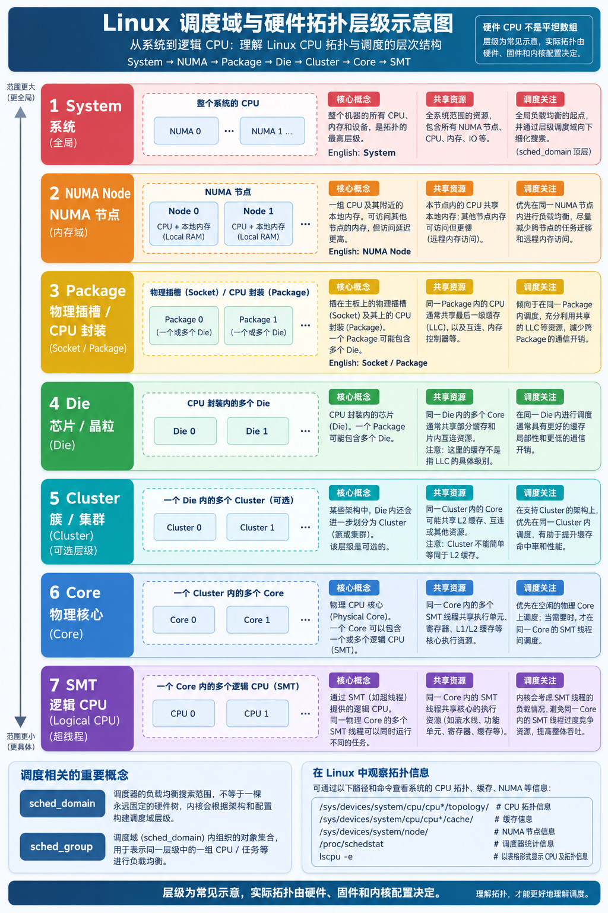

# Linux 内核调度：一小时面试版

> 目标：面向通用 Linux 岗，在一小时内建立“task 如何获得 CPU、为什么迁移、如何定位调度问题”的完整框架。
>
> 阅读方法：先掌握第 1～4 节的单 CPU 主线，再看多核、cgroup 和观测排障，最后用高频问答与一页速记复习。

**缩写约定：** CPU（Central Processing Unit，中央处理器）、SMP（Symmetric Multiprocessing，对称多处理）、CFS（Completely Fair Scheduler，完全公平调度器）、EEVDF（Earliest Eligible Virtual Deadline First，最早可运行虚拟截止时间优先）、RT（Real-Time，实时）、DL（Deadline，截止时间）、RQ/rq（runqueue，运行队列）、NUMA（Non-Uniform Memory Access，非统一内存访问）、SMT（Simultaneous Multithreading，同时多线程）、PELT（Per-Entity Load Tracking，按实体负载跟踪）、EAS（Energy-Aware Scheduling，能耗感知调度）、TLB（Translation Lookaside Buffer，地址转换缓存）、IPI（Inter-Processor Interrupt，处理器间中断）。

## 0. 面试需要掌握到什么程度

### 0.1 必须能回答

```text
1. Linux 调度的对象是什么，task、进程、线程有什么关系？
2. task 如何进入 runqueue，调度器如何选择下一个 task？
3. schedule()、抢占、yield、阻塞和唤醒分别做什么？
4. nice、CFS/EEVDF、RT、Deadline 调度类如何区分？
5. runnable、running、sleeping、D 状态分别表示什么？
6. 多核 task placement 与 load balance 有什么区别？
7. sched_domain、sched_group、NUMA、SMT 和 LLC 如何联系？
8. PELT、capacity、EAS 和 thermal pressure 解决什么问题？
9. cpu.weight、cpu.max、cpuset、uclamp 分别限制什么？
10. 如何用 proc、perf、tracepoint 和 watchdog 定位调度故障？
```

### 0.2 只需知道概念，不必背源码

```text
EEVDF 红黑树的完整维护细节
sched_domain 构建函数的逐行调用链
各架构的汇编入口和切换寄存器
PELT 衰减公式的全部定点数实现
RT/DL 带宽控制的每个内部字段
```

### 0.3 一句话总览

> Linux 把每条可独立获得 CPU 的执行流表示为 task；task 进入某个 CPU 的 runqueue 后，由调度类按各自规则选出 next，在安全点完成抢占和上下文切换。多核场景还要同时考虑 affinity、拓扑、缓存、NUMA、CPU capacity 和 cgroup 约束。

## 1. 从程序到 task：身份、状态与生命周期

### 1.1 task、进程、线程

内核真正调度的是 `task_struct` 对应的 task，而不是用户态“进程”这个抽象名。

用户态常说的进程，通常是一组共享地址空间、文件表和信号处理结构的 task。

用户态常说的线程，通常是同一 thread group 中共享更多资源、但拥有独立寄存器和调度状态的 task。

因此可以记成：

```text
task：内核调度和管理的执行流
进程：资源隔离和地址空间视角
线程：同一进程内共享资源的执行流
```

### 1.2 PID、TID、TGID

| 名称 | 含义 | 面试表述 |
| --- | --- | --- |
| PID | 进程标识，在 namespace 中可见 | 常被用来指主线程/进程 ID |
| TID | 线程标识 | 每个 task 都有自己的 TID |
| TGID | thread group ID | 同一进程内线程通常共享 TGID |

内核内部用 `struct pid` 管理不同 PID namespace 中的编号，不能把 PID 简化成全局唯一整数。

### 1.3 task 生命周期主线

```text
程序或已有 task
    ↓
fork()/clone() 创建新 task
    ↓
copy_process() 建立身份和资源共享关系
    ↓
wake_up_new_task() 选择 CPU 并加入 rq
    ↓
调度器选择并运行
    ↓
阻塞、唤醒、迁移或被抢占
    ↓
execve() 替换程序映像（不创建 task）
    ↓
exit() 或从 main 返回
    ↓
父进程 wait 回收，未回收前可能是 zombie
```

### 1.4 `fork()`、`vfork()`、`execve()`

`fork()` 创建新的 task 和新的进程关系；地址空间通常通过 COW（Copy-On-Write，写时复制）共享物理页。

`vfork()` 让父进程暂时等待，子进程借用父地址空间，直到 `execve()` 或 `_exit()`；它有严格契约，不能随意替代 `fork()`。

`execve()` 不创建新 task，只替换当前 task 的用户地址空间、代码和数据；PID、调度实体和许多进程属性继续存在。

### 1.5 task 状态

| 状态 | 直观含义 | 能否被调度 |
| --- | --- | --- |
| `TASK_RUNNING` | runnable，正在运行或在 rq 等待 | 可以 |
| 可中断睡眠 | 等待事件，可被信号唤醒 | 不可以 |
| `TASK_UNINTERRUPTIBLE` | 不可中断睡眠，常见显示为 `D` | 不可以 |
| stopped/traced | 被停止或调试器暂停 | 不可以 |
| exiting/zombie | 正在退出或等待父进程回收 | 不可以 |

`TASK_RUNNING` 不等于“此刻正在 CPU 上执行”；它也表示已经入队、等待被选中的 runnable task。

### 1.6 zombie 与 D 状态

zombie 是 task 已经退出，只保留 PID、退出码等 wait 所需信息；它不再运行，也不持有完整用户地址空间。

`D` 状态的 task 仍然活着，只是在等待锁、I/O 或条件；它可能触发 Hung Task 检测，但不是 zombie。

## 2. 单 CPU 调度核心模型

### 2.1 runqueue

每个逻辑 CPU 有自己的 `struct rq`，里面维护当前 task、各调度类队列、时钟和统计信息。

```text
CPU0 ── rq0 ── curr + fair/rt/dl/idle 队列
CPU1 ── rq1 ── curr + fair/rt/dl/idle 队列
CPU2 ── rq2 ── curr + fair/rt/dl/idle 队列
```

本地 rq 访问通常需要 rq lock；跨 CPU 迁移需要按锁序同时保护两个 rq。

### 2.2 runnable、running、blocked

```text
runnable：具备运行条件，已在 rq 或即将入队
running：当前 CPU 的 curr task
blocked：等待资源或事件，不在可运行队列
```

一个 task 可以从 runnable 变成 running，也可以从 running 主动阻塞；唤醒路径再把它从 blocked 变成 runnable。

### 2.3 `cfs_rq` 与 `rq`

`rq` 是一个 CPU 的总运行队列；`cfs_rq` 是 fair 调度类在该 CPU 上的队列。

组调度时，一个 `cfs_rq` 还可以作为父层中的 `sched_entity`，因此公平调度实体不一定就是普通用户 task。

### 2.4 调度类优先级

概念上的调度类顺序是：

```text
stop → deadline → rt → fair → idle
```

高优先级调度类先获得选择机会；同一调度类内部再使用自己的队列和排序规则。

### 2.5 `schedule()` 的稳定主线

```text
schedule()
  → 关闭或保护调度相关状态
  → 更新当前 task 的运行统计
  → 根据 prev 状态决定是否出队
  → 调用调度类选择 next
  → 必要时执行 context_switch()
  → 恢复锁和抢占状态
```

如果 `next == prev`，通常不需要完整切换；如果 next 不同，才需要切换栈、寄存器、地址空间等现场。

### 2.6 `pick_next_task()`

调度核心按调度类优先级询问各类的 pick 函数。

```text
先看 stop
没有 stop 再看 deadline
没有 deadline 再看 RT
没有 RT 再看 fair
最后运行 idle task
```

这解释了为什么一个高优先级 RT task 可以压过大量普通 CFS task。

### 2.7 `need_resched` 与 `TIF_NEED_RESCHED`

唤醒更合适的 task、时间片条件满足或远程 CPU 请求抢占时，内核通常先设置 need-resched 标志。

标志不是立即切换栈；CPU 在中断返回、系统调用返回或可抢占内核代码的安全点检查它。

这样可以避免在任意持锁、更新状态或架构入口中途切换，保持调度不变量。

### 2.8 主动调度与被动抢占

主动调度：当前 task 主动等待资源、调用 `schedule()`、yield 或退出。

被动抢占：更高优先级 task 出现、当前 task 需要让出 CPU，或 tick 触发调度条件。

用户态 CPU-bound 死循环仍可被 tick 抢占；内核态长时间关闭抢占或处于不可抢占区间时，延迟可能显著增加。

### 2.9 `cond_resched()`

`cond_resched()` 在允许睡眠且确实需要重新调度时让出 CPU，常用于可能运行较久的内核循环。

它不是所有上下文都能调用；hardirq、softirq 和持有不能睡眠锁的路径不能随意调用。

## 3. 调度触发与唤醒延迟

### 3.1 常见调度触发点

| 触发点 | 为什么需要调度 |
| --- | --- |
| task 阻塞 | 当前 task 无法继续运行 |
| task 退出 | 当前执行流即将消失 |
| 更高优先级 task 唤醒 | 需要尽快切换到更合适的 task |
| tick 到期 | 更新运行统计并检查公平性/时间片 |
| 显式 yield | task 主动放弃当前执行机会 |
| CPU 进入 idle | 触发 newidle balance 尝试拉取任务 |
| 中断返回 | 安全点检查 need-resched |

### 3.2 wakeup 到 running

```text
t0  事件发生，waker 开始唤醒
t1  try_to_wake_up() 使 wakee 变为 runnable
t2  wakee 入队目标 rq，可能设置 need-resched
t3  目标 CPU 到达安全调度点
t4  sched_switch 切换到 wakee
t5  wakee 执行到业务代码
```

`t2-t1` 更接近唤醒入队开销；`t4-t2` 反映 runnable 等待和抢占延迟。

### 3.3 `try_to_wake_up()` 的概念步骤

```text
检查 task 当前状态
→ 确认允许运行的 CPU 集合
→ 选择目标 CPU
→ 设置 TASK_RUNNING 并入队
→ 必要时向目标 CPU 发送 reschedule 请求
```

具体函数拆分会随内核版本变化，但“状态、合法 CPU、入队、触发抢占”是稳定主线。

### 3.4 什么是安全调度点

安全调度点通常满足：

- 当前不在 hardirq/softirq 处理核心路径；
- `preempt_count` 允许抢占；
- 不持有禁止睡眠或禁止切换的关键锁；
- 调度相关状态已经完成一致性更新；
- 架构入口允许返回或重新进入调度器。

因此“设置了 need-resched”与“立刻切换”之间可能存在延迟。

### 3.5 中断上下文限制

hardirq 和 softirq 上下文没有可睡眠的进程上下文，不能调用会阻塞的 `mutex_lock()`、`schedule()` 或可能睡眠的内存分配。

中断处理需要快速确认设备、清除中断源并把慢工作交给 softirq、workqueue 或 threaded IRQ。

## 4. 优先级、权重与调度类

### 4.1 调度类总表

| 调度类 | 典型策略 | 主要关注点 |
| --- | --- | --- |
| stop | 内核停止任务 | CPU 管理操作，优先级最高 |
| deadline | `SCHED_DEADLINE` | runtime、deadline、period |
| RT | `SCHED_FIFO`/`SCHED_RR` | 固定优先级、确定性响应 |
| fair | CFS/EEVDF | 普通任务公平和延迟 |
| idle | `SCHED_IDLE` | 只在没有其他任务时运行 |

### 4.2 policy、priority、nice、weight

`policy` 决定 task 属于哪类调度策略；`priority` 在 RT 等策略中直接影响顺序。

普通 fair task 常通过 nice 表达相对优先级，内核把 nice 映射成 weight。

nice 不是“绝对优先级”；nice 较低的 task 在竞争时获得更多份额，但没有竞争时 nice 较高的 task 仍可使用空闲 CPU。

### 4.3 CFS 的直觉

经典 CFS 用 `vruntime` 估计 task 已获得的加权 CPU 服务量。

```text
实际运行时间越多 → vruntime 通常越大
权重越低 → 同样实际时间对应的 vruntime 增长更快
选择 vruntime/公平账本更“落后”的实体
```

真实现代内核的 fair class 已引入 EEVDF，不能把所有版本都描述成“只取最小 vruntime”。

### 4.4 EEVDF 的面试说法

EEVDF 为每个 fair entity 维护服务欠账（lag）和虚拟截止时间（virtual deadline）。

先判断 entity 是否 eligible，再在 eligible 候选中选择更早的虚拟截止时间。

它的目标是同时改善公平性和交互延迟；不要把 EEVDF 的 virtual deadline 与 `SCHED_DEADLINE` 的实时 deadline 混为一谈。

### 4.5 RT：FIFO 与 RR

`SCHED_FIFO` 的同优先级 task 通常按队列顺序运行，除非阻塞、主动让出或被更高优先级 task 抢占。

`SCHED_RR` 在同优先级 task 之间按时间片轮转。

RT task 可以长期压制 fair task，因此内核通常提供 RT bandwidth/throttling 保护系统活性。

### 4.6 Deadline：runtime、deadline、period

一个 deadline task 可以用三个参数描述：

```text
runtime：每个周期最多可执行的预算
deadline：本次作业希望完成的相对截止时间
period：预算补充和作业释放的周期
```

`runtime <= deadline <= period` 是常见参数关系，但可调度性还要考虑 CPU affinity、其他 reservation 和实际 WCET。

### 4.7 CBS 与 admission

CBS（Constant Bandwidth Server，恒定带宽服务器）限制 deadline task 的预算，避免一个 task 无限执行。

admission control 在设置或修改参数时检查 root domain 可用 capacity；总 utilization 小于 CPU 数并不代表任意 affinity 都可调度。

### 4.8 调度类常见误区

```text
nice -20 不是“永远先运行”，它只影响 fair 类内部竞争。
RT 优先级高于 nice，nice 不能压过 RT。
SCHED_IDLE 不是“禁止运行”，没有更高需求时它仍会运行。
Deadline 的 deadline 与 EEVDF virtual deadline 不在同一时间尺度。
```

## 5. SMP、拓扑与选核

> 本节源码位置基于 `v7.3-rc6-337-g3857c2fe5449`。函数职责比绝对行号稳定；升级内核后应重新核对行号和具体分支。

### 5.1 为什么要做多核放置

单 CPU 调度回答“当前 rq 中谁先运行”；SMP 还必须回答“task 应进入哪个 CPU 的 rq”。放到空闲 CPU 可以降低排队延迟，但迁移可能损失 cache locality、增加 NUMA 远端访问，或把 task 放到 capacity 不足的小核。

需要先区分两个概念：

```text
task placement：创建、唤醒、exec 附近，为这一次入队选择 CPU
load balance：布局已经失衡后，从繁忙 rq 向空闲 rq 迁移 runnable task

placement 偏预防；balance 偏纠正。
```

fork 首次选核和普通唤醒选核都属于 placement；periodic、newidle、NO_HZ 和 active balance 属于后续 load balance。

### 5.2 CPU 拓扑总图



```text
System：整台机器的 CPU 范围
NUMA Node：CPU 与距离较近的本地内存
Package/Socket：物理插槽中的 CPU 封装
Die：Package 内的硅片子单元
Cluster：可选的紧密互联 Core 组
Core：物理核心
SMT：Core 暴露出的逻辑 CPU/硬件线程
```

这些名称描述不同维度，不是所有机器都严格组成同一棵树。一个 Package 可以包含多个 Die，也不保证只有一个 LLC domain。

### 5.3 Cache、NUMA、Cluster 与 SMT

LLC（Last Level Cache）是角色名称，不是固定编号；主流 x86 常见为 L3，其他架构也可能由 L2 承担。通常访问延迟满足 `L1 < L2 < LLC < DRAM`，但实际共享范围必须查看目标平台。

NUMA 系统仍提供统一可寻址的物理内存；“非统一”是指本地与远端 Node 的访问延迟和带宽不同。跨 Node 访问合法，只是代价更高。

Cluster 可能由共享 L2、cache tag 或内部互联形成，不能直接写成“Cluster 就是 L2”。SMT sibling 可以同时运行 task，但共享同一 Core 的执行资源和部分 cache；逻辑 CPU idle 也不等于整个物理 Core idle。

```bash
lscpu -e
cat /sys/devices/system/cpu/cpu0/topology/thread_siblings_list
cat /sys/devices/system/cpu/cpu0/topology/core_cpus_list
cat /sys/devices/system/cpu/cpu0/cache/index*/shared_cpu_list
find /sys/devices/system/node -maxdepth 1 -type d
```

CPU 编号是否相邻不能证明 SMT sibling 关系。

### 5.4 `sched_domain`、`sched_group` 与 child domain

面试结论：`sched_domain` 定义当前层的搜索范围，`sched_group` 是该范围内横向比较的候选区域，child domain 是留在或进入某个已选分支后继续向下细分的搜索层级。

```text
sd        = 当前这一层的地图
sg        = 地图中的候选区域
new_cpu   = 进入所选区域的锚点
更小的 sd = 进入区域后的下一张详细地图
```

假设：

```text
Core0={CPU0,CPU1}  Core1={CPU2,CPU3}
Core2={CPU4,CPU5}  Core3={CPU6,CPU7}
LLC0 ={CPU0..CPU3} LLC1 ={CPU4..CPU7}
```

从 CPU0 的视角：

```text
PKG sched_domain，span={CPU0..CPU7}
│
├── SG0=LLC0 {CPU0..CPU3}     local group
└── SG1=LLC1 {CPU4..CPU7}     remote group

CPU0 的 child sched_domain，span={CPU0..CPU3}
│
├── SG0=Core0 {CPU0,CPU1}
└── SG1=Core1 {CPU2,CPU3}

CPU0 的更小 child sched_domain，span={CPU0,CPU1}
│
├── SG0={CPU0}
└── SG1={CPU1}
```

父 domain 中某个 group 的 span，可能与该 group 内某个 CPU 的低层 domain span 相同，但角色不同：父层把 group 当成横向候选；进入该区域后，低层 domain 负责继续拆分。每个 CPU 都有以自己为本地分支的 domain 链，所以 CPU0 的 `sd->child` 指向 LLC0，而 CPU4 的对应低层 domain 指向 LLC1。

### 5.5 选核公共入口

fork 和普通唤醒最终都经过通用入口：

```text
kernel/sched/core.c:3631：select_task_rq()
    if (p->nr_cpus_allowed > 1 && !is_migration_disabled(p))
        p->sched_class->select_task_rq(...)
    else
        cpumask_any(p->cpus_ptr)
```

普通 fair task 继续进入：

```text
kernel/sched/fair.c:9917：select_task_rq_fair()
    cpu      = smp_processor_id()   当前执行选核的 CPU
    new_cpu  = prev_cpu             初始候选
    sd_flag  = wake_flags & 0xF     映射到本次所需 domain flag
```

核心映射：

```text
WF_FORK → SD_BALANCE_FORK
WF_EXEC → SD_BALANCE_EXEC
WF_TTWU → SD_BALANCE_WAKE
```

### 5.6 三个容易混淆的 domain flag

```text
SD_BALANCE_FORK：fork/clone 时允许在该 domain 做 group 级放置
SD_BALANCE_WAKE：普通唤醒时允许走完整的 idlest-group slow path
SD_WAKE_AFFINE：普通唤醒时允许比较 waker CPU 与 wakee prev_cpu
```

`SD_BALANCE_WAKE` 与 `SD_WAKE_AFFINE` 不是同一个功能。前者可能扫描 group，开销较大；后者只做快速 locality 判断。

默认值来自：

```text
kernel/sched/topology.c:1937-1977：sd_init()
    SD_BALANCE_FORK = 1
    SD_BALANCE_WAKE = 0
    SD_WAKE_AFFINE  = 1
```

因此普通唤醒通常走 `wake_affine()+select_idle_sibling()`，而不是每次都做完整 group balance。

对于距离超过阈值的 NUMA domain：

```text
kernel/sched/topology.c:2015-2018：sd_init()
    清除 SD_BALANCE_EXEC、SD_BALANCE_FORK、SD_WAKE_AFFINE
```

这限制了高频 placement 的最远范围，避免因很小的负载收益破坏 NUMA locality。`include/linux/sched/sd_flags.h:61-82` 还把这些 flag 声明为 `SDF_SHARED_CHILD`：父层具有该行为时，child 层也应连续具有，而不是中间断层。

### 5.7 fork 首次选核：从创建者 CPU 开始

以下 fork slow path 讨论的是 fair 调度类；RT、Deadline、sched_ext 等调度类由各自的 `select_task_rq()` 实现决定放置策略。

新任务还没有运行历史。创建阶段先把它的初始 CPU 设为创建者当前 CPU：

```text
kernel/sched/core.c:4897-4921：sched_cgroup_fork()
    __set_task_cpu(p, smp_processor_id())
```

随后：

```text
kernel/sched/core.c:4964-4988：wake_up_new_task()
    wake_flags = WF_FORK
    p->__state = TASK_RUNNING
    select_task_rq(p, task_cpu(p), &wake_flags)
    post_init_entity_util_avg(p)
    activate_task(..., ENQUEUE_INITIAL)
    wakeup_preempt(...)
```

`TASK_RUNNING` 表示可运行，不表示已经占用 CPU；`activate_task()` 才把子任务加入最终目标 rq。

fork 不带 `WF_TTWU`，所以不会进入普通唤醒专用的 EAS、`wake_affine()` 和 `select_idle_sibling()` 分支。它在 `select_task_rq_fair()` 中从创建者 CPU 的最小 domain 向 parent 遍历，记录连续带有 `SD_BALANCE_FORK` 的最大 domain，然后进入 slow path：

```text
kernel/sched/fair.c:9948-9975：select_task_rq_fair()
    for_each_domain(cpu, tmp)
        if (tmp->flags & SD_BALANCE_FORK)
            sd = tmp
    sched_balance_find_dst_cpu(sd, ...)
```

### 5.8 fork slow path：先选 group，再选候选 CPU

`sched_balance_find_dst_group()` 对每个允许任务运行的 group 汇总：

```text
kernel/sched/fair.c:12575-12628：update_sg_wakeup_stats()
    group_load / group_util / group_runnable
    sum_nr_running / idle_cpus / group_capacity
    task 是否适合 group 中 CPU 的 capacity
```

随后按 group 状态选取：

```text
kernel/sched/fair.c:12631-12681：update_pick_idlest()
    overloaded / fully_busy → avg_load 更低者
    has_spare              → idle CPU 更多，再比较 group_util
    misfit_task            → max_capacity 更高者
```

`kernel/sched/fair.c:12691-12853：sched_balance_find_dst_group()` 还会把远端 idlest group 与 local group 比较。差异不足以抵消迁移代价时返回 `NULL`。

```text
group == NULL：
    当前大范围内不值得离开 local group
    不等于 local group 内已经最优
    因此 sd=sd->child，继续在本地小范围细分
```

找到 group 后，`kernel/sched/fair.c:8674-8727：sched_balance_find_dst_group_cpu()` 在其内部选候选 CPU：

```text
有 idle CPU：优先 idle state 退出延迟更小者
延迟相同：优先最近进入 idle、缓存可能更热者
没有 idle CPU：选择 cpu_load 更低者
```

### 5.9 为什么选到候选 CPU 后还要继续向下？

上层选择解决“大方向”，下层选择用更细的拓扑统计修正最终 CPU。例：

```text
CPU4 load=10，CPU5 load=100 → Core2 总体=110
CPU6 load=20，CPU7 load=20  → Core3 总体=40
```

在 LLC1 中单看 CPU，可能暂选 CPU4；进入 core 层后却会发现 Core3 整体更合适，于是最终候选可以变成 CPU6。

如果候选从 CPU0 分支跳到 CPU4 分支，不能直接使用原 `sd->child`，因为它属于 CPU0 的本地链：

```text
CPU0 的 PKG domain
    └── child=LLC0 {CPU0..CPU3}   错误方向

已选远端 SG=LLC1 {CPU4..CPU7}
    └── 应切换到 CPU4 的 domain 链
```

源码通过下面的逻辑完成切换：

```text
kernel/sched/fair.c:8730-8780：sched_balance_find_dst_cpu()
    cpu    = new_cpu
    weight = 旧 sd->span_weight
    sd     = NULL

    for_each_domain(cpu, tmp):
        tmp->span_weight >= 旧 weight → 停止
        tmp 支持本次 sd_flag         → 记录 tmp
```

结果是找到“以 `new_cpu` 为本地 CPU、比旧 domain 更小、仍支持本次 balance 的最大 domain”，再继续细分：

```text
PKG {0..7} 选 LLC1，暂选 CPU4
    ↓ 切换到 CPU4 的 domain 链
LLC1 {4..7} 选 Core3，暂选 CPU6
    ↓ 切换到 CPU6 的 domain 链
SMT {6,7} 选择最终逻辑 CPU
```

因此 provisional CPU 有两个作用：它既是当前最佳候选，也是进入所选远端分支的锚点。

### 5.10 fork 选核总图

```text
父任务在 CPU X 调用 fork/clone
        │
        ▼
sched_cgroup_fork()
        │  task_cpu(child) = CPU X
        ▼
wake_up_new_task()
        │  p->__state = TASK_RUNNING
        │  wake_flags = WF_FORK
        ▼
select_task_rq(p, CPU X, WF_FORK)
        │
        ├── 只允许 1 个 CPU，或 migration_disabled
        │       └── cpumask_any(p->cpus_ptr) ──────────────────────────────┐
        │                                                                 │
        └── 可在多个 CPU 运行                                              │
                ▼                                                         │
        fair_sched_class.select_task_rq                                   │
        = select_task_rq_fair()                                           │
                │  cpu      = 当前创建者 CPU X                            │
                │  prev_cpu = task_cpu(child) = CPU X                     │
                │  new_cpu  = prev_cpu                                    │
                │  sd_flag  = SD_BALANCE_FORK                             │
                │  want_affine = 0；不走 EAS/wake_affine/idle sibling     │
                ▼                                                         │
        从 CPU X 的最小 sched_domain 向 parent 遍历                        │
                │                                                         │
                ├── tmp 带 SD_BALANCE_FORK                                │
                │       └── sd = tmp，继续向 parent，扩大允许搜索的范围   │
                │                                                         │
                └── tmp 不带 SD_BALANCE_FORK                              │
                        └── 停止；sd 保留此前最大的连续有效 domain         │
                │                                                         │
                ▼                                                         │
             sd == NULL ?                                                 │
                │                                                         │
        ┌───────┴────────┐                                                │
       是                否                                                │
        │                │                                                │
        │                ▼                                                │
        │     sched_balance_find_dst_cpu(sd, p, CPU X, prev_cpu,          │
        │                                 SD_BALANCE_FORK)                 │
        │                │                                                │
        │                ├── sd->span 与 p->cpus_ptr 无交集               │
        │                │       └── 返回 prev_cpu ────────────────────┐  │
        │                │                                             │  │
        │                └── 有交集                                    │  │
        │                        ▼                                      │  │
        │              ┌──── while (sd) ────────────────────────────┐   │  │
        │              │                                            │   │  │
        │              │  sd 不带本次 sd_flag？                     │   │  │
        │              │      └── sd = sd->child ───────────────┐   │   │  │
        │              │                                        │   │   │  │
        │              │  sched_balance_find_dst_group(sd)      │   │   │  │
        │              │      │ 汇总各 group 的 load/util、      │   │   │  │
        │              │      │ runnable、idle CPU、capacity     │   │   │  │
        │              │      │ 比较 local 与 idlest group       │   │   │  │
        │              │      ▼                                 │   │   │  │
        │              │  group == NULL？                        │   │   │  │
        │              │      └── 当前层不值得离开 local group   │   │   │  │
        │              │          sd = sd->child ────────────────┤   │   │  │
        │              │                                        │   │   │  │
        │              │  找到更好的 group                       │   │   │  │
        │              │      ▼                                 │   │   │  │
        │              │  sched_balance_find_dst_group_cpu()     │   │   │  │
        │              │      │ idle：先比退出延迟，再比 idle 时间│   │   │  │
        │              │      │ busy：选择 cpu_load 更低的 CPU   │   │   │  │
        │              │      ▼                                 │   │   │  │
        │              │  得到暂定 new_cpu                       │   │   │  │
        │              │      │                                 │   │   │  │
        │              │      ├── new_cpu == 当前锚点 cpu        │   │   │  │
        │              │      │       └── 没有跨分支             │   │   │  │
        │              │      │           sd = sd->child ────────┤   │   │  │
        │              │      │                                 │   │   │  │
        │              │      └── new_cpu != 当前锚点 cpu        │   │   │  │
        │              │              │ 已进入另一个 group       │   │   │  │
        │              │              │ cpu = new_cpu             │   │   │  │
        │              │              │ 记住旧 sd->span_weight    │   │   │  │
        │              │              ▼                         │   │   │  │
        │              │        切换到 new_cpu 自己的 domain 链  │   │   │  │
        │              │        从小到大找：                     │   │   │  │
        │              │          span 比旧 sd 小                │   │   │  │
        │              │          且带 SD_BALANCE_FORK           │   │   │  │
        │              │        的最大下层 domain ───────────────┘   │   │  │
        │              │                                            │   │  │
        │              └── sd == NULL 时结束；返回最后的 new_cpu ────┘   │  │
        │                                                                  │  │
        └── 返回初始 new_cpu=prev_cpu ─────────────────────────────────────┤  │
                                                                           │  │
        ┌──────────────────────────────────────────────────────────────────┘  │
        └─────────────────────────────────────────────────────────────────────┘
                ▼
        __set_task_cpu(child, dst_cpu)
                ▼
        锁定 dst_cpu 的 rq
                ▼
        post_init_entity_util_avg()
                ▼
        activate_task(..., ENQUEUE_INITIAL)
                │  子任务至此才真正进入目标 runqueue
                ▼
        wakeup_preempt()：判断是否需要抢占当前任务
```

读图时抓住两个回环：留在当前分支就沿 `sd->child` 向下；跳到远端 group 就先把 `new_cpu` 变成新锚点，再切换到该 CPU 的 domain 链向下。只有这样，后续 child domain 才属于已经选中的分支。

### 5.11 普通唤醒选核入口

普通睡眠任务有运行历史，选核更重视历史 CPU 和缓存局部性：

```text
kernel/sched/core.c:4274-4438：try_to_wake_up()
    增加 WF_TTWU
    检查 task state
    处理仍在 rq 或仍在旧 CPU schedule 中的竞态
    设置 TASK_WAKING
    select_task_rq(p, p->wake_cpu, &wake_flags)
    必要时 set_task_cpu()
    ttwu_queue()
```

进入 `select_task_rq_fair()` 后的顺序是：

```text
WF_CURRENT_CPU 强制当前 CPU
    ↓
系统支持且未 overutilized 时尝试 EAS
    ↓
判断 wake_wide 与 affinity，决定是否 want_affine
    ↓
wake_affine() 在 this_cpu 与 prev_cpu 间产生 target
    ↓
select_idle_sibling() 在 target 附近寻找 idle CPU
```

少数设置了 `SD_BALANCE_WAKE` 的拓扑可以走完整 slow path，但默认值为关闭。

### 5.12 `wake_affine()`：waker CPU 还是 wakee CPU

参数含义：

```text
this_cpu：waker 当前运行的 CPU
prev_cpu：wakee 原先运行或倾向返回的 CPU
sync：waker 提示自己很可能马上睡眠
```

`kernel/sched/fair.c:8574-8601：wake_affine_idle()` 的真实顺序是：

```text
1. this_cpu 已 idle 且与 prev 共享 cache：
   prev 也 idle → prev；否则 → this

2. sync 且 this_cpu 只有 waker 一个有效 runnable：
   → this，预测 waker 即将让出 CPU

3. prev_cpu idle：
   → prev

4. 都不能决定：
   → 进入 weight 比较
```

第二步可能压过“prev 当前 idle”，因为 `WF_SYNC` 提示的是一次生产者—消费者式直接交接：waker 刚处理的数据可能仍在 this CPU 的 cache 中，并且它马上阻塞，不会长期把两个 runnable task 堆在一起。只有同时覆盖 this 与 prev 的 domain 带 `SD_WAKE_AFFINE` 时才会进入这段逻辑，过远 NUMA 通常已被裁剪。

`kernel/sched/fair.c:8604-8644：wake_affine_weight()` 比较：

```text
放到 this：this 当前负载 + wakee 负载 - sync 时可能离开的 waker 负载
留在 prev：prev 当前负载 - wakee 可能残留的历史贡献
```

再结合 CPU capacity 和 `imbalance_pct` 归一化。只有 this 明显更好才返回 this，否则顶层 `kernel/sched/fair.c:8647-8664：wake_affine()` 保守返回 prev。

### 5.13 `select_idle_sibling()`：在 locality 锚点附近找 idle CPU

`wake_affine()` 只产生首选 `target`，并不直接决定最终 CPU。`kernel/sched/fair.c:9173-9297：select_idle_sibling()` 的目的，是以 target 为 locality 锚点，用有限成本寻找可让 wakee 尽快运行的近端 idle CPU。

搜索顺序：

```text
1. target 可立即运行 wakee 且 capacity 合适
2. prev != target、与 target 共享 cache、prev 可立即运行 wakee 且 capacity 合适
3. per-CPU kthread 完成工作后唤醒原 CPU 上 task 的特例
4. recent_used_cpu 近端、可立即运行、在 affinity 中且 capacity 合适
5. 按拓扑分叉：
   ├── 存在 sd_asym_cpucapacity：select_idle_capacity()，找到候选或直接返回 target
   └── 对称 capacity 路径：进入 target 的 LLC domain
       ├── SMT 且没有完整 idle core、prev 与 target 共享 cache：先查 prev 的 idle SMT sibling
       ├── select_idle_cpu() 在 LLC∩affinity 中做有限扫描；有 idle core 时优先完整 idle core
       └── 没找到时，cluster 平台可回退 prev_aff/recent，最终返回 target
```

这里的“可立即运行”由 `choose_idle_cpu()` 判断：除了真正 idle 的 CPU，还可接受 rq 上只有 `SCHED_IDLE` 任务且 wakee 自身不是 idle policy 的 CPU。`select_idle_cpu()` 不保证扫描整个 LLC；系统越繁忙，找到 idle CPU 的概率越低，`nr_idle_scan` 会限制扫描量，避免为了不存在的空闲核读取大量远端 rq cache line。

所以普通唤醒不是“找全系统最空闲 CPU”，而是：

```text
先保留 wakee/waker locality
    +
在近端快速寻找真正 idle 的执行机会
    +
把长期全局失衡留给 load balance
```

### 5.14 `ttwu_queue()`：选核之后如何入队

选核结束后，`try_to_wake_up()` 在目标改变时设置 `WF_MIGRATED` 并调用 `set_task_cpu()`，随后进入 `ttwu_queue()`。

```text
kernel/sched/core.c:4028-4077：ttwu_queue_cond()
    先检查 SCX、stop class、CPU active 和任务 affinity
    不共享 LLC/最后级共享 cache → 满足条件时倾向远端 wake-list
    同一 CPU                    → 不用远端 wake-list
    目标 CPU 无 runnable task   → 可让目标 CPU 自己激活

kernel/sched/core.c:4090-4101：ttwu_queue()
    TTWU_QUEUE 开启且 ttwu_queue_cond() 成立
                  → 挂到目标 rq->wake_list，必要时发 IPI
    否则           → 当前 CPU 锁目标 rq 并 ttwu_do_activate()
```

跨 LLC 并非无条件使用 IPI；在 `TTWU_QUEUE` 开启且 `ttwu_queue_cond()` 的安全条件都满足时，通常把激活工作交给目标 CPU，避免 waker 直接获取远端 rq lock、写远端 cache line，并在需要时发 IPI。条件不满足，或共享 LLC 且目标 CPU 正忙时，当前 CPU 直接锁目标 rq 激活有时反而更便宜。

### 5.15 普通唤醒选核总图

```text
任务 p 被 wake_up_process()/事件完成等路径唤醒
        │
        ▼
try_to_wake_up(p, state, wake_flags)
        │  wake_flags |= WF_TTWU
        │  校验 p->__state，持有 p->pi_lock
        ▼
特殊情况是否已经完成唤醒？
        │
        ├── p == current
        │       └── ttwu_do_wakeup()；无需重新选核 ────────────────────────┐
        ├── p 仍在 rq 上
        │       └── ttwu_runnable()；可直接置为 runnable ─────────────────┤
        ├── p 仍在旧 CPU 的 schedule() 中，且 wake-list 入队成功          │
        │       └── 交给旧 CPU 完成；无需重新选核 ────────────────────────┤
        └── p 已离开 rq/旧 CPU                                             │
                │  p->__state = TASK_WAKING                               │
                ▼                                                         │
        select_task_rq(p, p->wake_cpu, WF_TTWU...)                         │
                │                                                         │
                ├── 只允许 1 个 CPU，或 migration_disabled                │
                │       └── 返回唯一允许 CPU ─────────────────────────┐   │
                │                                                     │   │
                └── fair task：select_task_rq_fair()                   │   │
                        │  this_cpu = waker 当前 CPU                   │   │
                        │  prev_cpu = wakee 的 p->wake_cpu             │   │
                        │  new_cpu  = prev_cpu                         │   │
                        ▼                                             │   │
                WF_CURRENT_CPU 且 this_cpu 在 affinity 中？            │   │
                        ├── 是：返回 this_cpu ─────────────────────┐   │   │
                        └── 否                                    │   │   │
                             ▼                                    │   │   │
                root_domain 未 overutilized？                     │   │   │
                        ├── 是：find_energy_efficient_cpu()       │   │   │
                        │       ├── 找到 CPU：EAS 直接返回 ───────┤   │   │
                        │       └── 未找到：恢复 new_cpu=prev     │   │   │
                        └── 否：跳过 EAS                          │   │   │
                             │                                    │   │   │
                             ▼                                    │   │   │
                want_affine = !wake_wide(p)                       │   │   │
                              && this_cpu 在 p->cpus_ptr 中        │   │   │
                             │                                    │   │   │
                             ▼                                    │   │   │
                从 this_cpu 的小 domain 向 parent 遍历            │   │   │
                             │                                    │   │   │
                             ├── want_affine                      │   │   │
                             │   && SD_WAKE_AFFINE                │   │   │
                             │   && prev_cpu 在 tmp->span 中      │   │   │
                             │       │                            │   │   │
                             │       ├── this_cpu != prev_cpu     │   │   │
                             │       │       ▼                    │   │   │
                             │       │   wake_affine()            │   │   │
                             │       │       │                    │   │   │
                             │       │       ├─ wake_affine_idle()│   │   │
                             │       │       │  ① this idle 且共享 cache：
                             │       │       │     prev idle→prev，否则→this
                             │       │       │  ② sync 且 this 仅有 waker→this
                             │       │       │  ③ prev idle→prev │   │   │
                             │       │       │                    │   │   │
                             │       │       └─ 尚未决定：         │   │   │
                             │       │          wake_affine_weight()
                             │       │          this 明显更优→this│   │   │
                             │       │          否则→prev         │   │   │
                             │       │                            │   │   │
                             │       └── 得到 locality target     │   │   │
                             │           sd=NULL，停止 domain 遍历│   │   │
                             │                                    │   │   │
                             ├── tmp 带 SD_BALANCE_WAKE           │   │   │
                             │       └── 记录最大连续 sd，继续向上│   │   │
                             │                                    │   │   │
                             └── 不满足上述条件                   │   │   │
                                     └── !want_affine 时停止遍历  │   │   │
                             │                                    │   │   │
                             ▼                                    │   │   │
                         sd != NULL？                              │   │   │
                      ┌──────┴────────┐                           │   │   │
                     是               否                           │   │   │
                      │               │                           │   │   │
                      ▼               ▼                           │   │   │
 sched_balance_find_dst_cpu()   select_idle_sibling(p, prev, target)
 完整 group slow path                  │                           │   │   │
 （默认 SD_BALANCE_WAKE 关闭，          ├── target 可立即运行且 fit→target
  因此普通唤醒很少走这里）              ├── 共享 cache 的 prev 可运行且 fit→prev
                      │                ├── per-CPU kthread 完成工作的特例→prev
                      │                ├── 近端 recent_used_cpu 合适→recent
                      │                └── 仍未找到                │   │   │
                      │                     │                      │   │   │
                      │                     ├── 有 sd_asym_cpucapacity
                      │                     │       └── select_idle_capacity()
                      │                     │           找到候选或返回 target
                      │                     │                      │   │   │
                      │                     └── 对称 capacity      │   │   │
                      │                             ├── 无 LLC domain→target
                      │                             ├── SMT 无完整 idle core：
                      │                             │   先查 prev 的 idle sibling
                      │                             ├── select_idle_cpu()：
                      │                             │   LLC∩affinity 有限扫描，
                      │                             │   有 idle core 时优先整核
                      │                             └── cluster 回退 prev/recent，
                      │                                 最终返回 target
                      │                     │                      │   │   │
                      └──────────────┬──────┘                      │   │   │
                                     ▼                             │   │   │
                               得到最终 dst_cpu                    │   │   │
                                     │                             │   │   │
        ┌────────────────────────────┴─────────────────────────────┘   │   │
        └─────────────────────────────────────────────────────────────┘   │
                                     ▼                                   │
                    task_cpu(p) != dst_cpu？                              │
                         ├── 是：WF_MIGRATED；set_task_cpu(p, dst_cpu)     │
                         └── 否：保留原 CPU                               │
                                     │                                   │
                                     ▼                                   │
                         ttwu_queue(p, dst_cpu, wake_flags)               │
                                     │                                   │
                         ┌───────────┴────────────┐                      │
                TTWU_QUEUE &&                 条件不满足                  │
                ttwu_queue_cond() 成立            │                      │
                         │                        │                      │
                         ▼                        ▼                      │
                加入目标 rq->wake_list      当前 CPU 锁目标 rq           │
                必要时发 IPI                ttwu_do_activate()           │
                         │                        │                      │
                         └───────────┬────────────┘                      │
                                     ▼                                   │
                         wakee 在目标 rq 上变为 runnable                  │
                                     │                                   │
        ┌────────────────────────────┴───────────────────────────────────┘
        ▼
    唤醒处理完成
```

读图时要把 `wake_affine()` 和 `select_idle_sibling()` 分开：前者只在 this/prev 之间形成 locality target；后者仍可能选择 target 附近的另一个 idle CPU。若 EAS 或完整 `SD_BALANCE_WAKE` slow path 已经直接返回，则不会再进入 `select_idle_sibling()`。

### 5.16 fork 与普通唤醒对照

| 维度 | fork 首次选核 | 普通唤醒选核 |
| --- | --- | --- |
| 运行历史 | 新任务没有历史 | wakee 有 prev/recent CPU |
| wake flag | `WF_FORK` | `WF_TTWU` |
| 主要 domain flag | `SD_BALANCE_FORK` | `SD_WAKE_AFFINE`，少数 `SD_BALANCE_WAKE` |
| 主要方法 | domain→group→候选 CPU→低层 domain | EAS→wake_affine→select_idle_sibling |
| locality 依据 | 创建者 CPU 与拓扑层级 | wakee 历史、waker 数据、LLC/SMT |
| 搜索特征 | 可从大范围逐层细化 | 主要在 target 附近做低成本 idle 搜索 |

### 5.17 PELT、capacity 与 EAS 在选核中的位置

面试结论：PELT 是调度器的“近期需求账本”，跟踪想运行、实际运行和加权负载的衰减历史；它提供统计信号，placement 和 load balance 才负责选择位置或迁移任务。

#### 5.17.1 三种统计：想运行、实际运行、加权负载

| 指标 | 普通 task 的含义 | 主要用途 |
| --- | --- | --- |
| `load_avg` | runnable 历史乘以调度权重 | 加权负载比较，结合 nice 和组调度份额 |
| `runnable_avg` | 想运行的历史，包括正在执行和排队 | 识别需求及 CPU 竞争 |
| `util_avg` | 实际执行的历史，经 PELT 时钟归一化 | capacity 匹配、选核、调频和 EAS |

下面按普通 task、无 delayed dequeue 等特殊状态说明输入，历史值本身不会在状态改变时立即清零：

| 状态 | load 时间输入 | runnable 输入 | running 输入 |
| --- | --- | --- | --- |
| 正在运行 | 1 | 1 | 1 |
| 在 rq 中排队 | 1 | 1 | 0 |
| 睡眠 | 0 | 0 | 0 |

任务的 `load_avg` 在归一化时还要乘以权重。当前源码分别使用 `se->on_rq` 和 `se_runnable(se)`；delayed dequeue 下实体可能仍在队列，却已经没有普通 runnable 需求，不能永远把两者等同。

例子：同一 CPU 上 A、B 都是 nice 0，长期持续 runnable，公平各运行一半时间。假设 CPU capacity 为 1024、以最大频率运行，无组调度限制及其他执行开销，统计已稳定：

| 指标 | A | B | 根 `cfs_rq` 汇总 |
| --- | --- | --- | --- |
| `load_avg` | 约 1024 | 约 1024 | 约 2048 |
| `runnable_avg` | 约 1024 | 约 1024 | 约 2048 |
| `util_avg` | 约 512 | 约 512 | 约 1024 |

两个任务一直想运行，所以 runnable 需求合计可超过 1024；一个 CPU 的实际执行能力只有一份，所以稳态 util 合计约为 1024。nice 主要改变加权 load，不能把它直接当成实际 CPU 利用率。

```text
kernel/sched/pelt.c:307：__update_load_avg_se()
    ___update_load_sum(now, &se->avg,
        !!se->on_rq,           // load 时间输入
        se_runnable(se),       // runnable 需求
        cfs_rq->h_curr == se)   // 当前是否执行该实体

kernel/sched/pelt.c:321：__update_load_avg_cfs_rq()
    输入队列 load.weight、h_nr_runnable、h_curr 是否非空
    // 实体与队列各自推进统计，组调度还要传播层级贡献
```

#### 5.17.2 衰减、sum/avg 与 PELT 时钟

```text
新累计量 = 衰减后的旧历史 + 新时间段的贡献
近期贡献权重大；越久以前的贡献，权重越小。
y^32 ≈ 0.5：经过约 32 个 PELT 周期，旧贡献的权重减半。
```

常说“约 32ms 半衰期”，但当前定点实现先将纳秒右移 10 位，一个计量单位为 1024ns，一个周期为 1024 个单位，即约 1.049ms；32 个周期约 33.55ms 的 PELT 时间。它不是固定窗口结束后清零，也不意味着 PELT 每隔 1ms 就遍历所有 task。

`struct sched_avg` 保存 `last_update_time`、`period_contrib`、`*_sum` 和 `*_avg`。sum 是衰减累计量，avg 根据当前不完整周期的位置归一化，避免把尚未发生的时间当成 idle 而产生抖动。

```text
kernel/sched/pelt.c:181：___update_load_sum()
    delta = now - sa->last_update_time; // 计算尚未统计的时间
    accumulate_sum(...);               // 衰减旧 sum，再加入新贡献

kernel/sched/pelt.c:258：___update_load_avg()
    load_avg     = load * load_sum / divider
    runnable_avg = runnable_sum / divider
    util_avg     = util_sum / divider
    // 上面三行为公式摘要；divider 随 period_contrib 调整
```

PELT 使用 `cfs_rq_clock_pelt()`，不是简单的墙上时间。`kernel/sched/pelt.h:100：update_rq_clock_pelt()` 用 CPU capacity 和频率比例缩放执行时间；idle 时还会同步时钟，并处理 lost idle time，带宽限流的队列还需处理 throttled 时间。目的在于避免同一工作因低频执行更久，就被误判为需要更多归一化算力。效果依赖架构提供的 capacity/frequency 信息。

#### 5.17.3 谁来更新：tick、调度事件和 blocked 维护

PELT 在调度事件发生时根据时间差补算，不是每个 task 各有一个固定周期定时器。

| 路径 | 更新职责 |
| --- | --- |
| tick | 推进当前实体、队列及组层级统计 |
| 入队、出队、实体切换等 | 在输入状态变化附近结算历史，维护队列贡献 |
| blocked 维护 | 推进 rq、cfs_rq 及组层级中残留的睡眠历史 |
| 睡眠实体再次被使用 | 唤醒、迁移或同步读取等路径按需推进实体自己的历史 |

```text
kernel/sched/core.c:5782：sched_tick()
    → kernel/sched/fair.c:15332：task_tick_fair()
        → kernel/sched/fair.c:6769：entity_tick()
            → kernel/sched/fair.c:6057：update_load_avg()

kernel/sched/fair.c:11643：sched_balance_update_blocked_averages()
    锁目标 rq，更新时钟，推进 blocked 队列统计
    // 不等于逐个遍历全部睡眠 task 更新它们的 sched_avg
```

任务睡眠后不再加入新运行贡献，但已经积累的 load/runnable/util 仍会衰减。因此 CPU 当前 idle，历史负载也可能尚未为零；这不是仍在执行睡眠任务。

#### 5.17.4 新任务、迁移与 util_est

新任务没有实测历史，但并非所有 PELT 初值都是零：`init_entity_runnable_average()` 为 task 初始化满权重的 load；`post_init_entity_util_avg()` 根据选定队列负载估计 util，并以剩余 capacity 的一半限制初值，同时初始化 runnable。组实体的初始化规则不同。

迁移时 task 保留需求历史，源队列移除贡献，目标队列接入贡献；还要处理衰减和不同队列的时间基准。不能把迁移理解成清空统计，也不能把普通睡眠出队一律当成 PELT detach。

```text
kernel/sched/fair.c:1321：init_entity_runnable_average()
kernel/sched/fair.c:1366：post_init_entity_util_avg()
kernel/sched/fair.c:5468：set_task_rq_fair()
kernel/sched/fair.c:5907：attach_entity_load_avg()
kernel/sched/fair.c:5962：detach_entity_load_avg()
```

周期性任务睡眠后，PELT util 会下降，刚醒来时可能低估下一段执行需求。`util_est` 用过去的执行样本保留需求估计；需求上升快速跟随，下降平滑，并避免把抢不到 CPU 导致的低执行量当成需求下降。

```text
kernel/sched/fair.c:6163：task_util_est()
    return max(task_util(p), _task_util_est(p)); // 实测历史与估计取较大值
```

#### 5.17.5 capacity、misfit 与 EAS

capacity 表示 CPU 在统一尺度上的计算能力；可用能力还受其他调度类、IRQ 和硬件压力等影响。thermal pressure 描述温控等造成的能力损失，当前源码使用的硬件压力统计名还应结合平台实现解释。

misfit 表示 task 与当前 CPU 的能力不适配，是选核和均衡的判断条件，不是一套独立的定时均衡机制。判断适配时还可能结合 uclamp 等限制，不能只按 CPU 个数推断。

EAS 使用 Energy Model 比较满足需求的候选 performance domain 能耗，不是永远选择小核。它需要异构 capacity、有效 Energy Model 和合适的运行条件；系统 overutilized 时会跳过相应能耗选核路径。PELT util 也不是用户工具中任意采样窗口的 CPU 百分比。

#### 5.17.6 PELT 复习总图

```text
运行 / 排队 / 睡眠
    │  决定 load、runnable、running 输入
    ▼
tick / 入队出队 / 实体切换 / blocked 维护
    ▼
update_load_avg()：取 cfs_rq_clock_pelt()
    ├─ 更新实体 sched_avg
    ├─ 更新 cfs_rq 汇总与组层级传播
    └─ 迁移时移除 / 接入统计贡献
    ▼
时间差 → 旧 sum 衰减 + 新贡献 → 按周期位置归一化
    ├─ load_avg：加权需求
    ├─ runnable_avg：运行 + 排队需求
    └─ util_avg：归一化后的执行历史
                   │
                   └─ util_est 补偿短期低估
    ▼
placement / load balance / schedutil / EAS

睡眠 task 无自己的 tick：
    队列 blocked 历史由维护路径衰减
    实体历史在需要时同步；无需每个 tick 遍历全部睡眠 task
```

### 5.18 placement 之后的 load balance

面试结论：placement 优化本次入队；负载均衡根据后续布局变化修正失衡。前三种机制主要区分发起时机和执行者，active balance 则是普通迁移未成功时按条件启用的源端 push 手段。

#### 5.18.1 四种机制对照

| 机制 | 触发场景 | 执行位置 | 目的 |
| --- | --- | --- | --- |
| periodic | tick 检查均衡时间到期 | 调度软中断 | 持续修正各层域内的失衡 |
| newidle | fair 选任务时没有可选任务 | 当前调度路径 | 即将 idle 前尽快找工作 |
| NOHZ | 停 tick 的 idle CPU 需要统计或均衡维护 | 被选中的 ILB CPU | 代多个 idle rq 执行维护 |
| active | 普通迁移没成功，且满足主动均衡条件 | 源 CPU stopper | 停下原运行任务后尝试推送 |

普通均衡通常由接收任务的一方发起 pull；接收方可以仍然忙着，只是相对较轻。NOHZ 的执行 CPU 与接收任务的目标 CPU 可以不同。

#### 5.18.2 均衡范围：当前 domain，逐层向 parent 扩大

每次 `sched_balance_rq()` 在当前 `sched_domain_span(sd) ∩ cpu_active_mask` 内找源；周期性和 newidle 从目标 CPU 的小 domain 向 parent 遍历，最多到该 CPU 的顶层 domain。下面是示例，不代表所有平台层级：

```text
dst CPU0 的 domain 链
    小 sd：{0,1}             比较局部 group
      ↓ parent
    大 sd：{0,1,2,3}         比较更大范围的 group
      ↓ parent
    顶层 sd：{0,1,2,3,4,5,6,7}

每层：比较 group → 选源 group → 在其中选择 src rq
```

顶层 domain 不一定覆盖整台机器，cpuset 分区、CPU 隔离和 hotplug 会改变范围。即使源、目标处于同一 domain，task 也必须满足自己的 affinity、cpuset 和迁移限制；“均衡可以搜索到”不等于“每个任务都允许搬过去”。主动均衡会寻找覆盖源、目标的 domain，并重新检查 CPU 状态。

periodic 迁移成功后仍可能检查更大层；newidle 找到任务、预计成本过高或不应继续时停止；NOHZ 代理按被代管目标 rq 的层级检查，有本地工作需要执行时可以中止代管扫描。

#### 5.18.3 共同核心：先找源，再筛选可迁移任务

进入 `sched_balance_rq(dst_cpu, dst_rq, sd, ...)` 时，目标 rq 和本轮范围已知，源 rq 尚未选定；这里只是开始一次均衡尝试，并不保证存在值得修正的失衡。

```text
kernel/sched/fair.c:13726：sched_balance_rq()
    should_we_balance(&env)          // 本 CPU 是否应承担本轮工作
    sched_balance_find_src_group()  // 比较 group，找提供任务的区域
    sched_balance_find_src_rq()     // 在源 group 内选择具体 src rq
    detach_tasks()                  // 锁源 rq，筛选并摘任务
    attach_tasks()                  // 锁目标 rq，将任务接入
```

源 group 选择综合 load、util/capacity、runnable、任务数、idle CPU 数、misfit、SMT、非对称优先级、NUMA 和 LLC 等信息，不能简单说成选 `util_avg` 最大的 CPU。选源 group 的过程还会计算迁移类型及量。

| `migration_type` | `imbalance` 的含义 | 选任务依据 |
| --- | --- | --- |
| `migrate_load` | 加权负载量 | `task_h_load()`，组调度时考虑层级份额 |
| `migrate_util` | 利用率量 | `task_util_est()` |
| `migrate_task` | 任务数量 | 搬合适数量的可迁移任务 |
| `migrate_misfit` | 一次适配修正需求 | 找不适合源 CPU 能力的 task |
| `migrate_llc_task` | 任务数量 | 找偏好目标 LLC 的 task，需相关配置 |

`kernel/sched/fair.c:13003：calculate_imbalance()` 确定类型和量，`11297：detach_tasks()` 据此扣减迁移预算。函数返回的搬移计数不能与所有类型的 imbalance 单位混为一谈。

`11114：can_migrate_task()` 继续检查 affinity、执行状态、throttled 层级、per-CPU kthread、调度资格、delayed dequeue、proxy execution、缓存与 NUMA/LLC 局部性等。缓存热度在部分条件下可放宽，affinity 不能因等待很久被突破。普通迁移拒绝仍在源 CPU 执行的 task；摘除后经过迁移状态保护，再接入目标队列，而不是必须一直同时持有两个 rq 锁。

#### 5.18.4 periodic：到 next_balance 是“该检查了”

```text
kernel/sched/core.c:5782：sched_tick()
    → kernel/sched/fair.c:15023：sched_balance_trigger()
        if (time_after_eq(jiffies, rq->next_balance))
            raise_softirq(SCHED_SOFTIRQ); // 当前时间已达到下次检查时间
    → kernel/sched/fair.c:15000：sched_balance_softirq()
        更新 blocked 统计
        → kernel/sched/fair.c:14235：sched_balance_domains()
            从小 domain 向 parent 检查各层是否到期
```

`jiffies` 是内核时间计数。例如 next_balance 为 1000，当前计数达到或超过 1000，就请求软中断。源码用时间比较宏处理计数回绕，不应直接拿普通整数比较替代它。

rq 的 next_balance 汇总其域链的下一次检查时刻；进入软中断后，每层仍判断 `sd->last_balance + interval` 是否到期。不是每个 tick 都扫描所有层，更不是每个 tick 都搬任务。

```text
kernel/sched/fair.c:14024：get_sd_balance_interval()
    interval = sd->balance_interval;       // 基础单位 ms
    if (cpu_busy)
        interval *= sd->busy_factor;       // 忙时放大
    interval = msecs_to_jiffies(interval);
    if (cpu_busy)
        interval -= 1;                    // 减少不同层周期重合
    interval = clamp(interval, 1UL, max_load_balance_interval);
```

基础间隔会动态调整：需要继续修正失衡时恢复 min_interval；达到均衡或遇到部分绑核情形时按条件加倍退避。max_interval 是普通退避界限，绑核情形还有专门上限，并非绝对精确的最大触发延迟；最终还受 jiffies 粒度、全局限幅和软中断执行时机影响。

例如基础间隔 4ms、busy_factor 为 16，忙时约按 64ms 量级检查，但还要转换、修正与限幅。它是检查周期，不是某个任务的迁移等待期限；每层也可能因另一 CPU 承担均衡而停止继续工作。

#### 5.18.5 newidle：不等周期，但搜索要划算

`kernel/sched/fair.c:10270：pick_task_fair()` 没有 fair 任务可选时调用 `14848：sched_balance_newidle()`；这是选任务路径中的尝试，不是已经 idle 很久后才执行。

- 已有 `ttwu_pending`、CPU 非 active 或没有 domain 时，不继续搜索。
- root domain 没有过载，或 `avg_idle` 短于预估搜索成本时，跳过搜索。
- 每层要求 `SD_BALANCE_NEWIDLE`；累计成本加下一层成本超过预计 idle 时间时停止。
- 启用 `NI_RANDOM` 时结合历史成功率抽样；`NI_RATE` 还把调用频率纳入控制。
- 找到任务或不应继续时停止扩大范围；可抢占内核的摘任务路径在拿到首个 task 后尽早退出，减少临界区延迟。

搜索期间会释放目标 rq 锁，因此重新加锁后还要检查并发入队及更高调度类变化。返回正值表示 fair 已有任务，零表示未获得任务，负值要求重新选择调度类。newidle 不遵守周期性间隔，但不是无条件扫描全系统。

#### 5.18.6 NOHZ：忙 CPU 发起，idle 代理代管

`nohz_balancer_kick()` 也由 tick 路径调用，区别在服务对象：本地周期性均衡维护本 CPU 的域链，NOHZ 让一个 idle load balancer（ILB）替停 tick 的 idle CPU 做维护。调用 kick 函数不等于一定发 IPI。

| 条件或标志 | 工作 |
| --- | --- |
| blocked 历史需要到期更新 | `NOHZ_STATS_KICK`，可只更新统计 |
| NOHZ 均衡到期，有 tickless idle CPU，且检测到迁移需求 | `NOHZ_BALANCE_KICK` 配合统计维护 |
| 下一次维护时间需要更新 | `NOHZ_NEXT_KICK` |

迁移需求的典型条件包括本 rq 的 nr_running 至少为 2、可用 capacity 降低、misfit、非对称优先级及 LLC 分布需要调整。均衡到期检查与 blocked 统计到期检查是不同判断。

```text
kernel/sched/fair.c:14421：nohz_balancer_kick()
    → kick_ilb() → find_new_ilb()
        从 housekeeping 集合中选择 idle CPU
        优先整个物理 core idle，保留 SMT idle sibling 回退
    → 跨 CPU 异步调用 / IPI
    → kernel/sched/core.c:1400：nohz_csd_func()
        若代理仍 idle，记录 flags 并请求 SCHED_SOFTIRQ
    → nohz_idle_balance() → _nohz_idle_balance()
        遍历 tickless idle rq
        按 flags 更新统计；需要均衡且该 rq 到期时检查其 domain 链
```

例如 CPU0 忙，CPU1/2/3 idle 停 tick，CPU2 被选为 ILB：CPU2 执行代码，但可替 CPU1 拉任务并把任务放入 rq1，不是全部任务都放到 CPU2。代理出现需要运行的工作时可中止；新近进入 idle 的 CPU 也可经 `nohz_run_idle_balance()` 直接代管 blocked 统计，避免额外 IPI。

#### 5.18.7 active：源 CPU stopper 接管后再迁移

普通 pull 无法摘正在源 CPU 执行的 task。例如弱 CPU 上仅有一个持续计算任务，而更强 CPU 空闲，可能需要主动均衡。

`kernel/sched/fair.c:13568：need_active_balance()` 综合非对称优先级、按任务数量均衡的连续失败、源 CPU capacity 降低、misfit、LLC 定向迁移等条件，并检查是否应保护 LLC 局部性。它不是普通 pull 每失败一次就触发。

```text
kernel/sched/fair.c:13923：sched_balance_rq()
    need_active_balance(&env)        // 判断是否值得主动迁移
    检查源 curr 的 affinity、入队状态以及已有 active_balance 工作
    busiest->push_cpu = this_cpu;
    stop_one_cpu_nowait(src_cpu, alb_stop_fn(...), ...);

kernel/sched/fair.c:14066：__active_load_balance_cpu_stop()
    stopper 在源 CPU 上开始运行，原 task 已被切下 CPU
    重新检查源/目标 active 状态和共同 domain
    detach_one_task() → attach_one_task()
```

stopper 使原运行任务不再正在执行，才可能迁移它；不是让 task 继续执行时直接改所属 CPU。它每次尝试摘一个符合条件的 task，不保证就是最初观察到的 curr，也不保证成功。仍必须遵守 affinity 和其他硬限制。

newidle 不增加这里的普通失败计数，misfit 和部分 LLC 保护失败也不累计该计数，避免过早激进迁移；但 newidle 仍可能因其他主动均衡条件走 stopper 路径。

#### 5.18.8 长期等待不等于迁移到期

没有“task 等待 X ms 就必须迁移”的统一阈值。假设 task 是 runnable：其他 CPU 即将 idle 可通过 newidle 拉走；已经停 tick 的 idle CPU 可由 NOHZ 代理拉走；较轻 CPU 的周期性检查也可搬走；普通迁移失败且满足条件时才可能主动迁移。

均衡先判断 CPU/group 失衡，再筛选可迁移任务，不是专门选等待最久的任务。所有 CPU 都忙时，task 可能在原 CPU 获得执行而无需迁移；睡眠 task 需要先被唤醒；affinity、隔离、quota/throttling 等也可能阻止迁移或运行。`migration_cost_ns` 是缓存热度与搜索成本启发式参数，见 7.4，不是饥饿超时。

#### 5.18.9 四种均衡的复习总图

```text
忙 CPU 的 sched_tick()                     fair 无任务可选
    │                                              │
    ├─ 本地 rq->next_balance 到期                  ▼
    │     → SCHED_SOFTIRQ                   sched_balance_newidle()
    │     → 更新 blocked 统计                      │
    │     → sched_balance_domains()          pending/过载/成本/flag
    │         小 sd → parent，每层到期才检查        │
    │                                              │
    └─ nohz_balancer_kick()                         │
          需要时选 ILB + IPI                        │
          → 代理 SCHED_SOFTIRQ                      │
          → 代 idle rq 更新统计                    │
          → 如需均衡且到期，按目标 rq 域链检查      │
                         │                         │
                         └──────────┬──────────────┘
                                    ▼
                         sched_balance_rq(dst, sd)
                           判断均衡责任
                           找源 group，计算类型与量
                           找 src rq
                           can_migrate_task() 筛选
                                    │
                       ┌────────────┴────────────┐
                       ▼                         ▼
                 普通 detach/attach         没搬成且需主动均衡
                 拉任务到目标 rq                 │
                       │                  源 CPU stopper 接管
                       │                         │
                       │                  detach_one/attach_one
                       │                         │
                       └────────────┬────────────┘
                                    ▼
                         转移任务及 PELT 统计贡献

范围：当前 sd 的 active CPU；逐层可扩大，顶层未必是全系统。
限制：affinity/分区/throttle 等仍生效；到期检查不保证迁移。
停止：periodic 可继续上层；newidle 找到工作或成本不足时停；
      NOHZ 代理有本地工作时可中止代管。
```

## 6. cgroup CPU 控制

### 6.1 四个常用接口

| 接口 | 控制对象 | 直观含义 |
| --- | --- | --- |
| `cpu.weight` | 竞争份额 | 同时竞争时相对怎么分 |
| `cpu.max` | CPU 带宽上限 | 一个 period 最多用多少时间 |
| `cpuset.cpus` | 位置 | task 允许在哪些 CPU 运行 |
| `uclamp.min/max` | 利用率提示 | 向调度器表达性能下限/上限 |

`cpu.max.burst` 允许短时使用历史欠用额度，但不提高长期平均带宽。

### 6.2 weight 与 quota

weight 只有在多个可运行组竞争时才体现相对份额；单独一个活跃组可以利用空闲 CPU。

quota 是硬上限，达到 quota 后组会 throttle 到下一个 period；nice 或 weight 不能突破 quota。

```text
quota 先决定“最多能用多少”
weight 再决定“竞争时怎么分”
```

### 6.3 cpuset 与 quota 的区别

cpuset 允许 task 出现在哪些 CPU；quota 限制 task 总共能消费多少 CPU 时间。

```text
可运行 CPU 数 ≠ 能长期消费的 CPU 带宽
```

例如 task 允许运行在 8 个 CPU 上，但 quota 只有 1 CPU，长期平均仍约为 1 个 CPU 的带宽。

### 6.4 cgroup 层级约束

子 cgroup 的有效资源受父 cgroup 限制。

父组 quota 已耗尽时，子组即使自己的 `cpu.max` 尚有剩余，也可能无法继续运行。

排障不能只看叶子 cgroup，需要沿父级链检查 `cpu.max`、`cpu.stat`、cpuset 和 CPU pressure。

### 6.5 quota 引起的周期性延迟

多个 worker 在一个 period 开始并行运行，快速耗尽 quota，随后一起 throttle 到下一个 period，业务延迟就会呈周期性尖峰。

排查时同时观察：

```text
cpu.stat 的 nr_periods/nr_throttled/throttled_usec
业务请求延迟
运行中 task 数量
CPU Pressure 和 sched_switch 时间线
```

## 7. 上下文切换与调度成本

### 7.1 调度与切换是两个阶段

调度决定 next 是谁；上下文切换把 prev 的现场变成 next 的现场。

```text
pick_next_task()  → 选择
context_switch()  → 兑现选择
```

### 7.2 `context_switch()` 做什么

概念路径：

```text
准备 MM/active_mm
→ 切换地址空间相关状态
→ 保存和恢复内核栈、寄存器
→ 切换架构线程状态
→ finish_task_switch() 清理旧 task
```

具体函数名随架构和版本变化，但“地址空间 + 栈 + 寄存器 + 线程状态”是稳定职责。

### 7.3 线程切换与进程切换

同一地址空间的线程切换通常可以减少 MM/TLB 变化，但仍需切换寄存器、内核栈和调度状态。

不同进程切换可能涉及页表、ASID/PCID、TLB 和 cache 影响；不能绝对说每次线程切换都便宜、每次进程切换都昂贵。

### 7.4 迁移成本

task 迁移可能使 L1/L2 cache 变冷、改变 LLC 命中率、重新填充 TLB、增加 NUMA 远端内存访问，并影响频率/功耗状态。短任务可能在 cache 重新变热前已完成，收益反而为负。

`/sys/kernel/debug/sched/migration_cost_ns` 对应 `sysctl_sched_migration_cost`，当前源码默认 500000ns，即 0.5ms。它是成本的启发式估计，不是实测迁移耗时或 runnable 等待超时。

```text
kernel/sched/fair.c:10647：task_hot()
    delta = rq_clock_task(env->src_rq) - p->se.exec_start;
    return delta < (s64)sysctl_sched_migration_cost;
    // exec_start 是任务执行记账基准，不是入队等待起点
```

时间差较短时可能视作 cache-hot，普通均衡倾向保留缓存局部性；超过阈值只是解除这一项时间保护，仍须被均衡选中并通过 affinity、执行状态等检查。buddy、SMT/core cookie 等还有额外判断，反复均衡失败或主动均衡也可放宽热度策略。

```text
小于 migration_cost_ns → 可能暂缓迁移以保护缓存
超过 migration_cost_ns → 可以继续检查，绝不保证迁移
```

设为 0 会关闭这项基于时间的热度保护，但不解除所有迁移限制。该参数还参与 newidle/NOHZ 的短空闲成本判断；核心 newidle 预算另会使用各层实测搜索成本。周期参数和范围控制见 8.11。

## 8. 调度观测与故障排查

### 8.1 证据类型

```text
累计计数：/proc/interrupts、/proc/schedstat
时间占比：mpstat、top、vmstat
当前快照：ps、/proc/<pid>/sched、runqueue 状态
带时间戳事件：sched_switch、sched_wakeup、trace-cmd
```

累计次数不能直接等同于 CPU 开销；必须结合采样窗口和时间占比。

### 8.2 调度排障地图

| 现象 | 首先查看 | 下一步 |
| --- | --- | --- |
| CPU 高 | `top`、`mpstat`、`pidstat` | `perf top/stat` |
| load 高但 CPU 不满 | `vmstat`、task 状态 | D 状态、I/O、cgroup throttle |
| runnable 很多 | `vmstat r`、`/proc/schedstat` | `sched_switch`、wakeup 延迟 |
| 调度延迟 | `sched_wakeup`、`sched_switch` | `perf sched`、trace-cmd |
| 迁移频繁 | `/proc/schedstat` | `sched_migrate_task`、affinity |
| IRQ/softirq 集中 | `/proc/interrupts`、`/proc/softirqs` | IRQ affinity、NAPI、ksoftirqd |
| task 长期阻塞 | `/proc/<pid>/stack`、`wchan` | 锁、I/O、依赖链 |
| CPU 不再调度 | dmesg、watchdog 日志 | Soft/Hard Lockup 分析 |

### 8.3 `top`、`ps`、`mpstat`

`top` 看进程 CPU、状态、线程和 load 的实时快照；按 `H` 可切换线程视图。

```bash
top -H
ps -eLo pid,tid,psr,stat,pri,ni,rtprio,policy,wchan:32,comm
mpstat -P ALL 1
```

`mpstat` 属于 `sysstat` 软件包，不是单独名为 mpstat 的软件包。

### 8.4 `mpstat` 字段

| 字段 | 含义 |
| --- | --- |
| `%usr` | 用户态执行时间 |
| `%nice` | 以 nice 调整过的用户任务时间 |
| `%sys` | 普通内核态时间 |
| `%iowait` | CPU 空闲但等待 I/O 完成的估计时间 |
| `%irq` | hardirq 时间 |
| `%soft` | softirq 时间 |
| `%steal` | 虚拟机被宿主机偷走的时间 |
| `%guest` | 运行虚拟机 guest 的时间 |
| `%idle` | 空闲时间 |

`%nice` 不是“nice 调度器专用 CPU”，而是运行 nice 值非零的用户任务所占时间。

### 8.5 `vmstat`、`pidstat`

```bash
vmstat 1
pidstat -p <pid> -w 1
pidstat -t -p <pid> 1
```

常见 `vmstat` 字段：

```text
r  runnable task 数
b  不可中断睡眠 task 数
cs 上下文切换次数
us 用户态时间
sy 内核态时间
wa I/O wait 时间
si/so swap in/out
```

`pidstat -w` 关注 voluntary/nonvoluntary context switch；切换次数多不等于延迟一定高，要结合每次切换成本和业务响应。

### 8.6 `/proc/schedstat` 与 `/proc/<pid>/sched*`

`/proc/schedstat` 提供 CPU 和调度域累计统计，字段格式随版本和配置变化，应先确认目标内核文档。

`/proc/<pid>/sched` 适合查看单 task 的运行时间、切换、迁移和调度统计。

`/proc/<pid>/schedstat` 通常提供更紧凑的运行、等待和切换计数；不要把不同版本字段按固定列号解释。

### 8.7 tracepoint 事件关系

```text
sched_waking       开始唤醒
sched_wakeup       task 已变为 runnable
sched_switch       CPU 从 prev 切到 next
sched_migrate_task task 改变 CPU
```

用同一 task 的 `sched_wakeup` 与后续 `sched_switch` 配对，可以估算 runnable-to-running 延迟。

分析时要保留时间戳、CPU、PID/TID 和 task 名，注意 PID 复用、事件丢失和跨 CPU 乱序。

### 8.8 `perf sched`

```bash
perf sched record -- sleep 5
perf sched timehist
perf sched latency
```

`perf sched` 适合查看调度时间线、task 等待 CPU 的延迟和迁移；采集会有开销，生产环境应缩短窗口并限制范围。

### 8.9 trace-cmd 最小采集

```bash
trace-cmd record -e sched_switch -e sched_wakeup -e sched_migrate_task -- sleep 5
trace-cmd report
```

复杂过滤、动态探针和事件关联见追踪专篇，不在本面试版展开。

### 8.10 affinity 与策略只读检查

```bash
taskset -pc <pid>
chrt -p <pid>
cat /proc/<pid>/status | grep -E 'State|Cpus_allowed_list|voluntary|nonvoluntary'
cat /sys/fs/cgroup/<group>/cpu.max
cat /sys/fs/cgroup/<group>/cpu.weight
```

先读取约束，再判断调度器是否“没有迁移”；不应把 affinity 限制误判为负载均衡失效。

### 8.11 均衡参数与相关 feature

先读参数、统计和 trace 验证问题，再决定是否调节。参数路径依赖运行内核配置、版本和挂载；笔记源码版本不代表目标机器的运行内核。均衡不是由一个统一的 sysfs/procfs 开关控制。

#### 8.11.1 周期、范围与成本接口

以下 `D` 代表 `/sys/kernel/debug/sched/domains/cpuN/domainM/`，domain 编号按该 CPU 的域链从小到大列出：

| 接口 | 含义与单位 | 注意事项 |
| --- | --- | --- |
| `D/min_interval`、`D/max_interval` | 基础周期退避参数，ms | 实际检查还受动态 interval、忙时倍数、jiffies 和限幅影响 |
| `D/busy_factor` | 忙时周期放大倍数 | 不是 task 等待时限 |
| `D/imbalance_pct` | 判断失衡的百分比参数 | 不是 CPU 利用率的简单触发阈值 |
| `D/cache_nice_tries` | 均衡失败后放宽局部性策略的参考次数 | 不解除 affinity |
| `D/max_newidle_lb_cost` | 该层 newidle 搜索成本，ns | 调度器会自动维护，不能当成周期 |
| `D/name`、`D/level`、`D/flags` | 域名称、层级和功能 | 当前接口只读；没有可写的“任意最大层级”开关 |
| `/sys/kernel/debug/sched/migration_cost_ns` | 缓存热度及部分短空闲成本判断，ns | 默认 0.5ms，不是迁移超时，见 7.4 |
| `/sys/kernel/debug/sched/nr_migrate` | 普通均衡扫描任务数量的上限参数 | 不保证一次搬走这么多任务 |
| cgroup v1：`cpuset.sched_load_balance` | 请求在 cpuset CPU 集合内建立均衡范围 | 重叠或父 cpuset 启用时，不能只凭叶子关闭就断言完全隔离 |
| cgroup v1：`cpuset.sched_relax_domain_level` | 限制 domain 的唤醒/newidle 相关搜索行为 | 不是周期性均衡的统一最大层级，也不是覆盖所有 wake fast path |
| cgroup v2：`cpuset.cpus.partition` | `member`、`root`、`isolated` 调度分区 | 有效分区才生效；isolated 分区不做负载均衡，需满足分区创建条件 |

`kernel/sched/debug.c:806：register_sd()` 注册参数，`830：update_sched_domain_debugfs()` 创建域目录。需要 `CONFIG_SCHED_DEBUG`、debugfs 支持及挂载；当前源码还要求 sched verbose 开启，才创建 domain 目录。开启 verbose 是调试设置修改，并非下面只读命令自动执行的动作。

```bash
uname -r
cat /sys/kernel/debug/sched/verbose
cat /sys/kernel/debug/sched/migration_cost_ns
cat /sys/kernel/debug/sched/features
# domains 目录存在时再检查某个 CPU；N/M 替换为实际编号
cat /sys/kernel/debug/sched/domains/cpu0/domain0/name
cat /sys/kernel/debug/sched/domains/cpu0/domain0/level
cat /sys/kernel/debug/sched/domains/cpu0/domain0/min_interval
cat /sys/kernel/debug/sched/domains/cpu0/domain0/max_interval
cat /sys/kernel/debug/sched/domains/cpu0/domain0/busy_factor
cat /sys/kernel/debug/sched/domains/cpu0/domain0/flags
```

cpuset 行为依据本仓 `Documentation/admin-guide/cgroup-v1/cpusets.rst` 和 `cgroup-v2.rst`；`kernel/sched/topology.c:1804：set_domain_attribute()` 对 relax level 主要清除相应层的 `SD_BALANCE_WAKE/SD_BALANCE_NEWIDLE`。调度域重建会重新生成调试目录和参数，debugfs 修改不是持久化配置。

#### 8.11.2 与 PELT、均衡和选核相关的 feature

`NO_` 前缀表示该项关闭，其余为开启。下表“运行样本”来自此前提供的 features 输出，不代表当前仓库编译出来的状态；“源码默认”依据 `kernel/sched/features.h`，实际仍可被运行时修改。这里只收录本主题相关项。

| Feature | 运行样本 | 当前源码默认 | 目的 |
| --- | --- | --- | --- |
| `CACHE_HOT_BUDDY` | 开 | 开 | 特定 buddy 视作缓存热，降低普通迁移概率 |
| `LB_MIN` | 关 | 关 | 加权负载迁移时按条件跳过很小的 load，减少低收益迁移 |
| `ATTACH_AGE_LOAD` | 开 | 开 | 跨 rq 转移时推进 PELT 衰减并对齐时间基准 |
| `UTIL_EST` | 开 | 开 | 用历史需求估计补偿 PELT 短期低估 |
| `SIS_UTIL` | 开 | 开 | 根据 LLC 利用率限制 idle CPU 扫描数量 |
| `WA_IDLE` | 开 | 开 | wake-affine 的 idle/sync 快速判断 |
| `WA_WEIGHT` | 开 | 开 | wake-affine 中比较加权负载与 capacity |
| `WA_BIAS` | 开 | 开 | 有效负载比较适度倾向 waker CPU |
| `TTWU_QUEUE` | 开 | 非 PREEMPT_RT 开，PREEMPT_RT 关 | 满足条件的远程唤醒交给目标 CPU wake-list，减少锁争用 |
| `NONTASK_CAPACITY` | 开 | 开 | 容量统计考虑 IRQ/steal 等非任务时间影响 |
| `NEXT_BUDDY` | 关 | 关 | 唤醒路径设置下一次优先考虑的 buddy 提示 |
| `PICK_BUDDY` | 开 | 开 | 选任务时允许使用满足资格的 buddy 提示 |
| `NI_RANDOM` | 未列出 | 开 | 按 newidle 历史成功率进行随机搜索控制 |
| `NI_RATE` | 未列出 | 开 | 将 newidle 调用频率纳入搜索机会控制 |

feature 开启只允许相关策略执行，不保证条件成立。运行样本缺少当前源码的 NI 项，说明两者 feature 集合有差异；不应向旧内核写入不存在的 feature 名称。它们也都不是“等待超过某个时限后强制迁移”的开关。

## 9. Lockup 与调度故障

### 9.1 Hung Task、Soft Lockup、Hard Lockup：3×3 速记

| 概念 | 看什么 | 典型表现 | 谁检测 | 如何构造触发 |
| --- | --- | --- | --- | --- |
| Hung Task | 看某个 task 是否长期处于 `D` 状态。 | 线程调用 `mutex_lock()` 获取一把已被其他线程持有且一直不释放的锁，于是长期睡眠等待。 | `khungtaskd` 定期检查，超时由 `kernel.hung_task_timeout_secs` 控制。 | 线程 A 先加锁并一直不解锁；线程 B 调用 `mutex_lock()`，随后一直处于 `D` 状态。 |
| Soft Lockup | 看 CPU 是否长时间没有进行任务调度。 | CPU 一直执行内核循环，当前 task 不退出、不主动调度，其他 task 得不到运行机会。 | softlockup watchdog 检查 watchdog 线程是否长期没运行。 | 在内核代码中执行 `preempt_disable()` 后持续循环，不调用 `schedule()` 或 `cond_resched()`。 |
| Hard Lockup | 看 CPU 是否连普通中断都无法处理。 | CPU 关闭本地中断后一直循环，时钟中断、普通 IRQ 和调度都无法推进。 | 通常由 NMI watchdog、PMU 或架构相关 watchdog 检测。 | 执行 `local_irq_disable()` 后进入持续循环。 |

```text
Hung Task 看 task；
Soft Lockup 看 CPU 是否还能调度；
Hard Lockup 看 CPU 是否还能响应普通中断。
```

```text
任务卡住 → CPU 不调度 → CPU 连普通中断都处理不了。
```

三者不是严格递进关系，但一个 CPU 的 Hard Lockup 可能导致其他 CPU 上等待同一把锁的 task 出现 Hung Task。

## 10. 高频面试问答

### 10.1 task、进程、线程有什么区别？

面试简答：Linux 内核调度的是 task；进程和线程主要通过 task 之间共享哪些资源来区分。

追问：线程通常共享地址空间和文件表，但仍有独立寄存器、内核栈和调度状态。

### 10.2 `TASK_RUNNING` 是否等于正在运行？

面试简答：不等于；它表示 task 可运行，可能正在 CPU 上，也可能已经入队等待。

追问：真正的当前 task 可从每 CPU 的 `rq->curr` 语义理解。

### 10.3 `rq` 和 `cfs_rq` 有什么区别？

面试简答：`rq` 是 CPU 的总运行队列，`cfs_rq` 是 fair 调度类在该 CPU 或组层级中的队列。

追问：组调度会让 `cfs_rq` 作为父层的调度实体参与公平竞争。

### 10.4 `schedule()` 是选择还是切换？

面试简答：`schedule()` 负责推进调度流程并选择 next，必要时调用 `context_switch()` 完成现场切换。

追问：如果 next 仍是 prev，通常不需要完整上下文切换。

### 10.5 用户态死循环会不会被抢占？

面试简答：普通用户 task 即使不调用 yield，也会在 tick 或其他抢占条件下被内核抢占。

追问：内核态关闭抢占、关中断或持有特殊锁时，抢占可能被延迟。

### 10.6 什么是安全调度点？

面试简答：是内核状态已一致、允许抢占且不在不可切换临界区的位置，例如中断返回或可抢占内核代码路径。

追问：need-resched 标志只是请求，不代表任意位置立刻切栈。

### 10.7 `cond_resched()` 解决什么问题？

面试简答：它让可能执行很久的可睡眠内核循环在需要时主动让出 CPU。

追问：hardirq、softirq 或持有不能睡眠锁的路径不能随意调用。

### 10.8 nice 和 RT priority 的区别？

面试简答：nice 主要影响 fair 类内部的相对权重；RT priority 属于实时类，调度类优先级高于 fair。

追问：nice 不能压过 RT，也不能突破 cgroup quota。

### 10.9 CFS 和 EEVDF 如何回答？

面试简答：CFS 以公平服务量为核心，经典直觉是比较 vruntime；现代 fair class 引入 EEVDF，用 eligibility 和 virtual deadline 改善公平与延迟。

追问：不要把 EEVDF virtual deadline 与 SCHED_DEADLINE 的实时 deadline 混为一谈。

### 10.10 FIFO 和 RR 有什么区别？

面试简答：FIFO 的同优先级 task 通常运行到阻塞、让出或被更高优先级抢占；RR 会在同优先级 task 间按时间片轮转。

追问：RT task 长时间运行可能压制普通 fair task，因此需要 RT throttling。

### 10.11 Deadline 的三个参数是什么？

面试简答：runtime 是预算，deadline 是相对截止时间，period 是释放周期。

追问：还要结合 affinity 和 admission control 判断是否可调度。

### 10.12 `fork()` 和 `execve()` 是否都创建 task？

面试简答：`fork()` 创建新 task；`execve()` 只替换当前 task 的用户地址空间和程序映像。

追问：exec 后 PID 和调度实体仍属于原 task。

### 10.13 `vfork()` 为什么不能随便替代 `fork()`？

面试简答：vfork 子进程暂时借用父进程地址空间并阻塞父进程，直到 exec 或 `_exit()`，契约更严格。

追问：子进程期间修改普通变量、返回函数或调用不安全函数都可能破坏父进程状态。

### 10.14 task 为什么会进入 D 状态？

面试简答：它通常在等待不可中断的锁、I/O 或内核条件，暂时不能被调度运行。

追问：D 状态 task 仍然活着，不等于 zombie。

### 10.15 task placement 和 load balance 的区别？

面试简答：placement 在创建或唤醒时选择这一次的目标 CPU；load balance 在已有失衡后迁移 runnable task。

追问：前者偏预防，后者偏纠正。

### 10.16 `sched_domain` 是什么？

面试简答：它是调度器做 CPU placement 和负载均衡时的分层搜索范围，每个 CPU 通常有从近到远的 domain 链。

追问：domain 内部通过 sched_group 组织均衡对象。

### 10.17 调度域有哪些层级？

面试简答：常见示意是 SMT、可选 Cluster、共享 Cache/LLC 的 Core 组、Package/Die、NUMA 和 System，但实际层级由平台拓扑和内核配置决定。

追问：不要把某个 x86 版本的层级名称当成所有平台的固定 ABI。

### 10.18 `sched_domain`、`sched_group` 和 child domain 有什么区别？

面试简答：domain 定义当前层的搜索范围，group 是该层横向比较的候选区域，child domain 是留在或进入某个分支后继续细分的下一层地图。

追问：父层 group 与低层 domain 可能覆盖相同 CPU，但前者用于父层比较，后者用于内部继续选核；每个 CPU 都有以自己为本地分支的 domain 链。

### 10.19 fork 首次选核的主线是什么？

面试简答：新任务先把创建者 CPU 记作初始 CPU；`wake_up_new_task()` 带 `WF_FORK` 进入 fair 选核，从该 CPU 的低层 domain 向上找到最大连续 `SD_BALANCE_FORK` 范围，再逐层执行 group→候选 CPU→低层 domain 细化。

追问：fork 不走普通 `WF_TTWU` 的 EAS、`wake_affine()` 和 `select_idle_sibling()` 分支，最终由 `activate_task()` 加入目标 rq。

### 10.20 为什么 fork 已经在 group 中选出 CPU，还要继续向下？

面试简答：上层只决定 NUMA/LLC 等大方向，单 CPU 最空闲不代表它所在 core 整体最好；候选 CPU 既是当前答案，也是进入远端分支低层 domain 链的锚点。

追问：候选跨到远端 group 后不能沿原 `sd->child`，因为那仍属于原 CPU 的本地分支；必须改从 `new_cpu` 的 domain 链选择比旧 span 更小的有效 domain。

### 10.21 `SD_BALANCE_WAKE` 和 `SD_WAKE_AFFINE` 有什么区别？

面试简答：`SD_BALANCE_WAKE` 允许普通唤醒执行完整的 idlest-group slow path；`SD_WAKE_AFFINE` 只允许快速比较 waker CPU 与 wakee 的 prev CPU。

追问：前者默认关闭、后者默认开启；过远 NUMA domain 通常会清除 `SD_WAKE_AFFINE`，限制 locality 决策范围。

### 10.22 `wake_affine()` 如何选择 this CPU 或 prev CPU？

面试简答：先看 idle 状态和 sync 交接机会，再比较有效负载；只有 this CPU 明显更好时才迁移，否则保守返回 prev CPU。

追问：sync 且 this CPU 只有 waker 一个有效 runnable 时，即使 prev 空闲也可能选择 this，因为调度器预测 waker 即将睡眠，wakee 可以接管其 CPU 并利用生产者—消费者缓存局部性。

### 10.23 `select_idle_sibling()` 的目的和顺序是什么？

面试简答：它以 `wake_affine()` 产生的 target 为 locality 锚点，在近端低成本寻找 idle CPU，而不是全系统找最低负载 CPU。

追问：依次考虑 target、共享 cache 的 prev、per-CPU kthread 特例和 recent CPU；随后分叉——存在 `sd_asym_cpucapacity` 时由 `select_idle_capacity()` 选择并直接返回，否则才进入对称 capacity 的 SMT/LLC 有限扫描。找不到时返回 target，长期失衡交给 load balance。

### 10.24 NUMA Node 是什么？

面试简答：NUMA Node 通常是一组 CPU 加上距离较近的本地物理内存；访问远端 Node 仍合法但代价更高。

追问：NUMA 不代表每个 CPU 只能访问自己的内存。

### 10.25 Socket 和 Package 有什么区别？

面试简答：Socket 是主板物理插槽，Package 是插入其中的 CPU 封装；一个 Package 可能包含多个 Die。

追问：软件调度更关心 Package、Die、Core、Thread 等拓扑，而不是机电插槽本身。

### 10.26 LLC 一定是 L3 吗？

面试简答：不一定；LLC 表示最后一级缓存的角色，主流 x86 常是 L3，但架构不同可能对应其他级别。

追问：共享范围也不一定覆盖整个 Package。

### 10.27 Cluster 是什么？

面试简答：Cluster 是可选的紧密 CPU 分组，可能共享 L2、cache tag 或内部互联。

追问：Cluster 是拓扑分组，不是 Cache 类型，不能简单写成 Cluster=L2。

### 10.28 SMT sibling 能同时运行吗？

面试简答：能；两个逻辑 CPU 可以同时运行 task，但共享同一物理 Core 的执行资源和部分 cache。

追问：scheduler 记录的是逻辑 CPU runtime，不是独占 ALU 的微架构吞吐。

### 10.29 如何确认 SMT sibling？

面试简答：读取 `/sys/devices/system/cpu/cpu*/topology/thread_siblings_list` 或查看 `lscpu -e` 的 CORE 列。

追问：不能根据 CPU 编号是否相邻来猜测 sibling。

### 10.30 PELT 是什么？

面试简答：PELT 按实体跟踪衰减历史，分别形成加权 load、runnable 需求和实际执行 util。

追问：它供选核、均衡、调频和 EAS 使用；不是每 1ms 遍历所有 task 的定时采样器。原理与总图见 5.17。

### 10.31 capacity 和 thermal pressure 有什么关系？

面试简答：capacity 表示 CPU 可提供的计算能力；thermal pressure 表示温控或频率限制造成的有效能力损失。

追问：CPU 数量不变时，有效 capacity 仍可能下降。

### 10.32 EAS 是否总是选择小核？

面试简答：不是；EAS 比较满足性能约束时的能耗，必要时会选择大核。

追问：EAS 需要异构拓扑、Energy Model 和合适的调频条件。

### 10.33 newidle balance 和 periodic balance 的区别？

面试简答：periodic 按各层时间间隔检查；newidle 在 fair 无任务可选时尝试拉取，不等待周期，但受成本等限制。

追问：NOHZ 代理替停 tick 的 idle rq 更新统计或拉任务；active 在源 CPU stopper 中推任务。共同核心与总图见 5.18。

### 10.34 cpu.weight 和 cpu.max 的区别？

面试简答：weight 决定竞争时的相对份额，max 决定一个 period 内的硬带宽上限。

追问：weight 不能突破 quota，只有一个组活跃时 weight 也不会限制其利用空闲 CPU。

### 10.35 cpuset 和 cpu.max 的区别？

面试简答：cpuset 限制 task 能运行在哪些 CPU，cpu.max 限制 task 总共能消费多少 CPU 时间。

追问：8 个允许 CPU 配合 1 CPU quota，长期仍只有约 1 CPU 带宽。

### 10.36 为什么 quota 会造成周期性延迟？

面试简答：worker 在 period 开始并行耗尽 quota，随后被 throttle 到下一个 period，延迟随 period 周期性抖动。

追问：用 `cpu.stat` 的 throttled 字段和业务延迟联合确认。

### 10.37 上下文切换包括哪些状态？

面试简答：通常涉及内核栈、寄存器、地址空间/页表相关状态和架构线程状态。

追问：同地址空间线程切换可能减少 MM/TLB 成本，但不代表零成本。

### 10.38 上下文切换次数多一定是调度问题吗？

面试简答：不一定；还要看每次切换成本、cache/TLB 影响、任务类型和业务延迟。

追问：通过 `pidstat -w`、`perf sched` 和业务时间线联合判断。

### 10.39 如何判断调度延迟？

面试简答：配对 `sched_wakeup` 与后续 `sched_switch`，估算 task 从 runnable 到真正运行的时间。

追问：还要区分唤醒入队、rq 排队、不可抢占区间和 CPU 频率造成的延迟。

### 10.40 load 高但 CPU 不满意味着什么？

面试简答：load 包含不可运行的 D 状态 task，因此可能是 I/O、锁等待或 cgroup throttle，而不是 CPU 算力不足。

追问：查看 `vmstat b`、task `wchan`、I/O 和 cgroup `cpu.stat`。

### 10.41 Hung Task、Soft Lockup、Hard Lockup 如何区分？

面试简答：Hung Task 看 task 长期 D 状态；Soft Lockup 看 CPU 长时间不调度；Hard Lockup 看 CPU 连普通中断都处理不了。

追问：三者可能由同一把锁或同一条异常路径关联，但不是严格递进。

### 10.42 `khungtaskd` 是全局还是 per-CPU？

面试简答：通常是全局的内核线程，周期性遍历系统 task 检查 Hung Task。

追问：扫描周期较长、单 task 检查较轻，并会通过让步避免长期占用 CPU。

### 10.43 Soft Lockup 时普通中断还能执行吗？

面试简答：通常还能；Soft Lockup 重点是 CPU 长时间没有正常调度，而不是普通 IRQ 完全停止。

追问：如果同时关闭本地中断，可能进一步表现为 Hard Lockup。

### 10.44 Hard Lockup 为什么需要 NMI watchdog？

面试简答：普通中断已经无法进入时，需要不依赖普通 IRQ 的 NMI 或架构 watchdog 观察 CPU 心跳。

追问：具体能力依赖架构、PMU 和内核配置，x86 与 ARM64 不能绝对类比。

### 10.45 `mpstat` 找不到时应安装什么？

面试简答：`mpstat` 通常由 `sysstat` 软件包提供，不存在独立的 mpstat 包。

追问：安装后用 `mpstat -P ALL 1` 按 CPU 观察 `%irq`、`%soft`、`%sys` 和 `%idle`。

### 10.46 为什么 IRQ 计数高不一定 CPU 开销高？

面试简答：`/proc/interrupts` 是累计次数，单次 handler 可能很轻，也可能很重，必须结合 `%irq` 和采样窗口。

追问：还要看 IRQ 是否集中在某个 CPU，以及 softirq/NAPI 是否形成后续开销。

### 10.47 load、runnable、util 三种 PELT 指标怎样区分？

面试简答：load 是加权需求，runnable 包括运行和排队需求，util 是归一化执行历史。

追问：两个持续 runnable 的同权任务共享一个最大能力 CPU，各自 runnable 约 1024、util 约 512，rq runnable 可超过 1024。见 5.17.1。

### 10.48 睡眠任务没有 tick，PELT 怎么衰减？

面试简答：队列 blocked 历史由维护路径推进，睡眠实体在唤醒、迁移或需要同步时补算。

追问：无需每个 tick 遍历全部睡眠 task；睡眠后历史也不会瞬间归零。见 5.17.3。

### 10.49 到了 next_balance 就一定迁移吗？

面试简答：不是；到期只请求一次检查，每层还要判断自己的 interval、均衡责任及是否失衡。

追问：src rq 在 sched_balance_rq() 内通过源 group 再选出，不是在调用前已经确定。见 5.18.3～5.18.4。

### 10.50 负载均衡最多能搜索多大范围？

面试简答：单次在当前 sd 的 active CPU 内查找，域链可以逐层扩大到该 CPU 顶层 domain。

追问：顶层未必覆盖全系统，且 task affinity 另行限制实际迁移。见 5.18.2。

### 10.51 NOHZ 和 periodic 都由 tick 触发，区别在哪里？

面试简答：periodic 检查本地 rq，NOHZ kick 请求 idle 代理替停 tick 的多个 rq 维护。

追问：代理 CPU 不必是任务接收 CPU；只带统计标志时不执行任务均衡。见 5.18.6。

### 10.52 主动均衡怎样迁移正在运行的任务？

面试简答：先让源 CPU stopper 接管执行，原 task 被切下后再尝试摘除并接入目标。

追问：它不是迁移仍在执行的 task，也不保证摘到原 curr；affinity 和 CPU active 条件仍需满足。见 5.18.7。

### 10.53 任务等待很久，会自动被迁移吗？

面试简答：没有统一等待超时；均衡根据 CPU/group 失衡选择可迁移任务，不专门选等待最久者。

追问：可能由 newidle、NOHZ、periodic 或满足条件的 active 路径搬走，也可能在原 CPU 运行；睡眠、quota 或绑核要另查。见 5.18.8。

### 10.54 migration_cost_ns 是迁移等待期限吗？

面试简答：不是；默认 0.5ms，主要用于时间型缓存热度判断，并参与部分短空闲成本控制。

追问：超过阈值仅解除相应时间保护，不保证立即迁移；exec_start 也不是入队等待起点。见 7.4。

### 10.55 怎样控制均衡周期和层级？

面试简答：debugfs 的 domain 参数调周期；cpuset 接口控制域分区或相关事件搜索范围。

追问：relax_domain_level 不是周期性均衡最大层级，cgroup v1/v2 接口也不同；先核对运行内核与配置。见 8.11。

## 11. 一页速记

### 11.1 调度主线

```text
task 创建或唤醒
→ 选择合法 CPU
→ 进入 per-CPU rq
→ 调度类选择 next
→ need-resched 在安全点生效
→ context_switch 切换现场
→ task 运行、阻塞、被抢占或退出
```

### 11.2 调度类

```text
stop     最高，CPU 管理
deadline 预算 + 截止时间
RT       固定优先级 FIFO/RR
fair     CFS/EEVDF，普通任务
idle     最低优先级后台任务
```

### 11.3 多核主线

```text
共同概念：
    placement：创建/唤醒时放哪里
    balance：失衡后从哪里拉任务
    sched_domain：当前层搜索范围
    sched_group：domain 内横向比较区域
    child domain：进入分支后的下一层地图

fork 首次选核：
    WF_FORK
    → 从创建者 CPU 的小 domain 向 parent 找 SD_BALANCE_FORK 范围
    → 选 group
    → 暂选 CPU 作为远端分支锚点
    → 切换到该 CPU 的低层 domain 继续细分
    → activate_task() 入目标 rq

普通唤醒选核：
    WF_TTWU
    → 可选 EAS
    → wake_affine(this_cpu, prev_cpu, sync) 产生 target
    → select_idle_sibling() 先查 target/prev/recent，再走异构 capacity 或对称 SMT/LLC 分支
    → ttwu_queue() 直接激活或交给远端 wake-list

统计信号（5.17）：
    load = 加权需求；runnable = 运行 + 排队需求；util = 执行历史
    旧历史衰减 + 新贡献 → PELT avg；util_est 补偿短期低估

长期失衡（5.18）：
    periodic：tick 到期 → 软中断 → 各层 domain 检查
    newidle：fair 无任务 → 按成本搜索，不等周期
    NOHZ：kick idle 代理 → 代停 tick 的 rq 更新统计/均衡
    active：普通迁移没成功且满足条件 → 源 CPU stopper push
    共同核心：dst rq + sd → 源 group → 源 rq → 筛选 → 摘除/接入

两个边界：
    domain 搜索范围还受分区影响，task 迁移必须遵守 affinity
    检查到期不保证迁移；migration_cost_ns 不是等待超时
```

### 11.4 cgroup 主线

```text
cpuset   限制位置
weight   竞争份额
max      带宽上限
uclamp   利用率提示
```

### 11.5 排障主线

```text
CPU 高       → top/mpstat/pidstat → perf top
load 高      → vmstat/task 状态  → I/O、锁、cgroup
调度延迟     → sched_wakeup/switch → perf sched/trace-cmd
IRQ 集中     → /proc/interrupts   → affinity/softirq
task 卡住    → status/stack/wchan → 锁和 I/O
CPU 卡死     → dmesg/watchdog     → Soft/Hard Lockup
```

### 11.6 最后一句面试总结

> Linux 调度先在单 CPU 的 rq 中按调度类选择 task，再在多 CPU 间结合 affinity、拓扑、cache、NUMA、capacity 和负载信号放置或迁移 task；遇到延迟问题，应先用 proc 和统计工具判断是 CPU 竞争、不可运行、迁移、cgroup 限流还是中断/锁导致，再用 perf 和 trace 建立时间线证据。
