# Linux 内核进程管理与调度：从 task 生命周期到 CFS、EEVDF 与多核均衡

> 本文把进程管理和传统 Linux 调度器放在一条连续主线上：程序如何成为 task，task 如何进入可运行状态，调度器如何在单核上分配时间、在多核间选择 CPU，又如何完成真正的上下文切换。
>
> 文中的历史源码分别标明 Linux 4.4、4.18、5.10 等背景；Linux 6.6 是公平调度向 EEVDF 转换的重要节点。稳定原理与特定版本实现会分开叙述。
>
> 目标不是背函数名，而是建立一套可以用于阅读源码、解释性能现象和定位调度故障的模型。

## 0. 文档定位、资料与知识地图

### 0.1 调度器面对的根本问题

一个程序被装入内存后，并不会自动持续占有 CPU。

系统里可能同时存在几百个可运行的执行流，而每个逻辑 CPU 在任一时刻只能执行其中一个。

调度器必须连续回答四个问题：

1. 哪些执行流现在具备运行条件？
2. 当前 CPU 下一步应该运行谁？
3. 一个刚被创建或唤醒的任务应该进入哪个 CPU？
4. 决策完成后，硬件执行现场如何从旧任务切换到新任务？

这些问题分别对应任务状态、单 CPU 选取、SMP 任务放置与负载均衡、上下文切换。

公平并不等于每次轮流运行相同时间。

任务可能具有不同权重、不同延迟目标、不同 CPU 亲和性，还可能属于受 cgroup 限制的层级。

实时任务关心确定性，普通任务关心比例公平和响应时间，节能系统还要考虑 CPU capacity、频率和能量模型。

因此 Linux 没有一个包办所有策略的算法，而是用调度核心连接多个调度类。

### 0.2 贯穿全文的六条问题线

阅读后续内容时，始终追踪以下六条线索：

| 问题线 | 需要追踪的对象                        | 最终要理解的结论           |
| ------ | ------------------------------------- | -------------------------- |
| 身份   | `task_struct`、PID、TGID、namespace | 内核到底在管理谁           |
| 状态   | `__state`、`on_rq`、`on_cpu`    | task 当前能否被选择        |
| 时间   | exec runtime、vruntime、lag、deadline | task 应该获得多少 CPU      |
| 位置   | CPU、`rq`、`sched_domain`         | task 应该在哪个 CPU 上运行 |
| 约束   | policy、affinity、cgroup、capacity    | 哪些选择合法且有意义       |
| 切换   | MM、寄存器、栈、TLB                   | 决策如何变成真正执行       |

调度源码复杂，往往不是算法公式复杂，而是同一任务的状态会被本地 CPU、远程唤醒者、中断和迁移代码并发观察。

理解任何函数前，都应先问：调用者持有什么锁，任务当前是否在队列上，它属于哪个 CPU，哪个字段承担发布状态的作用。

### 0.3 从程序到运行的总链路

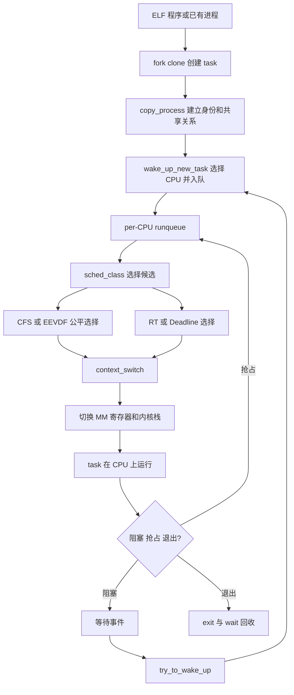

图中存在两个不同层次的“选择”。

`select_task_rq()` 一类函数选择任务归属的 CPU；`pick_next_task()` 一类函数从当前 CPU 的 runqueue 中选择下一个任务。

把两者混为一谈，会导致阅读多核路径时不断迷失。

### 0.4 版本地图

本文引用的 Wowotech 资料跨越较长时间，必须按版本理解。

| 资料主题                                      | 主要代码背景     | 本文处理方式                        |
| --------------------------------------------- | ---------------- | ----------------------------------- |
| credentials、PID、早期进程创建                | 2014 年前后内核  | 保留模型，使用现代命名校正字段      |
| 优先级、调度 API、切换与 syscall              | Linux 4.4.6 附近 | 讲稳定主线，标记旧签名与 arm32 历史 |
| CFS 六篇系列                                  | Linux 4.18       | 用于完整建立经典 CFS 模型           |
| task placement、PELT、load balance、schedutil | Linux 5.4/5.10   | 用于多核和容量模型                  |
| EEVDF                                         | Linux 6.6 起     | 使用上游文档和源码补足原资料缺口    |
| EEVDF 后续增强                                | Linux 6.6 之后   | 单独标记为现代演进，不倒灌历史      |

CFS 自 Linux 2.6.23 合入后长期负责普通任务公平调度。

Linux 6.6 开始把 EEVDF 的 eligibility 与 virtual deadline 选择思想引入 fair class。

“fair class”仍然存在，不意味着内部永远采用经典的“最小 vruntime 即下一任务”规则。

### 0.5 参考资料

以下资料用于提供历史语境，正文不会要求读者打开它们才能理解核心内容。

#### 进程身份、权限与生命周期

1. [process credentials](https://www.wowotech.net/process_management/19.html)
2. [process identification](https://www.wowotech.net/process_management/process_identification.html)
3. [Linux 系统如何标识进程](https://www.wowotech.net/process_management/pid.html)
4. [Process Creation（一）](https://www.wowotech.net/process_management/Process-Creation-1.html)
5. [Process Creation（二）](https://www.wowotech.net/process_management/process-creation-2.html)
6. [进程管理和终端驱动：基本概念](https://www.wowotech.net/process_management/process-tty-basic.html)

#### 调度接口、优先级与切换

7. [Linux 调度器：用户空间接口](https://www.wowotech.net/process_management/scheduler-API.html)
8. [Linux 调度器：进程优先级](https://www.wowotech.net/process_management/process-priority.html)
9. [进程切换分析：基本框架](https://www.wowotech.net/process_management/context-switch-arch.html)
10. [进程切换分析：TLB 处理](https://www.wowotech.net/process_management/context-switch-tlb.html)
11. [进程切换分析：同步处理](https://www.wowotech.net/process_management/scheudle-sync.html)
12. [中断上下文中调度会怎样](https://www.wowotech.net/process_management/schedule-in-interrupt.html)
13. [ARM Linux 系统调用代码分析](https://www.wowotech.net/process_management/syscall-arm.html)
14. [ACCESS_ONCE 宏定义的解释](https://www.wowotech.net/process_management/access-once.html)

#### CFS、PELT 与带宽控制

15. [O(n)、O(1) 和 CFS 调度器](https://www.wowotech.net/process_management/scheduler-history.html)
16. [CFS 调度器（1）：基本原理](https://www.wowotech.net/process_management/447.html)
17. [CFS 调度器（2）：源码解析](https://www.wowotech.net/process_management/448.html)
18. [CFS 调度器（3）：组调度](https://www.wowotech.net/process_management/449.html)
19. [CFS 调度器（4）：PELT](https://www.wowotech.net/process_management/450.html)
20. [CFS 调度器（5）：带宽控制](https://www.wowotech.net/process_management/451.html)
21. [CFS 调度器（6）：总结](https://www.wowotech.net/process_management/452.html)
22. [per-entity load tracking](https://www.wowotech.net/process_management/PELT.html)
23. [PELT 算法浅析](https://www.wowotech.net/process_management/pelt.html)

#### 多核放置、均衡与频率

24. [CFS 任务负载均衡概述](https://www.wowotech.net/process_management/load_balance.html)
25. [CFS 任务的 load balance](https://www.wowotech.net/process_management/load_balance_detail.html)
26. [load_balance 函数代码详解](https://www.wowotech.net/process_management/load_balance_function.html)
27. [CFS 任务的 task placement](https://www.wowotech.net/process_management/task_placement.html)
28. [CFS 任务放置代码详解](https://www.wowotech.net/process_management/task_placement_detail.html)
29. [schedutil governor 情景分析](https://www.wowotech.net/process_management/schedutil_governor.html)

#### Deadline 调度

30. [Deadline 调度器原理](https://www.wowotech.net/process_management/deadline-scheduler-1.html)
31. [Deadline 调度器细节和使用方法](https://www.wowotech.net/process_management/dl-scheduler-2.html)

现代语义主要依据以下一手资料校正：

- [CFS Scheduler](https://docs.kernel.org/scheduler/sched-design-CFS.html)
- [EEVDF Scheduler](https://docs.kernel.org/scheduler/sched-eevdf.html)
- [Deadline Task Scheduling](https://docs.kernel.org/scheduler/sched-deadline.html)
- [Utilization Clamping](https://docs.kernel.org/scheduler/sched-util-clamp.html)
- [Control Group v2](https://docs.kernel.org/admin-guide/cgroup-v2.html)
- [sched(7)](https://man7.org/linux/man-pages/man7/sched.7.html)
- [clone(2)](https://man7.org/linux/man-pages/man2/clone.2.html)

## 1. task、进程、线程与生命周期

### 1.1 程序、进程和执行流

程序是磁盘上的代码与静态数据，进程是程序的一次运行实例。

仅有代码和数据不足以描述正在运行的实例，还需要寄存器现场、虚拟地址空间、打开文件、权限、信号状态和调度状态。

教材常说进程是资源分配单位、线程是调度单位。

这个说法有助于入门，但 Linux 内核并没有为用户进程和用户线程维护两套互不相干的调度对象。

内核把每条可以独立获得 CPU 的执行流表示为 task，并用 `struct task_struct` 描述。

多个 task 共享同一个地址空间、文件表和信号处理结构时，用户态把它们看作同一进程中的线程。

两个 task 不共享这些资源时，用户态通常把它们看作不同进程。

因此更准确的表述是：

> Linux 调度 task；进程和线程的差异主要来自 task 之间共享哪些资源。

### 1.2 `task_struct` 的职责分组

`task_struct` 很大，不应按字段顺序背诵。

可以按所有权和生命周期把字段分成几组：

| 分组     | 代表对象                             | 回答的问题                     |
| -------- | ------------------------------------ | ------------------------------ |
| 身份     | PID、TGID、parent、group leader      | 这个 task 是谁                 |
| 执行     | 内核栈、thread context、flags        | CPU 如何继续执行它             |
| 内存     | `mm`、`active_mm`                | 它使用哪个地址空间             |
| 文件系统 | `files`、`fs`                    | 它打开了什么、工作目录在哪     |
| 信号     | `signal`、`sighand`、pending     | 线程组如何接收和处理信号       |
| 权限     | `cred`、`real_cred`              | 内核以什么身份检查权限         |
| 调度     | policy、prio、`se`、`rt`、`dl` | 它如何竞争 CPU                 |
| 生命周期 | state、exit state、usage             | 它能否运行、是否退出、何时释放 |

现代内核里的具体字段会变化。

例如旧文章常展示 `volatile long state`，现代源码通常把运行状态字段命名为 `__state`，并通过专用访问函数和 `READ_ONCE()`/`WRITE_ONCE()` 约束访问。

学习结构体时应抓住关系，不应把某个版本的字段拼图当作稳定 ABI。

### 1.3 task 与共享资源的关系

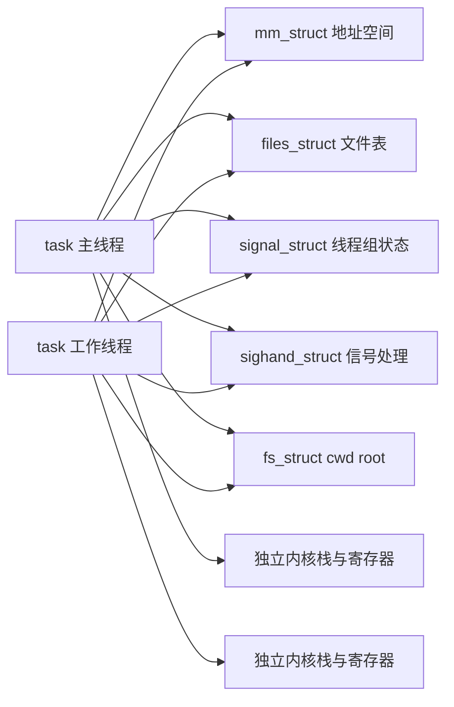

线程共享资源不意味着共享一切。

每个线程必须有独立的寄存器现场、内核栈、用户栈位置、调度实体和 thread ID，否则调度器无法分别暂停和恢复它们。

共享对象通常通过引用计数管理生命周期。

线程退出时减少引用；最后一个使用者离开时才真正释放对象。

### 1.4 `clone()` flags 如何塑造进程与线程

`fork()`、`vfork()`、`pthread_create()` 最终都建立新的 task，但选择不同共享关系。

典型线程创建会使用类似以下标志：

```c
CLONE_VM | CLONE_FS | CLONE_FILES |
CLONE_SIGHAND | CLONE_THREAD | CLONE_SYSVSEM
```

| flag                     | 主要效果                               |
| ------------------------ | -------------------------------------- |
| `CLONE_VM`             | 共享虚拟地址空间                       |
| `CLONE_FS`             | 共享 cwd、root、umask 等文件系统上下文 |
| `CLONE_FILES`          | 共享文件描述符表                       |
| `CLONE_SIGHAND`        | 共享信号处理函数表                     |
| `CLONE_THREAD`         | 加入同一线程组                         |
| `CLONE_PARENT_SETTID`  | 在父地址空间写入新 task ID             |
| `CLONE_CHILD_CLEARTID` | 退出时清零地址并唤醒 futex 等待者      |

这些标志之间存在约束。

例如共享信号处理函数通常要求共享地址空间；加入同一线程组也要求更完整的共享组合。

用户不应把 `clone()` 看成任意拼装而没有一致性要求的接口。

### 1.5 PID、TID 与 TGID

Linux 内核中的每个 task 都有可用于标识该执行流的 ID。

用户常说的 TID，在内核视角对应线程自己的 PID number；用户空间传统意义的进程 ID 通常对应线程组 ID，即 TGID。

假设一个进程包含三个线程：

```text
线程 A：PID/TID = 4100，TGID = 4100，group leader
线程 B：PID/TID = 4101，TGID = 4100
线程 C：PID/TID = 4102，TGID = 4100
```

`getpid()` 返回 TGID 4100。

Linux 特有的 `gettid()` 分别返回 4100、4101、4102。

主线程的 PID 与 TGID 相等，它是 thread group leader。

### 1.6 PID 不是简单整数

如果内核只在 `task_struct` 中保存一个整数 PID，会遇到三个问题：

1. PID 会复用，持有旧整数不能保证仍指向原任务。
2. 同一个任务在不同 PID namespace 中具有不同可见编号。
3. 一个编号可能按 PID、PGID、SID 等不同类型参与查找。

内核因此把数字、命名空间和可引用对象分开表示。

`struct pid` 可以连接一个逻辑身份与不同类型的 task 关系，并通过引用计数避免查找期间对象消失。

用户态看到的整数只是某个 PID namespace 中的投影。

容器内的 PID 1，在宿主机命名空间里可能是另一个较大的数字。

### 1.7 PID、PGID 与 SID 的层级

进程组（process group）服务于作业控制，session 则把一个登录或控制终端上下文中的进程组组织起来。

```text
session SID=3000
├── 前台进程组 PGID=3100
│   ├── shell pipeline task TGID=3100
│   └── shell pipeline task TGID=3101
└── 后台进程组 PGID=3200
    └── background job TGID=3200
```

管道 `producer | consumer` 包含不同进程，但 shell 通常把它们放进同一进程组。

终端驱动把 `Ctrl+C` 转成 `SIGINT` 后，信号发送给前台进程组，而不是只发送给某个任意进程。

PGID 的 leader 是 PID 等于 PGID 的进程。

进程组 leader 退出后，进程组仍可在其他成员存在时继续存在。

session leader 创建 session；session 可拥有一个 controlling terminal，并记录前台进程组。

### 1.8 TTY、PTY 与作业控制

TTY 是终端抽象，PTY 是成对的伪终端设备。

图形终端模拟器、SSH 和容器终端常通过 PTY master/slave 提供与传统终端相同的行规程和作业控制语义。

一个交互 shell 启动前台作业时大致执行：

1. fork 出管道中的进程；
2. 把它们加入同一 process group；
3. 用 `tcsetpgrp()` 把终端前台组交给该作业；
4. 等待作业停止或退出；
5. 收回终端前台组。

后台进程读取控制终端时可能收到 `SIGTTIN`，写终端时是否收到 `SIGTTOU` 取决于终端设置和操作类型。

`setsid()` 创建新 session，并让调用者成为 session leader 和 process group leader；若调用者已经是进程组 leader，调用会失败。

守护进程常先 fork，确保子进程不是 process group leader，再调用 `setsid()`。

### 1.9 credentials：谁在执行操作

调度器决定谁获得 CPU，credentials 决定获得 CPU 的 task 被允许做什么。

二者属于不同子系统，但 task 生命周期必须正确复制和共享 credentials。

常见身份包括：

| 身份                    | 用途                           |
| ----------------------- | ------------------------------ |
| real UID/GID            | 记录任务最初属于谁             |
| effective UID/GID       | 多数权限判断和 set-ID 语义     |
| saved set-user/group ID | 支持受控地放弃和恢复特权       |
| filesystem UID/GID      | 文件系统权限检查的历史分离需求 |
| supplementary groups    | 附加组权限集合                 |
| capabilities            | 把传统 root 权限拆成能力位     |

`task_struct` 中的 `real_cred` 与 `cred` 指针分别表达客观身份和当前主观凭据。

内核修改凭据时通常采用 prepare-copy-commit 模式，而不是在共享对象上随意原地改写。

这样读者可通过 RCU 等方式稳定观察旧凭据，新对象准备完毕后再一次发布。

### 1.10 `fork()` 从用户态看起来发生了什么

`fork()` 创建子进程，父子从同一返回点继续执行，但返回值不同。

```c
#include <errno.h>
#include <stdio.h>
#include <stdlib.h>
#include <sys/types.h>
#include <sys/wait.h>
#include <unistd.h>

int main(void)
{
    pid_t child = fork();

    if (child == -1) {
        perror("fork");
        return EXIT_FAILURE;
    }

    if (child == 0) {
        execlp("printf", "printf", "child pid=%ld\n", (long)getpid(), NULL);
        perror("execlp");
        _exit(127);
    }

    int status;
    if (waitpid(child, &status, 0) == -1) {
        perror("waitpid");
        return EXIT_FAILURE;
    }

    if (WIFEXITED(status))
        printf("parent reaped %ld, exit=%d\n", (long)child, WEXITSTATUS(status));

    return EXIT_SUCCESS;
}
```

子进程使用 `_exit()` 处理 `exec` 失败，避免重复刷新从父进程复制来的 stdio 缓冲。

父进程用 `waitpid()` 回收退出状态，否则子进程退出后会暂时保留 zombie 记录。

### 1.11 内核创建路径

不同版本和 libc 封装的入口名称可能不同，稳定的核心主线是：

```text
fork / clone / clone3
  -> 系统调用入口
  -> kernel_clone()
  -> copy_process()
       -> dup_task_struct()
       -> copy_creds()
       -> copy_files()/copy_fs()
       -> copy_sighand()/copy_signal()
       -> copy_mm()
       -> copy_thread()
       -> sched_fork()
  -> wake_up_new_task()
```

`copy_process()` 的工作不是简单 `memcpy(task_struct)`。

它必须验证 flags，分配唯一身份，建立引用关系，复制或共享资源，初始化架构线程现场，并确保失败路径按相反顺序释放已取得的资源。

新 task 在完整初始化前不能被其他 CPU 观察为可运行。

`wake_up_new_task()` 是把完成构造的 task 正式交给调度器的重要边界。

### 1.12 Copy-on-Write 与调度的关系

`fork()` 后父子通常拥有不同 `mm_struct`，但页表最初可以指向相同物理页。

私有可写页被临时标成只读；任一方写入时触发写保护缺页，内核再复制相应物理页。

这就是 Copy-on-Write（COW）。

COW 属于内存管理机制，却直接影响进程创建延迟和调度行为。

fork 本身可能很快，子进程后续写大量内存时才支付复制成本，并可能因缺页和内存回收频繁阻塞。

调度观察中“子进程 CPU 使用不高但完成很慢”可能来自缺页、I/O 或回收，而不一定是没有分配到 CPU。

### 1.13 `vfork()` 的特殊契约

`vfork()` 为紧接着 `execve()` 或 `_exit()` 的场景避免不必要的地址空间工作。

在子进程完成 exec 或退出前，父进程通常被阻塞，子进程暂时与父进程共享地址空间。

子进程在此期间修改普通变量、从函数返回或调用不安全函数都可能破坏父进程状态。

它不是“更快的 fork，可随处替换”，而是具有严格使用契约的接口。

现代应用通常让 libc 或进程创建库选择合适路径，不应为了微小优化随意改用 `vfork()`。

### 1.14 `execve()` 没有创建新 task

`execve()` 用新程序映像替换当前 task 的用户地址空间。

成功后不会返回原程序；PID 通常保持不变，调度身份仍属于同一个 task，但代码、数据、栈和大部分映射被替换。

典型路径可概括为：

```text
execve()
  -> do_execveat_common()
  -> prepare_binprm()
  -> search_binary_handler()
  -> load_elf_binary()
  -> begin_new_exec()
  -> setup_new_exec()
  -> start_thread()
```

多线程进程中执行 exec 时，其他线程需要退出，只留下调用 exec 的执行流承载新程序。

设置了 close-on-exec 的文件描述符会关闭，普通文件描述符则按规则保留。

信号处置、凭据和 dumpability 也会根据 exec 与 set-ID 文件语义调整。

### 1.15 退出、zombie 与回收

task 调用 `exit()` 或从主函数返回后，用户态资源并非在一个瞬间全部消失。

内核先执行线程退出和线程组退出逻辑，释放或减少共享对象引用，再向父进程报告状态。

退出 task 在父进程尚未 wait 时保留最小身份与退出信息，这个状态称为 zombie。

zombie 不再竞争 CPU，也不持有完整用户地址空间，但占用 PID 和用于 wait 的记录。

父进程读取退出状态后，内核才能完成最终回收。

若父进程先退出，子进程会被合适的 reaper 接管；PID namespace 也有自己的 child reaper。

### 1.16 进程创建的调度含义

创建 task 后必须决定它在哪个 CPU 开始运行。

`sched_fork()` 初始化调度字段，防止子任务继承一个已经消耗过服务量的瞬时状态。

`wake_up_new_task()` 根据调度类调用 CPU 选择逻辑、锁定目标 runqueue、完成入队并检查是否需要抢占当前任务。

因此 fork 性能不仅取决于复制资源，也取决于 runqueue 锁、CPU 选择、NUMA、cgroup 层级和唤醒抢占。

### 1.17 系统调用入口：架构无关目标与架构相关手段

系统调用的共同目标是从受限用户态安全进入内核，保存用户现场，验证系统调用号与参数，执行内核函数，再恢复用户态。

x86-64 常使用 `syscall` 指令，参数按 x86-64 syscall ABI 放入寄存器。

arm64 常使用 `svc #0`，系统调用号通常放在 `x8`，参数位于 `x0` 到 `x5`。

旧 Wowotech ARM 文章讨论从 SWI 指令提取系统调用号的历史 ABI，这不能直接套用到现代 arm64。

架构入口最终汇合到较通用的系统调用分派和退出工作，包括信号、审计、跟踪、reschedule 检查等。

### 1.18 PID namespace 的可见性

PID namespace 形成父子层级。

子 namespace 中的 task 在祖先 namespace 中可见并具有对应编号，祖先 namespace 的其他 task 不会自动以相同编号出现在子 namespace。

一个 task 因而可能沿 namespace 层级拥有多个 PID number。

`getpid()` 返回调用 task 当前 namespace 视角下的 TGID；`/proc` 挂载所关联的 PID namespace 又决定目录中能看到哪些进程。

容器排障时必须同时记录容器内 PID 与宿主机 PID，否则 trace、日志和 cgroup 数据难以关联。

每个 PID namespace 需要一个 child reaper，通常是该 namespace 的 PID 1。

它负责接收孤儿并回收退出状态；若 namespace init 异常退出，内核需要终止或处理该 namespace 中剩余 task。

namespace PID 1 对部分信号的默认处理也具有特殊性，不能简单把容器 init 当作普通进程。

### 1.19 `struct pid` 的引用关系

一个数值 PID 可能很快被复用，内核长期引用 task 身份时不应只保存整数。

`struct pid` 具有引用计数，并可按 `PIDTYPE_PID`、`PIDTYPE_TGID`、`PIDTYPE_PGID`、`PIDTYPE_SID` 等关系连接 task。

查找逻辑通常先在指定 namespace 把 number 转为 `struct pid`，再取得对应 task。

调用者还要遵守 RCU 或 task 引用规则，防止返回指针在使用前退出释放。

这说明“通过 PID 找 task”实际包含 number namespace、pid object 与 task lifetime 三层。

### 1.20 Thread group 退出语义

单个线程调用线程级退出时，只结束自己；调用 `exit_group()` 或主程序正常结束通常终止整个线程组。

线程组共享的 `signal_struct` 保存组级退出、累计资源和 child subreaper 等状态。

其中一个线程触发致命信号时，内核要通知其他线程退出，并避免多个线程重复发布父进程可见的同一组退出事件。

父进程通常 wait 用户态“进程”，但内核必须协调每个 task 的释放和最后 group leader 的可见状态。

### 1.21 Zombie 与 stopped child 的 wait 选择

`waitpid()` 不只是回收已退出子进程，还可根据选项报告 stopped 或 continued 状态。

父进程可以等待指定 PID、任意子进程、某个进程组，或使用 `waitid()` 精确选择事件类型。

内核在 child list、ptrace 关系和 thread group 之间寻找可报告事件，并保证同一退出状态不会被多个 waiter 重复消费。

`SIGCHLD` 被忽略或设置特定选项时，zombie 保留规则也可能变化。

### 1.22 Subreaper

服务管理器可通过 `PR_SET_CHILD_SUBREAPER` 成为后代孤儿的中间 reaper。

当直接父进程退出时，孤儿优先重新挂到最近的存活 subreaper，而不一定直接交给 namespace PID 1。

容器 runtime 和进程监督器利用这一机制回收双 fork 服务产生的后代。

它不改变 task 调度优先级，只改变 parent/child 生命周期关系和 wait 责任。

### 1.23 `pthread_create()` 到 clone

POSIX `pthread_create()` 由用户态线程库准备用户栈、TLS、启动参数和清理协议，再调用 clone 系统接口创建共享资源的 task。

新线程从库的 trampoline 开始，初始化线程本地状态后调用用户函数。

线程退出时，`CLONE_CHILD_CLEARTID` 让内核清零用户地址并执行 futex wake，使 `pthread_join()` 能等待 task 真正离开。

因此 pthread 生命周期同时依赖用户态库协议和内核 task 生命周期，不能只从 clone flags 解释全部行为。

### 1.24 `execve()` 后保留与重置

exec 保留 PID、父子关系、部分 credentials 和未设置 close-on-exec 的文件描述符。

被捕获的信号处置通常重置为默认，信号 mask 保留；用户内存映射、alternate signal stack 和用户线程则被替换或清除。

set-user-ID、file capabilities、`no_new_privs`、ptrace 和 mount flags 会共同决定 exec 后 credentials 是否提升。

这类规则影响安全边界，不应简化成“task_struct 不变，只有 mm 改变”。

### 1.25 Fork 失败路径

`copy_process()` 可能因 PID、内存、用户进程数限制、cgroup pids controller、安全模块或 flags 冲突失败。

失败时必须按已完成阶段撤销引用与分配，且不能把半初始化 task 暴露到 PID 查找或 runqueue。

应用应检查 fork 返回 -1，并区分 `EAGAIN` 与 `ENOMEM` 等错误；无界重试可能在资源压力下形成忙循环。

系统级 fork latency 或失败也可能来自 cgroup `pids.max`，不一定是物理内存耗尽。

### 1.26 创建—运行—退出时间线

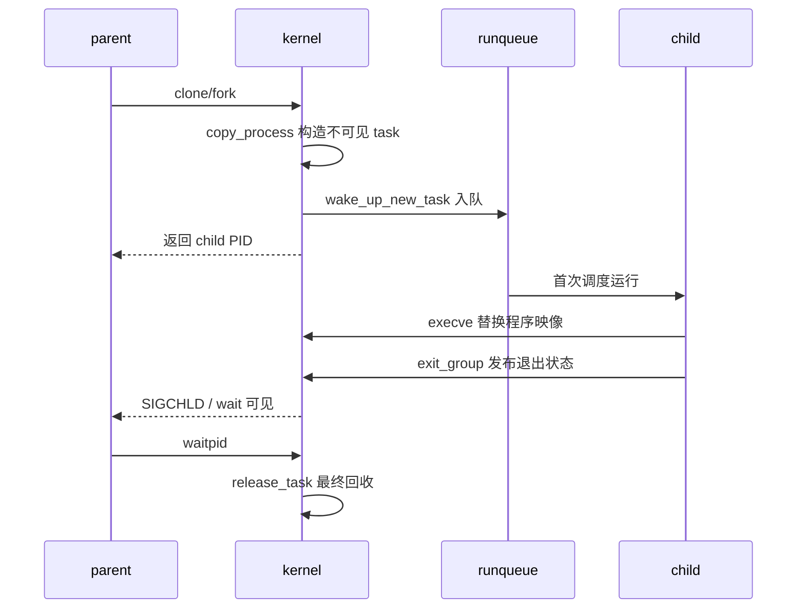

该时间线表明 fork 返回父进程不等于子进程已经执行，子进程何时首次运行取决于调度。

### 1.27 本章小结

task 是全文最基本的主体。

PID 体系解决身份，clone flags 决定资源共享，credentials 决定权限，fork/exec/exit 决定生命周期。

当一个 task 完成创建或从等待事件中醒来后，问题从“它是谁”转变成“它现在能否运行、应该在哪个 CPU 上运行、何时轮到它”。

这正是调度核心模型要回答的内容。

## 2. 调度核心模型：状态、runqueue 与调度类

### 2.1 可运行不等于正在运行

一个 task 具备运行条件时称为 runnable，但它可能仍在 runqueue 中等待。

running 表示它正在某个 CPU 上执行。

在单 CPU 上，任一时刻至多一个普通 task 是 current；其他 runnable task 排队等待。

阻塞 task 不参与 CPU 竞争，它等待 I/O、锁、定时器、信号或其他事件。

性能分析必须区分：

- running time：真正执行的时间；
- runnable waiting time：具备条件但没拿到 CPU 的时间；
- blocked time：没有运行条件、等待外部事件的时间。

CPU 利用率只能反映第一类，调度延迟主要来自第二类，I/O 延迟常落在第三类。

### 2.2 task 状态只是状态机的一部分

教材常画 `RUNNING、READY、BLOCKED` 三态图。

Linux 把 runnable 与 running 都包含在 `TASK_RUNNING` 语义中，再用 runqueue 和 CPU 字段区分是否真正执行。

常见睡眠状态包括可被信号打断的 `TASK_INTERRUPTIBLE`、通常只因明确事件唤醒的 `TASK_UNINTERRUPTIBLE`，以及 killable、stopped、traced 等组合状态。

退出状态由另一组字段表达，不能把所有状态都当成一个简单互斥枚举。

### 2.3 完整调度状态图

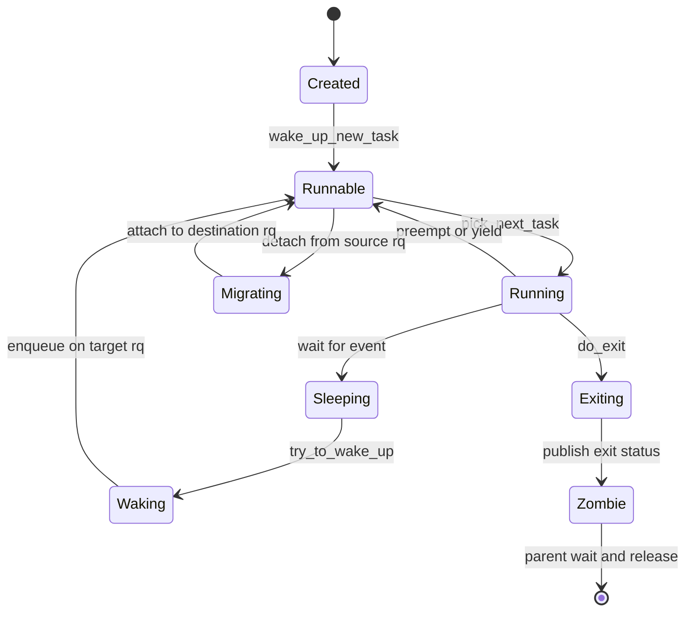

图中 `Waking` 和 `Migrating` 很重要。

它们表示任务正在由某个 CPU 或代码路径接管，其他并发路径不能再把它重复入队或同时迁移。

调度竞态的核心不只是 state 数值，而是谁拥有改变 state、CPU 和队列归属的权利。

### 2.4 per-CPU runqueue

现代 Linux 为每个逻辑 CPU 维护一个 `struct rq`。

它不是简单链表，而是该 CPU 调度状态的总容器，包含 current、idle、clock、可运行数量、不同调度类的子队列、capacity 和统计信息。

```text
CPU0 rq
├── curr
├── stop queue/state
├── dl_rq
├── rt_rq
├── cfs_rq
└── idle task

CPU1 rq
├── curr
├── dl_rq
├── rt_rq
├── cfs_rq
└── idle task
```

per-CPU 设计避免所有 CPU 为一个全局队列长期争锁，也有利于缓存局部性。

代价是系统必须执行任务放置和负载均衡，否则某个 CPU 可能排长队而另一个 CPU 空闲。

### 2.5 `rq` 与 `cfs_rq` 不是同一个对象

`rq` 表示某个 CPU 的整个调度队列。

`cfs_rq` 只表示 fair class 在某个 CPU、某个 task group 层级上的队列。

没有组调度时，每 CPU 的根 `cfs_rq` 最直观。

启用组调度后，一个 CPU 上可存在层级化的多个 `cfs_rq`；组作为 `sched_entity` 进入父队列，组内 task 进入子队列。

把 `rq`、根 `cfs_rq` 和组内 `cfs_rq` 混用，是理解 cgroup 公平分配时最常见的错误。

### 2.6 调度类是策略插件边界

调度核心不应了解每种策略的全部细节。

`struct sched_class` 因此提供 enqueue、dequeue、wakeup preemption、pick next、put previous、tick 等操作。

概念上的优先级顺序是：

```text
stop > deadline > realtime > fair > idle
```

具体源码中调度类的链接方式和是否出现额外类会随版本与配置变化。

本文只讨论传统内核调度类，不引入可编程的扩展调度框架。

高优先级调度类存在可运行任务时，低优先级类通常不会被选择；类内再按自己的算法排序。

### 2.7 为什么需要 stop 和 idle 类

stop 类用于极少数必须压过普通调度活动的内核操作，例如某些 CPU stop、迁移或热插拔协调。

它不是应用可以日常选择的“超级实时策略”。

idle task 则保证 CPU 永远有一个可运行上下文。

当没有其他任务可选时，CPU 运行 per-CPU idle task，进入合适的低功耗状态并等待事件。

idle task 不是普通后台进程，也不通过 nice 与普通任务竞争。

### 2.8 入队与出队的不变量

任务进入 runnable 集合时，调度类的 enqueue 操作把它加入目标 rq 的对应子队列，并更新计数和统计。

任务阻塞、退出或迁移离开时执行 dequeue。

必须保持以下不变量：

1. 一个普通 task 不能同时位于两个 CPU 的 runqueue；
2. task 不能被重复入队；
3. 队列节点、`on_rq`、可运行计数和负载统计必须一致；
4. 正在 CPU 上执行的 task 不能被另一 CPU 当作普通排队任务直接搬走；
5. 迁移必须同时遵守 affinity 和调度类约束。

这些约束解释了为什么看似简单的 enqueue/dequeue 路径需要 rq lock、task `pi_lock`、内存序和重试。

### 2.9 `schedule()` 何时被调用

常见触发可分为主动和被动两类。

主动调度发生在当前 task 等待资源、显式 yield 或退出时。

被动调度发生在更合适的 task 出现、时间份额条件满足，或内核准备返回可抢占上下文时。

时钟 tick 或唤醒路径通常不会在任意位置直接切换栈，而是设置 need-resched 标志。

系统在安全调度点观察标志后进入 `schedule()`。

### 2.10 `TIF_NEED_RESCHED`

need-resched 表示当前 CPU 应尽快重新执行调度决策。

设置它和真正上下文切换是两个时刻。

例如时钟中断判断当前公平任务应让出 CPU 后，可调用 `resched_curr()` 设置标志；中断退出路径随后检查能否抢占，再调用调度器。

如果当前处于禁止抢占的临界区，标志会保留，直到 preempt count 恢复到允许值。

这保证调度不会在持有不允许跨 task 切换的低层锁时发生。

### 2.11 `schedule()` 的稳定主线

版本间细节很多，但可以先记住以下职责顺序：

```text
schedule()
  -> __schedule()
       1. 更新 rq clock
       2. 处理 prev 状态与必要的 dequeue
       3. 选择 next task
       4. 更新 rq->curr 和切换统计
       5. context_switch(prev, next)
  -> sched_submit_work / sched_update_worker 等外围处理
```

`__schedule()` 运行在极敏感路径中。

进入后通常关闭抢占并取得本 CPU rq 的锁；选好 next 后，锁的释放可能与上下文切换协议交织。

不能只从普通 C 函数调用的角度理解它，因为 `switch_to()` 返回的位置属于“下一次该 task 再被切回来”的时间点。

### 2.12 prev 的状态如何决定是否出队

当前 task 调用 `schedule()` 前，如果仍是 `TASK_RUNNING`，通常表示它只是被抢占或主动让出，仍然 runnable，不应作为睡眠任务移出可运行集合。

如果它已把状态设置为某种睡眠状态，并且没有并发信号或唤醒改变条件，调度器需要把它从 runqueue 移除。

典型等待模式是：

```c
for (;;) {
    prepare_to_wait(&wq, &wait, TASK_INTERRUPTIBLE);
    if (condition)
        break;
    schedule();
}
finish_wait(&wq, &wait);
```

正确顺序是先把自己发布为等待者和睡眠状态，再检查条件。

若先检查条件再入等待队列，事件可能在两步之间发生，唤醒者看不到等待者，当前 task 随后睡眠并永久错过事件。

### 2.13 `READ_ONCE()` 解决的边界

旧文章介绍 `ACCESS_ONCE()`；现代内核主要使用 `READ_ONCE()` 和 `WRITE_ONCE()`。

它们约束编译器把一次访问合并、拆分或凭空重复，并为内核并发代码提供明确的单次访问表达。

它们不是锁，也不自动建立任意跨 CPU 的完整 happens-before 关系。

调度状态发布通常还依赖锁、release/acquire、专用 barrier 或控制依赖。

看到 `READ_ONCE(p->__state)` 时，应继续查找与之配对的状态写入和同步协议，而不是得出“并发已经安全”的结论。

### 2.14 为什么硬中断上下文不能睡眠

硬中断处理程序是在被打断 task 的上下文或专用中断栈上执行的一段异常处理，不是独立的可调度 task。

睡眠意味着把“当前 task”改成不可运行并切换出去，但中断处理程序并没有自己的 task 身份可以稍后被唤醒恢复。

中断路径还可能持有硬中断语义下的锁或要求尽快完成 ack/EOI。

因此 hardirq 和 softirq 不能调用可能睡眠的 API。

需要睡眠的工作应转交 threaded IRQ、workqueue 或其他进程上下文。

这条规则属于中断专题，但它同时确定了调度器的合法入口边界。

### 2.15 rq lock 与双队列锁

修改某 CPU runqueue 的核心状态需要持有相应 rq lock。

单个任务在本地入队只需一个 rq 时较直观，跨 CPU 迁移则可能同时涉及源和目标 rq。

双锁必须采用一致顺序或专用帮助函数，否则 CPU0 持有 rq0 等 rq1、CPU1 持有 rq1 等 rq0 会死锁。

调度器还必须处理任务在准备加锁期间改变 CPU 的情况，因此常见“读 task CPU—锁 rq—重新验证”的循环。

### 2.16 `on_rq` 与 `on_cpu`

`on_rq` 描述任务是否处于 runqueue 管理状态，但具体值还可能区分 queued 与 migrating。

`on_cpu` 表示任务正在某 CPU 上执行或处于切换协议中的相关状态。

两者不能由 task state 替代。

一个 `TASK_RUNNING` task 可能正在运行，也可能在队列等待；迁移中的 task 可能暂时不在普通队列节点上，却仍由迁移路径拥有。

远程唤醒路径要避免把仍在旧 CPU 执行的任务提前排到新 CPU，通常需要等待或利用相应同步关系。

### 2.17 调度时钟

调度器需要单调、细粒度的时间来累计执行时间、更新虚拟时间、PELT 和带宽配额。

`rq_clock()` 一类接口提供 runqueue 语境下的时钟视图。

读取硬件时钟可能昂贵，因此调度器在持锁路径中更新 rq clock，再让多个计算共享同一时刻。

调用者必须遵守“何时已经更新、哪些子时钟有效”的约束，否则统计可能重复或倒退。

### 2.18 调度策略用户接口

普通应用常接触以下接口：

| 接口                          | 作用                                  |
| ----------------------------- | ------------------------------------- |
| `nice()`、`setpriority()` | 调整普通任务 nice                     |
| `sched_setscheduler()`      | 选择 NORMAL/BATCH/IDLE/FIFO/RR 等策略 |
| `sched_setattr()`           | 设置 Deadline、uclamp 等扩展属性      |
| `sched_setaffinity()`       | 限定允许运行的 CPU                    |
| `sched_yield()`             | 主动让出当前策略下的执行机会          |
| `sched_getcpu()`            | 查询调用线程当前 CPU                  |

改变策略和优先级通常需要权限检查。

`sched_yield()` 的效果由调度策略决定，不能当作通用线程同步工具。

忙等循环里不断 yield 既不保证公平顺序，也可能浪费 CPU。

### 2.19 一个最小 affinity 示例

```c
#define _GNU_SOURCE
#include <errno.h>
#include <sched.h>
#include <stdio.h>
#include <string.h>

int main(void)
{
    cpu_set_t set;
    CPU_ZERO(&set);
    CPU_SET(2, &set);

    if (sched_setaffinity(0, sizeof(set), &set) == -1) {
        fprintf(stderr, "sched_setaffinity: %s\n", strerror(errno));
        return 1;
    }

    printf("running on cpu %d\n", sched_getcpu());
    return 0;
}
```

PID 参数为 0 表示调用线程自身。

该示例只表达 allowed CPU mask，不保证调用后立即在 CPU2 连续独占运行。

如果 CPU2 离线、不在 cpuset 有效集合内或编号不存在，调用会失败或有效集合受到进一步约束。

### 2.20 `pi_lock` 与 rq lock 的分工

task 的 `pi_lock` 保护优先级继承状态以及调度器需要跨 rq 稳定观察的若干 task 字段。

rq lock 保护某个 CPU 的队列与 current 等本地调度状态。

唤醒和迁移可能先持 `pi_lock` 再获取目标 rq lock，从而保证 task CPU/状态在锁转换期间不会被另一条路径改写。

并非所有字段都由同一把锁保护；阅读注释中的 locking rules 比猜测结构体邻近关系更可靠。

### 2.21 `set_task_cpu()` 不是普通赋值

修改 task 所属 CPU 会影响 PELT 时钟、NUMA 统计、迁移计数、调度类回调和 lockdep 验证。

任务必须处于允许迁移的状态，调用者通常持有合适的锁并确保它不在另一个 rq 上执行。

直接写 `p->cpu` 会绕过这些协议。

源码中的 `set_task_cpu()` 及其前后 detach/attach 操作共同构成迁移事务。

### 2.22 `double_rq_lock` 的锁序

跨 rq 操作若需要同时持有两把锁，内核按 rq 地址或 CPU 规则建立全局顺序。

若源和目标实际是同一个 rq，只能锁一次。

取得双锁后仍要重新验证 task CPU，因为在等待锁时状态可能变化。

这种 lock-validate-retry 模式在调度器中很常见，不能把 retry 当作异常路径忽略。

### 2.23 `schedule()` 与 worker 协作

workqueue worker 阻塞或恢复时，调度器需要通知 concurrency-managed workqueue 调整并发 worker 数。

`schedule()` 外围的 submit work/worker hooks 让 workqueue 知道当前 worker 是否准备睡眠，必要时唤醒替代 worker。

这不是 fair 算法的一部分，却说明调度入口还承担与其他内核执行框架的协议。

分析函数路径时应区分调度核心不可缺少步骤与配置相关外围 hook。

### 2.24 `schedule_timeout()` 与普通 `schedule()`

普通 `schedule()` 只放弃 CPU，不自带超时唤醒来源。

`schedule_timeout()` 在睡眠前安排 timer，到期后唤醒 task，并返回剩余时间语义。

wait-event timeout 宏进一步把条件检查、等待队列和 timeout 组合起来。

直接在循环中 `schedule()` 而没有等待队列、timer 或其他明确 waker，可能让 task 永久睡眠。

### 2.25 调度核心检查清单

阅读任何状态转换时，依次确认 task state、`on_rq`、`on_cpu`、task CPU、调度类、rq lock 与 `pi_lock`。

再确认操作是否更新 rq clock、调度类统计、PELT 和 cgroup 层级。

最后确认远程 CPU 是否需要 IPI，以及失败重试时 task 由谁拥有。

这份清单可以覆盖大多数 enqueue、dequeue、wakeup 和 migration 路径。

### 2.26 本章小结

调度核心维护的是一组严格状态不变量，而不只是“从队列拿一个任务”。

task state 表示运行条件，`on_rq` 表示队列所有权，`on_cpu` 表示执行所有权，per-CPU `rq` 保存本地调度状态。

调度类决定不同策略之间的优先关系，具体类再选择自己的最佳任务。

下一章进入 fair class 的经典 CFS 模型，解释普通任务的优先级如何转化为可计算的比例公平。

## 3. 优先级、权重与经典 CFS

### 3.1 为什么普通任务不能只使用固定优先级

若调度器永远选择优先级最高的普通任务，只要高优先级任务持续 runnable，低优先级任务就可能永久饥饿。

普通分时任务需要的是比例公平：权重较高者获得更多 CPU，但权重较低者仍应取得进展。

实时调度的固定优先级语义与此不同，后文会单独讨论。

经典 Completely Fair Scheduler（CFS）的出发点是模拟一台理想多任务处理器。

理想处理器可以让所有 runnable task 同时运行，每个任务按权重比例获得处理能力。

真实 CPU 只能一次运行一个 task，因此内核让任务轮流运行，并追踪它们相对于理想模型的服务进度。

### 3.2 policy、priority、nice 和 weight

这四个词不能混用。

policy 决定 task 属于哪种调度策略，如 `SCHED_NORMAL`、`SCHED_BATCH`、`SCHED_FIFO`。

priority 在内核中有多个表示，服务于调度类排序、优先级继承和用户接口映射。

nice 是普通任务暴露给用户的相对优先级，通常范围为 -20 到 19。

weight 是 fair class 计算 CPU 份额和虚拟时间时真正使用的负载权重。

nice 越小，weight 越大；weight 越大，同样实际执行时间折算出的虚拟时间越少。

### 3.3 内核优先级字段的关系

旧版本源码常见以下概念：

| 字段            | 语义                                 |
| --------------- | ------------------------------------ |
| `static_prio` | 由 nice 映射得到的普通静态优先级     |
| `normal_prio` | 按 policy 计算的正常优先级           |
| `prio`        | 当前有效优先级，可能受 PI 等机制提升 |
| `rt_priority` | 用户可见的实时优先级参数             |

普通 nice 0 常映射到内核普通优先级区间的中点。

数值越小在许多内核优先级比较中代表越高，但用户态实时优先级又常以较大数值代表更高。

不要只凭数字大小跨接口比较，应先确认所处表示空间。

### 3.4 nice 到 weight 不是线性映射

如果 nice 每增加 1 只把权重减去固定值，跨较大 nice 差异时比例会失真。

Linux 使用近似几何级数的权重表，使相邻 nice 等级对应大约 1.25 倍比例。

常用基准值为 nice 0 的 `NICE_0_LOAD = 1024`。

若任务 A 的 weight 为 1024，任务 B 的 weight 为 335，则在两者持续 runnable 且没有其他约束时，理想 CPU 份额为：

\[
share_A = \frac{1024}{1024+335} \approx 75.35\%
\]

\[
share_B = \frac{335}{1024+335} \approx 24.65\%
\]

这表示长期竞争份额，不保证任意 1 ms 窗口都精确达到该比例。

### 3.5 例题：三个任务的理想份额

统一示例包含三个持续 runnable 的任务：

| task           | nice | 简化 weight |
| -------------- | ---: | ----------: |
| A：交互前台    |   -5 |        3121 |
| B：普通 worker |    0 |        1024 |
| C：后台任务    |    5 |         335 |

总权重：

\[
W = 3121 + 1024 + 335 = 4480
\]

A 的份额：

\[
3121 / 4480 \approx 69.67\%
\]

B 的份额：

\[
1024 / 4480 \approx 22.86\%
\]

C 的份额：

\[
335 / 4480 \approx 7.48\%
\]

三者相加因四舍五入约为 100.01%，误差来自显示精度。

如果观测窗口足够长、任务不睡眠且没有 quota 或更高调度类干扰，实际 CPU time 应趋近这些比例。

### 3.6 虚拟运行时间 `vruntime`

实际执行时间无法直接比较不同权重 task 的公平进度。

高权重 task 理应多运行；若只比较实际 CPU time，它会总显得“占用更多”。

CFS 将实际执行时间归一化到 nice 0 的基准权重：

\[
\Delta v = \Delta t \times \frac{NICE\_0\_LOAD}{weight}
\]

其中：

- \(\Delta t\) 是本次实际运行时间；
- \(weight\) 是 task 的调度权重；
- \(\Delta v\) 是增加的虚拟运行时间。

高权重 task 的 `vruntime` 增长较慢，因此它可实际运行更久，才达到与低权重 task 相同的虚拟进度。

### 3.7 例题：相同实际时间的不同虚拟增量

仍使用 A、B、C，假设每个 task 都实际运行 4 ms。

A：

\[
\Delta v_A = 4 \times 1024 / 3121 \approx 1.312\text{ ms}
\]

B：

\[
\Delta v_B = 4 \times 1024 / 1024 = 4\text{ ms}
\]

C：

\[
\Delta v_C = 4 \times 1024 / 335 \approx 12.227\text{ ms}
\]

C 只运行 4 ms，公平账本却前进约 12.2 ms，随后要等待更久。

A 运行 4 ms，公平账本只前进约 1.3 ms，因此仍有资格更快再次运行。

### 3.8 `sched_entity` 是公平调度实体

fair class 不是直接把整个 `task_struct` 放进排序树，而是使用嵌入其中的 `struct sched_entity`。

概念字段包括：

```c
struct sched_entity {
    struct load_weight load;
    struct rb_node run_node;
    u64 exec_start;
    u64 sum_exec_runtime;
    u64 vruntime;
    /* EEVDF 版本还包含 deadline、vlag、slice 等信息 */
    struct sched_avg avg;
};
```

这段代码是说明性摘录，不代表所有版本的精确布局。

`sched_entity` 既可代表 task，也可在组调度中代表一个 task group。

统一实体抽象让同一公平算法可以递归应用于“组之间”和“组内任务之间”。

### 3.9 经典 CFS 的时间排序树

Linux 4.18 的经典模型使用红黑树组织 runnable entity，并按 vruntime 排序。

最左实体拥有最小 vruntime，可理解为在公平账本中最落后。

```text
                 se(v=18)
                /        \
          se(v=12)       se(v=27)
          /     \             \
      se(v=9)  se(v=15)      se(v=31)
        ^
        经典 CFS 最左候选
```

红黑树提供 O(log n) 插入和删除，cached leftmost 使取得最左节点接近 O(1)。

现代 EEVDF 仍使用增强树，但排序键和子树信息服务于 virtual deadline 与 eligibility，不能继续只看最小 vruntime。

### 3.10 `cfs_rq->min_vruntime`

`min_vruntime` 是 runqueue 公平时间轴的单调基准。

它不会简单等于“树上任意时刻最小字段值”，因为当前运行实体不一定在普通树节点中，更新还必须保证单调。

它有三项关键作用：

1. 表示该 `cfs_rq` 已推进到的大致公平进度；
2. 为新建或唤醒实体提供放置基准；
3. 在迁移实体时帮助把相对虚拟位置从一个 rq 转换到另一个 rq。

如果新任务总以 vruntime 0 入队，运行很久的系统中它会落后基准巨大距离，从而不公平地长期占用 CPU。

### 3.11 vruntime 溢出为何可控

无符号时间字段最终可能回绕。

内核比较虚拟时间时通常依赖有界差值和带符号比较，而不是天真地使用普通无符号 `<`。

只要参与比较的实体不会相差超过有符号范围的一半，回绕前后的相对顺序仍可判断。

`min_vruntime` 和实体放置规则避免 runnable 集合出现无限大的距离。

这与内核比较 jiffies 时使用 `time_before()` 一类宏的思想相似。

### 3.12 `update_curr()`：公平账本的写入点

经典 CFS 中，`update_curr()` 是连接真实 CPU 时间与公平模型的关键函数。

逻辑步骤为：

```text
读取当前 rq 时钟
  -> delta_exec = now - curr->exec_start
  -> 更新 exec_start
  -> 累加 sum_exec_runtime
  -> calc_delta_fair(delta_exec, curr)
  -> 累加 curr->vruntime
  -> 更新 min_vruntime
  -> 更新统计、带宽和 PELT 相关状态
```

它会在 tick、enqueue/dequeue、put_prev 等多个边界被调用。

只在时钟 tick 更新会导致 tick 之间的运行时间在任务阻塞或切换时丢失，因此事件路径也必须结账。

### 3.13 调度周期、目标延迟和最小粒度

早期 CFS 讲解常使用 target latency：希望所有 runnable task 在一个目标周期内至少获得一次运行机会。

若 runnable task 数量较少，实体的理想 slice 可近似为：

\[
slice_i = period \times \frac{weight_i}{\sum weight}
\]

任务很多时，若仍固定很短 period，每个 slice 会小到上下文切换成本不可接受。

调度器因此结合最小粒度扩展 period，避免每个任务只运行极短时间。

具体 tunable 名称和计算在版本间变化，不能把某版 sysctl 当成永久 ABI。

### 3.14 例题：理想 slice

假设一个简化调度周期为 24 ms，三个任务权重改为 2048、1024、1024。

总权重为 4096。

任务 A：

\[
slice_A = 24 \times 2048 / 4096 = 12\text{ ms}
\]

任务 B 和 C：

\[
slice_B = slice_C = 24 \times 1024 / 4096 = 6\text{ ms}
\]

这组 slice 正好反映 2:1:1 权重比例。

若最小粒度为 4 ms、系统突然出现 20 个等权任务，则 24/20=1.2 ms 太短；简化模型会把周期扩展到至少 80 ms，才能给每个任务约 4 ms。

### 3.15 新任务应该放在哪里

新任务没有历史运行时间，但不能因此在公平账本中从零开始。

经典 `place_entity()` 以 `min_vruntime` 为基准，并根据 initial placement、sleeper bonus 和调度特性调整。

fork 场景还可能对父子虚拟位置进行安排，避免大量 fork 让新进程无成本抢占已有任务。

稳定原则是：新实体应从当前公平进度附近开始，而不是继承一个跨 rq 不可比较的绝对值。

### 3.16 睡眠任务与公平性

交互任务常运行很短时间后等待输入或 I/O。

它睡眠期间没有消费 CPU，醒来时理应较快获得服务，否则界面响应会很差。

但如果睡眠任务保留无限久以前的低 vruntime，它醒来后可能连续运行过多时间，攻击公平性。

CFS 放置逻辑在响应性与防止 sleeper abuse 之间设定边界，将唤醒实体放在当前基准附近而不是任意落后位置。

### 3.17 enqueue 与 dequeue

经典路径可概括为：

```text
enqueue_task_fair()
  -> 对 task 到根的每层 sched_entity
       -> enqueue_entity()
            -> 更新当前实体
            -> 放置或归一化 vruntime
            -> 更新 PELT 与 load
            -> 加入红黑树

dequeue_task_fair()
  -> dequeue_entity()
       -> 更新当前实体
       -> 从树移除
       -> 更新 load、PELT 和层级状态
```

组调度会让路径沿 parent entity 逐层传播。

不能把 enqueue 理解成一个 `list_add()`；它同时修改公平、负载、带宽和层级可运行状态。

### 3.18 pick、set next 与 put prev

选取候选、让候选成为 current、把旧 current 放回队列是不同操作。

经典语义中：

- pick 找出公平上最适合的实体；
- `set_next_entity()` 从树中取出实体并设置执行起点；
- `put_prev_entity()` 结算旧实体并在仍 runnable 时重新入树。

current 常不作为普通 queued 节点留在树里，因此统计树节点数量时要理解版本中的 `nr_running` 是否包括 current。

### 3.19 周期 tick 的作用

`scheduler_tick()` 调用当前任务所属调度类的 `task_tick()`。

fair class 在 tick 中更新当前执行时间、PELT 与带宽状态，并判断是否需要 reschedule。

经典 CFS 的 tick 抢占会比较任务已运行时间、理想 slice、最小粒度和其他实体的虚拟位置。

tick 只是触发检查的机会，不是 CFS 时间精度的唯一来源。

CFS 以纳秒级时间记账，即使系统 tick 粒度更粗，切换和事件路径也会结算实际时间。

### 3.20 SCHED_NORMAL、BATCH 与 IDLE

这三类策略都由 fair class 管理，但侧重点不同。

`SCHED_NORMAL` 面向一般交互与吞吐混合负载。

`SCHED_BATCH` 告诉调度器任务更偏批处理，可弱化唤醒交互性优惠，减少不必要抢占并改善缓存利用。

`SCHED_IDLE` 比 nice 19 更弱，用于只有系统确实空闲时才希望运行的任务，但仍不是 per-CPU idle task。

策略语义和具体抢占启发式随 CFS 向 EEVDF 演进，应用不应依赖某个内部 buddy 标志。

### 3.21 CFS 组调度的递归公平

假设用户 A 创建 100 个 task，用户 B 创建 1 个 task。

若只按 task 公平，A 获得约 100/101 CPU，B 只有 1/101。

组调度先让 A 组与 B 组按组权重竞争，再在 A 组内部划分其份额。

```text
root cfs_rq
├── group A entity weight=100
│   └── group A cfs_rq
│       ├── task A1
│       ├── task A2
│       └── ... A100
└── group B entity weight=100
    └── group B cfs_rq
        └── task B1
```

若两组等权且持续 runnable，各组约获 50%；A 的 100 个任务再平分其中 50%。

### 3.22 历史：为什么不是 O(n) 或 O(1) 调度器

Linux 2.4 时代的 O(n) 调度器需要在可运行任务集合中扫描候选，大系统上既增加选择成本，也让全局 runqueue 锁成为扩展瓶颈。

O(1) 调度器用优先级数组、bitmap、active/expired 队列实现常数时间选择。

它解决了复杂度问题，却依赖较多交互性启发式和时间片调整，行为难以形成统一公平模型。

CFS 用虚拟时间把比例公平变成排序问题，设计更容易从一个核心不变量推导。

算法复杂度不是唯一评价：缓存局部性、锁扩展性、响应性、可解释性和多核放置同样重要。

### 3.23 常见误区

“CFS 没有时间片”是过度简化。

经典 CFS 不使用 O(1) 调度器那种固定静态时间片，但仍计算一个实体适合连续运行多久，并通过粒度控制抢占。

“nice 决定谁先运行”也不准确。

nice 主要改变长期权重和虚拟时间增长；瞬时选择还受 vruntime、唤醒、组层级、CPU 位置和更高调度类影响。

“最左节点永远是下一个任务”只适用于经典 CFS 的简化视角，不能描述 EEVDF。

### 3.24 经典 CFS 的抢占计算

经典 `check_preempt_tick()` 首先检查 current 是否已经运行超过理想 runtime。

若超过，设置 need-resched；若运行时间尚小于最小粒度，则通常避免抢占。

之后可比较 current 与树最左实体的 vruntime 差，判断 current 是否明显领先公平进度。

这种双重判断同时限制连续执行时长和避免微小差异造成切换。

### 3.25 `sched_slice()` 的层级计算

没有组调度时，slice 只需按根 `cfs_rq` 总权重分配。

组调度中，task 的最终份额是沿层级逐级相乘的结果。

假设根层 A 组 1/4、B 组 3/4，A 组内 task X 占 2/5，则 X 的全机公平份额为：

\[
share_X=\frac14\times\frac25=\frac1{10}=10\%
\]

源码沿 `sched_entity` parent 链逐层计算 slice，不能只用 task weight 除以根总 task weight。

### 3.26 层级份额例题

根层 group web weight 200，group batch weight 100。

web 内两个 task 等权；batch 内一个 task。

web 组获得 2/3 CPU，每个 web task 获得 1/3；batch task 获得 1/3。

虽然 batch 只有一个 task，它不会获得 1/3 个 task 竞争中的同等份额，而是受父组 1/3 份额约束。

若 web 只有一个 task runnable，另一个睡眠，活跃 web task 可使用 web 组全部 2/3。

### 3.27 `calc_delta_fair()` 与倒数乘法

内核热路径避免频繁执行昂贵整数除法。

`struct load_weight` 可缓存 weight 的近似倒数，`__calc_delta()` 用乘法和移位计算归一化时间。

结果需要控制中间值溢出，并在精度和成本间权衡。

数学公式是 \(delta\times1024/weight\)，源码看起来却可能是多次 shift/multiply；两者语义相同。

### 3.28 `min_vruntime` 更新细节

候选最小值通常来自 current vruntime 与树最左实体 vruntime。

若 current 不存在或树为空，只使用存在者；再与旧 `min_vruntime` 取单调最大。

单调性意味着睡眠实体醒来不能让 runqueue 公平时间倒退。

调试时看到某 queued entity vruntime 小于 `min_vruntime` 不一定立即代表损坏，还要考虑 placement、舍入和版本的相对存储规则。

### 3.29 Fork 的 child-runs-first 历史

某些 CFS 版本提供 child-runs-first 特性，fork 后可交换父子虚拟位置，让子 task 更早运行。

这对 fork 后立即 exec 或退出的场景可能改善延迟和 COW 行为。

它是策略 feature，不是 POSIX 保证；应用不能依赖 fork 后父子执行顺序。

并发正确性必须通过 IPC、wait 或同步原语建立，而不是依赖观察到的调度习惯。

### 3.30 Sleeper bonus 的边界算例

假设 rq `min_vruntime=100 ms`，旧睡眠 task 保存 vruntime 20 ms。

若直接以 20 ms 入队，它有 80 ms 虚拟欠账，可能长期压制现有任务。

placement 可把它限制在例如 `min_vruntime - bounded_bonus` 附近。

若 bonus 上限为 6 ms，恢复位置约 94 ms，而不是 20 ms。

具体上限和公式随版本变化，稳定思想是保留有限响应优势而非无限历史信用。

### 3.31 Buddy heuristics

经典 CFS 曾使用 next、last、skip buddy 提示，在公平差距允许范围内偏好某些实体。

next buddy 可改善刚唤醒协作任务的响应，last buddy 可增加 cache locality，skip buddy 支持 yield 类行为。

buddy 不能任意推翻公平；候选与最左实体差距超过 wakeup granularity 时仍应回到公平选择。

EEVDF 演进逐步用 eligibility/deadline 和保护机制取代部分启发式，阅读版本源码时不要混用。

### 3.32 `yield_task_fair()`

普通 task 调用 `sched_yield()` 表示自愿放弃当前执行机会。

经典实现会结算 current，并把其虚拟位置或 buddy 提示调整到其他 runnable task 更可能先运行的位置。

若 rq 上没有其他任务，yield 可能很快返回同一 task。

它不保证把 CPU 交给某个指定线程，也不提供内存同步或事件通知。

### 3.33 权重变化例题

两个持续 runnable task 初始都 nice 0，各获约 50%。

把 A 改为 nice -5，近似 weight 3121，B 保持 1024。

A 新份额：

\[
3121/(3121+1024)\approx75.3\%
\]

B 约 24.7%。

份额不会在命令执行瞬间以墙钟窗口精确跳变，既有 vruntime、rq 状态和观测窗口会造成过渡。

### 3.34 CFS 性能不变量

公平树操作应保持 O(log n)，pick 快路径应避免遍历所有 task。

记账必须在 rq lock 范围内保持一致，但锁临界区又不能随 task 数线性增长。

组调度和 PELT 增加层级成本，因此内核通过 cached values、增量传播和静态 key 在未启用功能时减少开销。

评价调度补丁时既要证明公平语义，也要审查 hot path 指令、cacheline 和锁持有时间。

### 3.35 CFS 延迟与吞吐实验设计

要验证 nice 份额，应让任务持续 CPU-bound、绑定同一 CPU、避免 quota，并在足够长窗口统计 CPU time。

若任务分散到不同空闲 CPU，它们都可获得近 100% 单核，nice 比例不会按单 CPU 竞争显现。

要验证交互延迟，应让一个任务周期睡眠后短暂运行，另一个持续 CPU-bound，再记录 wakeup-to-switch，而不是只看总 CPU time。

两类实验分别验证长期公平与短期响应，不能用一个指标替代另一个。

### 3.36 `SCHED_BATCH` 算例

编译任务与交互任务同为 nice 0。

编译任务设置 `SCHED_BATCH` 后，长期 weight 并未自动降低，因此持续竞争份额仍可接近相等。

变化主要在唤醒抢占与交互性处理：batch task 不应凭短睡眠频繁抢占。

若目标是限制编译任务长期 CPU，应使用 nice、cgroup weight 或 quota，而不是只设置 BATCH。

### 3.37 `SCHED_IDLE` 与 nice 19

`SCHED_IDLE` 不是 nice 19 的别名，而是更弱的 fair policy。

系统有普通 fair work 时，IDLE policy task 只获得很少机会；但它仍参与调度并可能在没有其他 work 时充分运行。

若 IDLE task 持有普通任务需要的锁，调度器和锁机制必须避免形成不可恢复的优先级反转。

因此它没有被实现成简单“永远不运行”的最低数字权重。

### 3.38 Fairness 观察窗口

CFS 保证趋向权重公平，不保证任意短窗口精确比例。

窗口至少要覆盖多个调度 period、sleep/wake 周期和组层级变化。

一个 10 ms 采样中 A 占 100%、B 占 0% 可能完全正常；若 10 s 持续竞争仍严重偏离，才需要检查 weight、affinity、quota 和更高调度类。

统计工具自身的采样边界也会影响短窗口结论。

### 3.39 从 CFS 过渡到 EEVDF 的阅读方法

先在 Linux 4.18 源码中追踪 `update_curr()`、`min_vruntime`、`place_entity()`、经典 pick 与 wakeup preempt。

再在 Linux 6.6 及后续版本搜索 `deadline`、`vlag`、`entity_eligible()`、`pick_eevdf()`。

对每个被替换分支记录“旧选择依据—新选择依据”，而不是比较整个 `fair.c` 的巨大 diff。

PELT、组调度和 SMP 路径作为共同基础单独追踪。

### 3.40 经典 CFS 最小验证结论

只要能从 weight 推导份额、从实际时间推导 vruntime，并说明 `min_vruntime`、placement 和树选择的关系，就掌握了经典模型。

源码中的倒数乘法、buddy 和层级循环都是围绕这些不变量实现的工程细节。

### 3.41 本章小结

经典 CFS 的验证不能只观察一次 pick；应在持续竞争窗口核对 CPU time 比例，并同时检查 task 是否睡眠、迁移或受组层级限制。

若长期份额符合 weight，而短期顺序不同，这通常是粒度、placement 或唤醒响应的结果，不构成公平失效。

只有先控制这些变量，才能把偏差归因于 vruntime 记账或树选择。

经典 CFS 把真实运行时间按权重折算为 vruntime，用 `min_vruntime` 维护 runqueue 的公平时间轴，并通过有序树选择公平账本上落后的实体。

这个模型擅长表达长期比例，却不能直接表达任务对服务延迟和请求长度的不同需求。

EEVDF 保留虚拟时间基础，引入 lag、eligibility 与 virtual deadline，让公平与延迟选择更系统地结合。

## 4. EEVDF：从服务欠账到虚拟截止时间

### 4.1 EEVDF 解决什么问题

Earliest Eligible Virtual Deadline First（EEVDF）源自实时和公平排队研究。

它不是把 CFS 完全推翻，而是更明确地回答两个问题：

1. 哪些实体已经获得资格继续接受服务？
2. 在有资格的实体中，谁的虚拟截止时间最早？

经典“选择最小 vruntime”主要反映谁累计服务较少。

EEVDF 还把实体的服务请求长度纳入 deadline，使短请求的延迟目标能够被自然表达。

### 4.2 先建立流体公平模型

假设理想处理器可以同时服务所有 runnable entity。

实体 i 的权重为 \(w_i\)，总权重为 \(W\)，则它在一段真实时间内应得到的服务比例为：

\[
r_i = \frac{w_i}{W}
\]

实际 CPU 逐个运行实体，因而每个实体的实际服务与理想服务会出现偏差。

偏差为正时实体“被欠服务”，偏差为负时实体“超前消费”。

Linux 文档用 lag 描述这一公平误差，但具体符号约定必须以公式和源码为准，不能只凭英文直觉。

### 4.3 Virtual time

系统虚拟时间 V 表示理想公平系统推进到的位置。

每个实体自己的虚拟运行时间 \(v_i\) 表示它已经消费的归一化服务。

直观上：

- \(v_i < V\)：实体落后于系统公平进度，系统欠它服务；
- \(v_i > V\)：实体超前于公平进度，已经多消费服务。

Linux 实现不会每次都遍历所有实体求 V，而是维护加权 vruntime 总和，并利用 runqueue 状态增量更新。

### 4.4 Lag 的直观与实现表达

理论上可把实体服务欠账写成与 \(V-v_i\) 成比例的量：

\[
lag_i = w_i(V-v_i)
\]

若只关心 eligibility，权重为正，不改变符号：

\[
V-v_i \ge 0 \Rightarrow i\text{ eligible}
\]

Linux 源码会使用适合整数计算和溢出控制的形式，并对保存的 `vlag` 进行限制。

文档中的“positive lag means owed service”对应这一符号约定。

lag 不是 task 在 runqueue 上等待了多少毫秒，也不是 PELT load。

### 4.5 为什么 eligibility 必不可少

如果只选择 virtual deadline 最早的实体，一个已经超额消费 CPU 的实体可能因短 slice 得到很早 deadline，并继续抢占其他任务。

eligibility 先排除公平上暂时没有资格的实体。

这形成两级规则：

```text
第一层：lag >= 0，实体有资格
第二层：eligible 集合中 virtual deadline 最早者获选
```

第一层保护比例公平，第二层优化请求完成顺序与响应延迟。

### 4.6 Request、slice 与 virtual deadline

实体请求一段实际服务时间 \(r_i\)。

把它按权重转换到虚拟时间尺度，virtual deadline 可写成：

\[
vd_i = ve_i + \frac{r_i}{w_i}
\]

其中 \(ve_i\) 是该请求的 virtual eligible time。

Linux 实现常以 `vruntime + calc_delta_fair(slice, se)` 的形式建立 deadline。

同权重下，slice 越短，deadline 越早；不同权重下，请求要按 weight 归一化。

### 4.7 例题：同权实体的 deadline

假设 A、B、C 权重都为 1024，当前都 eligible。

它们的 virtual eligible time 相同，为 20 ms；请求 slice 分别为 2、4、8 ms。

因为权重相同，归一化比例一致：

```text
vd_A = 20 + 2 = 22 ms
vd_B = 20 + 4 = 24 ms
vd_C = 20 + 8 = 28 ms
```

EEVDF 先选择 A。

这类似 shortest-request-first 的延迟效果，但 eligibility 防止短请求实体无限绕过公平约束。

### 4.8 例题：不同权重的归一化 deadline

设 A 权重 2048、实际 slice 4 ms；B 权重 1024、实际 slice 3 ms。

用 nice 0 权重 1024 归一化：

\[
vslice_A = 4 \times 1024/2048 = 2\text{ ms}
\]

\[
vslice_B = 3 \times 1024/1024 = 3\text{ ms}
\]

如果两者 virtual eligible time 都为 10 ms：

```text
vd_A = 12 ms
vd_B = 13 ms
```

A 虽然实际请求更长，但因权重更高，归一化后的虚拟请求更短，因此 deadline 更早。

### 4.9 三任务逐轮推演：初始状态

考虑统一示例的简化版本：三个等权任务 A、B、C，初始系统虚拟时间 V=0。

| task | vruntime | slice | 初始 deadline | eligible |
| ---- | -------: | ----: | ------------: | -------- |
| A    |        0 |     2 |             2 | 是       |
| B    |        0 |     4 |             4 | 是       |
| C    |        0 |     6 |             6 | 是       |

所有实体的 \(V-v_i=0\)，均有资格。

deadline 最早的是 A，因此第一轮运行 A。

### 4.10 第一轮结束

A 消费 2 个虚拟时间单位后，`vruntime_A` 到 2，它的本次 request 到期。

若三者一直 runnable，系统虚拟时间也随整体服务推进，但不会简单等于当前 task 的 vruntime。

为便于手算，假设此刻 V 近似推进到 \(2/3\)。

那么：

```text
V - vA = 2/3 - 2   < 0，A 暂时 ineligible
V - vB = 2/3 - 0   > 0，B eligible
V - vC = 2/3 - 0   > 0，C eligible
```

在 B、C 中，B 的 deadline 4 更早，因此第二轮运行 B。

### 4.11 第二轮与资格恢复

B 运行 4 单位后，B 的 vruntime 前进到 4。

在此期间系统虚拟时间继续推进，落后的 C 保持 eligible，A 的欠账也逐渐恢复。

选择时要重新计算 eligibility，而不是机械沿用上一轮结果。

如果此时 A 已重新 eligible，A 的下一 request 会获得新的 deadline；若仍不 eligible，则 C 可能成为唯一候选。

真实内核使用精确的加权平均与增强树完成判断，手算例子的作用是理解两阶段选择，而非复刻所有整数舍入。

### 4.12 为什么不能把 lag 当成静态字段

系统虚拟时间随其他实体运行而推进。

即使 task 自己的 vruntime 没变，它相对 V 的 lag 也会变化。

因此“某 task 的 lag 是多少”必须带上 runqueue 状态和观察时刻。

实体迁移到另一个 rq 后，新 rq 的 V 不同，还需要保存和重建相对 lag，不能直接比较两个 CPU 的绝对 vruntime。

### 4.13 平均虚拟时间如何避免 O(n)

直接计算：

\[
V = \frac{\sum w_i v_i}{\sum w_i}
\]

每次选择若遍历所有实体，复杂度会退化。

实现维护加权和与总权重，实体入队、出队、reweight 时增量加减。

current 可能不在普通树节点中，因此计算还要把当前实体纳入一致视图。

为控制大数乘法与回绕，源码常相对 `min_vruntime` 计算 key，再处理正负部分。

### 4.14 EEVDF 的增强红黑树

仅按 deadline 排序仍不足以快速找到 eligible 实体。

树节点除了自身 deadline，还可维护子树最小 vruntime 等增强信息。

选择过程可以跳过整个不可能包含 eligible entity 的子树，再在剩余候选中寻找最早 deadline。

```text
                 deadline=30
              min_vruntime=8
                /          \
       deadline=18         deadline=42
       subtree min=8       subtree min=25
       /        \
   d=12,v=20   d=22,v=8
```

若 eligibility 阈值表明 vruntime 20 的节点无资格，但子树 min=8 仍可能 eligible，就必须继续搜索对应分支。

增强字段使“最早 deadline 且 eligible”能在树结构上高效完成。

### 4.15 `entity_eligible()`

源码中的 `entity_eligible(cfs_rq, se)` 把理论条件映射为整数比较。

它依赖 runqueue 的平均虚拟时间状态，而不只是读取 `se->vlag >= 0`。

保存的 `vlag` 主要在 dequeue、placement、迁移或 reweight 边界保留相对公平位置。

阅读源码时应区分“即时计算资格”和“离队时保存 lag”两种用途。

### 4.16 `update_deadline()`

当实体的当前 request 尚未消耗完，`vruntime < deadline`，通常不需要生成新 deadline。

当 vruntime 到达或越过 deadline，说明 slice/request 完成，需要：

1. 选择或更新下一 slice；
2. 以当前 vruntime 为起点计算新 virtual deadline；
3. 标记可能需要重新调度。

简化形式为：

```c
se->deadline = se->vruntime + calc_delta_fair(se->slice, se);
```

具体函数返回值和 slice 保护机制随版本演进。

### 4.17 `pick_eevdf()` 的概念流程

```text
pick_eevdf(cfs_rq)
  -> 检查当前实体是否仍有资格和保护条件
  -> 从 deadline 有序树取得早期候选
  -> 用子树增强信息跳过无 eligible 实体的分支
  -> 比较当前实体与树中最佳候选
  -> 返回 earliest eligible virtual deadline
```

不能把它简化为 `rb_first_cached()`。

左最节点表示最早 deadline，但若它不 eligible，需要在增强树中继续搜索。

### 4.18 唤醒抢占为何比较 deadline

经典 CFS 唤醒抢占常围绕 vruntime 差和 wakeup granularity 判断。

EEVDF 下，如果被唤醒 task eligible 且 virtual deadline 比 current 更早，它更有理由立即运行。

这让短 slice 的延迟敏感任务能更快响应。

抢占仍受粒度、策略特性和 current 保护机制约束，避免每次微小 deadline 差都触发昂贵切换。

### 4.19 Slice protection

若任务刚被选中就不断被新唤醒任务抢占，可能永远无法完成最小有效工作，缓存局部性也会恶化。

后续 EEVDF 实现引入或调整了 run-to-parity、slice protection 等行为，让 current 在一定条件下保留执行机会。

这些是 Linux 6.6 之后持续演进的实现策略，不应全部归入最初 EEVDF 合入版本。

稳定理解是：调度器要在更早 deadline 与避免过度抢占之间平衡。

### 4.20 睡眠实体的 lag 问题

任务睡眠时不再与 runnable 集合竞争。

若完全冻结其正 lag，任务可以反复短暂睡眠并积累不合理优势；若立即清零，又会破坏已经形成的公平欠账。

EEVDF 设计讨论如何让 sleeping/dequeued entity 的 lag 随虚拟时间合理衰减。

较新的实现可能采用 deferred dequeue 等机制，让短睡眠实体暂时保留在可追踪状态。

该行为不是 Linux 6.6 初始 EEVDF 的通用描述，必须按目标版本核验。

### 4.21 Reweight 时为什么要调整相对值

改变 nice 会改变实体 weight。

如果只替换 weight 而不调整 lag 与相对 deadline，实体在修改优先级瞬间可能凭空获得或失去大量服务信用。

正确目标是保持已有服务误差的物理含义，再让未来服务按新权重推进。

源码会围绕平均虚拟时间转换 `vlag`、vruntime 和相对 deadline，之后重新加入加权统计。

### 4.22 跨 CPU 迁移

每个 `cfs_rq` 有自己的虚拟时间原点。

实体从 CPU0 迁到 CPU1 时，绝对 vruntime 不应直接照搬比较。

经典 CFS 常把实体 vruntime 相对源 `min_vruntime` 归一化，再相对目标基准恢复。

EEVDF 还要保持 lag 与 deadline 的相对语义。

这解释了迁移路径中为何存在 detach/attach、relative deadline 和 PELT lag 同步等步骤。

### 4.23 自定义 slice 的边界

现代 `sched_setattr()` 可让合适策略表达 slice/latency 偏好，但它不是硬实时完成时间保证。

较短 slice 可获得较早 virtual deadline，提高响应性，却增加切换频率和缓存损失。

较长 slice 有利于吞吐和局部性，但交互延迟可能上升。

权重仍控制长期份额，slice 主要影响服务粒度和 deadline 排序。

### 4.24 CFS 与 EEVDF 的对比

| 维度     | 经典 CFS 简化模型             | EEVDF                                |
| -------- | ----------------------------- | ------------------------------------ |
| 公平进度 | vruntime                      | virtual time 与 lag                  |
| 资格判断 | 隐含在最小 vruntime/放置中    | 显式 eligibility                     |
| 选择键   | 最小 vruntime                 | eligible 中最早 virtual deadline     |
| 请求长度 | 通过 slice 与抢占粒度间接体现 | 直接进入 virtual deadline            |
| 延迟表达 | sleeper 与 wakeup 启发式      | 短 request 获得早 deadline           |
| 树增强   | cached leftmost 等            | deadline 排序加 eligibility 子树信息 |

两者都追求权重公平，也都需要处理睡眠、迁移、组调度和抢占成本。

### 4.25 面试式表达

可以用以下短答案概括：

> CFS 用加权 vruntime 追踪实体的公平进度，经典实现倾向选择 vruntime 最小者。EEVDF 进一步计算实体相对系统 virtual time 的 lag，只允许未超额消费的 eligible entity 竞争，再从中选择 virtual deadline 最早者。slice 经过权重归一化进入 deadline，因此短请求可改善延迟，而 eligibility 保持长期公平。

这个回答之后应能继续解释 V、lag 和 deadline 的来源，而不是只背三个名词。

### 4.26 Linux 6.6 的转换边界

Linux 6.6 合入 EEVDF 选择核心时，fair class 的大量外围仍沿用 CFS 基础设施。

`sched_entity`、`cfs_rq`、PELT、组调度和 SMP balance 并没有被整体替换。

因此更准确的说法是“fair class 的实体选择逐步转向 EEVDF”，而不是“内核删除 CFS 子系统并新增独立 EEVDF 调度类”。

官方 CFS 文档后来写成 CFS 正在为 EEVDF 让路，也反映这是持续迁移过程。

### 4.27 理论 EEVDF 与 Linux 工程实现

论文模型常假设明确的 service request、连续 virtual time 和理想数值精度。

内核必须面对整数纳秒、权重缩放、任务睡眠、迁移、层级组调度、tick 与 hrtimer，以及 O(log n) 数据结构限制。

Linux 的 `slice` 是对 request 的工程表达，lag 会被 clamp，virtual time 用增量加权状态维护。

学习时先掌握理论不变量，再解释每个近似为何不破坏长期公平边界。

### 4.28 加权平均 virtual time 例题

三个 runnable entity 状态如下：

| task | weight | vruntime |
| ---- | -----: | -------: |
| A    |   2048 |       10 |
| B    |   1024 |       14 |
| C    |   1024 |       18 |

简化加权平均：

\[
V=\frac{2048\times10+1024\times14+1024\times18}{4096}
\]

分子除以 1024 后为 \(2\times10+14+18=52\)，分母对应 4，因此：

\[
V=13
\]

A 的 \(V-v_A=3\)，有正欠账；B 为 -1，C 为 -5。

只有 A 在这个简化时刻 eligible。

### 4.29 Lag 的权重尺度

继续上例，使用 \(lag=w(V-v)\)：

```text
lag_A = 2048 * 3  = 6144
lag_B = 1024 * -1 = -1024
lag_C = 1024 * -5 = -5120
```

三个 lag 相加为 0，符合封闭 runnable 集合中服务误差守恒的直觉。

实现中的 current、离队实体、舍入和 clamp 会使观察值不总能如此整齐，但守恒模型有助于检查公式符号。

### 4.30 为什么 lag 需要限制

实体长时间离队或 runqueue 状态剧烈变化时，未经限制的 lag 可能非常大。

重新入队后若一次兑现全部正 lag，会造成长时间垄断；巨大负 lag 又可能造成不可接受的饥饿。

EEVDF 理论给出与 request 和权重相关的服务误差界，Linux 据此把保存 lag clamp 在有限范围。

限制同时避免整数乘法溢出并改善系统面对异常 sleep pattern 的稳定性。

### 4.31 `avg_vruntime()` 的 current 处理

当前运行实体常从红黑树普通节点中取出，但它仍属于 runnable 集合并参与 virtual time。

计算平均时若漏掉 current，总 weight 和加权和会在每次 set-next 后突然变化，eligibility 判断失真。

实现读取树聚合值后，把 current 的 weight/key 加入临时计算。

这也是为什么只用调试器遍历树无法还原完整 `cfs_rq` 公平状态。

### 4.32 相对 `min_vruntime` 的 key

直接维护 \(w_i v_i\) 会随系统运行不断变大。

内核可使用 `key_i = v_i - min_vruntime`，维护较小的相对值。

平均 virtual time 最后再加回 `min_vruntime`。

当基准推进时，所有相对 key 的共同偏移可通过聚合公式处理，无需逐节点修改整棵树。

### 4.33 增强树搜索示例

设 eligibility 条件等价于 `vruntime <= 15`，树按 deadline 排序：

```text
deadline 8,  vruntime 20  不 eligible
deadline 10, vruntime 18  不 eligible
deadline 12, vruntime 14  eligible
deadline 16, vruntime 9   eligible
```

单看左最 deadline 8 会选错。

子树 `min_vruntime` 告诉搜索者：包含前两个节点的子树最小 vruntime 若仍大于 15，可以整体跳过；到含 deadline 12 的子树时才深入。

最终选择 deadline 12，而不是全树 vruntime 最小的 deadline 16 节点。

### 4.34 Current 是否参与比较

current request 尚未完成且仍 eligible 时，它本身可能比树中候选具有更早 deadline。

pick 逻辑必须比较 current 和 queued entity，而不是无条件把 current 放回树再取左最。

保留 current 可避免一次没有必要的 dequeue/enqueue，也有利于 cache locality。

若 current 失去 eligibility 或 request 到期，则重新选择其他候选。

### 4.35 Deadline 相等时

多个 entity 可能因舍入或相同 slice/weight 得到相同 deadline。

红黑树仍需要稳定的插入方向和比较规则，以免节点丢失。

相等 deadline 不意味着必须按 PID 顺序；具体 tie-break 可由插入位置、vruntime 或 current 规则决定。

公平保证来自长期 lag 约束，不依赖固定可见的同 deadline 顺序。

### 4.36 Slice 与吞吐的数值权衡

假设每次上下文切换直接和间接成本合计 8 微秒。

slice 设为 0.5 ms，单 CPU 持续两个 task 时每秒约 2000 次 slice 边界，成本约：

\[
2000\times8\mu s=16ms=1.6\%CPU
\]

slice 设为 4 ms，边界约 250 次/s，成本约 0.2% CPU，但最坏轮转等待明显增大。

这说明 latency_nice/slice 偏好需要结合 workload，而不是越短越好。

### 4.37 延迟敏感 task 是否获得更多 CPU

较短 request 可让 task 获得更早 virtual deadline，因此更快被选择。

但它运行后 vruntime 和 lag 照常结账，长期服务仍受 weight 约束。

延迟偏好改变“何时获得份额”，不应凭空改变“长期获得多少份额”。

若观测到长期份额变化，应继续检查 nice、cgroup weight、sleep pattern、quota 和测量窗口。

### 4.38 Eligibility 与 work conservation

理论选择要求 eligible，但某些瞬间可能看似所有 queued entity 都不 eligible。

work-conserving 调度器不应让 CPU 在有 runnable work 时无故 idle。

virtual time 定义和 current 处理保证通常至少存在合法候选；整数舍入路径也需要 fallback。

源码中的 fallback 不等于 EEVDF 放弃公平，而是维护工作守恒与数值鲁棒性。

### 4.39 Dequeue 时保存 `vlag`

实体离开 runnable 集合前，内核依据当前平均 virtual time 计算相对 lag，并保存到 entity。

离队后它不再参与 runqueue 加权和。

重新入队时 placement 用保存 lag 重建合适 vruntime：概念上可写为 \(v_i=V-vlag_i/w_i\)。

实际代码使用缩放整数并限制范围，但目标是保留离队前的有限服务误差。

### 4.40 Reweight 推演

task 当前 weight 1024、保存 `vlag=2048`，表示约 2 个虚拟时间单位的正欠账。

若 weight 改为 2048，为保持物理服务欠账不变，相对虚拟差应变为：

\[
2048/2048=1
\]

若仍保留 2 个虚拟单位，新 lag 将翻倍到 4096，凭空增加信用。

因此 reweight 必须按 old/new weight 缩放相对虚拟量。

### 4.41 Group scheduling 下的 EEVDF

父 `cfs_rq` 调度 group entity，子 `cfs_rq` 调度 task entity。

每层都有自己的 virtual time、lag、deadline 和 runnable weight。

选择 next task 时先在根层选中一个 group，再进入其子队列选 entity，直到到达 task。

最终 task 的服务同时受每层 eligibility 和 weight 约束，不能只查看叶子 deadline 解释全局顺序。

### 4.42 Bandwidth throttle 对 lag 的影响

cgroup 被 throttle 时，组内 task 仍可 runnable，但 group entity 暂时不能从父层取得服务。

这段等待来自硬 bandwidth 约束，不应被解释为 fair scheduler 欠下无限可立即兑现的 CPU。

unthrottle/placement 路径需要调整层级时间基准，避免长 throttle 后组以陈旧 vruntime 冲到最前。

公平账本与 quota 账本必须分别维护再在层级边界结合。

### 4.43 EEVDF 调试所需状态

只记录 task vruntime 不足以解释 pick。

至少需要：

- entity weight、slice、vruntime、deadline；
- `cfs_rq` min/average virtual time 相关状态；
- current 是否在 request 内；
- entity 是否 queued、eligible；
- group 层级；
- 目标源码版本的 feature flags。

因此把某次 `sched_switch` 归因于“PID A vruntime 更小”在现代内核上往往证据不足。

### 4.44 常见错误口径校正

EEVDF 的 deadline 是 virtual deadline，不是应用墙钟 deadline，也不是 `SCHED_DEADLINE` 的绝对调度 deadline。

lag 是公平服务误差，不是 Linux load average，也不是唤醒延迟。

eligible 表示在公平模型中有服务资格，不代表 CPU affinity、调度类和 cgroup bandwidth 等其他约束已经满足。

EEVDF 仍属于 fair class，不能压过 runnable RT/DL class。

### 4.45 EEVDF 状态关系图

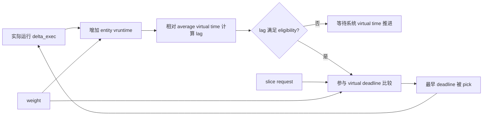

图中 weight 同时影响服务记账与 request 的虚拟长度，因此长期份额和短期 deadline 仍使用一致尺度。

### 4.46 EEVDF 自测推演

给定 V=50，A/B/C vruntime 为 48、51、45，deadline 为 56、53、60。

A 与 C 因 vruntime 不大于 V 而 eligible，B 暂时不 eligible。

eligible 集合中 A deadline 56 早于 C 的 60，因此选择 A；不能选择全局 deadline 最早但不 eligible 的 B。

A 运行后 vruntime 上升，下一轮应重新计算 V 和所有资格，不能固定轮转顺序。

### 4.47 EEVDF 最小验证结论

给定 V、entity vruntime 与 deadline，应先算 \(V-v_i\) 判断资格，再在 eligible 集合中找最早 deadline。

若回答直接选择全局最早 deadline，遗漏公平门禁；若仍只选最小 vruntime，则遗漏 request latency。

调试时还必须确认 task 所在的 cgroup 层级和 fair class，因为其他调度类与 bandwidth 约束先于 EEVDF 选择生效。

做到“先约束、再资格、后 deadline”，才能完整解释一次现代 fair pick。

引用具体字段时还要标明内核 tag，因为 EEVDF 在 6.6 之后仍持续调整树增强、slice 保护和睡眠实体处理。

### 4.48 本章小结

EEVDF 的正确性也要分长期与短期验证：长期看 lag 是否保持有界、份额是否符合 weight，短期看 request 是否按 eligibility 与 deadline 排序。

只优化短请求延迟而让某 task lag 无限为负，或只保持份额却无视 deadline 次序，都没有满足完整目标。

EEVDF 把公平调度拆成资格与次序两个问题。

lag 判断 task 是否欠服务，virtual deadline 在有资格者中表达请求的紧迫程度。

增强树让这套选择保持可扩展，placement、reweight、sleep 和 migration 则负责维护跨事件的公平不变量。

下一章沿真实事件路径观察 task 如何被唤醒、何时触发抢占，以及调度决策何时真正生效。

## 5. 唤醒、抢占与时间推进

### 5.1 唤醒不是把 state 改成 RUNNING 就结束

一个 sleeping task 被事件唤醒时，内核必须完成一组原子语义：

1. 确认 task 当前状态与唤醒掩码匹配；
2. 获得该 task 状态转换的所有权；
3. 选择允许运行的目标 CPU；
4. 把 task 加入目标 runqueue；
5. 发布 `TASK_RUNNING` 与队列状态；
6. 判断是否要抢占目标 CPU 的 current；
7. 必要时发送 reschedule IPI。

任何一步与另一个唤醒者或迁移者竞态，都可能造成重复入队、丢失唤醒或双 CPU 执行。

### 5.2 `try_to_wake_up()` 的稳定主线

```text
try_to_wake_up(p, state, wake_flags)
  -> 锁定 p->pi_lock
  -> 检查 p 的状态
  -> 处理仍 on_cpu 的同步
  -> 标记 TASK_WAKING
  -> select_task_rq()
  -> 必要时迁移 task CPU
  -> ttwu_queue()
       -> 本地或远程 activation
       -> enqueue_task()
       -> check_preempt_curr()
```

具体帮助函数会随版本变化，但“先取得 task 状态所有权，再决定 CPU 和入队”的逻辑稳定。

### 5.3 `TASK_WAKING` 的意义

`TASK_WAKING` 表示任务已经被某条唤醒路径认领，但尚未完全成为目标 rq 上的普通 runnable task。

其他唤醒者看到这个中间状态，不应再次执行完整入队。

负载均衡和 affinity 变更也要尊重这一阶段。

中间状态把一个跨多个锁、可能跨 CPU 的复杂事务变成可观察的所有权协议。

### 5.4 为什么要等待 `on_cpu`

任务可能刚在旧 CPU 上被切出，远程 CPU 同时尝试唤醒它。

如果旧 CPU 尚未完成切换协议，新 CPU 就把同一 task 选为 current，会出现两个 CPU 使用同一内核栈和寄存器上下文的灾难。

唤醒路径通过 `on_cpu` 与配对的内存序确认旧 CPU 已释放执行所有权。

这不是普通性能优化，而是 task 不能同时运行于两个 CPU 的基本安全条件。

### 5.5 选择目标 CPU

调度核心通过 task 所属调度类调用 `select_task_rq()`。

fair class 的 `select_task_rq_fair()` 会考虑 wake/fork/exec 场景、affinity、idle CPU、cache、capacity、sched domain 与 EAS。

此时选择的是 task 入哪个 rq，不是当前 CPU 下一个运行谁。

若 task 只能在一个 CPU 上运行，选择问题退化为该 CPU，但仍需处理 CPU online/active 与 cpuset 约束。

### 5.6 本地与远程入队

目标 CPU 就是当前 CPU 时，可以在本地锁定 rq 并 activation。

目标是远程 CPU 时，直接争用远程 rq lock 可能产生严重 cacheline bouncing。

现代内核可使用 wake list，把任务放入目标 CPU 的 lockless list，再用 IPI 通知目标 CPU 批量处理。

是否采用该路径取决于缓存共享、目标状态、feature 和体系结构成本。

### 5.7 唤醒时序图

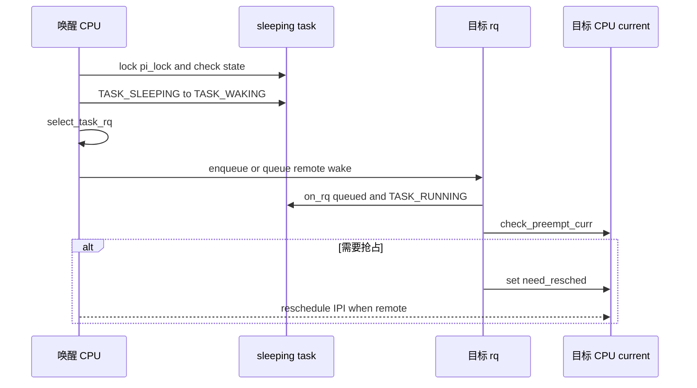

图中状态发布和入队顺序必须与锁、barrier 共同理解，不能按普通顺序赋值推断所有 CPU 的观察顺序。

### 5.8 唤醒抢占

被唤醒 task 已入队后，调度类比较它与 current。

更高调度类任务通常立即要求抢占低调度类 current。

同属 fair class 时，经典 CFS 比较虚拟位置和 wakeup granularity；EEVDF 比较 eligibility、virtual deadline 和 current 保护条件。

判断结果通常是设置 need-resched，而非在持有任意唤醒锁的位置直接调用 `schedule()`。

### 5.9 为什么需要 wakeup granularity

两个公平任务的虚拟位置只相差极小量时立即抢占，获得的延迟收益很小，却要支付上下文切换和 cache 污染。

wakeup granularity 建立迟滞区间：新 task 必须“足够更值得运行”才抢占 current。

值过大降低交互响应，值过小增加切换。

EEVDF 虽改变比较模型，仍需要控制过度抢占的思想。

### 5.10 tick 抢占

周期 tick 进入 `scheduler_tick()`，更新 rq clock，并调用 current 调度类的 `task_tick()`。

fair class 结算运行时间、更新 deadline/vruntime、PELT 与 bandwidth，再决定 request 是否完成或其他实体是否应运行。

需要重新调度时设置 need-resched。

真正切换发生在中断退出或后续安全抢占点。

### 5.11 无 tick 是否意味着不抢占

NO_HZ 和 full dynticks 可以减少周期 tick，但不意味着 CPU 上的任务永不被抢占。

高精度定时器、远程 reschedule IPI、唤醒事件、显式调度点和其他中断仍可触发调度。

调度器需要为 slice/request 到期安排适当事件，具体机制依内核配置和版本而异。

分析 NO_HZ 系统时不能只统计 scheduler tick 次数来判断调度是否工作。

### 5.12 用户态返回路径

中断、异常或系统调用准备返回用户态时，会处理 thread flags。

若 need-resched 已设置且上下文允许，内核先执行调度，再返回用户程序。

信号投递、通知和调度检查可能在同一 exit-to-user 循环中反复处理，直到没有待办工作。

这使内核能够把异步调度请求延迟到安全边界。

### 5.13 内核抢占

可抢占内核允许 task 在许多内核代码路径中被更高优先需求抢占，而不必等到返回用户态。

前提是 preempt count 为 0、未处于 hardirq/softirq 等非法上下文、未持有禁止抢占的锁。

`preempt_disable()` 增加禁止抢占计数，`preempt_enable()` 在恢复时检查是否积累 need-resched。

关闭抢占只约束本 CPU task 切换，不自动阻止其他 CPU 并发访问共享数据。

### 5.14 自愿调度与非自愿调度

自愿调度通常发生在 task 主动等待条件、I/O、锁或调用 yield 时。

非自愿调度通常因为时间份额、优先级或被唤醒任务而发生。

`/proc/<pid>/status` 和资源统计可看到 voluntary/nonvoluntary context switches，但分类只能帮助定位方向。

大量自愿切换可能来自正常 I/O，也可能来自锁竞争；大量非自愿切换可能来自 CPU 竞争，也可能来自实时任务干扰。

### 5.15 丢失唤醒例题

错误等待代码：

```c
if (!ready) {
    set_current_state(TASK_INTERRUPTIBLE);
    schedule();
}
```

可能时序：

```text
waiter: 读 ready=false
waker : 写 ready=true，检查等待队列但 waiter 尚未登记
waker : wake_up 返回
waiter: 设置睡眠状态并 schedule
```

此后没有新的事件，waiter 永久睡眠。

等待队列 API 通过“先登记并发布状态，再复查条件”的循环关闭窗口。

### 5.16 唤醒风暴

若大量 task 等待同一事件，`wake_up_all()` 可能同时让它们 runnable。

只有少数 CPU 能立即运行，其余 task 在 rq 上排队并争用同一锁，形成 thundering herd。

症状包括 runnable 数激增、上下文切换增加、锁等待加重，而业务吞吐未同比提升。

解决要从等待条件和唤醒粒度入手，例如独占等待、分片队列或一次只唤醒能取得资源的数量。

### 5.17 抢占延迟来源

need-resched 已设置后，task 仍可能因以下原因迟迟不切换：

- 长时间禁止抢占；
- 长 hardirq/softirq；
- 关闭中断区间过长；
- 不合理的自旋锁临界区；
- 架构入口/退出尚未到安全点；
- 更高优先级调度类持续运行。

因此 wakeup latency 应分解为 wakeup-to-runnable、runnable-to-running 与不可抢占区间，而不是只看一个总时间。

### 5.18 多个唤醒者竞态

两个 CPU 同时对同一 sleeping task 调用 wakeup 时，只有一个应成功取得状态转换所有权。

先获得 `pi_lock` 并匹配 state 的路径把 task 转为 waking；后一个看到状态已变化后返回“没有执行新的唤醒”。

返回值表示本次调用是否真正唤醒，而不是 task 最终是否会运行。

这种去重保证等待队列和完成量可以容忍并发 wake 调用。

### 5.19 Wake queue 与 IPI 合并

多个 task 需要远程唤醒到同一 CPU 时，每个任务都立刻发送 IPI 会造成中断风暴。

远程 wake list 允许唤醒者用原子链表排队，只有从空到非空等关键边界发送一次 IPI。

目标 CPU 在 scheduler IPI 中批量取出 task 并入队。

合并降低 IPI 数，却增加从 list 到 rq 的一个中间阶段，trace 时间线要区分 waking 与正式 runnable。

### 5.20 Reschedule IPI

远程 CPU 的 current 不会自动知道自己的 rq 出现更高优先候选。

唤醒者设置目标 need-resched，并在必要时发送 reschedule IPI。

IPI 让目标尽快进入中断退出检查，而不是直接由源 CPU 操纵目标 CPU 的栈。

若目标 CPU 已 idle 或已有待处理 resched，内核可避免重复 IPI。

### 5.21 Memory ordering 的发布关系

waker 写入任务数据、设置条件并执行 wakeup，waiter 被调度后必须看到事件前的有效数据。

等待队列锁、task state barrier 和 wakeup 锁共同建立必要顺序。

只把 condition 声明为 volatile 不能建立跨 CPU 同步。

使用标准 wait/wake、completion、mutex 等原语，可获得其定义的内存序；手写无锁睡眠协议必须证明配对 barrier。

### 5.22 Exclusive waiter

等待队列可把 waiter 标为 exclusive，普通 wakeup 只唤醒有限数量的 exclusive task，同时仍处理必要的 non-exclusive waiter。

这避免资源只够一个消费者时唤醒所有线程。

被唤醒 task 到真正取得资源之间仍有竞态，因此 waiter 必须循环复查条件。

exclusive wake 改善 herd，不把条件检查变成一次性可靠。

### 5.23 Completion 的一次事件语义

completion 封装“等待某个操作完成”的计数与等待队列。

`complete()` 唤醒一个 waiter，`complete_all()` 唤醒所有；waiter 消费完成计数后返回。

它适合一次阶段完成，不适合保护共享数据长期互斥。

在中断中调用 `complete()` 合法，因为唤醒本身不睡眠；等待 completion 必须在可睡眠上下文。

### 5.24 抢占模型版本边界

`CONFIG_PREEMPT_NONE`、voluntary、full preempt 以及动态抢占配置决定内核代码中的可抢占点密度。

PREEMPT_RT 进一步把部分锁和中断处理线程化，改变延迟特性，但调度器最底层与少数 raw spinlock 区仍不可抢占。

文档讨论的 need-resched 原理适用于这些模型，具体最坏延迟不能脱离配置判断。

### 5.25 Tick 与 hrtick

周期 tick 粒度可能不足以精确执行很短 slice。

配置支持时，high-resolution scheduler tick 可用 hrtimer 在更精确的 slice 边界触发调度事件。

hrtick 提高精度也增加 timer 编程成本，并非所有平台默认启用。

观察到 task 运行略超 request 不一定是记账错误，可能来自 tick/抢占可达点和不可抢占区间。

### 5.26 `cond_resched()`

长内核循环若不自然睡眠，在非完全抢占配置下可能长时间阻止其他 task 运行。

`cond_resched()` 在允许位置检查是否需要调度，并在必要时自愿切换。

它不能在持有不允许睡眠的 spinlock 或 hardirq 中调用。

把它加进循环前要检查对象生命周期和锁是否允许当前 task 离开临界区。

### 5.27 抢占延迟数值推演

task H 在 t=0 被唤醒并于 t=20 us 入队。

目标 CPU 此时处于 180 us 的禁止抢占区，已经执行了 40 us；剩余 140 us 后才允许调度。

调度与切换再耗 8 us，则 H 在约 t=168 us 开始运行。

其 runnable-to-running 延迟为：

\[
168-20=148\mu s
\]

优化 wakeup 路径 5 us 对总延迟帮助有限，真正瓶颈是 140 us 不可抢占剩余区间。

### 5.28 唤醒后迁移竞态

task 被选到 CPU1 后，cpuset 或 affinity 可能在入队前后变化。

路径必须重新验证目标是否仍 allowed，并在必要时选择 fallback CPU。

CPU hotplug 也可能让候选从 active 集合退出。

调度器宁可重试或使用允许的兜底 CPU，也不能把 task 留在永远不会运行的离线 rq。

### 5.29 `wake_up_new_task()` 与普通 wakeup

新 task 从未在旧 CPU 上执行，不存在等待旧 `on_cpu` 清除的问题，但需要初始化公平位置和 CPU 历史。

普通 sleeping task 带着 previous CPU、PELT、cache locality 和可能保存的 lag。

两条路径都要 select CPU、activate 和检查抢占，却不能共享所有 placement 假设。

阅读 trace 时 `sched_wakeup_new` 与 `sched_wakeup` 也应区别解释。

### 5.30 本章小结

唤醒是一项跨状态、CPU 和队列的并发事务。

`TASK_WAKING`、`pi_lock`、`on_cpu`、rq lock 和内存序共同保证 task 只被入队一次、只在一个 CPU 上运行。

tick 和 wakeup 路径主要提出 reschedule 请求，安全点才真正执行上下文切换。

接下来需要理解调度器如何估计 task 最近有多忙、CPU 有多少能力；这些统计决定多核放置、均衡和频率选择。

## 6. PELT、CPU capacity、uclamp 与 schedutil

### 6.1 为什么不能只看 `nr_running`

CPU0 上有一个长期满载任务，CPU1 上有四个每 100 ms 只运行 1 ms 的任务。

若只看 task 数量，CPU1 似乎更忙；若看实际计算需求，CPU0 才接近饱和。

瞬时 runnable 状态也不稳定：一个任务恰好在采样时睡眠，不代表它长期负载低。

调度器需要连续、可衰减、可按实体归属的历史信号，这正是 Per-Entity Load Tracking（PELT）要解决的问题。

### 6.2 从 per-rq 到 per-entity

早期 per-rq load tracking 能估计一个 runqueue 整体有多忙，却不知道负载来自哪个 task。

没有 per-entity 信息，调度器难以回答：迁走哪个任务能消除 imbalance，这个任务是否适合小核，它属于哪个 cgroup。

Linux 3.8 引入 PELT 后，task、group entity、`cfs_rq` 以及部分其他调度类状态都能维护衰减平均。

迁移 task 时，其历史负载可以随实体移动，而不是从目标 CPU 重新冷启动。

### 6.3 PELT 的三个时间状态

对 fair task 而言，一个窗口中可以区分：

1. blocked：不 runnable；
2. runnable but waiting：在队列等待 CPU；
3. running：真正执行。

PELT 用这些状态形成不同信号。

`load_avg` 与 runnable 历史和 weight 相关，`runnable_avg` 反映 runnable 压力，`util_avg` 只累计实际 running 所占的容量需求。

不同内核版本的 sum 字段和缩放细节会变化，但三类语义必须区分。

### 6.4 指数衰减

PELT 把时间划分为约 1024 微秒的基本周期，并使用指数衰减。

可用连续近似表达旧贡献：

\[
value(t+\Delta t)=value(t)\times y^{\Delta t/1024\mu s}+new\_contribution
\]

常数 y 选择为约 32 个周期后贡献减半：

\[
y^{32}=\frac{1}{2}
\]

因此常说 PELT 半衰期约为 32 ms。

它不是每 32 ms 突然砍半，而是每个周期连续按固定比例衰减。

### 6.5 半衰期例题

某 task 在停止运行时 `util_avg=800`，之后长期睡眠且没有新贡献。

忽略离散舍入：

32 ms 后：

\[
800\times(1/2)=400
\]

64 ms 后：

\[
800\times(1/2)^2=200
\]

96 ms 后为 100，160 ms 后约为 25。

旧负载不会立刻消失，但约五个半衰期后只剩原来的 1/32。

### 6.6 持续满载的稳态

指数平均既衰减旧值，也加入当前窗口贡献。

持续 running task 每个周期都加入满贡献，最终 `util_avg` 逼近 capacity scale 的上限，通常以 1024 作为归一化满容量。

持续 50% duty cycle 的周期任务，在周期远短于衰减观察窗口且频率稳定时，`util_avg` 会在 512 附近波动。

周期很长时，信号会呈明显充放电，而不是稳定在精确平均值。

### 6.7 `load_avg`

`load_avg` 关注 runnable 历史并乘以调度权重。

两个运行占比相同但 nice 不同的 task，`util_avg` 可以接近，而 `load_avg` 因 weight 不同而不同。

这使比例公平负载均衡能够估计迁移某个 task 对加权竞争压力的影响。

不能用 `load_avg/1024` 直接解释为 CPU 百分比，因为它还包含 weight 尺度。

### 6.8 `runnable_avg`

`runnable_avg` 记录 task 处于 runnable 状态的历史，包括 running 和等待 CPU。

若 task 长期 runnable 但只能获得少量 CPU，runnable 信号接近高位，而 util 可能较低。

这种差异表明存在 CPU 等待压力。

组实体的 runnable 传播更复杂，因为子 `cfs_rq` 中多个任务可同时 runnable，而父 group entity 一次只能在一个 CPU 上运行。

### 6.9 `util_avg`

`util_avg` 表达 task 最近实际消耗的 CPU capacity。

它用于判断 task 是否适合某个 CPU、估算 rq utilization、驱动 schedutil，并参与 EAS 能量计算。

util 不是应用业务吞吐，也不等同于 wall-clock 占比，频率与 CPU capacity 缩放会影响其语义。

现代 PELT 尝试保持 utilization 对 CPU 当前频率不变，使“同一工作需求”在降频时不会被误判为更小。

### 6.10 `struct sched_avg`

概念字段如下：

```c
struct sched_avg {
    u64 last_update_time;
    u64 load_sum;
    u64 runnable_sum;
    u32 util_sum;
    unsigned long load_avg;
    unsigned long runnable_avg;
    unsigned long util_avg;
};
```

sum 保留衰减窗口的累计状态，avg 用适当 divider 归一化。

字段宽度和排列随版本变化，这里只说明数据流。

### 6.11 PELT 更新时间

PELT 不由单独后台线程定期扫描所有 task。

它在调度事件发生时按 `last_update_time` 一次性补算经过的周期，包括：

- tick；
- enqueue/dequeue；
- task 迁移与 attach/detach；
- current 更新；
- blocked load 更新；
- cgroup 层级传播。

这样没有事件的实体无需每毫秒被遍历，衰减仍可在下次访问时计算到当前时刻。

### 6.12 `update_load_avg()` 主线

fair class 中可概括为：

```text
update_load_avg(cfs_rq, se, flags)
  -> 更新 se 自身的 PELT sum/avg
  -> 更新 cfs_rq 聚合 PELT
  -> 必要时 attach/detach entity load
  -> 向 task group 父层传播变化
  -> 触发 util change 相关通知
```

调用者必须正确表达 entity 是新 attach、普通更新还是迁移 detach，否则聚合量会重复计入或丢失。

### 6.13 组调度传播的不变量

子 `cfs_rq` 的 utilization 要通过 group `sched_entity` 反映到父 `cfs_rq`。

传播不能简单把所有 task util 相加后无限递归，因为 group entity 的 runnable/running 状态和层级权重会限制实际服务。

内核维护 pending propagation 与差值，使父层聚合逐步与子队列状态一致。

理解 PELT 传播时应画出具体 task—cfs_rq—group se—parent cfs_rq 四层关系。

### 6.14 迁移时的 PELT

task 从 CPU0 移到 CPU1 时，历史 utilization 应跟随 task，否则频繁迁移会把重任务伪装成新任务。

但源、目标 rq 的 PELT 时钟可能不完全同步，attach/detach 前需要把实体衰减到兼容时刻。

源 rq 聚合减去实体贡献，目标 rq 聚合加上贡献。

若操作次序错误，系统总 util 会在迁移瞬间凭空增加或减少。

### 6.15 CPU capacity

capacity 表示 CPU 在归一化尺度上的最大计算能力。

在对称系统中，各 CPU 原始 capacity 通常相同；big.LITTLE 等异构系统中，小核 capacity 可能低于 1024，大核接近 1024。

capacity 不是当前 CPU 使用率，而是“这颗 CPU 在参照性能点能承载多少标准化工作”。

调度器比较 task util 与 CPU capacity，判断 task 是否 fits。

### 6.16 原始、频率与可用 capacity

需要区分几个层次：

- original capacity：架构给出的最高计算能力；
- frequency capacity：当前频率相对最高频率的缩放；
- thermal pressure：热限制减少的可用能力；
- irq/RT/DL pressure：不能供 fair task 使用的部分。

fair placement 关心可用于承载新增任务的剩余 capacity，而不是只看硬件标称值。

### 6.17 Capacity 例题

系统有小核 L，capacity 512；大核 B，capacity 1024。

task X 的 `util_avg=700`。

X 在 L 上的需求比为：

\[
700/512\approx136.7\%
\]

即使 L 满频也无法按历史需求及时完成工作。

X 在 B 上为：

\[
700/1024\approx68.4\%
\]

因此 capacity-aware placement 倾向大核。

若 X 的 `uclamp.max` 被限制为 400，placement 是否按 400 评估取决于具体路径和平台，但这并不会真的把原始 PELT util 改写成 400。

### 6.18 频率不变性

假设同一 task 在最高频率需要 5 ms 计算，在半频可能需要约 10 ms。

若直接按 running wall time 更新 utilization，降频会让它看起来需求翻倍，进而造成反馈混乱。

frequency invariance 用架构频率尺度校正 PELT 时间，使信号更接近任务在最高 capacity 参照下的需求。

实现依赖架构提供可靠的频率/性能缩放，硬件 boost、idle 和固件控制都会增加复杂性。

### 6.19 `util_est`

PELT 对新突发负载需要数个半衰期才能上升。

短周期任务每次刚唤醒时，`util_avg` 可能落后于即将到来的计算需求。

utilization estimation（util_est）记录近期 activation 的完成利用率，唤醒时用较积极估计弥补 PELT ramp-up 延迟。

它适合重复、相对稳定的突发任务；负载模式突变时估计也可能过高或过低。

### 6.20 Utilization clamping

Utilization clamping（uclamp）允许用户空间对调度决策使用的 utilization 提出下界和上界提示。

`UCLAMP_MIN` 表示最低性能需求，常用于减少关键任务升频延迟或倾向更强 CPU。

`UCLAMP_MAX` 表示最高性能需求，常用于限制后台任务性能与能耗。

范围通常归一化为 0–1024。

uclamp 不会修改 PELT 原始历史；它在 placement、frequency selection 等消费点对有效 util 施加边界。

### 6.21 task、cgroup 与系统级 clamp

task 可以通过 `sched_setattr()` 请求 clamp。

cgroup CPU controller 可进一步限制组内 task 的有效范围，系统级 sysctl 又提供全局边界。

请求值可能被接口接受，但实际 effective value 受上层限制。

因此排障时要同时读取 task request、cgroup 设置和系统默认，不能只看应用传入参数。

### 6.22 uclamp 聚合边界

runqueue 上多个 task 的 clamp 需要高效聚合，不能每次选频遍历所有 task。

内核使用 bucket 等结构在 enqueue/dequeue 时维护有效 clamp。

一个允许高性能的 task 与受 `uclamp.max` 限制的 task 同处同一 rq 时，rq 聚合可能仍允许较高频率。

因此 uclamp max 不是严格的 per-task 硬件频率隔离；共核运行者会相互影响。

### 6.23 schedutil 的位置

CPUFreq governor 决定调频策略，驱动负责把目标映射到硬件能力。

schedutil 直接消费调度器 utilization 信号，使任务状态变化能快速影响频率。

数据链可概括为：

```text
PELT/util_est/RT-DL pressure/uclamp
  -> effective CPU utilization
  -> cpufreq_update_util()
  -> schedutil policy calculation
  -> resolve target frequency
  -> cpufreq driver fast/slow switch
```

具体回调名和 fast-switch 路径随版本、driver 与 policy 范围变化。

### 6.24 选频简化公式

可用以下比例建立直觉：

\[
f_{target}=1.25\times f_{max}\times\frac{util}{capacity}
\]

1.25 是为及时完成负载预留的 headroom 的概念值，真实实现可能用等价整数比例和不同映射。

若 `util=512`、`capacity=1024`、`fmax=2.4 GHz`：

\[
f_{target}=1.25\times2.4\times0.5=1.5 GHz
\]

driver 最终选择不低于目标的可用频点，并受 policy min/max、thermal 和硬件限制。

### 6.25 I/O wait boost

任务因 I/O 睡眠时 PELT util 可能衰减，但 I/O 完成后的短突发希望快速执行。

schedutil 可对 I/O wakeup 施加 iowait boost，临时提高频率请求，再随时间或连续更新衰减。

它改善交互延迟，也可能增加能耗。

把所有 wakeup 都标成 I/O wakeup 会破坏信号质量，因此 wake flags 的语义很重要。

### 6.26 PELT 故障辨析

“CPU 使用率只有 30%，为什么频率很高”可能有多种原因：

- 关键 task 设置较高 `uclamp.min`；
- 短突发 util_est 或 iowait boost；
- 同 policy 的其他 CPU 有高 util；
- RT/DL 任务触发高性能需求；
- governor rate limit 尚未降频；
- 用户观察的是全机平均，而 policy 按 cluster 聚合。

不能仅凭 top 的百分比判断 schedutil 错误。

### 6.27 PELT 的离散时间构造

PELT 不是直接调用浮点指数函数。

内核把经过时间拆成三个部分：上次未完成周期、若干完整 1024 us 周期、当前周期已过去部分。

完整周期贡献可用预计算衰减表和等比数列求和，因而无论 task 睡了 2 ms 还是 2 s，都不需要逐周期循环。

超过约 63 个半衰期的旧贡献可以视为零，进一步限制计算成本。

### 6.28 等比贡献推导

若每个完整周期 runnable 并贡献 1024，衰减因子为 y，连续 n 个周期的累计为：

\[
S_n=1024(1+y+y^2+\cdots+y^{n-1})
\]

利用等比数列：

\[
S_n=1024\frac{1-y^n}{1-y}
\]

n 趋向无穷时达到稳定上限。

内核用整数常数 `LOAD_AVG_MAX` 一类值近似这个稳态和 divider，避免浮点运算。

### 6.29 部分周期为何重要

调度事件不会恰好发生在 1024 us 边界。

若忽略周期头尾，频繁运行几百微秒的交互 task 会被系统性低估。

`period_contrib` 记录当前周期已经贡献多少时间，下次更新先补齐或衰减这段。

sum 与 avg 的 divider 也包含当前 partial period，保证事件频率不同的 task 得到一致结果。

### 6.30 Running、runnable 参数

底层 update-sum 逻辑通常接收 task 在经过区间中是否 load/runnable/running 的布尔或缩放参数。

blocked entity 只衰减，不加入新贡献。

runnable waiting entity 加入 load/runnable，但不加入 util running。

current entity 三者按对应语义贡献。

这就是三个平均能从同一时间引擎导出的原因。

### 6.31 Load 与 weight 的算例

task A、B 都有 50% runnable 平均。

A nice 0，weight 1024；B 简化 weight 2048。

归一 runnable 比例都约 512，但加权 load 可近似：

```text
load_A = 512 * 1024 / 1024 = 512
load_B = 512 * 2048 / 1024 = 1024
```

B 对公平竞争负载的贡献是 A 的两倍，而两者实际运行占比未必不同。

### 6.32 Runnable 大于 util 的排队例题

两个等权 CPU-bound task 固定在同一个 CPU。

稳态下每个 task 几乎一直 runnable，因此各自 `runnable_avg` 接近 1024。

CPU 时间平分，每个 `util_avg` 接近 512。

两者差值约 512，反映每个 task 大约一半时间在 runnable 队列等待。

若迁移一个 task 到空闲 CPU，各自 util 会逐渐上升到 1024，而 runnable 仍接近 1024。

### 6.33 Blocked load

task 睡眠后，它已不在 runnable tree，但历史 load 不应瞬间归零。

`cfs_rq` 需要定期或在事件中更新 blocked entities 的衰减贡献，否则 rq 看起来长期比实际更忙。

内核维护 leaf `cfs_rq` 列表等结构，批量推进 blocked load。

长 idle CPU 的 blocked update 还要与 NO_HZ 时钟处理协作。

### 6.34 PELT clock 与 rq clock

PELT 使用的时间需要在 CPU idle、频率变化和 task 迁移下保持一致语义。

某些实现区分 task clock 与 PELT clock，对 IRQ/steal/idle 时间进行调整，使 fair utilization 不把不可用 CPU 时间错误算作 task 需求。

读取时间必须在 rq lock 和 clock update 规则下进行。

若 trace 插桩改变时钟更新顺序，可能观察到难以解释的短暂差值。

### 6.35 IRQ utilization

硬中断执行占用 CPU，却不属于被打断 fair task 的计算需求。

调度器单独跟踪 IRQ pressure，并从 fair 可用 capacity 中扣除或缩放。

网络 IRQ 集中到某 CPU 时，即使 fair task util 不高，该 CPU 可供 task 的能力也可能不足。

排障应联合查看 softirq/IRQ 时间和 rq utilization。

### 6.36 RT 与 DL utilization

RT task 通常不维护与 fair task 完全相同的 per-task PELT，但 rq 会跟踪 RT/DL 类对 capacity 的占用。

fair placement 和 schedutil 需要知道更高调度类已使用多少计算能力。

RT task 唤醒时，为避免 DVFS ramp-up 造成不可预测延迟，schedutil 可能直接请求较高频率，再由 uclamp 规则调整。

因此高频不一定来自 fair `util_avg`。

### 6.37 Thermal pressure

CPU 因温度、供电或固件限制无法达到原始最高性能时，架构可向调度器报告 thermal pressure。

有效 capacity 下降后，原来 fits 的 task 可能成为 misfit，触发向其他 CPU 迁移。

若所有同类 CPU 都受热限制，迁移只会增加抖动，平台信号和 domain 分类需要共同避免无效动作。

监控标称频率而不看 thermal 限制会误判调度器选择。

### 6.38 Frequency invariance 例题

task 在最高频率 2 GHz 每 10 ms 运行 4 ms，参考 util 约：

\[
1024\times4/10\approx410
\]

CPU 降到 1 GHz 后完成同样指令近似需要 8 ms。

若按 wall running time，util 会升到约 819；频率不变性把 1 GHz 下的运行时间按性能比例缩放，使需求仍接近 410 的最高频参考。

若 task 的工作量本身同时增加，校正后 util 仍会真实上升。

### 6.39 PELT ramp-up 时间

从 0 开始持续满载，经过一个半衰期平均约到最终值的 50%。

两个半衰期到 75%，三个到 87.5%，四个到 93.75%。

达到约 90% 需要略多于 3 个半衰期，即约 106 ms。

官方 uclamp 文档因此指出忙任务单靠 PELT 感知最大需求可能经历约 200 ms 的充分收敛过程。

### 6.40 util_est 的 EWMA

task 每次 activation 结束时可得到本次实际 utilization 估计，util_est 用 Exponentially Weighted Moving Average 更新历史完成值。

唤醒 placement 常取 PELT util 与估计值的较大者，避免短突发刚开始时低估。

当 task 行为转轻时，估计需要若干 activation 才下降；实现会用 unchanged 标志等机制减少不必要更新。

### 6.41 uclamp min 例题

task P 原始 util 200，请求 `uclamp.min=600`。

PELT 仍显示 200，但选频消费点可按至少 600 评估。

若 `fmax=2.4 GHz`、capacity 1024，忽略 headroom，最低目标约：

\[
2.4\times600/1024\approx1.406 GHz
\]

这是一项性能提示，不保证硬件一定提供精确频点或 task 获得固定 CPU 时间。

### 6.42 uclamp max 共享 rq 例题

P0 请求 max 400，P1 请求 max 1024，两者同处一个 rq。

若 rq 对 max 采用满足所有 runnable task 的聚合，上限可能由 P1 推到 1024。

P0 的繁重执行也可能间接享受较高 cluster 频率。

若需要严格资源隔离，应结合 CPU/cgroup 隔离、quota 或平台 QoS，不能把 uclamp 当作硬频率沙箱。

### 6.43 Schedutil policy 聚合

多个 CPU 可能共享同一 cpufreq policy 和硬件频率。

policy 目标通常取成员 CPU 中最紧迫的 utilization 需求，而不是各 CPU 独立设置频率。

一个高 util CPU 会让整个 cluster 升频，其他低 util CPU 也运行在同一频点。

观察单 CPU util 与 cluster frequency 不一致时，应先确认 policy related CPUs。

### 6.44 Fast switch 与 slow path

支持 fast switch 的 driver 可在调度器上下文快速更新频率，降低响应延迟。

不支持时，schedutil 记录请求并唤醒 irq_work/kthread 等异步路径，由可睡眠上下文调用 driver。

slow path 增加调频延迟和合并行为，但允许执行需要睡眠的固件操作。

调度 hot path 不能直接调用任意可能阻塞的 driver。

### 6.45 Rate limit

频率每次微小 util 变化都更新会增加寄存器/固件开销并造成震荡。

schedutil 使用 up/down rate limit 或最小更新间隔合并请求。

升频通常比降频更强调响应，具体 tunable 取决于内核与 policy。

延迟问题中要区分 PELT 上升慢和 governor 因 rate limit 尚未执行更新。

### 6.46 PELT 源码阅读路径

建议按以下顺序：

```text
sched_entity::avg
  -> ___update_load_sum()
  -> accumulate_sum()
  -> decay_load()
  -> ___update_load_avg()
  -> __update_load_avg_se()/cfs_rq()
  -> fair.c::update_load_avg()
```

先用一个 task 的 running/sleeping 时间线验证 sum，再进入组传播和迁移；否则很容易淹没在配置分支中。

### 6.47 PELT 数据流图

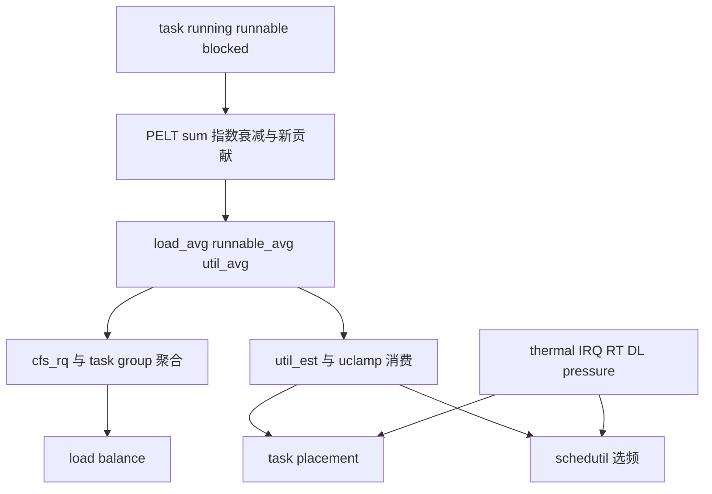

原始 PELT 信号、聚合压力和用户 clamp 是不同层次，调试输出必须标明观察的是哪一层。

### 6.48 本章小结

任何 PELT 数值都必须带上观察时刻、缩放尺度和聚合层级，否则不能直接比较。

PELT 把 task 最近的 runnable、running 和加权竞争历史变成可衰减信号。

capacity 把不同 CPU 的计算能力放到同一尺度，uclamp 提供用户性能提示，schedutil 把有效 utilization 转成频率需求。

这些信号的下一个主要消费者是多核任务放置与负载均衡。

## 7. SMP 任务放置、调度域与负载均衡

### 7.1 单核选择与多核放置

单核调度问“这个 rq 里下一步运行谁”。

SMP 调度还要问“task 应该属于哪个 rq”。

把任务移到空闲 CPU 能减少等待，却可能丢失 cache、增加 NUMA 远程访问或把重任务放到 capacity 不足的小核。

多核调度本质是 latency、throughput、locality、energy 和 migration cost 的权衡。

### 7.2 两条互补路径

Task placement 在 task 创建、唤醒或 exec 时为它选择 CPU。

Load balance 在系统已经出现不均衡后，从繁忙 CPU 迁移 runnable task。

前者尽量避免形成坏布局，后者负责纠正持续变化后的布局。

只依赖周期均衡会增加唤醒延迟；只依赖唤醒放置又无法处理长期 CPU-bound task 造成的失衡。

### 7.3 合法 CPU 集合

选择前先计算 task 可以运行的 CPU 集合。

来源包括：

- `sched_setaffinity()` 设置的 mask；
- cpuset cgroup 限制；
- CPU online/active 状态；
- migration disable 等临时约束；
- 调度类和 hotplug 特殊规则。

性能最优的 CPU 若不在有效 mask 中，就不是合法候选。

### 7.4 CPU topology

硬件 CPU 不是平坦数组。


图中层级是常见示意，实际拓扑由硬件、固件和内核配置决定。

`sched_domain` 是调度器的负载均衡范围，不等于一棵永远固定的硬件树。

在同一 core 的 SMT sibling 间迁移，cache 与执行资源关系不同于跨 LLC 或跨 NUMA node 迁移。

调度器按拓扑建立层级，逐层定义哪些 CPU 参与何种均衡。

### 7.5 `sched_domain` 与 `sched_group`

每个 CPU 从近到远拥有一条 sched domain 链。

一个 domain 覆盖某个拓扑范围，并由若干 sched group 组成；在当前层级，均衡发生在 group 之间。

group 内部可能是一个 CPU，也可能是下一级 domain 的整个 cluster。

`sched_group_capacity` 汇总 group capacity，帮助判断该组能否承载当前 utilization。

### 7.6 Domain flags

不同均衡事件只在具有相应 flag 的 domain 执行。

例如 wake、fork、exec、periodic balance 和 asym capacity 选择各自关心不同拓扑边界。

平台 topology 构建错误会让调度器在错误范围内均衡，表现为频繁跨 LLC 迁移或重任务滞留小核。

分析前应查看 `/proc/schedstat`、debugfs 或 trace 中实际 domain，而不是只凭硬件宣传资料猜测。

### 7.7 唤醒任务的 locality

task 睡眠前运行的 CPU 可能保留其代码和数据 cache。

唤醒它回到 previous CPU 有利于 locality。

另一方面，waker 当前 CPU 可能正持有 task 即将消费的数据，把 wakee 放在 waker 附近可利用 producer-consumer locality。

wake affine 在这两种局部性与负载差异之间选择。

### 7.8 Idle CPU 优先

若合法集合中有真正 idle 的合适 CPU，立即放置可减少 runnable waiting time。

但 SMT sibling idle 不等于整个物理 core idle；与繁忙 sibling 共享执行资源可能不如另一个完全 idle core。

调度器的 idle sibling 搜索会考虑 LLC、core 和 capacity 范围，避免盲目选择编号最近的 CPU。

### 7.9 `select_task_rq_fair()` 框架

概念路径为：

```text
select_task_rq_fair(p, prev_cpu, wake_flags)
  -> 检查 allowed CPUs
  -> EAS 条件满足时尝试 find_energy_efficient_cpu
  -> wake 场景评估 wake_affine
  -> 沿 sched_domain 寻找 idle/balanced target
  -> fast path 选择 idle sibling
  -> fallback 到 previous 或允许 CPU
```

版本中快慢路径和函数拆分会变化，但候选合法性、局部性、capacity 与 idle 状态是稳定轴线。

### 7.10 fork、exec 与 wake 的差异

fork 出的新 task 没有独立历史 locality，但与父 task 共享或复制大量内存，初始放置要考虑父 CPU 与系统负载。

exec 替换程序映像，旧工作集局部性价值降低，调度器可以更积极地重新选择 CPU。

wake task 通常保留之前工作集和 PELT 历史，previous CPU 更有意义。

domain flags 让平台分别控制三类场景的均衡范围。

### 7.11 Energy Aware Scheduling

Energy Aware Scheduling（EAS）在异构系统的轻中负载场景，比较把 task 放在不同 performance domain 后的估计能耗。

它依赖 Energy Model（EM）提供 capacity/performance state 与成本关系。

EAS 不只是“优先小核”。

若小核必须升到低效高频仍无法及时完成任务，大核在较低相对负载下反而可能能效更好。

### 7.12 能量计算直觉

简化假设：小核 capacity 512，运行 task X 后 util 450，成本 40；大核 capacity 1024，运行后 util 450，成本 55。

若两者都能承载，选择小核节约 15 个相对能量单位。

若 X util 上升到 700，小核不 fits，候选只能是大核。

EAS 计算还要考虑同 performance domain 共享频率的其他 CPU，因为新增 task 可能让整个 cluster 升频。

### 7.13 EAS 的启用边界

系统过载时几乎所有 CPU 都需要工作，EAS 的节能选择空间很小，调度器可能转向传统负载均衡。

EAS 需要 asym capacity、有效 Energy Model、schedutil 等平台条件。

thermal pressure、uclamp 和 RT/IRQ utilization 也会改变 fits 与能量估计。

不能在普通对称服务器上看到 `find_energy_efficient_cpu()` 未运行就判断调度异常。

### 7.14 周期性负载均衡

每个 CPU 按 domain 的 balance interval 检查负载。

周期均衡从较近 domain 向较远层级进行，统计 local group 和其他 group，寻找 busiest group、busiest rq，再迁移适当任务。

均衡间隔会根据最近是否成功、CPU idle/busy 状态和 domain 参数调整。

频繁失败时盲目高频扫描只会浪费 CPU。

### 7.15 `load_balance()` 总流程

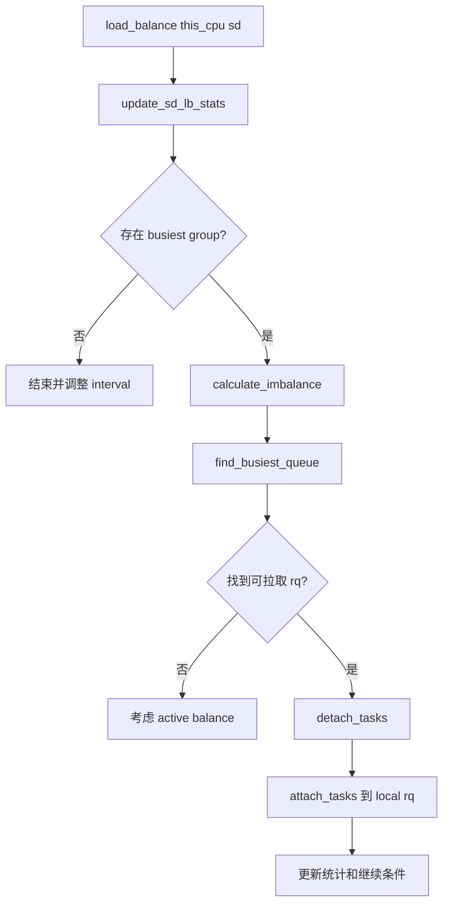

每一步都可能因为 affinity、cache hot、running 状态、migration disable 或 capacity 判断而停止。

### 7.16 Group classification

统计 sched group 后，内核会把它归类为有空闲 capacity、fully busy、misfit task、asym packing、overloaded 等状态。

分类决定 imbalance 使用 task 数、load、util 还是 capacity 差进行计算。

例如有 misfit task 的小核 group，即使任务数并不多，也应把重任务迁往更强 CPU。

因此不存在一个适用于所有场景的“平均负载公式”。

### 7.17 Busiest group 不是 load 最大就结束

候选 group 必须与 local group 比较，并结合 imbalance percentage 防止微小差异触发抖动。

跨 NUMA 或远层 domain 的迁移成本更高，需要更明显不均衡才值得行动。

本 group 若无 capacity，其他 group 即使 load 只略高也未必能向这里迁移。

asym capacity 系统还要优先解决 task 与 CPU 能力不匹配。

### 7.18 `find_busiest_queue()`

找到 busiest group 后，还要在其 CPU 中找具体 source rq。

source rq 必须有可迁移任务，且迁走后不能造成更坏失衡。

当前正在运行的唯一任务通常不能被普通被动拉取；一个 rq 只有一个 task 时，拉走它可能只是把 idle 从目标搬到源。

算法会比较 rq load/util/capacity 与 calculated imbalance。

### 7.19 `detach_tasks()`

detach 从 source rq 遍历候选 task，调用迁移合法性检查，并累计已移走 load/util/task 数。

它通常限制一次扫描和一次迁移数量，避免持有 rq lock 太久。

cache-hot task 可能暂时跳过，除非 imbalance 严重或多次均衡失败。

成功 detach 后 task 处于迁移所有权下，不能被普通唤醒路径重复处理。

### 7.20 `can_migrate_task()` 的约束

一个 task 不能迁移到不在其 allowed mask 的 CPU。

正在运行、migration-disabled、per-CPU kthread 或具有特殊绑定语义的 task 也可能不可迁移。

cache hot 判断用于避免刚运行过的 task 迁走后丢失工作集。

若所有候选都不可迁移，统计会记录 failure，后续可能触发 active balance 或延长 interval。

### 7.21 Active balance

被动 balance 由 idle/local CPU 到 source rq 拉任务。

若唯一合适任务正在 source CPU 上运行，普通 detach 无法取得它。

active balance 可安排 source CPU 自己停止并 push task，常通过 stop task 协调。

这是更昂贵的纠偏手段，不应成为每次均衡的常态。

### 7.22 Newidle balance

CPU 即将进入 idle 时调用 newidle balance，尝试从其他 rq 拉取任务，减少空闲同时降低等待延迟。

它位于 pick-next 慢路径，对延迟敏感；扫描过多 domain 会延长 CPU 真正进入 idle 的时间。

调度器利用平均 idle 时间、domain 成本和最近统计判断是否值得扫描。

深度 idle 状态与频繁短暂唤醒之间也存在能耗取舍。

### 7.23 NO_HZ idle balance

长期 idle CPU 停止调度 tick 后，不能依赖它自己周期执行 balance。

忙 CPU 或 designated idle load balancer 会记录需要均衡的 idle CPU mask，并触发 NO_HZ balance 工作。

目标是保持 tickless 节能，同时不让忙 CPU 长期排队而其他 CPU 沉睡。

相关 mask 和 kick 时序出错会表现为周期性负载集中。

### 7.24 例题：任务数与 utilization 冲突

CPU0 capacity 1024，有一个 task util 900。

CPU1 capacity 1024，有三个 task，各 util 100，总 util 300。

按任务数，CPU1 有三个、CPU0 只有一个；按 utilization，CPU0 剩余 124，CPU1 剩余 724。

若 CPU1 上允许接收 CPU0 的 task，将重任务整体迁移过去会使 CPU1 util 1200，反而过载。

更合理的动作可能是保持布局，等待新任务放到 CPU1；若 CPU0 上未来出现可拆分的第二个任务，再迁移其中一个。

### 7.25 例题：异构 misfit task

小核 CPU0 capacity 512，task A util 700；大核 CPU1 capacity 1024，task B util 200。

总 utilization 900，总 capacity 1536，看似系统并不过载。

但 A 在 CPU0 上 misfit，无法获得需要的性能；B 在大核浪费高 capacity。

交换 A、B 后：A 占大核约 68%，B 占小核约 39%，两者都 fits。

这说明均衡不只看总量，还要看 task-to-CPU 匹配。

### 7.26 Cache locality 与 migration cost

task 在 CPU0 运行后，其指令、数据和页表相关缓存可能位于 CPU0 或共享 LLC。

迁到远端 CPU 会产生 cold cache、远程 NUMA 内存和 TLB 填充成本。

短 task 可能在缓存重新变热前已经结束，迁移收益为负。

调度器用 migration cost、cache hot 和 domain 距离建立近似，但无法知道应用全部工作集语义。

### 7.27 NUMA balancing 与调度

自动 NUMA balancing 通过采样页访问，把内存迁向 task 或把 task 放向内存。

多线程进程的共享内存可能在不同 node 上，最佳 task 位置不只由单线程 fault 决定。

调度器维护 NUMA group、preferred node 和 fault statistics，尝试提高内存局部性。

跨 node CPU balance 与 memory migration 相互反馈，错误调优可能造成 task 和 page 来回震荡。

### 7.28 Affinity 造成的“假失衡”

CPU0 排队很长、CPU1 idle，不一定能迁移。

若所有 runnable task affinity 只允许 CPU0，调度器必须尊重约束。

cpuset cgroup、IRQ affinity、isolcpus 和应用绑核会共同缩小有效集合。

排障第一步应查看每个 task 的 `Cpus_allowed_list`，而不是立即修改 balance 参数。

### 7.29 频繁迁移故障案例

现象：吞吐下降、CPU 利用率高、perf 显示 cache miss 增加，`sched_migrate_task` 频繁。

分析顺序：

1. 确认迁移发生在哪个 sched domain；
2. 检查 task 是否短周期唤醒、waker 是否在不同 CPU；
3. 检查 affinity/cpuset 是否反复变化；
4. 比较迁移前后的 rq util 与 task util；
5. 查看是否存在 asym capacity misfit 或 NUMA fault；
6. 最后才考虑调度 tunable。

简单绑死 CPU 可降低迁移，但也可能制造热点和延迟，必须用工作负载验证。

### 7.30 Topology 构建

架构代码通过 CPU topology、device tree/ACPI 和 capacity 信息描述 sibling、core、cluster、package 与 NUMA 关系。

通用调度 topology 代码依据 level 定义为每 CPU 构建 sched domain 链和环形 sched group。

CPU hotplug、cpuset partition 或 topology 更新会触发 domain rebuild。

domain 不是启动后永远不变的静态数组，读取指针时需要 RCU 等保护。

### 7.31 Overlap domain

大多数层级 group 可由下一级自然划分，但 NUMA 距离等 topology 可能产生 overlapping groups。

overlap domain 的 sched group 不能简单共享同一对象，需要不同构建和引用管理。

理解 server 上复杂 domain 时，应查看实际 span 与 group mask，不要把手机两 cluster 图直接套用。

### 7.32 Balance interval 调整

domain 有最小、最大 interval 与 busy/idle 因子。

均衡成功或发现持续 imbalance 时可保持较积极检查；多次没有可迁移任务则指数回退，减少无效扫描。

CPU idle 时更希望尽快拉任务，busy 时扫描成本与收益不同。

sysctl 或 vendor 参数只是启发式输入，不能保证固定毫秒必然发生一次迁移。

### 7.33 `update_sd_lb_stats()`

该阶段遍历 domain 中的 sched group，为每组汇总 load、util、runnable、task 数、capacity、idle CPU 和 misfit 状态。

同时识别 local group，并按 group type 和 asym packing 规则比较 busiest 候选。

这是 load balance 的“测量阶段”，后续 `calculate_imbalance()` 才决定应搬多少。

统计读取发生在并发运行系统中，是近似快照，不可能锁住整个 domain 获得绝对一致全局状态。

### 7.34 Group type 优先级

某些 group 类型比单纯平均 load 更紧迫。

例如 `group_misfit_task` 表示强 task 被困弱 CPU，`group_asym_packing` 表示 SMT/CPU 优先次序不理想，`group_overloaded` 表示 runnable task 超过 capacity。

选择 busiest group 时先比较类型，再比较类型内指标。

这避免一个轻微 load 高的普通 group 遮蔽真正 misfit 问题。

### 7.35 `calculate_imbalance()` 的目标

imbalance 可用 load、util、task 数或 capacity 单位表达，取决于 group classification。

目标不是让两边数值绝对相等，而是迁移后改善状态且不把 local 变成新的 busiest。

整数舍入和最小 task 粒度意味着精确一半往往不可达。

如果最小可迁 task 比 imbalance 大，算法要在多拉一个与不拉之间选择较小伤害。

### 7.36 Load imbalance 算例

两个等 capacity group，各含一个 CPU。

G0 load 1500，G1 load 500，总 load 2000，理想各 1000。

从 G0 向 G1 迁移约 500 load 可达到理想。

若 G0 只有两个 task，load 分别 900 和 600，迁 600 后变成 G0=900、G1=1100，比不迁的差值 1000 显著改善。

迁 900 后为 600/1400，差值 800，也改善但较差，因此应优先 600 task，前提是 affinity 与 cache 条件允许。

### 7.37 Util imbalance 算例

CPU0 util 900，CPU1 util 300，capacity 都为 1024。

task X util 250 可从 CPU0 迁移。

迁移前余量分别 124、724；迁移后 util 为 650、550，余量 374、474。

两边都 fits 且更均衡，迁移有意义。

若 X util 700，迁后 CPU1=1000、CPU0=200，也仍 fits 但形成反向明显失衡，算法未必选择它。

### 7.38 `detach_one_task()` 与批量 detach

某些路径只需要拉一个 task，使用单任务 detach 减少锁持有和列表管理。

普通 load balance 可建立 detached task 列表，达到 imbalance 或 loop 上限后一次 attach 到目标 rq。

detach 时 task 已从 source 调度类队列移除并更新 source 统计，attach 才更新目标。

中间列表由 balance 路径独占，失败退出必须确保所有 task 有明确归宿。

### 7.39 LBF 标志与失败反馈

`lb_env` 中的 flags 记录是否因 affinity、全 pinned、loop break、需要 active balance 等原因停止。

若发现 busiest rq 的所有 task 都不允许目标 CPU，后续可避免在同一无效组合上反复扫描。

失败统计帮助调整 balance interval 或选择其他目标。

阅读 `load_balance()` 时，返回迁移数量不足以解释行为，还要追踪 env flags。

### 7.40 Cache hot 判断

task 最近运行时间与 `sysctl_sched_migration_cost` 等阈值可用于估计 cache hot。

这是启发式：内核不知道 task 实际 cache footprint，也不知道共享 LLC 是否保留全部数据。

多次 balance 失败或源 rq 严重 overloaded 时，算法可忽略 hot 限制以恢复系统平衡。

迁移成本设得过高会导致失衡，过低会导致 ping-pong。

### 7.41 NUMA 距离例题

task 在 node0 CPU 上运行，但其 80% 热页位于 node1。

跨 node 内存访问每次多 60 ns，每秒访问 50M 次，额外时间理论为：

\[
60ns\times50M=3s\text{ 的累计访存延迟/秒}
\]

访问可并行，不能直接当作 300% wall time，但足以说明 locality 成本巨大。

把 task 迁到 node1 或迁热页到 node0 哪个更好，要看线程共享、CPU 负载和页面迁移成本。

### 7.42 Wake affine：waker 与 wakee

waker 可能刚生产 wakee 所需数据，二者同 LLC 运行可减少通信延迟。

若把 wakee 堆到 waker CPU，又可能造成该 rq 过载。

wake affine 比较 previous CPU 与 current/waker CPU 的负载、capacity 和同步唤醒特征。

`WF_SYNC` 是 waker 即将睡眠的提示，不是保证；调度器可假设 CPU 将让给 wakee，但仍需验证其他负载。

### 7.43 Synchronous wakeup 例题

线程 A 在 CPU2 完成请求解析，唤醒 worker B 后立即等待 B 的结果。

若 B 放到 CPU2，A 随后睡眠，B 可接替同一 CPU 并利用 cache；不增加该 CPU 长期 runnable 数。

若 A 并不会真的睡眠，错误的 sync 提示可能让 A、B 在 CPU2 竞争，而 CPU3 空闲。

用户同步设计和 wake flags 会影响调度启发式质量。

### 7.44 Idle sibling 搜索层次

选择顺序可优先 previous CPU idle、同 core 完全 idle、同 LLC idle CPU，再扩展到更远 domain。

在 SMT 系统，物理 core 的一个 sibling busy 时，另一个逻辑 CPU 虽显示 idle，却共享执行端口和 cache。

若存在整个 core idle 的 CPU，后者可能提供更高实际 capacity。

具体优先策略随 asym packing 和平台 topology 变化。

### 7.45 Asymmetric CPU priority

即使 capacity 相同，平台也可给 CPU 设置优先次序，例如希望先填满低编号 core、让其他 core 进入深 idle。

asym packing balance 会把任务聚集到更高优先 CPU，而不是均匀铺开。

这可能改善 turbo 或能耗，却使“所有 CPU 利用率均匀”不再是目标。

观察到 idle CPU 前应检查该 domain 是否配置 asym packing。

### 7.46 SMT 与 core scheduling 边界

传统 balance 认识 SMT sibling 的共享 capacity，并尽量避免不良 packing。

安全 core scheduling 还会依据 trust cookie 协调 sibling 同时运行哪些 task，但它是额外安全机制。

本文不展开 core scheduling，只提醒启用后 idle sibling 可能是安全约束导致的强制空闲，不能归咎于 fair load balance。

### 7.47 CPU isolation

`isolcpus`、cpuset partition、nohz_full 和 IRQ affinity 常用于低延迟或专用 workload。

隔离 CPU 可能退出普通 domain balance 或只接收显式绑定 task。

housekeeping CPU 因承担 timer、workqueue 和 IRQ 看起来更忙是预期布局。

设计隔离集合时要为系统维护工作保留足够 capacity，否则低延迟 task 之外的系统反而拥塞。

### 7.48 Migration disabled

`migrate_disable()` 让当前 task 暂时不能换 CPU，但不必等同于永久单 CPU affinity。

它常用于访问 per-CPU 数据或需要 CPU 稳定的短临界区。

任务阻塞与 PREEMPT_RT 配置下的语义有额外细节，调度器可能创建迁移约束状态。

长时间 migration disabled 会阻止 balance 修复热点，应保持临界区短小。

### 7.49 CPU hotplug

CPU 下线时，调度器停止普通入队，把可迁 task 转移到其他 allowed CPU，并处理 per-CPU kthread 和 stop task。

若某 task affinity 只包含即将下线 CPU，内核需要扩大/修正允许集合或阻止操作，具体取决于 task 类型。

domain 与 root domain 随 active CPU 集变化重建。

hotplug trace 中的大量迁移是维护动作，不应与正常 load balance 混为一谈。

### 7.50 Balance 调试证据

要解释一次未迁移，至少需要 source/destination rq 状态、domain span、group classification、calculated imbalance 和候选 task 的 allowed mask。

只看到 `load_balance()` 返回 0 不代表没有不均衡，可能是所有 task pinned、cache hot、正在运行或 loop limit。

只看到 migration 也不代表周期 balance，可能来自 wake placement、affinity 变更、NUMA 或 hotplug。

应把 trace event 与调用栈或触发场景结合。

### 7.51 Placement 与 balance 联合时间线

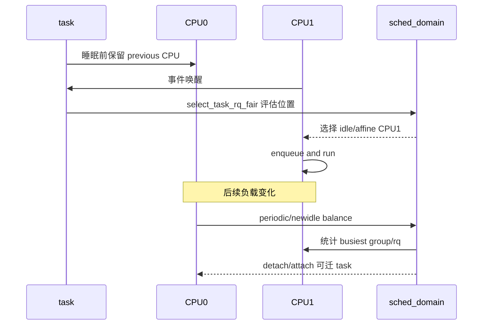

placement 处理这一次事件，balance 处理随后形成的整体布局，两者共享 topology 和负载信号但触发方向不同。

### 7.52 Imbalance 防抖

CPU0 util 520、CPU1 util 504，在 capacity 1024 的对称系统中差异只有 16。

迁移最小 task util 100 会把差异反转并放大，且支付 cache 成本。

imbalance percentage 和 task 粒度应让调度器保持现状。

均衡的目标是减少有意义的不公平和过载，不是让每次采样的数字完全相等。

### 7.53 Root domain

root domain 汇集一组可共同参与调度约束的 CPU，并持有 Deadline bandwidth、RT overload、CPU priority 和 EAS performance domain 等状态。

cpuset partition 可形成不同 root domain，使 Deadline admission 和 balance 边界发生变化。

同一机器总 CPU 足够，不代表某个受限 root domain 内的 Deadline 请求可以通过。

分析 admission 或 overload 时必须使用 task 实际所在 root domain 的 capacity。

### 7.54 Push 与 pull

fair load balance 主要由目标 CPU pull runnable task。

RT/DL class 还会维护 pushable task，在高优先任务使本 rq 过载时主动向其他 CPU push，或由低负载 CPU pull。

不同调度类的迁移目标不同：fair 优化负载与 capacity，RT/DL 还要满足优先级和 deadline。

不能用 `load_balance()` 一条 fair 路径解释所有 sched migrate event。

### 7.55 Work stealing 与调度均衡

用户态线程池的 work stealing 迁移的是任务队列中的 work item，内核 load balance 迁移的是 runnable task。

两层同时工作时，work item 可能换线程、线程又换 CPU，局部性更加复杂。

高性能 runtime 常用线程 affinity 固定 worker，再让用户态窃取控制细粒度工作；这会限制内核可迁移空间。

设计时应明确哪一层负责负载分配，避免相互震荡。

### 7.56 多核放置决策表

| 现象              | 首先检查                | 可能的合理决策         |
| ----------------- | ----------------------- | ---------------------- |
| previous CPU idle | affinity、capacity      | 保持 locality 回原 CPU |
| waker 即将睡眠    | `WF_SYNC`、同 LLC     | wakee 接替 waker CPU   |
| 小核出现 misfit   | 大核 allowed、thermal   | 迁往更高 capacity CPU  |
| local CPU newidle | domain cost、busiest rq | pull 一个可迁 task     |
| 所有候选 pinned   | allowed mask            | 保持失衡并记录 failure |
| 轻载异构系统      | EM、EAS 条件            | 选择最低估计能耗 CPU   |

决策表不是固定优先级，真实代码按 domain、feature 和实时状态组合条件。

### 7.57 多核章节最小源码路径

```text
try_to_wake_up
  -> select_task_rq_fair
       -> wake_affine / select_idle_sibling / EAS
  -> enqueue

rebalance_domains or newidle_balance
  -> load_balance
       -> update_sd_lb_stats
       -> find_busiest_queue
       -> detach_tasks
       -> attach_tasks
```

先能解释两条路径的触发方向，再深入各类 group classification。

### 7.58 用户态与内核双层均衡

用户态线程池可能通过 work stealing 移动 work item，内核则在 CPU 间迁移承载 worker 的 task。

若两层同时频繁搬迁，数据局部性会连续失效，单看 `sched_migrate_task` 无法解释 work item 的真实来源。

排障应同时记录请求到 worker 的分配和 worker 到 CPU 的映射，再决定优化线程池还是内核 placement。

### 7.59 本章小结

多核决策最终应同时满足合法 CPU、容量可承载、迁移有净收益和长期公平四项条件。

其中任何一项失败，都可能让保持当前布局比迁移更合理。

任务放置在事件发生时选择 rq，负载均衡在布局变差后迁移任务。

调度域把硬件拓扑变成分层搜索空间，PELT、capacity 和 Energy Model 为决策提供度量。

迁移必须同时满足合法性、公平、容量与局部性；因此“让每个 CPU 的任务数相同”从来不是完整目标。

## 8. cgroup CPU 控制：权重、带宽与层级

### 8.1 权重和上限是两类控制

cgroup CPU controller 提供相对份额和绝对带宽两种不同机制。

`cpu.weight` 在同级组都需要 CPU 时决定相对竞争份额；系统空闲时，一个组可以使用超过其按权重计算的名义份额。

`cpu.max` 则限制组在 period 内可消费的 CPU runtime，即使其他 CPU 空闲，额度用完也可能被 throttle。

把 weight 当成硬上限或把 quota 当成优先级都会导致错误容量规划。

### 8.2 层级公平

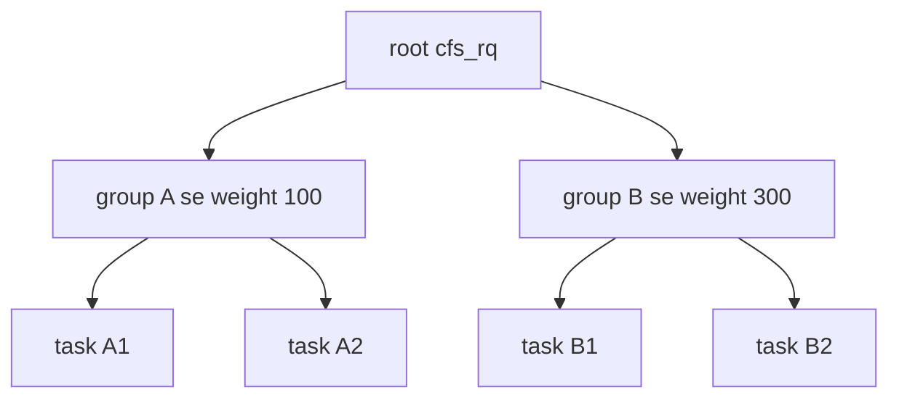

若 A、B 都持续 runnable，B 理想上获得约 75%，A 获得约 25%。

A 内部的 A1/A2 再按各自 weight 分享 A 的 25%，不会直接与 B1/B2 在根队列平铺竞争。

### 8.3 cgroup v1 与 v2

cgroup v1 常见 `cpu.shares`、`cpu.cfs_quota_us`、`cpu.cfs_period_us`。

cgroup v2 使用 `cpu.weight` 和统一的 `cpu.max` 文本接口，并提供 `cpu.max.burst` 等能力。

两代接口数值范围和层级规则不同，文档或命令必须标明版本。

容器运行时展示的 CPU limits 最终常映射到这些内核接口。

### 8.4 `cpu.max`

v2 文件通常形如：

```text
50000 100000
```

表示每 100000 微秒 period 获得 50000 微秒 CPU runtime。

单 CPU 持续运行时约等于 50% CPU。

在多核上 runtime 是 CPU 时间总和：两个 CPU 同时各运行 25 ms，也会消费 50 ms 配额。

### 8.5 多核 quota 例题

设置：

```text
cpu.max = 200000 100000
```

quota/period：

\[
200000/100000=2
\]

它允许该 cgroup 平均使用约 2 个 CPU 的总时间，并不保证固定获得某两个 CPU。

若组内 8 个线程同时在 8 CPU 上运行，理论上约 25 ms 就会消耗 200 ms CPU 时间，随后在本 period 剩余约 75 ms wall time 中被 throttle。

### 8.6 Runtime 分发

全局 `cfs_bandwidth` 管理组的 period、quota 与可分发 runtime。

每 CPU 的 group `cfs_rq` 从全局池按 slice 取得本地 runtime，减少每次执行都争用全局锁。

本地 runtime 消耗到阈值时再申请；全局额度不足则 throttle 对应层级。

分批分发提高扩展性，但会引入少量残留 runtime 和多 CPU 并发消耗的观察差异。

### 8.7 Throttle

组用完 quota 后，其 `cfs_rq` 被标记 throttled，并从上层公平竞争中移除。

组内 task 仍可能逻辑 runnable，却因带宽控制不能运行。

下一个 period replenishment 后，内核向 throttled 队列分发 runtime 并逐步 unthrottle。

监控中这类 task 不是传统 I/O blocked，也不是单纯 runqueue 竞争，必须查看 `cpu.stat` 的 throttled 指标。

### 8.8 层级 throttle

子 cgroup 自己还有 quota，不代表父组无限制。

父组被 throttle 时，所有后代都无法继续获得 CPU，即使子组本地还有额度。

有效带宽受整条祖先链约束。

排障只看叶子 `cpu.max` 可能发现“额度明明没用完”，却忽略父层已达到上限。

### 8.9 Burst 的正确理解

`cpu.max.burst` 允许组在过去未充分使用配额时积累有限的 burst 能力，并在短时需求上升时超过常规 quota。

它是有上限、依赖历史欠用的信用，不是无限借用未来配额，也不提高长期平均带宽。

持续满载组没有足够欠用历史，burst 很快耗尽，长期仍受 `quota/period` 限制。

burst 适合统计复用的短峰值，代价是多个组同时 burst 时可能增加尾延迟。

### 8.10 Quota 引起的延迟案例

服务 cgroup 配置 1 CPU quota，但运行 8 个 worker。

每个 period 开始，8 个 worker 可并行抢占多个 CPU，很快用完总额度，然后全部 throttle 到下一 period。

平均 CPU 使用符合 1 核，响应时间却呈周期性尖峰。

解决可能包括减少并行 worker、缩短合适的 period、提高 quota、优化请求或利用 burst；单纯增加 nice 无法解除 throttle。

### 8.11 `cpu.weight` 的层级例题

根下 A weight 100、B weight 300；A 下 A1/A2 权重 100/300；B 下只有 B1。

A 获根份额 25%，B 获 75%。

A1 获 A 的 25%，即全机 6.25%；A2 获全机 18.75%；B1 获 75%。

若 B1 睡眠，A 可利用空闲 CPU 超过 25%，因为 weight 只在竞争时分配。

### 8.12 Weight 与 nice 接口

cgroup v2 还可提供 `cpu.weight.nice`，用类似 nice 的范围映射组权重。

映射是有损的，因为 nice 等级只有有限离散值，而 `cpu.weight` 范围更细。

读取回来的 nice 可能是最接近权重的值。

task nice 控制组内 task 竞争，group weight 控制兄弟组竞争，两者作用层级不同。

### 8.13 `cpu.stat`

常见字段包括 usage、user、system，以及启用 bandwidth 时的 periods、throttled 次数和 throttled 时间。

字段名称与单位应按 cgroup v2 当前文档核对。

`nr_throttled/nr_periods` 接近 1 表示几乎每个活跃 period 都耗尽 quota，但不直接说明业务一定受损。

还要结合每次 throttle 持续时间和请求延迟。

### 8.14 Throttle 比例例题

10 秒观察到 `nr_periods=100`、`nr_throttled=80`、累计 throttle 12 秒。

累计 throttle 时间可跨多个 CPU/并发实体计算，可能超过墙钟 10 秒，不能直接解释为“服务停了 120% 时间”。

80% period 发生 throttle，说明额度经常用完；平均每个 throttled period 累计约 150 ms throttle contribution。

需要再用 trace/延迟确认哪些线程同时受影响。

### 8.15 Runtime slice

每 CPU `cfs_rq` 从全局 bandwidth 池取得一小块 runtime slice。

slice 太小会频繁争用全局锁，太大可能在多个 CPU 留下暂时未用的本地额度，影响精确分配延迟。

内核会在适当时机归还或过期处理 runtime。

用户通常不应先调 slice sysctl，应先验证 quota、并行度和 period 的业务匹配。

### 8.16 Period timer

高精度 period timer 到期后推进 period、补充全局 runtime，并处理 throttled `cfs_rq`。

系统长时间 idle、timer 延迟或多 period 跨越时，代码需要计算经过多少期，而不是只补一次。

unthrottle 会重新把组 entity 加回父层，并可能触发 reschedule。

timer 处理本身要限制锁持有时间，避免一次唤醒巨大层级造成长延迟。

### 8.17 Hierarchical quota 例题

父组 P 限 2 CPU，子组 C1 限 1.5 CPU，C2 不单独限额。

C1 最多使用 min(1.5, 父剩余额度)，C2 最多使用父层剩余，但 C1+C2 长期不能超过 P 的 2 CPU。

若 C1 用满 1.5，C2 最多约 0.5；若 C1 只用 0.2，C2 可用约 1.8。

父层 quota 是所有后代共享硬约束，不按子 task 数平均。

### 8.18 Weight 与 quota 联合

两个兄弟组 A/B weight 都 100，父层总 quota 1 CPU。

A、B 都持续 runnable 时，各约分享 0.5 CPU；只有 A 活跃时，A 可用满父 quota 1 CPU。

若 A 自己还配置 quota 0.3 CPU，则 A 最多 0.3，B 可使用剩余 0.7。

quota 先形成可用上限，weight 在同时有资格竞争的实体间分配可用 CPU。

### 8.19 Burst 统计复用例题

组 quota 50 ms/100 ms，burst 上限 30 ms。

前几个 period 只使用 20 ms，可积累但最多 30 ms 信用。

某个峰值 period 最多可使用约 80 ms，之后信用耗尽。

持续需求 80 ms/period 时，后续仍回到 50 ms 长期平均；burst 只吸收一次或稀疏峰值。

### 8.20 cgroup pressure stall

CPU Pressure Stall Information（PSI）可反映 task 因 CPU 竞争无法运行的时间比例。

quota throttle 和普通 rq 等待都可能增加 CPU pressure，但来源不同。

把 PSI 与 `cpu.stat`、runnable 数和 sched trace 联合，可区分“有竞争但未 throttle”和“硬额度耗尽”。

PSI 是服务受阻程度，不替代每 task latency trace。

### 8.21 容器 CPU 数认知

应用可能根据可见 CPU 数创建 worker，但 quota 只允许其中一小部分总 capacity。

例如可见 8 CPU、quota 1 CPU，创建 8 个 CPU-bound worker 会形成 period 内并行爆发和 throttle。

现代运行时可能读取 affinity、cpuset 或 cgroup quota 调整并行度，但不同语言版本行为不同。

容量规划应明确“可放置 CPU 数”与“可消费 CPU 带宽”是两个维度。

### 8.22 Bandwidth 数据流图

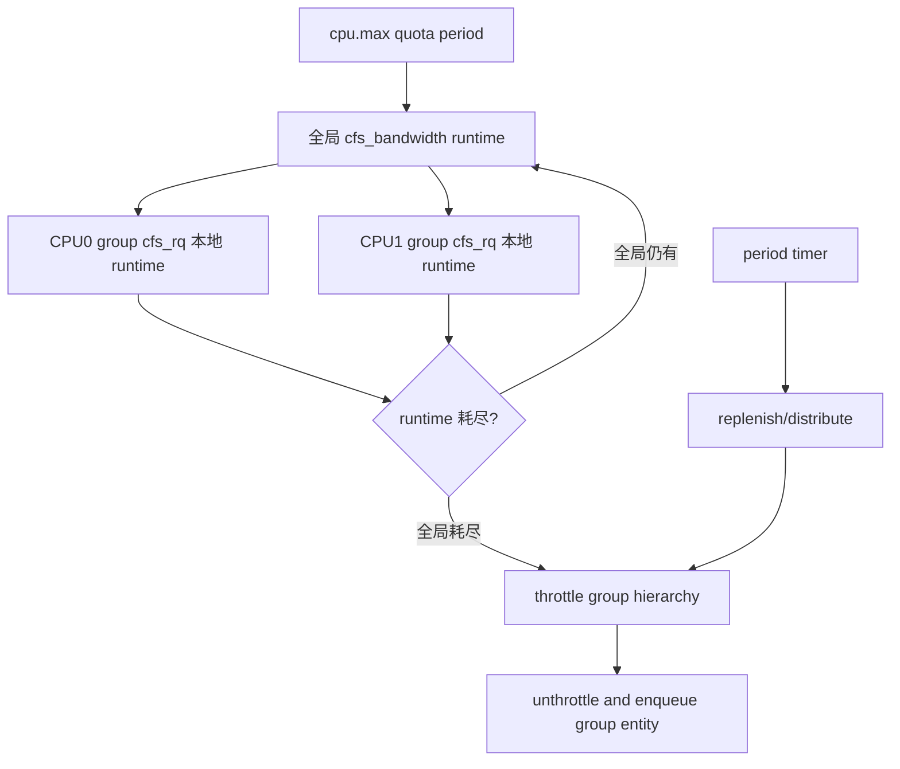

### 8.23 Weight、quota、cpuset 联合边界

cpuset 决定组内 task 可以放在哪些 CPU，weight 决定与兄弟组竞争的相对份额，quota 决定 period 内最多使用多少 CPU 时间。

一个组可放置到 8 个 CPU，不代表拥有 8 CPU 带宽；quota 1 CPU 时仍只能长期消费约 1 CPU。

反过来 quota 4 CPU、cpuset 只允许 2 CPU 时，实际最多使用 2 CPU，剩余额度无法突破位置约束。

容量规划应取带宽上限与可放置 capacity 的共同可实现部分。

若组还设置 `uclamp.max`，它主要限制性能提示，仍不会替代 quota 的 CPU 时间上限。

若父组 weight 很低但没有 quota，兄弟组空闲时它仍可使用全部允许 CPU。

因此排障必须分别读取 cpuset、weight、max、uclamp 和父层配置，不能从单一文件推断完整资源合同。

### 8.24 本章小结

验证 cgroup CPU 合同时，至少进行三组实验：兄弟组同时满载验证 weight；单组满载验证 quota；短峰值验证 burst。

每组都记录父层配置、可用 CPU mask、`cpu.stat` 与业务延迟。

若只运行一个组，无法验证相对 weight；若采样短于多个 period，无法判断长期 quota；若没有历史欠用，无法验证 burst 信用。

把实验条件写清楚，才能避免把偶然 idle 或多核并行误认为控制器失效。

最后还要确认统计单位与采样窗口覆盖了足够多的 bandwidth period。

组调度用层级 `sched_entity` 实现竞争份额，bandwidth controller 用 period runtime 实现硬上限。

weight 决定“竞争时怎么分”，quota 决定“最多能用多少”，burst 决定“历史欠用可支持多大短峰值”。

这些规则仍只约束 fair class；实时和 Deadline task 有不同队列与带宽模型。

## 9. 实时调度与 SCHED_DEADLINE

### 9.1 实时的含义

实时系统首先关心在确定时间约束内完成，而不是平均吞吐最大。

Linux 的 `SCHED_FIFO`、`SCHED_RR` 提供固定优先级实时调度，`SCHED_DEADLINE` 则用 runtime、deadline、period 表达带宽和时限。

普通主线内核可提供有用实时语义，但最坏延迟还受不可抢占区、IRQ、锁、硬件和配置影响。

选择实时策略不能替代完整 worst-case latency 分析。

### 9.2 RT 优先级队列

RT class 通常按实时优先级维护 bitmap 和每优先级 FIFO 队列。

先选择最高有效实时优先级，再选择该优先级队首任务。

RT class 高于 fair class，因此有 runnable RT task 时，普通任务通常不能运行。

但 RT throttling、CPU affinity、优先级继承和 Deadline class 会影响实际结果。

### 9.3 `SCHED_FIFO`

同优先级 FIFO task 获得 CPU 后持续运行，直到：

- 主动阻塞；
- 主动 yield；
- 退出；
- 被更高优先级 task 抢占；
- 因系统 RT 带宽限制被 throttle。

它没有普通时间片轮转。

一个错误的无限循环 FIFO task 可让同 CPU 上较低优先级任务长期饥饿。

### 9.4 `SCHED_RR`

Round Robin（RR）在同优先级 RT task 之间增加 quantum。

任务耗尽 quantum 后移到同优先级队列尾部，让同级其他 task 运行。

更高优先级 task 仍可随时抢占，低优先级仍需等待。

RR quantum 可通过接口查询，不能假设所有系统固定为某个毫秒数。

### 9.5 Priority inversion 与 PI

低优先级 task L 持有 mutex，高优先级 task H 等待该 mutex，中优先级 task M 持续抢占 L。

H 虽优先级最高，却间接被 M 阻塞，这叫 priority inversion。

具有 Priority Inheritance（PI）的 rtmutex 临时提升 L 的有效优先级，使其尽快释放锁。

这解释了 `prio` 与 `normal_prio` 分离：前者可反映继承后的当前有效优先级。

### 9.6 RT throttling

为避免 RT task 完全饿死系统维护工作和普通任务，Linux 提供全局或组相关 RT runtime 限制。

典型 sysctl 用 period 与 runtime 表示 RT class 在窗口内最多使用的 CPU 时间。

额度耗尽时 RT rq 可被 throttle，直到补充。

管理员可关闭限制，但错误 RT 程序届时可能让系统难以操作。

### 9.7 Deadline 的三个参数

`SCHED_DEADLINE` task 由以下参数描述：

- runtime：每个 period 最多需要或获配的 CPU 执行时间；
- deadline：job 释放后希望完成的相对截止时间；
- period：相邻 job 的最小释放间隔。

通常要求：

\[
runtime \le deadline \le period
\]

内核接口以纳秒表示这些值，并有最小粒度与权限约束。

### 9.8 EDF 与 CBS 分工

Earliest Deadline First（EDF）在 ready job 中选择绝对调度 deadline 最早者。

Constant Bandwidth Server（CBS）为每个 task 管理 runtime budget 与 deadline，防止超额执行破坏其他 task 的时限。

可以这样区分：

> EDF 决定谁先运行；CBS 决定每个 task 以什么预算和 deadline 参与。

只讲“Deadline 就是截止时间最早先跑”会遗漏最重要的带宽隔离。

### 9.9 单任务参数例题

周期控制 task 每 20 ms 产生一次 job，worst-case execution time 为 4 ms，相对 deadline 为 10 ms。

可请求：

```text
runtime  = 4 ms
deadline = 10 ms
period   = 20 ms
```

带宽为：

\[
U=runtime/period=4/20=0.2
\]

task 申请一个 CPU 20% 的带宽，并要求每个预算在释放后 10 ms 内完成。

若实际执行超过 runtime，CBS 会 throttle 或推迟其服务，而不是让它无限侵占 CPU。

### 9.10 Admission control

设置 Deadline 参数时，内核检查 root domain 中已承诺带宽是否仍可接受。

M 个等 capacity CPU 的必要总量直觉是：

\[
\sum_i \frac{runtime_i}{period_i} < M
\]

实际 admission 还受全局 RT/DL 带宽上限、cpuset/root domain 和实现策略影响。

通过总利用率检查是获得保证的前提之一，并不意味着任意参数组合在异构或受限 affinity 下都可调度。

### 9.11 多任务带宽例题

单 CPU 有三个 Deadline task：

| task | runtime | period | utilization |
| ---- | ------: | -----: | ----------: |
| A    |    2 ms |  10 ms |        0.20 |
| B    |    5 ms |  20 ms |        0.25 |
| C    |   10 ms |  25 ms |        0.40 |

总利用率：

\[
U=0.20+0.25+0.40=0.85
\]

从纯容量看低于 1，仍有 15% 余量。

若系统默认只允许 Deadline/RT 使用约 95%，0.85 也低于该上限。

若再加入 runtime 3 ms、period 20 ms 的 D，新增 0.15，总和到 1.00，通常会因没有保留余量或超过配置 cap 而被拒绝。

### 9.12 绝对 deadline 时间线

```text
t=0: A 释放，relative deadline=10，absolute deadline=10
t=0: B 释放，relative deadline=15，absolute deadline=15
t=0: 先运行 A
t=2: A 完成，运行 B
t=7: B 完成
t=10: A 下一 job 释放，absolute deadline=20
```

EDF 比较每个当前 job 的 absolute scheduling deadline，不是只按固定 period 大小排序。

task 睡眠再唤醒时 CBS 会根据剩余 runtime 和时间条件决定保留或补充 deadline/budget。

### 9.13 Deadline throttling 与 replenishment

task 的 runtime 预算耗尽后，即使 job 代码还想继续运行，也会被 throttle。

预算在合适 replenishment 时刻恢复，task 带着更新后的 scheduling deadline 再参与 EDF。

这把超时 task 的干扰限制在已预留带宽内。

若 runtime 长期小于真实 WCET，task 会频繁 throttle 并错过业务 deadline；这是参数错误，不是 EDF 选择错误。

### 9.14 `sched_yield()` 在 Deadline 中

Deadline task 调用 `sched_yield()` 通常表示当前 job 提前完成并放弃剩余 runtime。

内核会让它等到下一 period/replenishment，而不是像普通任务那样仅移动到某个同级队列尾。

不同 policy 下同一个系统调用具有不同语义，再次说明 yield 不能作为通用同步原语。

### 9.15 Deadline 与 fork

Deadline task 默认不能随意 fork 出继承同等带宽保证的子任务，否则 admission control 已承诺的总带宽会被绕过。

接口提供 reset-on-fork 等相关策略控制。

创建实时线程前应明确每条执行流的 runtime 预算，而不是先把主进程设为 Deadline 再无限复制。

### 9.16 RT、DL 与 fair 对比

| 维度     | Fair/CFS/EEVDF           | FIFO/RR                | Deadline                 |
| -------- | ------------------------ | ---------------------- | ------------------------ |
| 主要目标 | 权重公平与响应           | 固定优先级确定性       | 带宽隔离与 deadline      |
| 排序依据 | lag/deadline 或 vruntime | RT priority            | absolute deadline        |
| 带宽     | weight/cgroup quota      | RT throttling 外部约束 | task 自带 runtime/period |
| 用户风险 | 饥饿较少                 | 高优先级失控可饿死系统 | 参数不当会 throttle/拒绝 |
| 典型用途 | 通用应用                 | 控制线程、音频等       | 周期性实时工作           |

### 9.17 POSIX priority 范围

应用应使用 `sched_get_priority_min()` 和 `sched_get_priority_max()` 查询策略范围，而不是硬编码。

Linux 的 FIFO/RR 用户实时优先级通常为 1–99，内核内部表示方向与用户数值方向不同。

设置实时策略需要 `CAP_SYS_NICE` 或受资源限制允许。

错误处理应区分权限不足、参数非法和 admission 失败。

### 9.18 Reset-on-fork

`SCHED_RESET_ON_FORK` 可让具有特权调度策略的父 task 创建子进程时，子进程重置为普通策略或清除负 nice。

它防止不可信子程序通过 fork 继承实时能力。

设置后通常需要适当权限才能清除该 flag。

安全服务执行外部程序时应明确继承策略，而不是假设 exec 自动重置所有调度属性。

### 9.19 RR 时间线

三个同优先级 RR task A/B/C，quantum 4 ms，均持续 runnable：

```text
0-4 A | 4-8 B | 8-12 C | 12-16 A | ...
```

t=6 若更高优先级 H 唤醒，H 立即抢占 B。

B 未用完的 quantum 如何在恢复时处理依具体语义，但 H 退出后仍回到最高 runnable priority。

低优先级 L 在 A/B/C 持续运行时没有机会。

### 9.20 FIFO 阻塞后的队列位置

FIFO task 因 I/O 阻塞后从 RT rq 移除，唤醒时重新加入对应优先级队列。

优先级改变、yield 和被更高优先级抢占对队列位置的规则不同。

POSIX 定义与 Linux 实现共同约束顺序，不能把所有切出都理解成“移到队尾”。

这对多个同优先级控制线程的确定顺序很重要。

### 9.21 RT push/pull

多 CPU 系统若一个 rq 有多个高优先 RT task、另一个 CPU 可运行它们，RT class 尝试 push 可迁 task。

CPU 选择不仅看空闲，还要比较目标 CPU 当前最高 RT priority，避免让更低优先 task 占据更合适 CPU。

overloaded rq 进入 root domain RT overload mask，其他 CPU pull 时快速定位。

affinity 仍可能让过载无法解除。

### 9.22 RT throttling 例题

全局 period 1000 ms，runtime 950 ms。

单 CPU 上一个 FIFO task 持续运行，最多约使用 950 ms，随后 RT rq throttle，预留约 50 ms 给非 RT 工作。

实际 replenishment、IRQ 与多个 CPU/root domain 会影响时间线。

把 runtime 设为 -1 可关闭限制，但需要准备失控 RT task 的外部恢复手段。

### 9.23 CBS budget 更新直觉

Deadline task 唤醒时，如果旧 deadline/budget 与当前时间仍一致，可继续使用剩余预算。

若长期睡眠或参数关系表明旧 reservation 已过期，CBS 补充 runtime 并把 scheduling deadline 推进到未来。

这样 task 不能睡很久后携带过期早 deadline 和完整预算突然压制其他 server。

具体判定涉及 remaining runtime、deadline 与 bandwidth 比较。

### 9.24 CBS 超额执行例题

task runtime 2 ms、period 10 ms，但每个 job 实际需要 4 ms。

它运行 2 ms 后 budget 耗尽并 throttle，剩余 2 ms 只能在后续 replenishment 执行。

业务 job 会跨 period，deadline 不断错过，但其他 Deadline task 的预留带宽仍被保护。

正确修复是把 runtime 设为不低于可信 WCET 或优化 workload，而不是关闭 CBS。

### 9.25 Deadline reclaim

某些实现支持让 Deadline task 回收其他 server 未用带宽，同时保持可调度性约束。

reclaim 能提高平均利用率，但会增加运行时记账和保证分析复杂度。

应用不能把可回收的空闲带宽当作硬保证；保证仍应建立在自身 reservation 上。

具体 flag 和支持范围必须按目标内核核验。

### 9.26 多 CPU admission 边界

四 CPU 总 utilization 3.0 小于 4，不代表任意 affinity 都可调度。

若所有 Deadline task affinity 只允许 CPU0，实际可用 capacity 只有 1，总 reservation 3.0 明显不可行。

内核按 root domain 和 allowed CPU 维护 admission 状态，并在 affinity/cpuset 变化时重新验证或阻止破坏保证的操作。

总量公式只是第一层 sanity check。

### 9.27 Deadline 与 EEVDF deadline

`SCHED_DEADLINE` 的 scheduling deadline 位于墙钟/rq clock 时间尺度，服务于实时 job 时限。

EEVDF virtual deadline 位于按权重归一化的虚拟服务尺度，服务于 fair class 顺序。

两者都使用“earliest deadline”措辞，但不可比较，也不会进入同一红黑树。

调度类优先级先让 DL class 压过 fair class，之后各类内部使用自己的 deadline。

### 9.28 Deadline 配置示意代码

```c
struct sched_attr attr = {
    .size = sizeof(attr),
    .sched_policy = SCHED_DEADLINE,
    .sched_runtime = 2 * 1000 * 1000,
    .sched_deadline = 5 * 1000 * 1000,
    .sched_period = 10 * 1000 * 1000,
};

if (sched_setattr(0, &attr, 0) == -1)
    perror("sched_setattr");
```

`sched_setattr()` 常需自行声明 syscall wrapper；示例省略结构体完整兼容字段，只展示纳秒参数关系，不应原样当生产代码。

### 9.29 实时应用工程检查

设置 policy 前还要处理：

- 内存锁定与缺页；
- CPU affinity 与 IRQ 干扰；
- 锁的 PI 属性；
- 动态分配和不可控系统调用；
- CPU frequency 与 idle latency；
- watchdog 和失控恢复；
- 最坏执行时间测量。

调度策略只是实时系统的一环。

### 9.30 本章小结

RT class 以固定优先级提供 FIFO/RR 语义，PI 处理锁导致的优先级反转，RT throttling 保护系统活性。

Deadline class 用 EDF 选择最早 deadline，用 CBS 管理每 task budget，并在 admission control 阶段限制总承诺。

调度器完成选择后，还必须把 CPU 从 prev 的地址空间与寄存器现场切到 next；下一章解释这一最后步骤。

## 10. 上下文切换：从调度决策到 CPU 执行

### 10.1 调度与切换是两个阶段

Scheduling 决定 next 是谁，context switch 执行 prev 到 next 的现场转换。

若 pick 结果仍是 prev，不必执行完整切换。

若 next 不同，内核要处理地址空间、寄存器、内核栈、架构线程状态以及 rq 所有权。

性能统计中的 context switch 次数只说明发生了 task 切换，不直接说明调度算法耗时。

### 10.2 `context_switch()` 的职责

稳定主线可概括为：

```text
context_switch(rq, prev, next)
  -> 准备地址空间和 lazy active_mm
  -> switch_mm_irqs_off()/架构 MM 切换
  -> prepare_lock_switch 等锁协议
  -> switch_to(prev, next, last)
  -> finish_task_switch(last)
```

具体名称和调用层级随架构、版本与配置变化。

最关键的分界是：MM switch 改变用户地址解释，`switch_to` 改变 CPU 继续执行的寄存器和内核栈。

### 10.3 为什么 `switch_to` 看起来会返回两次

普通函数调用在同一调用栈上返回。

`switch_to(prev,next,last)` 切换栈指针后，CPU 开始使用 next 上次保存的内核栈。

从 next 的视角，它从自己此前被切出的 `switch_to` 之后继续执行。

某个 task 今天执行 switch_to 切出，可能几毫秒后再次被选中，才从看似同一行代码继续。

因此调度切换代码中的局部变量、锁释放和返回值协议都需要按跨时间控制流理解。

### 10.4 保存哪些 CPU 状态

架构切换通常保存 callee-saved 通用寄存器、栈指针和恢复控制流所需状态。

用户态完整寄存器现场通常已在系统调用、异常或中断入口保存在 task 的内核栈上，不需要 `switch_to` 再复制一遍所有寄存器。

浮点、SIMD、向量、调试寄存器、TLS 和硬件扩展状态可能采用 eager 或 lazy 管理，具体依架构和安全要求。

切换成本会随启用的扩展状态增大。

### 10.5 内核栈

每个 task 有独立内核栈。

task 从用户态进入内核后，CPU 使用该 task 的内核栈保存异常现场和执行系统调用。

切换 task 时改变内核栈意味着 next 恢复自己的调用链与等待位置。

两个 CPU 绝不能同时使用同一 task 的内核栈，这正是唤醒路径必须等待 `on_cpu` 清除的原因。

### 10.6 用户进程与内核线程的 `mm`

用户 task 通常有非空 `mm`，代表自己的用户地址空间。

内核线程没有用户地址空间，`mm == NULL`。

但 CPU 的页表硬件不能在执行内核线程时处于完全无地址空间状态，因此内核线程借用前一个用户 `mm` 作为 `active_mm`。

它不会访问借来地址空间的用户映射，只为保持内核映射和硬件上下文有效。

### 10.7 `active_mm` 借用协议

从用户 task 切到内核线程时，内核线程增加或借用 prev 的 active_mm 引用。

从内核线程切到另一个用户 task 时，切换到 next->mm，并放下借用引用。

两个内核线程之间切换可能继续使用同一 active_mm，避免无意义的用户页表切换。

旧文章把这一过程称为 lazy TLB mode；现代架构实现细节可能不同，但借用模型仍有助于理解 `mm` 与 `active_mm`。

### 10.8 TLB 为什么与地址空间绑定

进程 A 和 B 都可把虚拟地址 `0x400000` 映射到不同物理页。

TLB 若只以虚拟地址缓存转换，从 A 切到 B 后使用 A 的旧条目会访问错误内存。

最简单方案是每次地址空间切换刷新非全局 TLB，但代价很高。

现代 CPU 使用地址空间标签，让不同进程的 TLB 条目共存。

### 10.9 x86-64：CR3 与 PCID

x86-64 页表根通过 CR3 选择。

Process-Context Identifier（PCID）把地址空间标签放入 TLB 语义，切换 CR3 时可避免无条件清空所有条目。

内核还要处理 KPTI、global mappings、generation 和跨 CPU shootdown。

是否保留条目取决于硬件特性和内核使用的 CR3/PCID 标志，不能简单说“写 CR3 一定 flush 全部 TLB”。

### 10.10 arm64：TTBR 与 ASID

arm64 使用 Translation Table Base Register（TTBR）选择页表，并以 Address Space Identifier（ASID）标记 TLB 条目。

ASID 位数有限，分配空间回绕时需要 generation 管理和适当 flush，防止新地址空间复用标签时命中旧转换。

切换路径还要满足体系结构 barrier 要求，保证页表写入与 TTBR/ASID 更新的可见顺序。

旧 arm64 4.4.6 路径的函数名和 ASID 算法不能原样代表现代内核。

### 10.11 x86-64 与 arm64 对照

| 目的             | x86-64                 | arm64                        |
| ---------------- | ---------------------- | ---------------------------- |
| 页表根           | CR3                    | TTBR0/相关寄存器             |
| 地址空间标签     | PCID                   | ASID                         |
| 用户系统调用入口 | `syscall`            | `svc #0`                   |
| 参数寄存器       | x86-64 syscall ABI     | x0–x5，号常在 x8            |
| task switch      | 架构 switch_to 宏/函数 | `cpu_switch_to` 等架构路径 |

表中只表示机制对应，不表示指令序列完全对称。

### 10.12 TLB shootdown

同一 `mm` 可被多个线程同时运行在不同 CPU。

如果 CPU0 修改并撤销页表映射，CPU1 可能仍缓存旧 TLB 条目。

内核需要向使用该 `mm` 的其他 CPU 发送 IPI，让它们失效相应地址范围，这就是 TLB shootdown。

频繁 `munmap()`、`mprotect()`、page migration 或大范围回收可造成 shootdown IPI 和停顿。

### 10.13 线程切换一定比进程切换便宜吗

同一进程的线程通常共享 `mm`，可避免完整地址空间切换，这是一个优势。

但真正成本还包括 cache 工作集、锁竞争、NUMA 位置、分支预测和扩展寄存器状态。

两个共享小工作集的不同进程可能切换很快；两个竞争大共享数据的线程可能造成严重 cacheline bouncing。

因此“线程切换一定便宜”应改成“共享 mm 可减少一类切换工作，整体成本取决于工作集与硬件状态”。

### 10.14 `finish_task_switch()`

切换到 next 后，还要完成 prev 的收尾：清理切换状态、释放必要锁、处理死亡 task 的最终栈释放等。

正在切出的 task 不能在仍使用其内核栈时释放自身栈。

因此退出 task 的最后资源常由切换到的另一个 task 在安全位置处理。

这也是 context switch 返回 `last`/prev 信息的原因之一。

### 10.15 上下文切换成本例题

服务每秒处理 10000 个请求，每请求因线程协作产生 6 次额外切换，共 60000 次/s。

假设每次直接调度与切换开销仅 2 微秒：

\[
60000\times2\mu s=120ms\text{ CPU time/s}
\]

直接成本约占一个 CPU 的 12%。

若 cache miss 和锁竞争让间接成本再达 5 微秒，总成本将接近 42% CPU。

这说明减少无意义 wakeup 和线程过量往往比微调 switch 汇编更有效。

### 10.16 切换数据流图

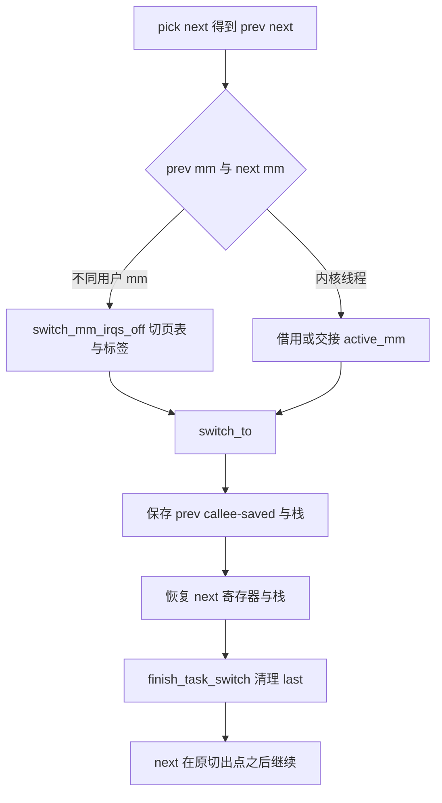

这张图把地址空间切换与执行上下文切换分开；二者都可能被统称为 context switch，但成本来源不同。

### 10.17 x86-64 系统调用到调度

用户执行 `syscall` 后，硬件切换到内核入口，入口代码建立 `pt_regs` 现场并转入通用 syscall 分派。

若系统调用阻塞，例如 `read()` 等待数据，当前 task 设置睡眠状态并进入 `schedule()`。

数据到达后唤醒 task，它再次被选中，从 `schedule()` 返回，系统调用继续并最终通过 exit-to-user 路径恢复寄存器。

need-resched 也可在系统调用返回用户态前触发一次非阻塞原因的调度。

### 10.18 arm64 系统调用到调度

arm64 用户态执行 `svc #0`，异常向量保存用户寄存器并进入 EL1 syscall 路径。

参数从 x0–x5 等寄存器取得，返回值写回 x0。

系统调用睡眠时，`cpu_switch_to` 一类架构路径只保存内核执行所需的 callee-saved 状态；用户 `pt_regs` 已留在该 task 内核栈上。

task 被切回后从同一内核调用链继续，最后 `eret` 恢复用户 PSTATE/PC。

### 10.19 首次运行新 task

新 task 没有“上一次从 schedule 切出”的普通现场。

`copy_thread()` 为它准备架构线程上下文，使首次 `switch_to` 恢复后进入专用 trampoline。

用户子进程 trampoline 最终返回用户态 fork 返回点，并把返回值设置为 0；内核线程则调用指定 thread function。

这解释了 fork 后父子从相似代码位置继续，却具有独立内核栈和返回值。

### 10.20 FPU/向量状态

现代应用可能使用 AVX、SVE/SME 等大型扩展状态。

内核需要在 task 切换或首次使用时保存恢复这些寄存器，并防止一个 task 读取另一个 task 的残留状态。

纯整数 task 不一定每次支付最大扩展状态成本，具体采用 eager、lazy 或 ownership tracking 依架构版本。

安全漏洞历史使“完全 lazy FPU switch”受到更多限制。

### 10.21 TLS 与用户线程

线程局部存储依赖每 task 的 thread pointer 或段基址。

x86-64 常涉及 FS/GS base，arm64 用户 TLS 常涉及 `TPIDR_EL0`。

`switch_to` 必须让 next 看到自己的 TLS 基址，否则 `errno`、pthread 数据和语言 runtime 状态会交叉污染。

这也是同进程线程共享 mm 却仍必须切换架构 thread state 的例子。

### 10.22 Speculation 与安全状态

某些 CPU 漏洞缓解要求在跨安全域切换时更新 speculation control、IBPB 或其他硬件状态。

这些操作增加 context switch 成本，并可能按 task flags、seccomp 或 core domain 条件执行。

不同内核启动参数会让同一 workload 的切换成本显著不同。

性能比较必须记录 CPU 微码和漏洞缓解配置。

### 10.23 MM switch 的 lazy 与 no-op 情况

prev 与 next 共享同一 `mm` 时，不需要切用户页表根，但仍可能更新 per-task CPU/TLS 状态。

next 是内核线程时可借用 active_mm，也可能避免硬件页表写入。

不同用户 mm 切换在 PCID/ASID 可复用时也不必全量 TLB flush。

因此“每次 context switch 都刷新 TLB”是错误口径。

### 10.24 TLB generation

地址空间标签只能区分所属 mm，不能自动知道该 mm 页表自上次使用后是否被修改。

内核为 mm/CPU 维护 TLB generation 或类似状态。

切入 mm 时若本 CPU generation 落后，必须执行所需 invalidation；已经同步则可保留条目。

这种延迟失效和 generation 比每次全刷更高效，但增加 shootdown 协议复杂度。

### 10.25 Switch 观测示例

```bash
perf stat -e context-switches,cpu-migrations,task-clock \
    -- taskset -c 2 ./workload
```

`context-switches` 是总切换数，`cpu-migrations` 是运行 CPU 改变次数，`task-clock` 是进程获得的 CPU 时间。

固定单 CPU 可减少 migration，但仍会与系统其他 task 发生 switch。

perf 事件名称和权限依系统配置，应先用 `perf list` 核验。

### 10.26 Switch rate 归一化

只报告“每秒 10 万次切换”不足以判断异常。

应计算每请求切换数、每 CPU 切换数与单次工作量。

若吞吐从 1 万请求/s 增到 10 万、每请求切换保持 2 次，总切换增加是正常扩展。

若吞吐不变而每请求从 2 次增到 20 次，才表明线程模型或竞争恶化。

还应区分同 CPU switch 与 migration：后者更可能引入远端 cache、NUMA 和 TLB 间接成本。

### 10.27 本章小结

评估切换成本时，应把调度计算、架构现场、TLB/cache 间接损失和安全缓解分别计量。

上下文切换把抽象调度决定落实为 MM、TLB、寄存器和内核栈转换。

PCID/ASID 降低地址空间切换的 TLB 成本，active_mm 支持没有用户 mm 的内核线程，`finish_task_switch()` 完成旧任务收尾。

理解这些对象后，才能正确解释调度 trace 中的 switch 事件和切换性能。

## 11. 观测、验证与调度故障分析

### 11.1 先把问题分层

调度故障不应从“调度器是不是不公平”开始猜测。

先判断属于哪一层：

1. task 根本未 runnable；
2. runnable 但等待 CPU；
3. 被 cgroup 或 RT bandwidth throttle；
4. 放在 capacity 不足或错误 NUMA CPU；
5. 已运行但频率太低；
6. 频繁切换或迁移造成间接损失；
7. 不可抢占区间导致唤醒后迟迟不能切换。

每层需要不同证据。

### 11.1.1 Hung Task、Soft Lockup、Hard Lockup：

| 概念        | 看什么                               | 典型表现                                                                              | 谁检测                                                                   | 如何构造触发                                                                                    |
| ----------- | ------------------------------------ | ------------------------------------------------------------------------------------- | ------------------------------------------------------------------------ | ----------------------------------------------------------------------------------------------- |
| Hung Task   | 看某个 task 是否长期处于`D` 状态。 | 线程调用`mutex_lock()` 获取一把已被其他线程持有且一直不释放的锁，于是长期睡眠等待。 | `khungtaskd` 定期检查，超时由 `kernel.hung_task_timeout_secs` 控制。 | 线程 A 先加锁并一直不解锁；线程 B 调用`mutex_lock()`，随后一直处于 `D` 状态。               |
| Soft Lockup | 看 CPU 是否长时间没有进行任务调度。  | CPU 一直执行内核循环，当前 task 不退出、不主动调度，其他 task 得不到运行机会。        | softlockup watchdog 检查 watchdog 线程是否长期没运行。                   | 在内核代码中执行`preempt_disable()` 后持续循环，不调用 `schedule()` 或 `cond_resched()`。 |
| Hard Lockup | 看 CPU 是否连普通中断都无法处理。    | CPU 关闭本地中断后一直循环，时钟中断、普通 IRQ 和调度都无法推进。                     | 通常由 NMI watchdog、PMU 或架构相关 watchdog 检测。                      | 执行`local_irq_disable()` 后进入持续循环。                                                    |

```text
Hung Task 看 task；
Soft Lockup 看 CPU 是否还能调度；
Hard Lockup 看 CPU 是否还能响应普通中断。
```

```text
任务卡住 → CPU 不调度 → CPU 连普通中断都处理不了。
```

三者不是严格递进关系，但一个 CPU 的 Hard Lockup 可能导致其他 CPU 上等待同一把锁的 task 出现 Hung Task。

### 11.2 静态接口

常用观察入口：

| 接口                            | 可回答的问题                        |
| ------------------------------- | ----------------------------------- |
| `/proc/<pid>/status`          | allowed CPUs、上下文切换、基础状态  |
| `/proc/<pid>/sched`           | 调度实体统计、runtime、switch 等    |
| `/proc/schedstat`             | CPU/domain 调度统计，格式随版本变化 |
| `/sys/fs/cgroup/.../cpu.stat` | usage、throttle、压力               |
| `cpu.max`、`cpu.weight`     | cgroup 配置                         |
| `/proc/interrupts`            | IRQ 是否集中干扰目标 CPU            |
| cpufreq sysfs                   | policy、当前/最大频率与 governor    |

读取接口前确认内核配置、cgroup 版本和字段单位。

### 11.3 sched tracepoints

核心事件包括：

- `sched_waking`：开始唤醒；
- `sched_wakeup`：task 已变为 runnable；
- `sched_switch`：CPU 从 prev 切到 next；
- `sched_migrate_task`：task 改变 CPU；
- `sched_process_fork/exec/exit`：生命周期；
- cgroup throttle 相关事件是否存在取决于版本。

用 wakeup 与 switch 的相同 PID 配对，可估算 runnable-to-running 延迟。

事件可能丢失、PID 复用或跨 CPU 乱序，生产分析需要带时间、CPU 和 task identity 处理。

### 11.4 Wakeup latency 分解

```text
t0 事件发生
t1 waker 调用唤醒
t2 task 完成入队，sched_wakeup
t3 目标 CPU 观察 need_resched
t4 sched_switch 到该 task
t5 task 执行到业务代码
```

`t2-t1` 反映唤醒与入队，`t4-t2` 反映 runnable 等待和抢占延迟，`t5-t4` 包含恢复用户态等开销。

只测业务事件到响应的总时间，无法判断是设备、锁、调度还是用户代码。

### 11.5 故障案例一：Runnable 很高但 CPU 不满

现象：load average 高，部分 CPU 利用率不高，延迟上升。

检查：

1. task affinity/cpuset 是否把大量任务限制到少数 CPU；
2. cgroup 是否 throttle；
3. CPU 是否 offline 或 isolated；
4. task 是否处于 `D` 状态而不是 runnable；
5. RT task 是否占据特定 CPU；
6. topology/domain 是否允许跨边界均衡。

若 task 都绑定 CPU0，空闲 CPU1 并不是 load balance bug。

### 11.6 故障案例二：周期性 100 ms 尾延迟

服务延迟几乎按固定 period 爆发，平均 CPU 正好等于容器限制。

查看 `cpu.stat`，若 `nr_throttled` 和 `throttled_usec` 同步增加，说明 quota 在 period 前用完。

再检查 worker 数与 quota：过多并行 worker 可能瞬间耗尽多核总 runtime。

优化应围绕 quota、period、并行度和工作量，而不是调 nice 或 wakeup granularity。

### 11.7 故障案例三：任务在小核上卡顿

trace 显示延迟 task 长期在 capacity 512 小核，`util_avg` 约 800。

检查 allowed mask、uclamp、EAS 条件、thermal pressure 和是否有 misfit migration。

若 affinity 排除了大核，调度器无法修复；若 uclamp 信号不当，应用可能误导 placement。

确认后再调整 affinity/uclamp，而不是先改 PELT 常数。

### 11.8 故障案例四：切换多、吞吐低

`perf stat` 显示 context-switches 很高，trace 中大量线程围绕同一锁 wake/sleep。

分析锁拥有者、一次唤醒数量和 worker 池规模。

若每次资源只够一个 waiter，却唤醒全部线程，会形成 herd、rq 排队和 cache 抖动。

修复方向是减少竞争和精准唤醒，不是让调度器“切换更快”。

### 11.9 观测会改变系统

高频 function graph、全量 kprobe 或大量 printk 会增加调度延迟和 cache 压力。

优先使用稳定 sched tracepoint，限制 PID、CPU、持续时间和 buffer。

比较问题前后时保持采集配置一致，并检查 lost events。

vmcore 只能看到冻结时刻对象，不能重建此前 wakeup-to-switch 时间线；这类问题必须事先运行时采集。

### 11.10 最小 tracefs 采集

```bash
cd /sys/kernel/tracing
echo 0 > tracing_on
echo > trace
echo 1 > events/sched/sched_wakeup/enable
echo 1 > events/sched/sched_switch/enable
echo 1 > tracing_on
sleep 5
echo 0 > tracing_on
cat trace
```

这是测试环境示意；生产应设置 PID/CPU filter、buffer 大小和采集时限，并在结束后关闭事件。

若 tracefs 位于 `/sys/kernel/debug/tracing`，路径需相应调整。

### 11.11 用 trace-cmd 采集

```bash
trace-cmd record \
    -e sched:sched_waking \
    -e sched:sched_wakeup \
    -e sched:sched_switch \
    -e sched:sched_migrate_task \
    sleep 10

trace-cmd report
```

二进制 `trace.dat` 便于离线排序和保留字段格式。

必须检查 buffer lost events，否则长尾样本可能恰好缺少 wakeup 或 switch 一端。

### 11.12 Wakeup 延迟配对算法

对每个 `sched_wakeup` 记录 `(pid, timestamp, target_cpu)`。

后续 `sched_switch` 的 next_pid 匹配该 PID 时，计算差值并删除 pending wake。

同一 task 在真正运行前可能收到重复 wake 调用，但只有成功 wake event 应建立新 pending 状态。

PID 会复用，长采集应结合 start time、comm 变化或 fork/exit 事件管理 identity。

### 11.13 延迟分位数

平均 wakeup latency 会掩盖极少数严重卡顿。

至少报告 P50、P90、P99、P99.9、最大值和样本数，并按 CPU、comm 或 cgroup 分组。

最大值容易受采集启动、系统 suspend 和 event loss 影响，应回到原始时间线核验。

优化后平均下降但 P99.9 上升，仍可能让交互业务变差。

### 11.14 Runqueue latency 与 off-CPU

Off-CPU 时间包含 blocked 与 runnable waiting，两者优化方向不同。

若 switch-out 的 prev_state 表示睡眠，直到 wakeup 是 blocked；wakeup 到 switch-in 是 rq latency。

若 prev 仍 runnable，switch-out 到下次 switch-in 主要是被抢占等待。

正确解析 `sched_switch` 状态字段要按 tracepoint format 和内核版本，而不是硬编码字符。

### 11.15 `/proc/<pid>/sched` 边界

该文件适合读取累计 runtime、switch、migration 和部分调度实体状态，但不是稳定用户 ABI，字段随配置版本变化。

读取本身不是原子快照，task 继续运行时多字段可能来自略不同时刻。

频繁轮询所有 PID 会产生开销。

用于一次现场核对很方便，长期监控应选择稳定 tracepoint 或经过验证的指标。

### 11.16 `perf sched`

`perf sched record` 采集 sched events，`perf sched latency/timehist` 可重建延迟和时间轴。

它适合快速定位 runqueue latency、迁移和 CPU 使用序列。

不同 perf 版本命令选项有差异，工具必须与内核 event format 兼容。

对容器 task 还要关联 namespace PID 与宿主 PID。

### 11.17 BPF 观测边界

eBPF 可在 tracepoint 上维护 wake timestamp map 并在线计算直方图，降低输出量。

优先使用 tracepoint 字段，而不是依赖易变化的 `try_to_wake_up()` kprobe 参数。

BPF map 容量、并发更新、PID 退出清理和采样开销都要设计。

本文不展开 BPF 编程，完整工具方法归追踪专题。

### 11.18 调度参数修改原则

先建立可复现 workload 和基线，再一次只改变一个参数。

记录内核版本、config、CPU topology、governor、cgroup、affinity、IRQ 布局与温度。

同时观察吞吐、延迟、切换、迁移、能耗和公平，避免只优化单指标。

内核内部 sched tunable 可能不是稳定 ABI，升级后要重新验证。

### 11.19 诊断报告的最小结构

可复核报告应记录 workload、时间范围、内核版本、CPU topology、task/cgroup/affinity 配置和采集开销。

证据至少包含 task 状态时间线、目标 CPU current、runnable 等待、迁移，以及 throttle 或 frequency 信息。

结论应写出因果链和尚未排除的替代解释，不能只贴一段 `sched_switch` 就断言调度器错误。

修复后在相同采集条件下比较延迟分位数、吞吐、切换、迁移和能耗，避免观察口径变化制造虚假改善。

### 11.20 本章小结

故障结论应能被反证：若声称 quota 导致延迟，解除 quota 后相同 workload 的 throttle 与周期尖峰应共同消失。

若只改善延迟但 throttle 仍在，可能是并行度、cache 或采样发生变化。

这种“机制预测—实验干预—指标响应”的闭环比单次现场截图更可靠。

报告中保留原始采集文件与命令，才能让其他人复算时间线和分位数。

调度诊断的核心是先证明 task 所处状态，再定位时间花在 blocked、runnable waiting、throttle、placement、frequency 还是 switch。

静态接口提供配置和累计量，tracepoint 提供状态时间线，perf 提供成本证据。

工具只负责观察，正确解释仍依赖前面建立的状态与公平模型。

## 12. 专题辨析、源码阅读与复习

### 12.1 高频概念对比

| 概念 A    | 概念 B         | 关键区别                                     |
| --------- | -------------- | -------------------------------------------- |
| process   | task           | process 是资源/用户抽象，task 是可调度执行流 |
| PID/TID   | TGID           | 前者标识线程，后者对应用户进程线程组         |
| runnable  | running        | 前者具备条件，后者正在 CPU 执行              |
| `rq`    | `cfs_rq`     | 前者是 CPU 总队列，后者是某层 fair 队列      |
| weight    | quota          | 相对竞争份额与绝对带宽上限                   |
| vruntime  | runtime        | 权重归一化公平时间与实际 CPU 时间            |
| lag       | waiting time   | 公平服务误差与墙钟排队时长                   |
| load      | util           | 加权 runnable 压力与实际 capacity 使用       |
| placement | load balance   | 事件时选 CPU 与事后迁移纠偏                  |
| schedule  | context switch | 选择 next 与实际切换现场                     |

### 12.2 阅读调度源码的顺序

不要从 `fair.c` 第一行顺序读到最后。

推荐五条纵向路径：

1. `schedule()` → `__schedule()` → pick → context switch；
2. wait queue → `try_to_wake_up()` → select CPU → enqueue → preempt；
3. tick → update current → request/slice 到期 → need-resched；
4. `select_task_rq_fair()` → EAS/wake affine/idle sibling；
5. rebalance → `load_balance()` → detach/attach。

每条路径先画状态变化，再补锁和统计，不要一开始钻入所有配置分支。

### 12.3 阅读结构体的方法

对每个字段记录四件事：

- 谁写；
- 在什么锁或内存序下写；
- 谁读；
- 字段失真会破坏哪个不变量。

例如 `on_cpu` 不是“一个布尔统计”，而是远程唤醒防止双 CPU 执行的同步状态。

`min_vruntime` 不是“树最小值缓存”，而是公平时间基准。

字段只有放回协议中才有意义。

### 12.4 推荐复习路线

第一遍只掌握 task、状态机、per-CPU rq、调度类和 context switch。

第二遍完成 nice/weight/vruntime、lag/deadline、PELT 三组公式。

第三遍追踪 wakeup、placement、load balance 三条源码路径。

第四遍加入 cgroup、RT/DL、capacity、uclamp 与诊断案例。

最后用 trace 验证一个真实 workload，把事件映射回状态机。

### 12.5 自测题

1. 为什么 Linux 可以用同一种 task 表示进程与线程？
2. PID、TGID、PGID、SID 分别解决什么身份问题？
3. `TASK_RUNNING` 为什么不能说明 task 正在 CPU 上？
4. `on_rq` 与 `on_cpu` 各保护什么不变量？
5. nice 如何通过 weight 改变长期 CPU 份额？
6. `min_vruntime` 为什么必须单调推进？
7. EEVDF 为什么先判断 eligible 再比较 deadline？
8. slice 如何按权重进入 virtual deadline？
9. `load_avg`、`runnable_avg`、`util_avg` 有什么差异？
10. task util 700 为什么不适合 capacity 512 的 CPU？
11. wake placement 与 periodic balance 分别何时执行？
12. 为什么 CPU 空闲也可能无法拉走繁忙 CPU 的 task？
13. `cpu.weight` 与 `cpu.max` 为什么不能互换？
14. EDF、CBS、admission control 分别负责什么？
15. 同进程线程切换为什么只是“通常”更便宜？

### 12.6 面试问答卡片

**问：CFS 的核心是什么？**

答：按 weight 把实际执行时间折算为 vruntime，使长期 CPU time 接近权重比例；经典实现以 `min_vruntime` 为时间轴并倾向选择 vruntime 最小实体。

**问：EEVDF 相比 CFS 增加了什么？**

答：显式计算相对 virtual time 的 lag，只让未超额服务的 entity eligible，再从 eligible 集合选择 virtual deadline 最早者。

**问：负载均衡为什么不能只看 task 数？**

答：task 的 utilization、weight、CPU capacity、affinity 与迁移成本不同，同样数量可能产生完全不同的等待和饱和程度。

**问：唤醒为什么需要 `pi_lock` 与 `on_cpu`？**

答：唤醒者必须独占 task 状态转换，并确认旧 CPU 已释放执行所有权，防止重复入队或同 task 在两个 CPU 同时运行。

**问：quota 为什么产生周期尾延迟？**

答：多线程可能在 period 前半段并行快速耗尽总 CPU runtime，之后整个组 throttle 到 replenishment，平均使用量正确但服务呈突发停顿。

### 12.7 源码问题模板

遇到一个未知调度函数时，按以下模板记录：

1. 调用发生在 wake、tick、pick、migrate 还是 switch？
2. 当前 CPU 和 task 所属 CPU 是否相同？
3. task 是 running、queued、waking、sleeping 还是 migrating？
4. 持有哪些锁，禁止了什么上下文？
5. 修改了哪个队列节点、计数、时间或 PELT 值？
6. 失败时由谁重试，task 此时归谁所有？
7. 哪个 tracepoint 能验证状态变化？

模板迫使阅读者从不变量出发，而不是停在函数名翻译。

### 12.8 场景题一：高 load average

系统 load average 30，但 32 CPU 总利用率只有 20%。

不能直接说调度器拥塞。

应检查 load average 是否主要来自不可中断睡眠 task、是否有 affinity/cpuset 集中、是否发生 cgroup throttle，以及采样窗口内 runnable 分布。

只有证明 task 持续 runnable 且受 CPU 等待，才进入 balance 和 priority 分析。

### 12.9 场景题二：nice 无效

把任务 A nice 从 0 改到 10，CPU 使用仍为 100%。

若 A 独占一个 CPU，没有其他同类 runnable task 与它竞争，weight 变化不会制造空闲，100% 是预期。

让 A 与另一个 fair task 绑定同一 CPU，才会看到长期份额变化。

若 A 属于 RT/DL policy，nice 也不是其主要排序参数。

### 12.10 场景题三：唤醒后未立即运行

task H 在 CPU3 被唤醒，直到 500 us 后才 switch-in。

依次检查它何时完成 enqueue、目标 CPU 是否处于不可抢占区、更高调度类是否运行、H 是否 eligible、是否被 quota throttle、是否发生迁移。

“已经 wakeup”只说明 runnable 条件成立，不保证立即获得 CPU。

不同原因需要不同修复，不能统一归为 CFS 延迟。

### 12.11 场景题四：EEVDF 选择看似不公平

task A vruntime 100，B vruntime 105，但内核选择 B。

在 EEVDF 中还要比较 average virtual time、eligibility、virtual deadline、slice、current protection 与组层级。

A vruntime 更小不再是充分条件。

若 B 的 deadline 更早且两者 eligible，选择 B 可以在长期 lag 约束内改善延迟。

### 12.12 场景题五：容器只有半核却跑遍多 CPU

quota 0.5 CPU 限制总 runtime，不必限制 CPU mask。

容器线程可以在多个 CPU 之间运行，累计长期只消费半个 CPU 时间。

若希望限制位置，需要 cpuset/affinity；若希望减少迁移，还要调整线程模型与 locality。

quota、CPU 数可见性和 placement 是独立维度。

### 12.13 进一步自测

16. 为什么 current 可能不在公平红黑树普通节点中？
17. 为什么 PELT 更新不需要每毫秒遍历 sleeping task？
18. uclamp 为什么不直接改写 `util_avg`？
19. 为什么同 cpufreq policy 的低 util CPU 也可能处于高频？
20. active balance 为什么比普通 pull 昂贵？
21. 父 cgroup throttle 时子组剩余额度为何无效？
22. Deadline 总 utilization 小于 CPU 数为何仍可能 admission 失败？
23. PCID/ASID 为什么只能减少而不能消灭 TLB invalidation？
24. wakeup latency 应拆成哪些时间段？
25. 如何证明一次迁移是收益而不是抖动？

### 12.14 一页复习主线

```text
task：身份、资源共享、生命周期
  -> state/on_rq/on_cpu：运行资格与所有权
  -> rq/sched_class：每 CPU 策略容器
  -> CFS：weight 与 vruntime 长期公平
  -> EEVDF：lag 门禁与 virtual deadline 次序
  -> PELT/capacity：量化任务需求与 CPU 能力
  -> placement/balance：选择和修复 CPU 位置
  -> cgroup/RT/DL：叠加份额、上限和实时约束
  -> context switch：MM、TLB、寄存器、栈真正交接
  -> trace：用状态事件验证推理
```

### 12.15 复习完成标准

不看文档时应能画出 task 状态机、CFS/EEVDF 选择图、PELT 数据流、load balance 主路径和 context switch 分层。

应能独立复算 weight 份额、vruntime、lag/deadline、PELT 半衰期、capacity、quota 和 Deadline utilization。

面对延迟案例，应先分类 blocked、runnable、throttled、misplaced 或 switching，而不是直接归因于调度器。

能做到这三点，说明知识已经从名词记忆转化为机制模型。

### 12.16 最终知识关系图

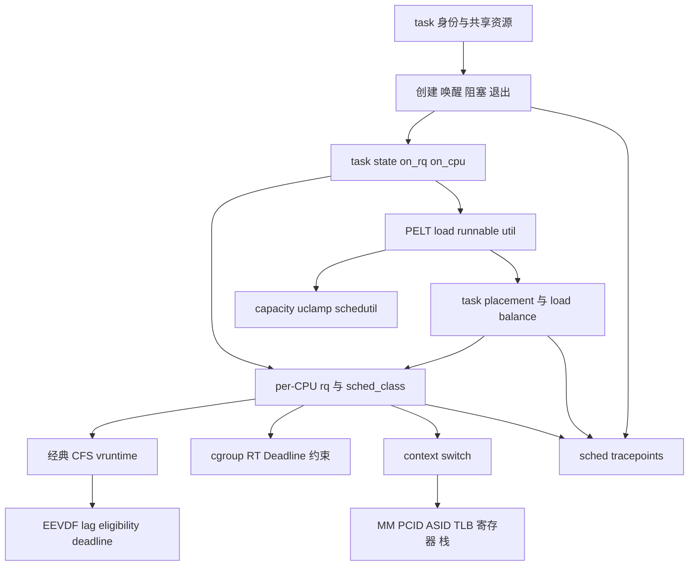

图中的闭环很重要：运行产生时间和 PELT 统计，统计影响下一次 placement 与 pick，切换结果又产生新的运行历史。

## 13. 结语

Linux 进程管理与调度不是互不相干的 API 集合。

clone flags 决定 task 共享什么，生命周期决定它何时 runnable，调度类决定使用哪套选择规则，CFS/EEVDF 维护普通任务公平，PELT 与 capacity 支撑多核位置和频率决策，context switch 最终让硬件执行新的 task。

阅读任一调度函数时，都应重新回答四个问题：task 当前处于什么状态，归哪个 rq 所有，谁持有改变它的权利，这次操作如何保持时间与负载账本一致。

能用这四个问题解释源码、trace 和故障现象，才算真正掌握了 Linux 调度主线。

调度器的每次决定都承接过去的账本：vruntime 与 lag 记录公平，PELT 记录近期需求，capacity 记录硬件能力，cgroup 与实时参数记录外部约束。

它也在创造下一次决定的输入：task 在哪个 CPU 运行、运行多久、何时阻塞，会更新 cache locality、利用率和服务误差。

因此调度不是一串孤立的 pick 函数，而是持续闭环控制系统。

掌握稳定模型后，面对新的内核版本应比较不变量如何实现，而不是把旧函数名强行对应到新代码。

最终目标不是记住某次主线快照的所有分支，而是能从 task 所有权、公平账本、容量信号和硬约束重新推导行为。

当实现继续演进时，这套推导方法仍然有效。
